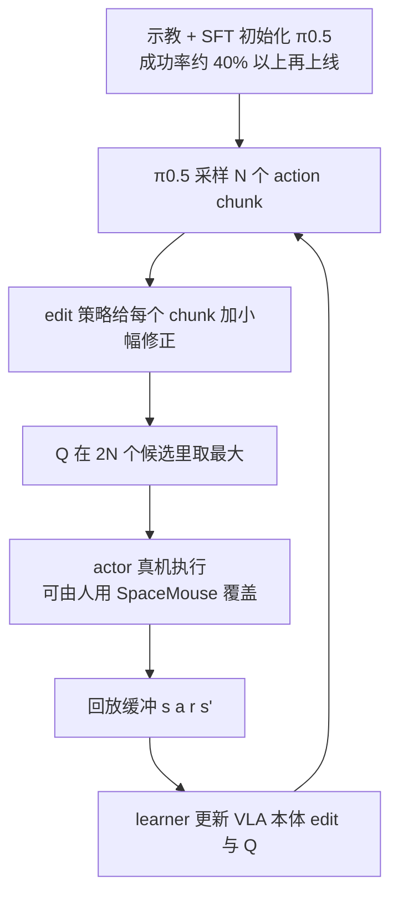

# EXPO-FT：样本高效 VLA 强化学习微调

**EXPO-FT**（*Sample-Efficient Reinforcement Learning Finetuning for Vision-Language-Action Models*，[arXiv:2605.25477](https://arxiv.org/abs/2605.25477)，[项目页](https://pd-perry.github.io/expo-ft/)，[代码](https://github.com/pd-perry/expo-ft)）由 Perry Dong、Kuo-Han Hung、Tian Gao、Dorsa Sadigh、Chelsea Finn（斯坦福大学）提出。论文用 [EXPO](./paper-expo.md) 的「base 提案 + 轻量 edit + Q 选优」包住 π0.5，并补上 action chunk 与人工干预两块（§4.1–4.2）。

## 一句话定义

**在 π0.5 上用 EXPO 式「base 提案 + 小幅 edit + Q 选优」做在线 RL 微调（扩展到 action chunk，并允许人工干预），论文报告八个真机任务各 30 次评测全部成功，平均 19.1 min 在线数据（表 2）。**

## 英文缩写速查

| 缩写 | 英文全称 | 简要说明 |
|------|----------|----------|
| EXPO-FT | EXPO finetuning（论文未展开 EXPO 全称） | 本文 VLA RL 微调系统（§4） |
| EXPO | 见 [EXPO](./paper-expo.md) | 论文 §3 的 base 流策略 + edit 策略 + OTF 选优算法 |
| VLA | Vision-Language-Action | 视觉语言动作模型，此处为 π0.5 |
| RL | Reinforcement Learning | 在线强化学习 |
| OTF | on-the-fly policy | 在 base 与 edited 候选中取 Q 最大者（式 2） |
| Q | Action-Value Function | 对 action chunk 打分的 critic |
| HIL | Human-in-the-Loop | 训练中人工用 SpaceMouse 干预（§4.2） |
| SFT | Supervised Fine-Tuning | 示教监督微调，RL 前的初始化与基线 |
| HG-DAgger | Human-Gated DAgger | 论文对比的人工把关式模仿基线（§5.3） |
| DSRL | Diffusion Steering via RL | 论文对比的潜噪声操控式 RL 基线（§5.3） |
| HIL-SERL | Human-in-the-Loop Sample-Efficient RL | 论文对比的从头训练 RL 基线（§5.3） |
| UTD | Update-To-Data ratio | 每份新数据对应的梯度更新数，表 3 为 20 |

## 为什么重要

- **问题（作者自述，§1）：** 预训练 VLA 达不到真实部署所需的可靠度；既有 RL 要么从头训练、不利用 VLA 先验，要么微调 VLA 但不够可靠或交互量过大。
- **样本效率（表 2）：** 八任务在线数据 14–35 min，平均 19.1 min，每任务 30 次评测全成功。注意这里的分钟数是在线机器人数据量，不含梯度更新耗时（论文未报告墙钟训练时间，见局限）。
- **可复用的工程骨架：** 论文把 learner / actor 解耦、独立 ResNet-50 critic、规则式稀疏奖励都写成了可复现细节（§4.3、附录 C），并随论文发布代码库。

## 核心原理与流程总览

**EXPO 回顾（§3）：** 两个策略——监督训练的 base 流策略 π_VLA，与最大化 Q 的轻量 edit 策略 π_edit（edit 被限制在 [-β, β]，加到 base 动作上；不对 VLA 反传）。推理和 TD 备份用 OTF 策略，在 base 与 edited 候选中取 Q 最大者（式 1–3）。

**EXPO-FT 的两处扩展（§4.2）：**
1. **Action chunk：** VLA 一次输出 H 步，每次执行 C ≤ H 步；edit 与 Q 都改为作用于执行的 chunk（式 4–5）。基座 VLA 仍用原训练目标更新。
2. **人工干预：** 操作员可覆盖 chunk 内任意连续时间步的动作，被覆盖后的 chunk 入回放缓冲。

## 工程实践

- **前置条件（§4.2）：** 零样本不行就收集示教并模仿微调到成功率约 40% 或以上；示教直接初始化回放缓冲。各任务示教量 10–40 条（附录 B.1）。
- **系统（§4.3）：** learner 管 VLA 训练、推理与回放缓冲；actor 管真机交互与干预。同步 / 异步均可，GPU ≤ 2 块时作者用同步。更新频率可按步、按回合或按大批回合。
- **critic（§4.3、附录 C.1）：** 独立 ResNet-50（3,4,6,3 阶段）+ 64 维本体嵌入，10 个 Q 网络的 RedQ 式集成；VLA 图像编码器在 RL 期间冻结。
- **采样（附录 C.1）：** 每次决策 8 个 base chunk + 8 个 edit chunk，确定性取 top-Q；edit 缩放精细任务用 0.05，其余用 0.2（表 4）。
- **优化（表 3–4）：** Adam 3e-4、γ=0.99、batch 64、UTD 20；重规划步数 C 为 4 或 8；每任务训练 8k–20k 步，两块 H200（§5.1）。
- **奖励（§4.3、附录 B）：** 每任务一个规则式稀疏二值检测器（像素颜色匹配、高度阈值等），论文称精度 >95%（§5.1）。
- **控制与观测（§5.1）：** 末端笛卡尔速度 + 夹爪速度，10 Hz；侧视与腕部 RGB 224×224 + 本体状态。
- **开源（二手）：** 仓库 server 基于 OpenPI fork、client 基于 DROID fork，细节见 [expo-ft 仓库归档](../../sources/repos/expo-ft.md)（来自仓库 README，未在论文中核对）；高动态场景见 [Real-Time EXPO-FT](./paper-real-time-expo-ft.md)。

## 实验与评测

- **任务（§5.2、图 3）：** Egg Flip、String Light Routing（Route I / Route II / Insert 三个子任务分别评）、Candy Scoop、Cube Pick、Flower Insert、Pool Shot，共 8 项真机评测，每项 30 次试验，成功由人工判定（§5.1）。
- **表 2（EXPO-FT / SFT / HG-DAgger，x/30）：** Egg Flip 30 / 16 / 18（18 min）；Route I 30 / 23 / 18（18 min）；Route II 30 / 21 / 25（35 min）；Insert 30 / 23 / 24（16 min）；Candy Scoop 30 / 22 / 28（20 min）；Cube Pick 30 / 22 / 26（14 min）；Flower Insert 30 / 14 / 24（14 min）；Pool Shot 30 / 23 / 14（18 min）；平均 30 / 20.5 / 22.1，在线数据 19.1 min。
- **表 1（四任务含全部基线，x/30）：** HIL-SERL 在 Egg Flip / Cube Pick / Pool Shot / Flower Insert 为 13 / 0 / 1 / 8；DSRL 为 15 / 24 / 25 / 12；HIL-SERL(M)（增加样本量，只跑了 Cube Pick 与 Pool Shot）为 27 与 13。四任务平均 SFT 18.8、HG-DAgger 20.5、DSRL 19、HIL-SERL 5.5、EXPO-FT 30。
- **作者对结果的解释（§5.4，自述）：** HG-DAgger 在 Egg Flip、Pool Shot 等动态 / 高精度任务上差距最大，因其只做行为克隆；DSRL 受限于先验分布已覆盖的模态；HIL-SERL 在初始状态分布更大的设置下难以稳定，Pool Shot 上基础 RLPD 学不动。这些是作者的归因，论文未做对应的消融实验验证（见局限）。
- **曲线（图 4、图 5）：** 训练成功率（含干预）随在线分钟数上升，干预率下降，回合时长缩短（附录 A.1）。本归档只按图注核对，未逐点读曲线。

## 与清单说法的核对

清单（Glen Berseth 的 CoRL 2026 阅读清单，P0，序号 001/101）对该论文的一句话摘要（作者说由 LLM 据摘要起草）：「Stable, sample-efficient real-world RL fine-tuning of pretrained VLAs that reaches deployment-level success on hard manipulation tasks.」

| 清单措辞 | 论文核对 |
|----------|----------|
| real-world | 属实：八个任务全是真机（§5、图 3）；没有仿真实验 |
| stable、sample-efficient | 论文自称（摘要、§1）；样本效率的证据是平均 19.1 min 在线数据（表 2）与图 4 训练曲线，「stable」没有多随机种子或方差报告（见局限） |
| pretrained VLAs | 属实但范围窄：只用了 π0.5 一个基座（§1、附录 C.1），且来自任务专用 LoRA SFT 检查点 |
| deployment-level success | 论文用词是「reliable / 部署所需可靠度」，证据为每任务 30 次评测 30/30（表 2）。30 次全成功只能说明成功率有较高下界，不是长期部署的统计保证；评测在训练同一分布的随机初始状态内（§5.1、附录 B.2） |
| hard manipulation tasks | 论文选的是高精度 / 动态 / 多初始状态任务（§5.2）；其中 Cube Pick 示教只要 10 条、SFT 已 22/30，难度并不均一 |
| 隐含：优于既有方法 | 属实但有范围：HIL-SERL 与 DSRL 只在四个任务上比（表 1），HG-DAgger 与 SFT 在八个任务上比（表 2）；RL Token、GR-RL、πRL 等相关工作在相关工作里提及，但没有作为实验基线 |
| 清单未提 | 人工干预是核心组件之一（SpaceMouse，§4.2）；每回合之间需要人工复位（§6，作者自认局限） |

## 局限

**论文自己承认（§6）：**
- 流程需要在回合之间人工复位，规模化时有操作负担。
- 微调 VLA 这类十亿级参数模型，高频训练与推理在算力上仍有难度。

**我看到的未验证之处（读者判断，不是论文结论）：**
- 论文没有消融实验：chunk 化、人工干预、OTF 选优、独立 critic 各自的贡献没有单独量化，「完整组合才可靠」的说法（§1）缺少拆分证据。
- 基线对比范围不齐：HIL-SERL 与 DSRL 只覆盖四个任务（表 1）；HIL-SERL(M) 只跑了两个任务且增加了样本；基线是否拿到与 EXPO-FT 同等的人工干预预算、调参力度，论文只在附录 C.3 给了超参，未量化。
- 比较含有干预差异：HG-DAgger 与 EXPO-FT 都用人工干预，DSRL 与 SFT 不用（§5.3）；表 2 的「在线数据分钟数」是否对所有方法同口径，正文只说「reports the total interaction time」。
- 报告的是单次训练运行下 30 次评测的成功次数，没有置信区间或多种子。评测成功由人工观察（§5.1），奖励检测器有约 5% 以内的误差余量。
- 单一基座（π0.5）、单一机器人栈；论文正文未写明具体机器人型号（推测与 DROID 平台相关，来自仓库归档而非论文）。
- 在线分钟数不含梯度更新与复位耗时；每任务 8k–20k 环境步（§5.1），UTD 20、两块 H200，总墙钟成本论文没给出（推测显著高于 19.1 min）。
- 本页中 Real-Time 分支、仓库结构等内容来自仓库归档，未在论文中出现。

## 关联页面

- 基座算法：[EXPO](./paper-expo.md)
- 实时续作：[Real-Time EXPO-FT](./paper-real-time-expo-ft.md)
- 基座 VLA：[π0.5](./paper-pi05-open-world-vla.md)
- 同类真机人在回路 RL：[SERL](./paper-rcl-2401-16013-serl-a-software-suite-for-sample-efficient-robot.md)
- 概念：[Universal Post-Training](../concepts/universal-post-training-robotics.md)、[Action Chunking](../methods/action-chunking.md)
- 方法：[VLA](../methods/vla.md)、[强化学习](../methods/reinforcement-learning.md)、[DAgger](../methods/dagger.md)
- 任务：[操作](../tasks/manipulation.md)
- 技术地图：[VLA 周报 2026-08-17 第一篇](../overview/vla-weekly-trends-2026-08-17-part1-technology-map.md)

## 参考来源

- [expo_ft_arxiv_2605_25477.md](../../sources/papers/expo_ft_arxiv_2605_25477.md)（原文通读归档）
- [expo-ft.md](../../sources/repos/expo-ft.md)
- [wechat_embodied_heart_expo_universal_post_training_2026-09-29.md](../../sources/blogs/wechat_embodied_heart_expo_universal_post_training_2026-09-29.md)
- [pd_perry_universal_post_training_robotics_2026-09.md](../../sources/blogs/pd_perry_universal_post_training_robotics_2026-09.md)

## 继续阅读

- [论文 PDF](https://arxiv.org/pdf/2605.25477v1)
- [后训练博客](https://pd-perry.github.io/posts/post-training.html)
- [EXPO-FT 项目页](https://pd-perry.github.io/expo-ft/)
