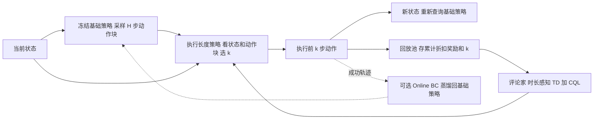

# ExRL：用执行长度控制适配长动作块策略（arXiv:2611.13482）

**ExRL**（*Execution at the Right Length*，[arXiv:2611.13482](https://arxiv.org/abs/2611.13482)，[项目页](https://exrl-project.github.io/)，[代码](https://github.com/Frankluox/ExRL)）来自 UESTC、同济大学、香港理工大学。项目页标注为 CoRL 2026 R2RL（Oral）。

## 一句话定义

**冻结已有的长动作块基础策略，只训练一个小适配器，决定每个预测块执行前 k 步就重新规划，用带持续时间的离策略 RL 学这个一维离散决策。**

## 英文缩写速查

| 缩写 | 英文全称 | 简要说明 |
|------|----------|----------|
| ExRL | Execution at the Right Length | 本文方法，学执行长度 |
| RL | Reinforcement Learning | 强化学习 |
| VLA | Vision-Language-Action | 视觉-语言-动作模型，如 π0.5 |
| DP | Diffusion Policy | 扩散策略，Robomimic/Adroit 的基础策略之一 |
| ACT | Action Chunking with Transformers | 输出动作块的 Transformer 策略 |
| TD | Temporal Difference | 时序差分，评论家的训练目标 |
| SMDP | Semi-Markov Decision Process | 半马尔可夫决策过程，决策持续时间可变 |
| SAC | Soft Actor-Critic | 软演员-评论家，ExRL-SAC 用其离散版 |
| CQL | Conservative Q-Learning | 保守 Q 学习，抑制对少见长度的高估 |
| BC | Behavior Cloning | 行为克隆，用于 Online BC 蒸馏 |
| UTD | Update-To-Data ratio | 每条新数据对应的更新次数 |
| RTC | Real-Time Chunking | 异步推理的实时动作块方法，论文称未联合测试 |

## 为什么重要

- 长块（常超 20 步、接近 50 步）能高频控制、减少推理停顿，但部署时往往不最优；直接优化整块动作或其隐变量的 RL，维度随块长增长，在线样本多（论文摘要、I）。
- ExRL 的适配空间是离散集合 K={1..H}，优化本身保持低维，可选长度反而随块长增加（I）。
- 不改基础策略，可套在 DP、ACT、π0、π0.5、π0-FAST、Cosmos Policy 上（V-A、V-C）。
- 作者自述：真机上叠方块约十分钟物理交互接近满分（V-D）。这是单任务、基础策略冻结条件下的结果，见「局限」。

## 核心原理与流程总览

**设定（III）：** 已有预训练动作块策略 π_base（块长 H），不假设其结构。目标是用在线交互最大化任务奖励。

**方法（IV）：**

1. π_base 在状态 s_t 采样动作块 a_{t:t+H}。
2. 执行长度策略 π_ex 看（状态，预测块），选 k∈{1..H}（可选 k=0 表示立即重规划）。
3. 执行前 k 个动作，到新状态再问 π_base。
4. 评论家 Q(s, a_{t:t+H}, k) 用时长感知目标训练：y = Σ_{i<k} γ^i r + γ^k V(s', a')（式 3），奖励累计和折扣都依赖所选 k，对应 SMDP 备份（附录 E）。
5. 两个实例：ExRL-Q 取贪心 argmax（式 4、6），ExRL-SAC 带离散 SAC 演员和熵项（式 7、8）。均加 CQL（式 9）。
6. 可选增强：Online BC 把成功 rollout 实际执行的动作整理成 H 步目标蒸馏回基础策略；离线示范被当作虚拟动作块，枚举其各长度前缀塞进回放池（图 3）。

**学到什么（V-F，附录 D）：** 接近物体或目标时执行更短，自由运动时更长；仿真里平均长度约减半，真机插接约四分之一。作者还给出「特征混叠」解释：频繁重规划可能反复得到相似的首个动作，打断块内已有的进展（附录 D-C，Spearman ρ=0.374，诊断性证据）。

## 工程实践

- **实验设置（V-B、附录 A）：** Robomimic（Lift/Can/Square/Tool Hang/Transport）、Adroit（Door/Hammer/Pen/Relocate，H=32）、LIBERO-90 单任务（H=50）。奖励为稀疏 −1/0。每条曲线三个种子，95% 置信区间。基础策略检查点特意选留有提升空间的（V-B）。
- **超参（附录 A-D）：** 大部分默认值共享，仅少量任务调整折扣 γ（长程任务 0.999）和网络宽度。README 的调参提示与此一致，并建议复杂任务用 1024 或 2048 宽度。
- **真机（V-D、附录 G）：** AgileX Piper 机械臂，20 Hz，每个任务单独微调一个 π0.5（H=50），ExRL-Q 冻结基础策略并取十个评论家均值。叠方块只用 13 条示范微调基础策略，叠衣服 50 条，插接 128 条，零件整理 21 条（表 VII）。操作员只标记任务或阶段完成。
- **真机奖励的一个坑（附录 G）：** 早期插接/整理实验里适配器偏爱短执行，频繁调用大模型拖慢 rollout，原奖励又没罚推理停顿；之后叠方块与叠衣服改用含物理时间的奖励与折扣 γ^{Δ/0.05}。
- **复现入口：** 仓库 README 列出 Robomimic、Adroit、LIBERO、真机四套指南，首次实验建议从 DP 的 Robomimic Can 开始。只静态读了 README，未运行。

### 主要数字（均出自论文，设置见上）

| 项目 | 结果 | 出处 |
|------|------|------|
| 真机叠方块 成功/总次数 | k=1 0/20，k=10 9/20，k=50 1/20，ExRL-Q 17/20 | 表 I |
| 真机叠衣服 | 0/20，12/20，11/20，17/20 | 表 I |
| 真机插电源 | 7/25，10/25，0/25，22/25 | 表 I |
| 真机零件整理（完成阶段/总阶段） | 0/125，69/125，46/125，104/125 | 表 I |
| LIBERO π0.5 | 接近 0% 升至超过 90%，20 万环境步内 | V-C |
| Tool Hang 上 DP | ExRL-SAC 超过 90%，其余基线约 20% 或以下 | V-C |
| Can 上 ExRL-Q 对 PPO 适配器 | 约 300 万步超 90% 对 PPO 约 4000 万步仍低于 40% | 附录 B |
| 打乱长度与状态对应（Square） | 成功率降 38–58 个百分点 | 表 VIII |

## 与文章说法的核对

对照公众号文章《机器人动作块太长，什么时候该重新规划？》对本文的段落：

| 文章说法 | 核对结果 |
|----------|----------|
| 长块摊薄推理成本但易错过中途纠偏；整套策略在线 RL 代价高 | 论文有类似动机：长块减少推理停顿（I），整块优化维度随块长增长（I）。「错过中途纠偏」是对论文 I 中「短执行提升对意外状态变化的响应」的转述，成立。 |
| 冻结基础策略，只学执行长度，变成低维控制问题 | 成立（IV）。 |
| 把执行长度作为离散动作，用含持续时间的回报与折扣训练适配器 | 成立，即式 3 的时长感知 TD 目标。 |
| 「先检查基础策略能否提出有效动作，长度控制无法凭空补齐技能」 | 论文只说能力受基础策略约束（IV 的 Online BC 小节、VII）；「先检查」是文章给读者的操作建议，论文并未给出检查方法。 |
| Piper 上冻结 π0.5，叠块固定执行 10 步 9/20 到 17/20，插接 10/25 到 22/25 | 数字与表 I 一致。需补充：固定 10 步是论文 sweep 中表 I 列出的三个固定长度（1、10、50）里最好的，不是穷举全部 k。「均为适配后的终测结果」与 V-D 所述 final evaluations 一致。 |
| 「真机实验保持基础策略不变」 | 成立，且论文在 VII 自述这是局限（未用 Online BC）。 |
| 「适合已有技能的部署适配」 | 判断性表述，与 VII 局限一致，但论文并未在多任务或未见任务上验证（VII）。 |
| 文章未提的限定 | 真机四个任务各用单独的 π0.5，基础策略由 13–128 条人类示范微调；叠方块与叠衣服的奖励含物理时间，早期实验未含，会影响结论解读；仿真结果也是文章没提的另一半证据。 |

## 局限

**论文自承（VII）：**

- 真机实验基础策略冻结、不含 Online BC，表现受基础策略可提出的动作限制，多个任务未到 100%。
- 每个任务单独适配，没测多任务联合适配或未见任务泛化。
- 没测与 RTC 等异步推理方法联合使用，对延迟敏感部署是开放问题。

**我看到的未验证之处（判断，非作者自述）：**

- 真机样本量小：叠方块、叠衣服各 20 次，插接 25 次，论文表 I 未给置信区间。
- 叠方块、叠衣服的时间奖励是在早期实验暴露问题后加入的（附录 G），奖励设计是否对其它任务稳健未验证。推测：奖励改动和任务顺序的影响没有被单独消融。
- 固定长度对照只列 k=1、10、50（表 I），最优固定值可能在其它 k，对「胜过最优固定长度」的真机结论有不确定性。仿真中 Optimal fixed-k 是扫描后的最优（V-B）。
- 基线调参：ExRL 多数设置共享，而各基线做了任务级搜索（附录 F 表 VI），整体偏向对基线公平，但 ResFiT 等只在 DP Square 上搜索再复用。
- 仿真基础策略检查点特意选留有提升空间的（V-B），绝对提升幅度取决于这个选择。
- 论文声明使用了生成式 AI 辅助代码与写作，作者称已审核（附录 F）。
- 本页为 2026-11-11 入库，论文为 v1 预印本，后续版本可能变化；代码只读了 README，未运行。

## 关联页面

- [动作分块（Action Chunking）](../methods/action-chunking.md)
- [强化学习](../methods/reinforcement-learning.md)
- [SAC](../methods/sac.md)
- [PPO](../methods/ppo.md)
- [残差策略学习](../methods/residual-policy-learning.md)
- [Diffusion Policy](../methods/diffusion-policy.md)
- [VLA](../methods/vla.md)
- [行为克隆](../methods/behavior-cloning.md)
- [奖励设计](../concepts/reward-design.md)
- [真机 RL 微调的安全问题](../concepts/safe-real-world-rl-fine-tuning.md)
- [LIBERO 基准](./libero-benchmark.md)
- [Real-Time Chunking](./paper-real-time-chunking.md)
- [Revisiting Open-Loop Action Chunking](./paper-revisiting-open-loop-action-chunking.md)
- [Why Action Chunking Improves BC](./paper-why-action-chunking-improves-bc.md)

## 参考来源

- [exrl_arxiv_2611_13482.md](../../sources/papers/exrl_arxiv_2611_13482.md)
- [arXiv:2611.13482](https://arxiv.org/abs/2611.13482)
- [项目页](https://exrl-project.github.io/)
- [代码仓库](https://github.com/Frankluox/ExRL)

## 继续阅读

- [arXiv PDF（v1）](https://arxiv.org/pdf/2611.13482v1)
- [Real-Time Chunking](./paper-real-time-chunking.md)：异步推理场景，论文自述尚未与 ExRL 联合测试
- [动作分块方法页](../methods/action-chunking.md)
