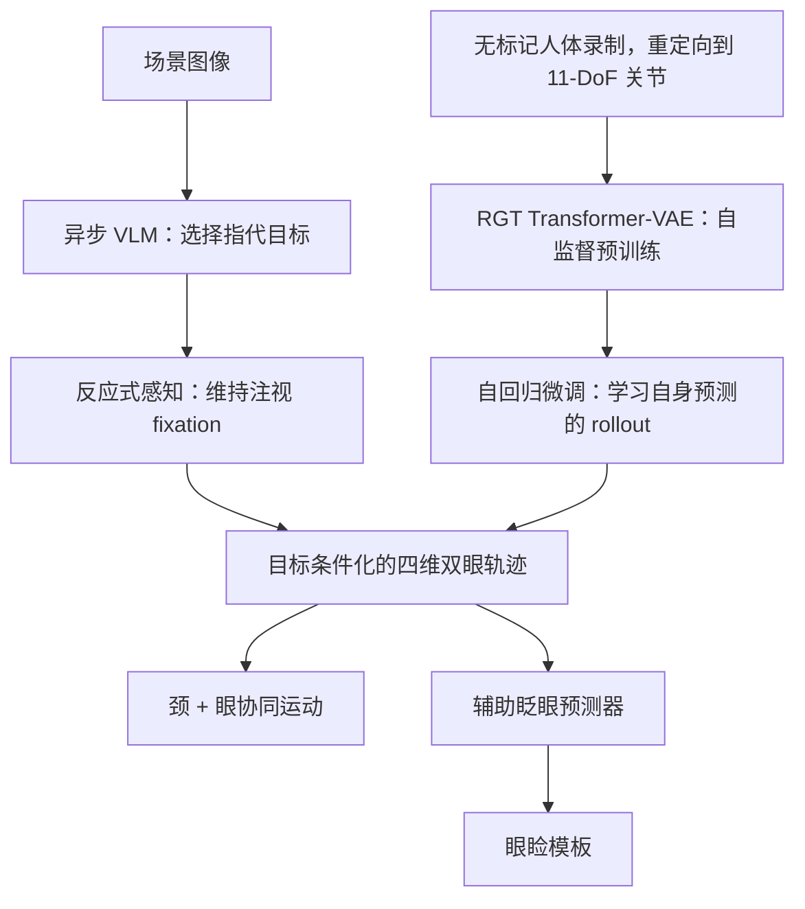

# Eye, Robot：基于 VLM 引导 Transformer-VAE 的表达性注视动力学学习

**Eye, Robot**（*Learning Expressive Gaze Dynamics via a VLM-Guided Transformer-VAE*，[arXiv:2610.19635](https://arxiv.org/abs/2610.19635)）用视觉语言模型选择注视目标，再由 Transformer-VAE 生成类人的头颈与眼部协同注视运动，让人形机器人的注视既能指向目标又具有人类注视的时间结构。

## 英文缩写速查

| 缩写 | 英文全称 | 简要说明 |
|------|----------|----------|
| VLM | Vision-Language Model | 视觉语言模型；异步地从场景中选出注视的指代目标 |
| RGT | Realistic Gaze Transformer | 本文的 Transformer-VAE 注视生成网络，先自监督预训练再自回归微调 |
| VAE | Variational Autoencoder | 变分自编码器；RGT 以其形式生成目标条件化的运动 |
| DoF | Degree of Freedom | 自由度；本文把人体重定向到机器人 11 自由度关节空间 |

## 为什么重要

注视是人形机器人表达"在看哪里、要做什么"的关键非语言信号。固定的跟踪规则无法体现人类注视中眼、头、眼睑耦合运动的时间结构，因此生成式的注视动力学模型有价值。本文把"选目标"（语义）与"生成运动"（动力学）分开，是理解人形表达性行为的一个清晰切分。

## 核心信息

| 项目 | 内容 |
|------|------|
| 论文 | Eye, Robot: Learning Expressive Gaze Dynamics via a VLM-Guided Transformer-VAE，arXiv:2610.19635（2026-10-14 提交，cs.RO，交叉 cs.AI，CC BY 4.0） |
| 作者 | Yuhang Hu, Junlin Lyu, Yuan Fang, Xiaoying Shen, Lechen Zhang, Jiong Lin, Judah Goldfeder, Steven Tian, Hod Lipson |
| 机构 | Columbia University，Department of Mechanical Engineering，Creative Machines Lab |
| 数据/平台 | 无标记人体录制，重定向到机器人 11 自由度关节空间；人形机器人平台（论文未命名，软皮人脸） |
| 开源状态 | **未核实**：论文页未列项目代码；文章所附匿名仓库 `anonymous.4open.science/r/eye_robot_pub-CF64/` 本次无法读取内容（2026-10-15 核查） |

## 核心原理

**一句话机制：** 语义模块选目标，感知模块保持注视，生成模块按目标与历史运动输出四维双眼轨迹，再驱动颈与眼协同运动。

- **目标选择：** VLM 异步给出场景指代，与运动生成解耦。
- **RGT：** 先用最近的全头运动历史做自监督预训练，再做自回归微调，缓解训练-推理分布偏移。
- **输出：** 四维双眼轨迹驱动颈眼协同；辅助预测器触发眼睑模板。

## 工程实践

| 项 | 说明 |
|----|------|
| 数据 | 无标记人体录制，经重定向到机器人关节空间（具体数据规模与格式论文摘要未给出，未核实） |
| 推理 | 论文声称实时 RGT 推理（未核实数值） |
| 评测设置 | 两秒基准；所有控制器接收相同的真值目标 |
| 源码 | 文章所附匿名仓库无法读取；不能据此复现 |
| 源码运行时序图 | **不适用**（未能核实可运行的官方代码，仓库内容不可读） |

## 实验与评测

- **两秒基准：** 所有控制器接收相同真值目标，RGT-Base 报告的七关节总体 MSE 最低。**页面摘要未给出数值，本页不写具体数字。**
- **真机演示：** 集成的目标选择与注视控制流程在人形机器人上运行。
- **章节覆盖：** 论文包含定量与定性结果、不同受试者适应性及消融（§4.1–4.3），细节未逐项核实。
- **尚未评估：** 自然度感知与开放词汇目标选择准确率，论文自述需受控评测。

## 结论

**一句话总判：这篇论文的可取之处是把"语义选目标"和"注视动力学生成"分开，但目前的定量证据不足以判断自然度。**

1. **分层是关键设计** — VLM 只负责选目标，运动由生成模型负责，便于分别替换。
2. **自回归微调值得注意** — 让模型学习自身预测的误差，比纯离线预训练更贴近 rollout。
3. **数字要慎读** — 摘要只给出"MSE 最低"的相对结论，没有具体数值，不能直接对比其他方法。
4. **自然度未被测量** — 论文自己承认感知自然度与开放词汇选择准确率尚未受控评测。
5. **复现依赖仓库** — 文章所附仓库是匿名链接且本次不可读，复现前需等待正式发布。

## 与其他工作对比

- **与 [Eye Robot 2 主动注视操作](./paper-eyerobot-2-active-gaze-manipulation.md)：** 名称相近，但不是同一论文（arXiv:2610.03710）。后者侧重双臂操作中的主动视觉，本文侧重人形注视动力学生成。
- **与 [ActGaze](./paper-actgaze.md)：** 同属注视相关工作，本文更偏向生成式的头颈眼协同运动。
- **与 [GNM 头部](./gnm-head.md)：** 头部机构与运动层面的参照；本文不讨论机构设计。

## 局限与风险

- 论文自述的两项核心评测（自然度、开放词汇选择准确率）尚未完成。
- 人形机器人平台未命名，跨平台迁移性未知。
- 无标记重定向数据的质量与人群覆盖面未在摘要中说明。
- 匿名仓库不可读，代码可用性未核实。

## 关联页面

- [Eye Robot 2 主动注视操作](./paper-eyerobot-2-active-gaze-manipulation.md)：同名系列但不同论文，便于区分。
- [ActGaze](./paper-actgaze.md)：注视相关的机器人工作。
- [GNM 头部](./gnm-head.md)：人形头部平台参照。
- [VLA 方法](../methods/vla.md)：VLM 与机器人动作生成的上层范式参照。
- [人形机器人](./humanoid-robot.md)：本文的应用载体类别。

## 参考来源

- [eye_robot_arxiv_2610_19635 归档](../../sources/papers/eye_robot_arxiv_2610_19635.md)

## 推荐继续阅读

- [arXiv:2610.19635：Eye, Robot](https://arxiv.org/abs/2610.19635)
- [arXiv:2610.03710：Eye Robot 2（相近名称的另一论文）](https://arxiv.org/abs/2610.03710)
