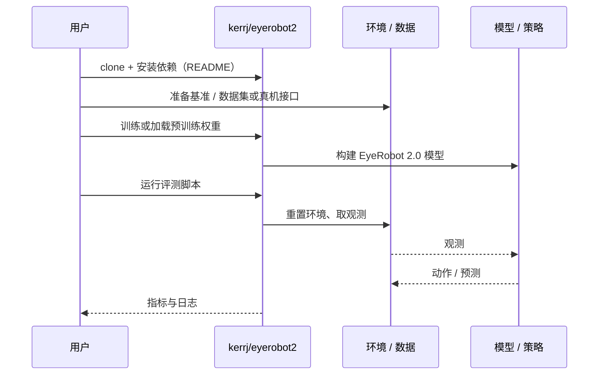

# EyeRobot 2.0（arXiv:2610.03710）

**EyeRobot 2.0**（*EyeRobot 2.0: Active Gaze for Precise Manipulation without Wrist Cameras*，[arXiv:2610.03710](https://arxiv.org/abs/2610.03710)，[项目页](https://eyerobot2.github.io/)，[代码](https://github.com/kerrj/eyerobot2)）来自 [具身智能小站 2026-10-13 盘点](../../sources/blogs/wechat_embodied_station_34_papers_mulligan_2026-10-13.md)，属「灵巧操作」组。

## 一句话定义

**联合主动注视、中心高分辨率视觉与注视坐标系动作表示，用单套双目做精细双臂操作，无需腕部相机。**

## 英文缩写速查

| 缩写 | 英文全称 | 简要说明 |
|------|----------|----------|
| Gaze | Active Gaze | 主动注视 |
| Fovea | Foveated Vision | 中心高分辨率视觉 |
| BC | Behavior Cloning | 行为克隆 |

## 为什么重要

- 腕部相机昂贵且受限；主动注视是替代方案。
- 开源结论：**已开源**（步骤 2.5，2026-10-14）。项目页链接的 GitHub 仓库可达。
- 同期同组工作见 [失败导向采集与可组合世界动作模型：具身智能小站 10-13 期 34 篇阅读坐标](../overview/embodied-station-2026-10-13-34-papers-technology-map.md)。

## 核心机制

| 项 | 内容 |
|----|------|
| **arXiv** | [2610.03710](https://arxiv.org/abs/2610.03710) |
| **开源** | **已开源** |
| **要点** | 多任务真机比较被动双目与腕部相机。 |
| **文内指标** | 以原文为准。 |

## 源码运行时序图

以下为按仓库入口（`kerrj/eyerobot2`）推断的通用运行链路；入库日仅核实仓库可达，未逐文件阅读，具体脚本名以 README 为准。

## 实验与评测

- 以原文为准。
- **读法：** 本页为索引级摘要，依据公众号转述的官方摘要与仓库信息整理；逐项数字与 baseline 以原文 PDF 为准。

## 与其他工作对比

- 横向索引见 [失败导向采集与可组合世界动作模型：具身智能小站 10-13 期 34 篇阅读坐标](../overview/embodied-station-2026-10-13-34-papers-technology-map.md)；同 arXiv 不重复造页。

## 结论

**注视坐标系动作表示让单套主动视觉替代腕部相机成为可能。**

1. 开源边界：**已开源** — 项目页链接的 GitHub 仓库可达。
2. 核心机制：多任务真机比较被动双目与腕部相机。
3. 复现与选型前核对任务协议、硬件与基准口径，勿直接横比公众号摘录数字。

## 关联页面

- [bimanual-manipulation](../tasks/bimanual-manipulation.md)
- [manipulation](../tasks/manipulation.md)
- [humanoid-policy-observation-inputs](../concepts/humanoid-policy-observation-inputs.md)
- [embodied-station-2026-10-13-34-papers-technology-map](../overview/embodied-station-2026-10-13-34-papers-technology-map.md)

## 参考来源

- [eyerobot_2_active_gaze_manipulation_arxiv_2610_03710.md](../../sources/papers/eyerobot_2_active_gaze_manipulation_arxiv_2610_03710.md)
- [wechat_embodied_station_34_papers_mulligan_2026-10-13.md](../../sources/blogs/wechat_embodied_station_34_papers_mulligan_2026-10-13.md)
- [arXiv:2610.03710](https://arxiv.org/abs/2610.03710)

## 推荐继续阅读

- [arXiv PDF](https://arxiv.org/pdf/2610.03710)
- [项目页](https://eyerobot2.github.io/)
- [https://github.com/kerrj/eyerobot2](https://github.com/kerrj/eyerobot2)
