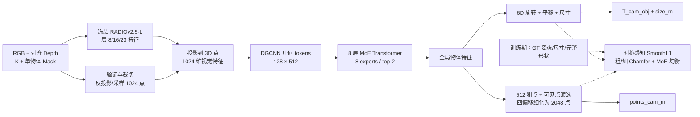
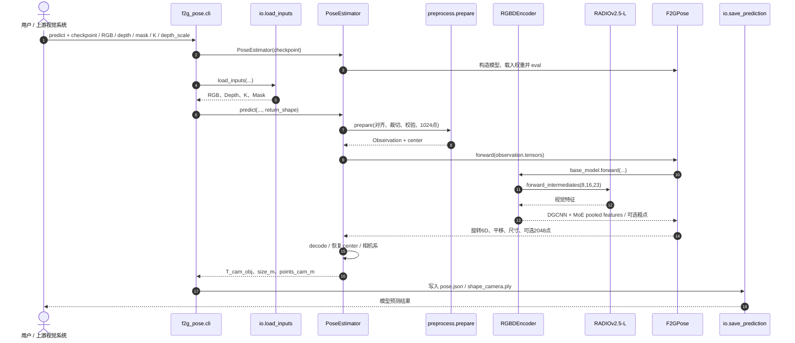

# F2G-Pose：无需实例 CAD 的 RGB-D 物体 6D 位姿与形状补全

**F2G-Pose**（*Geometry-Aware Foundation Feature Lifting for Direct RGB-D Category-Level Object Pose Estimation*，**面向直接 RGB-D 类别级物体位姿估计的几何感知基础特征三维抬升**）由 Jinyu Zhang、Haitao Lin、Jiashu Hou、Xiangyang Xue、Yanwei Fu 提出，论文 [arXiv:2610.31623](https://arxiv.org/abs/2610.31623) 标注 **NeurIPS 2026 accepted**。作者机构为**复旦大学（Fudan University）**和**上海创智学院（Shanghai Innovation Institute）**，已公开[项目主页](https://jrryzh.github.io/F2G-Pose/)、[代码](https://github.com/jrryzh/F2G-Pose)与[模型权重](https://huggingface.co/J3rr1/F2G-Pose)。

## 一句话定义

给定**单个目标掩码 + 对齐 RGB-D + 相机内参**，用一次前向推理直接预测物体的**6D 位姿（物体系到相机系）、米制尺寸与相机系 2048 点完整形状**，推理时不要求该物体的 CAD 模型、参考视图或显式类别 ID。

## 英文缩写速查

| 缩写 | 英文全称 | 简要说明 |
|---|---|---|
| RGB-D | Red-Green-Blue + Depth | 彩色图及对齐深度观测 |
| CAD | Computer-Aided Design | 特定物体的三维设计模型，F2G-Pose 推理无需提供 |
| 6D / SE(3) | Six-Dimensional Pose / Special Euclidean Group | 三维旋转 R + 三维平移 t |
| RADIO | A visual foundation model (RADIO v2.5-L) | 冻结的视觉特征提取主干 |
| DGCNN | Dynamic Graph Convolutional Neural Network | 以局部点邻域融合几何与图像特征 |
| MoE | Mixture of Experts | 8 专家、每 token 路由 top-2 |
| FPS | Frames Per Second | 每秒模型推理帧数；**不是**整套机器人闭环频率 |
| AUC / IoU | Area Under Curve / Intersection over Union | 3D 包围盒重叠阈值曲线下面积及重叠比 |
| CD-L1 | Chamfer Distance with L1 norm | 点云补全的几何误差 |

## 为什么重要

- **避开 CAD/配准门槛：** 不依赖目标实例的三维先验或逐物体参考图，可将单帧深度感知直接接入机械臂基于物体位姿的任务；但仍需正确的类别级训练覆盖、mask 与深度。
- **几何与语义共同定姿：** 纯部分点云在遮挡、对称形状和相似类目时歧义较大；RADIO 的视觉特征给点云补入外观与部件提示。
- **一次前向减少决策延迟：** 不运行 GenPose++ 的扩散多候选采样及事后提取；还能选择 `pose-only` 跳过补全。
- **补全形状服务避碰：** 论文 ARX 机械臂中姿态+尺寸决定抓取接近与放置目标，2048 点形状用于碰撞检查；**物体 pose 不等于夹爪 grasp pose**，需下游抓取/规划模块。

## 核心原理（方法）

### 任务设定和输出坐标

| 项目 | 论文与公开 API |
|---|---|
| 输入 | 单帧 RGB `H×W×3`、对齐深度 `H×W`、二值单物体 mask、相机内参 K、depth_scale |
| 可见几何 | 从前景深度中采样 1024 点，裁切/归一化后附着视觉特征 |
| 6D 姿态 | 旋转头预测连续 6D 表示并正交化为 3×3 R；平移头 t；输出 `T_cam_obj` |
| 尺寸 | `size_m`：沿物体规范轴的公制尺寸，单位米 |
| 完整形状 | `points_cam_m`：形状分支输出 2048 个相机坐标系三维点 |
| 坐标约定 | 相机 X 右、Y 下、Z 前；`p_cam = R @ p_obj + t`；并恢复预处理中心 |
| 性能切换 | `return_shape=False` 或 CLI `--pose-only`：仅位姿与尺寸 |

**注意：** “无 CAD”指**测试时无需实例 CAD**，不是未经训练可处理任意未知类别。任务网络使用带 canonical pose/尺寸/完整形状标注的 **SOPE 149 类**合成训练数据，且 RADIO 主干已在外部预训练。

### 图像特征抬升 → MoE 物体编码 → 两支回归

1. 冻结 **RADIOv2.5-L**，取第 **8/16/23** 层；1×1 Conv 分别压到 512 维、可学习权重融合，再 3×3 Conv 得 1024 维特征图。
2. 基于深度与 K 将 mask 前景反投影成点云，并以 patch 大小 **16** 将视觉特征附加到各 3D 点；形成 `1024×1027` 输入（3D 坐标+1024 视觉特征）。
3. **DGCNN** 局部聚合并两级下采样，获得 **128×512** object tokens。
4. **8 层、8 头 Transformer** 的 FFN 用 **8 专家 top-2 MoE** 替代；全局池化产生物体表征。
5. **Pose-size head** 直接回归 R/t/s；**shape head** 预测 512 粗点 + 合并 256 可见点，再置信度筛成 512 点，逐点扩展 4 个局部偏移得到 **2048 点**。

### 流程总览

### 训练目标

旋转监督对**无对称 / 90° / 180° / 任意角度**的对称等价姿态取最小 SmoothL1（作用于正交化前的 6D 旋转表示），平移与尺寸用 SmoothL1；粗/细点云都做 Chamfer-L1；MoE load-balancing 权重 `λ=0.01`。完整论文的训练为 **100 epochs / 全局 batch 512 / AdamW 1e-4 / 4×H200 / PyTorch 2.4 + CUDA 12.4**。

## 源码运行时序图

下图严格对应官方公开的 `src/f2g_pose/{cli,io,estimator,preprocess,model}.py` 推理入口。`--pose-only` 不会运行形状头，SAM 不是内置强制依赖；使用交互 demo 才可选择单独下载的 SAM checkpoint。

图中的 `Net->>Enc` 是 `F2GPose.forward` 调用 `base_model`；后者完成冻结 RADIO 特征、融合、DGCNN 和 MoE。源码未把输出点云转换成可直接打印/制造的封闭 CAD mesh。

## 实验与评测

**论文主表（arXiv v1 Table 1，AUC 为百分点）**：

| 方法/数据集 | ROPE IoU50 AUC ↑ | SOPE IoU50 AUC ↑ |
|---|---:|---:|
| GenPose++ | 19.1 | 31.9 |
| F2G-Pose | **27.8** | **43.7** |

**ROPE 消融（Table 4）**：

| 变体 | IoU50 AUC ↑ | FPS |
|---|---:|---:|
| 完整模型 | **27.8** | 23.7 |
| 不用 RGB 特征 | 16.2 | 29.5 |
| 不用 MoE | 24.0 | 19.2 |
| 不用 shape 监督 | 23.2 | 27.8 |

**延迟/机器人：** RTX 4090、batch 1、GPU 同步测得论文完整模型 **23.7 FPS**，仅姿态 **28 FPS**，不应等同于整个 RGB-D 分割 + 机器人控制总吞吐。ARX 机械臂 + RealSense，80 次完整模型试验中 **74/80 抓取成功，68/80 放置成功**；平均感知延迟 **36 ms**，论文报告 50 ms 内可用决策占比 100%。形状仅用于碰撞检查，不代表端到端自主抓取策略。

**形状与跨数据集：** SOPE、HouseCat6D camera-frame CD-L1（×10^-3）分别 **5.42 / 7.1**；HANDAL 7 类 92 个实例映射至 SOPE 分类体系，其 IoU50 AUC 为 **11.7**，说明跨数据集高精度对齐仍有明显难度。附录 B.1 明确提醒 camera-frame 与 canonical-frame CD 的输入、坐标和监督差异，跨表直接比数值不严谨。

**公开模型包和论文表格不是同一评测快照**。官方 `docs/EVALUATION.md` 的**全测试集、BF16、H200、pose-only** 评估给出 ROPE IoU50 **28.19**、SOPE **44.73**。当前 README 在 RTX 4090、batch 1、FP32、30 warmup + 200 GPU 同步迭代的 **model-only** 测速为 full **36.6 FPS** / pose-only **37.2 FPS**，不含预处理与 SAM；论文的 23.7/28 FPS 需保留原协议来源，不能直接等价比较。

## 与其他工作对比

| 方法 | 输入/假设 | 输出/权衡 |
|---|---|---|
| **F2G-Pose** | 单帧已分割 RGB-D；类别级 SOPE 训练；不需测试实例 CAD/参考图 | 一次前向预测物体姿态、米制尺寸、相机系补全点云；需高质量 mask+深度 |
| **GenPose++** | 类别级 RGB-D；扩散采样、候选决策 | 能显式产生多假设，但候选筛选/聚合增加延迟；论文比较 4 FPS（特定协议） |
| **FoundationPose** | 实例级定位，可用 CAD 或参考观测 | 实例特定输入/对齐范式不同；不能仅凭某个表格断言普适优劣 |
| **[Point2Pose](paper-point2pose.md)** | RGB-D 视频、2D 点长程跟踪 | 侧重**多物体随时间跟踪**、遮挡重现与在线 TSDF mesh，不是 F2G-Pose 的单帧类别级补全任务 |

## 结论

**适合做「给定单物体 mask 的实时物体位姿 + 近似几何」前端，但不应被误读为免分割、无类别限制或直接输出可执行夹爪轨迹的通用抓取系统。**

- **真影响指标：** RGB 特征抬升的收益最大（ROPE 27.8→16.2）；形状监督也显著影响 pose（27.8→23.2）。
- **方法收益：** DGCNN 局部几何、MoE 全局表示与共同形状监督，在单次前向中提供可用于规划的位姿/尺寸/点云。
- **计算权衡：** pose-only 更快；做避碰时保留形状分支。严格区分论文/公开权重/README 的硬件与计时口径。
- **部署检查：** 确认深度单位、相机内参、RGB-D mask 对齐、透明反光物体的有效点数；规划阶段另做手眼标定、抓取规划和安全检查。
- **研究边界：** 无 CAD 不代表超出训练类目的开放世界泛化；对严重遮挡、细长不对称部件和高精度对齐仍需额外机制。

## 工程实践

1. **环境：** Linux + NVIDIA CUDA GPU，官方验证 Python 3.10、PyTorch 2.4.0、CUDA 12.4；需编译 PointNet++ 和 Chamfer CUDA 扩展；另下载固定 RADIO 源码/权重与 F2G-Pose checkpoint。
2. **接口：** `from f2g_pose import PoseEstimator`；`PoseEstimator("weights/f2g-pose.pt").predict(rgb, depth, K, mask, depth_scale=0.001)`。深度是米时用 1.0；必须同尺寸同视角对齐且目标 mask 内至少 **50 个有效深度像素**。
3. **命令：** `f2g-pose demo --checkpoint weights/f2g-pose.pt --port 7860`；或 `f2g-pose predict --checkpoint ... --rgb ... --depth ... --mask ... --intrinsics ... --depth-scale 1 --output outputs/example`。可用官方 `examples/rope/` 茶壶样例。
4. **训练与重评估：** `f2g-pose train/eval/benchmark` 已公开；训练数据遵从 Omni6DPose 目录结构，权重可校验 SHA-256；重评估需固定 full/historical、精度、TF32、样本清单和排除规则。
5. **许可证：** 集成代码 Apache-2.0，RADIO 与 Omni6DPose 等第三方许可独立核对，不能将整个数据、权重、第三方代码统称 Apache-2.0。详细入口见[官方源码归档](../../sources/repos/jrryzh_f2g_pose.md)。

## 局限与风险

- **必须提供单物体分割 mask**。SAM 只是 demo 可选分割前端，不等于模型自身 mask-free；噪声/侵蚀会降低 IoU（论文附录 ROPE GT mask 27.8，SAM mask 27.2）。
- **深度破损导致尺度/朝向漂移**，尤其透明、镜面、细长部分，严重遮挡时缺少判向几何。
- **对称与近对称方向有多解**。当前一次确定性回归没有校准的不确定性或 abstention，机器人在危险抓取前应有置信/重观测策略。
- **类别级训练边界：** 主要验证 SOPE、ROPE、HouseCat6D 和筛选 HANDAL；不是任意类别/关节物体的零样本姿态框架。
- **物体几何是补全点云**，不是高保真可碰撞闭合网格；真实操作需额外规划、机械臂外参标定、碰撞裕量和容错。
- 本次复核读取论文、官方文档与关键推理源码；**没有本地 GPU 复现、真机重跑或独立测得 FPS/成功率**。

## 关联页面

- [Grasp Pose Estimation（抓取位姿估计）](../methods/grasp-pose-estimation.md) — **物体 pose** 与**夹爪 grasp pose** 的接口区别
- [Point2Pose](paper-point2pose.md) — 未知物体的 RGB-D 时序位姿与在线重建，对照单帧类别级 F2G-Pose
- [Embodied Perception Six Spatial Representations](../concepts/embodied-perception-six-spatial-representations.md) — 物体坐标系、相机坐标与三维表征
- [Manipulation](../tasks/manipulation.md) — 物体感知到抓取、避碰与执行
- [机器人感知栈选型](../queries/robot-perception-stack-selection-loop.md) — 前端分割/深度/后端规划集成

## 参考来源

- [F2G-Pose 论文全文深读：arXiv:2610.31623v1](../../sources/papers/f2g_pose_arxiv_2610_31623.md)
- [F2G-Pose 官方项目页核验](../../sources/sites/f2g-pose.md)
- [jrryzh/F2G-Pose 源码/复现入口核验](../../sources/repos/jrryzh_f2g_pose.md)

## 推荐继续阅读

- [论文 HTML 全文（含附录）](https://arxiv.org/html/2610.31623v1)
- [官方源码、训练与部署说明](https://github.com/jrryzh/F2G-Pose)
- [Hugging Face 模型卡及权重](https://huggingface.co/J3rr1/F2G-Pose)
