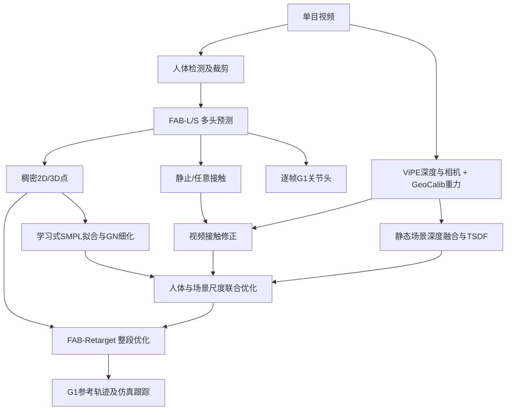
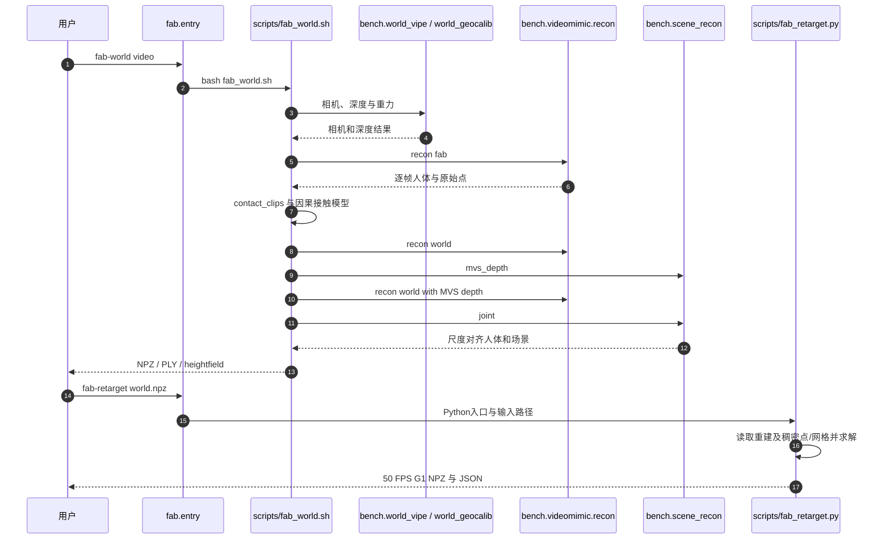

# FAB：像素、世界空间与场景中的快速精准人体估计 / Fast and Accurate Body Estimation in Pixels, World Space and Scenes

## 一句话定义

从单目视频恢复人体运动与静态场景，用接触预测约束尺度对齐，再通过FAB-Retarget生成G1参考轨迹。

## 英文缩写速查

| 缩写 | 英文全称 | 简要说明 |
|---|---|---|
| FAB | Fast and Accurate Body Estimation | 快速人体估计 |
| SMPL | Skinned Multi-Person Linear Model | 参数化人体模型 |
| MHR | Momentum Human Rig | 人体骨骼与表面表示 |
| IK | Inverse Kinematics | 逆运动学 |
| GRU | Gated Recurrent Unit | 因果接触时序修正 |
| TSDF | Truncated Signed Distance Function | 场景网格重建 |
| MPJPE | Mean Per Joint Position Error | 平均关节位置误差 |

## 为什么重要

把人体估计、尺度恢复与机器人运动参考串联，降低从普通视频获取接触丰富动作数据的门槛；稠密点可为部位方向与接触关系提供比稀疏骨骼更多的几何信息。

## 核心信息

| 项 | 内容 |
|---|---|
| 作者 | Jinkun Cao |
| 机构 | 独立个人项目（论文脚注声明与Amazon FAR职位无关） |
| 论文 | [arXiv:2611.25801v1](https://arxiv.org/abs/2611.25801)，2026-11-19 |
| 输入 | 单图或单目视频；可选相机内参 |
| 输出 | 2D/3D关节、稠密点、人体网格、接触、世界运动、静态场景与G1参考 |
| 开源 | 代码主体Apache-2.0；权重仅研究及非商业用途 |

## 核心原理

1. **Points-first。** FAB-H轻量微调SAM 3D Body；FAB-L/S使用DINOv3 ViT-L/16或ViT-S+/16学生，以骨干特征、教师输出和人工标签监督。预测70个图像关键点、14个评测关节及468个SMPL表面点；从热图和深度反投影得到3D点。学习式拟合后两步Gauss–Newton，再细化足踝。MHR头与稠密点是不同输出。
2. **接触。** 对双侧脚跟、脚趾、手、膝分类静止接触及任意接触，区分固定地面与滑板等移动支撑；因果GRU结合世界坐标修正预测。输出是接触标签，不是力或触觉测量。
3. **世界与场景。** ViPE/UniDepth恢复相机和深度，GeoCalib提供重力；多视角深度融合及人体可见性雕刻生成TSDF网格、高度场。人体深度锚定尺度，联合优化接触距离、穿透、深度一致性、根加速度及脚滑；全视频共享场景/相机尺度。
4. **G1重定向。** 逐帧G1头由方向优先IK生成29关节监督。FAB-Retarget则整段联合优化，可用skeleton、mesh或points模式，代价包括骨方向、骨盆、足接触、地形、碰撞和时序约束；points模式另加稠密表面对应，最后固定支撑足。手膝在重定向目标中主要用于避免穿透。默认 mesh/points 模式按足底高度和速度确定支撑，视觉接触用于世界对齐及可选 ground-aware 路径；表29消融不支持将视觉接触直接视为必然改善 G1 参考。

### 训练、对应与优化复现（附录 A、F）

学生训练 40k 步，512×512 裁剪，结合特征蒸馏与教师输出监督；FAB-H 先微调教师再冻结主体训练稠密头。G1 表面对应在匹配 T-pose 中按部位圆柱坐标建立，逐帧 Kabsch 恢复部位目标旋转。重定向从 sequence IK 初始化，Adam 1600 步，关节学习率 0.02、根位移步长 2 mm，最后固定支撑足；默认支撑判断为足底距地形 4 cm 内且速度低于 0.15 m/s。静态相机缺视差时保留 ViPE 深度。

## 流程总览

## 源码运行时序图

根据 pyproject.toml、fab/entry.py、scripts/fab_world.sh 的实际入口和调用链，以及 scripts/fab_retarget.py 输入接口整理；非执行trace。

## 实验与评测

| 指标 | 论文报告 |
|---|---|
| FAB-L 3DPW PA-MPJPE / MPJPE | 32.7 / 53.1 mm（表1） |
| FAB-L / S 单人速度 | 39.2 / 63.8 FPS，RTX 4070 Ti SUPER，TensorRT人体路径（表1） |
| FAB-L EMDB-2 WA-MPJPE / RTE | 57.1 mm / 1.06%，自有检测与相机（表2） |
| 静止足接触F1，EMDB-2 | 图像0.67，因果视频0.69，GVHMR 0.71（表5） |
| G1跟踪 | SONIC仿真中points模式25段跌倒4段（§4.5） |
| 非平地参考数据 | 5330段共14.5小时，2997段通过训练筛选（§4.5） |

表1比较速度时SAM 3D Body 8.5 FPS为eager PyTorch body-only路径，FAB 39.2 FPS含检测和拟合，但不包含整段世界重建与G1优化。表2不同检测框、内参及相机输入影响公平性。场景方面，SLOPER4D长轨迹完整性低于VideoMimic；VideoMimic自身地形上的跟踪通过片段更多。

## 对比与消融

同一 25 段平地测试、SONIC-G1 MuJoCo 跟踪（表8、28、29）：

| 方法 | 参考骨方向误差（°） | 足滑（m/s） | 跌倒数 | 跟踪骨方向误差（°） |
|---|---:|---:|---:|---:|
| GMR | 14.7 | 0.26 | 5 | 19.6 |
| FAB-L 逐帧 G1 头 | 14.5 | 0.38 | 5 | 20.4 |
| FAB-Retarget skeleton | 11.7 | 0.12 | 5 | 19.2 |
| FAB-Retarget mesh | 11.6 | 0.11 | 6 | 20.0 |
| FAB-Retarget points | 11.8 | 0.13 | 4 | 18.3 |

- points 相比 mesh 的部位旋转误差由 33.6° 降至 24.7°，但足滑略增；表29加入视觉接触后部分指标退化。25 段并非重定向器设计的独立留出集。
- 表12：FAB-L TensorRT 单人 39.2、双人 25.7 FPS，单人 PyTorch 32.6 FPS。
- 表23：RICH-191 中检测跟丢目标的 23 段，FAB-L WA-MPJPE 为 212.0 mm；其余 168 段为 47.3 mm。
- 表34：118 段共同注册片段、同 VideoMimic 地形及策略、无观测噪声、各自首帧初始化下，VideoMimic 和 FAB 参考分别有 73.7% 和 61.0% 通过跟踪。场景几何精度与动力学可跟踪性应分开验收。

## 结论

FAB的工程价值在于统一视觉人体几何、接触与机器人参考生成，而非将整条管线变成实时真机控制器。

- 动捕选型需将单帧速度和离线重建耗时分别测量。
- 用骨方向、部位旋转、脚滑、穿透和跟踪跌倒率联合评估重定向。
- 接触标签可辅助地形约束，但不等同于接触力。
- 对移动相机长视频单独验证内参、轨迹漂移与尺度。
- G1轨迹进入下游WBT前先做仿真质量过滤。

## 工程实践

按[源码归档](../../sources/repos/fab.md)安装依赖和模型，先运行fab-world，再将世界NPZ交给fab-retarget。保留work中间结果供points模式使用。导出的世界坐标为米制z-up；G1输出50 FPS并不代表推理速度。对接训练器时核查关节顺序、根姿态约定与重采样。对场景要求静态、有纹理且相机约8米内；动态物体接触并非完整物理重建。

## 局限与风险

- 论文未在真实机器人上测试；复杂瑜伽、体操、遮挡、移动支撑及长序列漂移仍可失败。
- FAB-H默认mesh路径缺少FAB-L/S的接触、部位与G1头。
- 代码开放，但权重限制非商业研究使用，SMPL等依赖许可单独审阅；未再分发数据集。
- 附录 E：支撑足相对人体偏向脚尖下俯；points 模式约 13°。手支撑俯卧撑不能由现有 SONIC 跟踪器稳定执行。已核对附录 A–F，未实际运行上游代码。

## 关联页面

- [SAM 3D Body](./sam-3d-body.md) — 蒸馏与人体表示上游
- [FAH](./paper-fah.md) — 同作者手部估计
- [GMR](../methods/motion-retargeting-gmr.md) — 重定向对照
- [Gauss-Newton](../methods/gauss-newton.md) — 人体拟合
- [Motion Retargeting Pipeline](../concepts/motion-retargeting-pipeline.md) — 数据管线
- [Whole-Body Tracking Pipeline](../concepts/whole-body-tracking-pipeline.md) — 下游
- [动作重定向纵深](../../roadmap/depth-motion-retargeting.md)
- [Real2Sim纵深](../../roadmap/depth-real2sim.md)

- [机器人视觉感知栈选型闭环](../queries/robot-perception-stack-selection-loop.md) — 分离检测、重建、策略消费的误差与延迟预算。

## 推荐继续阅读

- [论文全文](https://arxiv.org/html/2611.25801v1)
- [项目主页](https://www.jinkuncao.com/FAB/)
- [源码](https://github.com/noahcao/FAB)
- [权重](https://huggingface.co/noahcao/FAB)

## 参考来源

- [论文原文归档](../../sources/papers/fab_arxiv_2611_25801.md)
- [项目页归档](../../sources/sites/fab.md)
- [源码归档](../../sources/repos/fab.md)
