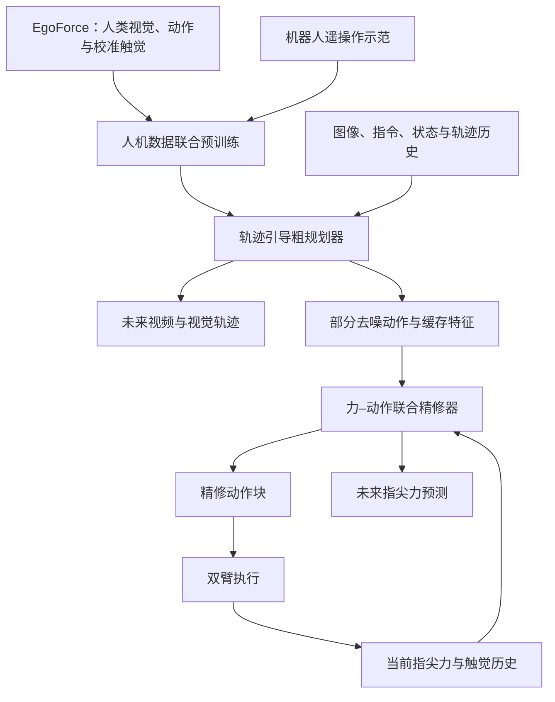
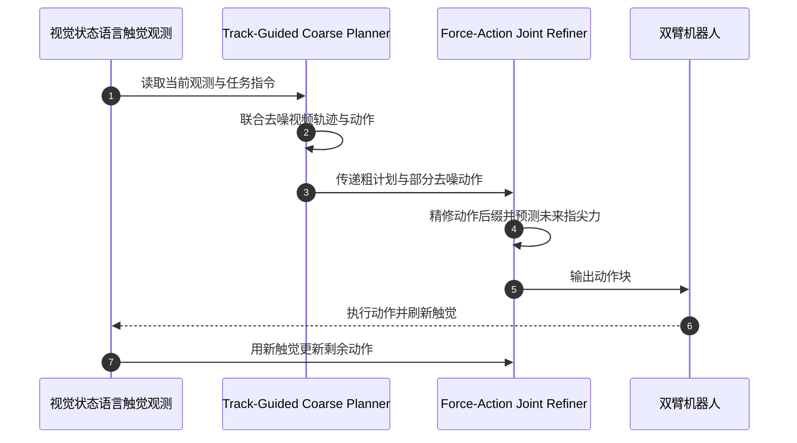

# FACT: A Multimodal Force–Action–Track Foundation Model for Human-to-Robot Dexterity（人到机器人灵巧操作的多模态力–动作–轨迹基础模型）

**FACT**（*A Multimodal Force–Action–Track Foundation Model for Human-to-Robot Dexterity*，[arXiv:2610.19155](https://arxiv.org/abs/2610.19155)）由密歇根大学、斯坦福大学和微软研究院提出。它先生成视觉引导的粗动作，再用当前触觉和未来力预测联合精修动作。本文与同名缩写的 [FACT（Failure-Aware Causal Training，arXiv:2608.10232）](./paper-fact.md) 是两项不同工作。

## 一句话定义

**先用未来视觉与点轨迹规划手怎么走，再让未来力与剩余动作互相约束手指如何完成接触。**

## 英文缩写速查

| 缩写 | 英文全称 | 简要说明 |
|------|----------|----------|
| FACT | Force–Action–Track Foundation Model | 本文的多模态灵巧操作模型 |
| EgoForce | Egocentric Force-rich Human Manipulation Dataset | 人类触觉操作数据集 |
| T-GCP | Track-Guided Coarse Planner | 联合预测动作、未来视频和视觉轨迹 |
| FAJR | Force–Action Joint Refiner | 联合预测未来力并精修动作 |
| DiT | Diffusion Transformer | 视频生成主干网络 |
| VQ | Vector Quantization | 将历史触觉信号编码为离散代码 |

## 为什么重要

- **人类数据补齐力信息**：通常的人类第一视角演示难以提供交互力，EgoForce 同步采集相机、手部动作与校准压力，提供跨具身预训练监督。
- **把触觉用于动作修正**：模型不仅读取当前力，还联合预测动作将引发的未来力；但未来力是学习与推理中的辅助预测，**不是直接下发给机器人的力/力矩指令**。
- **结果有明确边界**：十项真机任务均为任务专门微调，二值结果各基于 10 次 rollout；「机器人小脑」只是形象化描述，论文未证实「全球首个」或可与任意机器人“大脑”即插即用。

## 核心信息

| 项 | 内容 |
|----|------|
| **机构** | 密歇根大学、斯坦福大学、微软研究院 |
| **EgoForce 规模** | 约 2,000 小时、40,000 个 episode、1,000 项任务、1,000 名演示者 |
| **预训练数据** | EgoForce 人类触觉示范 + 100 小时 T-Rex 机器人遥操作数据 |
| **机器人评测** | 双臂 YAM 平台、Sharpa Wave 灵巧手、十项真实任务 |
| **开放状态** | 截至 2026-11-08，作者项目页标注代码和数据即将发布；权重入口未见列出 |

## 流程总览

依据 [论文 v1](https://arxiv.org/html/2610.19155v1) 的方法与附录：

预训练后按任务使用机器人和人类示范微调；图中的未来力是联合预测目标，并非直接的力控制指令。

## 方法栈

### 视觉轨迹引导的粗规划

基于 Wan2.2-TI2V-5B 视频 DiT，联合预测未来视频、视觉点轨迹和 16 步动作块。点轨迹描述手与物体的运动，为人类示范和机器人动作提供共享的任务表示。粗规划先去噪至中间状态，再将部分动作和缓存特征交给精修器。

### 力–动作联合精修

精修器接收当前指尖力与触觉历史，把剩余动作后缀和未来指尖力作为共同去噪目标。当前测量力表示正在发生的接触；未来力预测表示动作可能产生的接触后果。未来力用于辅助动作精修，不直接作为控制参考。

人类数据的手部姿态由相机估计、立体深度与手套传感器辅助，再重定向到机器人手。人类手套压力阵列可以估计法向力及由压力中心得到的两个力矩分量；切向力与扭转力矩不可观测，在标签中置零。因此，人类标签与机器人真实六轴指尖测量并不完全等价。

### 推理时序

每个动作块含 16 步，以 20 Hz 执行（一个 chunk 为 0.8 s）；精修器每 5 Hz 接收触觉刷新，并复用缓存的粗计划特征更新尚未执行的动作后缀。粗规划器每块运行一次，**不能把这描述成 1 kHz 的底层力矩伺服闭环**。

## 工程实践

| 层级 | 论文 v1 配置与接口 |
|------|------------------|
| 数据采样 | LeRobot-v2；动作与点轨迹 20 Hz、视频 10 Hz、指尖力 5 Hz；录制原始信号的采样频率与训练输入不同 |
| 机器人动作 | 16 × 62 维，双臂各 3D 位移、6D 旋转及 22 个手关节目标；末端目标经 YAM 运动学求解与内置关节控制器执行 |
| 粗规划器 | Wan2.2-TI2V-5B 视频 DiT，约 5.05B 参数；六次 Euler 去噪从 τ=1 到 0.4，生成视觉预测、点轨迹与部分动作 |
| 精修器 | 六层 Transformer，约 65M 参数；剩余动作从 τ=0.4 到 0、未来力从 τ=1 到 0，联合进行四次 Euler 步 |
| 触觉观测 | 双手共十指尖，每个指尖 6 轴力/力矩，单次 60 维；5 Hz 刷新时读取最近 16 个样本（3.2 s） |
| 滚动修正 | chunk 内偏移第 4、8、12 步补入新力观测，只重跑精修器并冻结已执行前缀，复用 coarse KV 缓存 |
| 训练资源 | EgoForce ~2,000 h + 机器人遥操作 100 h；论文使用 240 张 Zhenwu 810E PPU；每项任务在 8 GPU 微调 |

**人类触觉与机器人力传感不可混为一谈：** 人类手套压力阵列观测法向压力并估算两个弯矩，无法测切向力和扭矩，相应标签置零；机器人 Sharpa Wave 指尖提供六轴力/力矩。需核对跨具身重定向、时间戳同步及力归一化。

**复现状态：** 截至 2026-11-08，作者项目页仅展示演示与论文，代码、数据均标注 Coming Soon，未见权重入口；因此上述配置来自论文与附录，**不是已验证的开源部署教程**。

## 实验与评测

每项二值任务进行 10 次 rollout。连续任务统计弹奏正确音符数；移液器任务还报告旋钮是否被拨动及参与试次的读数误差。

| 真实机器人任务（论文 Table I） | FACT | T-Rex | π₀.₅ |
|-------------------------|------:|------:|-----:|
| 实验室移液，成功率 | 40% | 0% | 0% |
| 拧开试管盖，成功率 | 80% | 20% | 10% |
| 打开微量离心管翻盖，成功率 | 50% | 20% | 0% |
| 系鞋带，成功率 | 20% | 0% | 0% |
| 洗牌，成功率 | 30% | 10% | 0% |
| 多物体抓取，成功率 | 40% | 0% | 0% |
| 使用螺丝刀，成功率 | 30% | 10% | 0% |
| 七项二值任务平均成功率 | 41.4% | 8.6% | 1.4% |
| 竖琴，10 个音符中清晰发声音符数 | 6.7 | 2.1 | 0.5 |
| 木琴，10 个音符中清晰发声音符数 | 5.4 | 3.2 | 0 |
| 移液器旋钮，10 次中成功拨动次数 | 5 | 2 | 1 |
| 移液器旋钮，成功拨动试次平均误差 | 6.4 μL | 14.0 μL | 17.0 μL |

论文报告相对 T-Rex 在**试管盖**任务中最高提升 60 个百分点（80% vs 20%）；但不同任务使用不同评分指标，不能把十项结果统一当成成功率。两个基线都在相同任务示范上微调，但基础模型、输入模态及 π₀.₅ 动作压缩表示不同，差距不能归因于单独的力预测模块。

## 消融与读法

- 移除未来力预测后，打开试管盖从 80% 降至 40%，竖琴正确音符从 6.7 降至 0，旋钮参与次数从 5/10 降至 2/10。
- 移除视觉轨迹预测后，精细运动任务也有下降，例如实验室移液从 40% 降至 20%。
- 移除人类预训练中的触觉输入与力监督后（论文 Table II 同时移除这两项），开试管盖由 80% 降至 0%，微量离心管翻盖由 50% 降至 10%，系鞋带由 20% 降至 0%；旋钮误差由 6.4 μL 增至 20.5 μL。此消融并非只删除单个力损失。

**训练数据效率：** 论文 Table III 表明仅用 10 条机器人示范微调时，系鞋带为 10%、洗牌为 10%；再加入针对任务单独采集的 90 条人类示范后分别为 20% 和 30%。这 90 条不是从 EgoForce 预训练集直接抽取。

## 与其他工作对比

| 维度 | FACT（本文） | [T-Rex](./paper-trex-tactile-reactive-dexterous-manipulation.md) | [VT-WAM](./paper-vt-wam-visuotactile-contact-rich.md) | [π₀.₅](./paper-pi05-open-world-vla.md) |
|------|------|------|------|------|
| 触觉角色 | 当前力作观测 + **未来指尖力**作联合去噪目标 | 时空触觉 VQ-VAE 作反应式输入 | 联合预测未来触觉形变 | 不使用触觉 |
| 预训练数据轴 | ~2,000 h 人类触觉示范 + 100 h 机器人遥操作 | ~100 h 机器人触觉 play 数据 | 机器人视触觉数据 | 异构机器人 + 网络数据协同训练 |
| 动作生成 | 视频 DiT 粗规划（含点轨迹）→ 力–动作精修 | 变频率 MoT | 统一流匹配（视觉 / 触觉 / 动作） | flow-matching 动作专家 |
| 本文评测中的位置 | 主方法 | 主基线（十项任务最高 +60 pp） | 未在本文对比 | VLA 基线 |

- **相对 T-Rex：** 二者都把触觉接入灵巧双臂策略；差别在 FACT 把数据轴扩到人类示范，并让未来力预测参与动作精修，而非只用历史触觉做反应。
- **相对 VT-WAM：** 同为「预测接触后果」思路，VT-WAM 预测视觉触觉形变，FACT 预测指尖力；两者评测平台与任务不同，不可直接比成功率。
- **相对 π₀.₅：** 无触觉的通用 VLA 在移液、开盖等力敏感任务上接近 0%，说明这些任务的瓶颈在接触感知而非语义泛化。

## 源码运行时序图

**暂不适用：** 截至 2026-11-08，项目页标注代码即将发布，尚无可核实的训练或推理入口；上方推理时序图依据论文，不是源码调用图。

## 结论

**FACT 展示了把人类触觉示范迁移到机器人灵巧操作的路径：视觉轨迹提供粗运动表示，未来力预测让接触后果进入动作精修。**

1. 分别报告接触成功、精细操作质量和持续控制误差。
2. 当前力输入与未来力预测承担不同角色，前者是观测，后者是动作后果预测目标。
3. 人类示范价值依赖力信号校准、时间同步和跨具身动作迁移。
   人类微调示范是针对评测任务另行采集的，并非直接从通用 EgoForce 数据中抽取。
4. 每项二值任务仅十次 rollout，适合原型判断，不能单独证明部署可靠性。
5. 下载代码、数据或权重前，先在作者项目页确认公开状态和许可。

## 局限与风险

- **小样本评测：** 每项二值任务进行十次 rollout，结果可能受场景与物体摆放影响。
- **复现边界：** EgoForce 报告了数据规模，但本次没有核实公开下载入口。
- **计算成本：** 预训练使用 5.05B 参数视频 DiT 主干；论文报告在 240 台加速器上训练。
- **具身差异：** 人类手套和机器人指尖传感、动作空间不同，迁移效果依赖具体采集与微调配方。
- **开源状态：** 截至 2026-11-08，作者项目页标注代码与数据即将发布，未列权重下载入口；网站源码不等于模型可运行实现，发布后仍需核对许可和运行入口。
- **控制边界：** 论文支持双臂桌面操作的 20 Hz 轨迹输出与 5 Hz 触觉重规划，不支持将其描述为与任意高层 VLA 通用即插即用的底层控制器。
- **比较公平性：** π₀.₅ 基线为无触觉输入且动作压缩到 32 维、T-Rex 与 FACT 的预训练来源不同；只能说论文基准下更优，不能孤立归因全部收益。

## 关联页面

- [FACT（Failure-Aware Causal Training）](./paper-fact.md) — 同缩写、不同论文；以失败轨迹训练世界–动作模型。
- [VT-WAM（视觉–触觉–动作模型）](./paper-vt-wam-visuotactile-contact-rich.md) — 对照接触信号如何进入动作策略。
- [T-Rex](./paper-trex-tactile-reactive-dexterous-manipulation.md) — 本文主基线：机器人触觉 play 数据 + 触觉 VQ-VAE 的反应式灵巧策略。
- [π₀.₅](./paper-pi05-open-world-vla.md) — 本文无触觉 VLA 基线。
- [VLA](../methods/vla.md) — 视觉语言与机器人动作策略背景。

## 参考来源

- [论文来源归档](../../sources/papers/fact_egoforce_arxiv_2610_19155.md)
- [项目页来源归档](../../sources/sites/fact-1-0-github-io.md)

## 推荐继续阅读

- [论文 HTML v1](https://arxiv.org/html/2610.19155v1)
- [作者项目页](https://fact-1-0.github.io/)
- [arXiv 摘要与 PDF](https://arxiv.org/abs/2610.19155)
