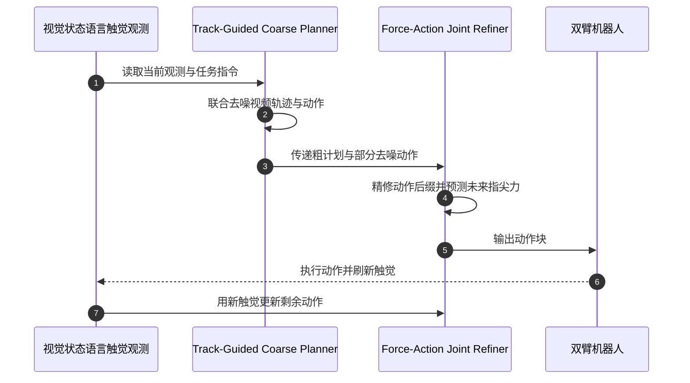

# FACT（EgoForce · 力–动作联合精修，arXiv:2610.19155）

**FACT**（*A Multimodal Force–Action–Track Foundation Model for Human-to-Robot Dexterity*，[arXiv:2610.19155](https://arxiv.org/abs/2610.19155)）由密歇根大学、斯坦福大学和微软研究院提出。它先生成视觉引导的粗动作，再用当前触觉和未来力预测联合精修动作。本文与同名缩写的 [FACT（Failure-Aware Causal Training，arXiv:2608.10232）](./paper-fact.md) 是两项不同工作。

## 一句话定义

**先用未来视觉与点轨迹规划手怎么走，再让未来力与剩余动作互相约束手指如何完成接触。**

## 英文缩写速查

| 缩写 | 英文全称 | 简要说明 |
|------|----------|----------|
| FACT | Force–Action–Track Foundation Model | 本文的多模态灵巧操作模型 |
| EgoForce | Egocentric Force-rich Human Manipulation Dataset | 人类触觉操作数据集 |
| T-GCP | Track-Guided Coarse Planner | 联合预测动作、未来视频和视觉轨迹 |
| FAJR | Force–Action Joint Refiner | 联合预测未来力并精修动作 |
| DiT | Diffusion Transformer | 视频生成主干网络 |
| VQ | Vector Quantization | 将历史触觉信号编码为离散代码 |

## 核心信息

| 项 | 内容 |
|----|------|
| **机构** | 密歇根大学、斯坦福大学、微软研究院 |
| **EgoForce 规模** | 约 2,000 小时、40,000 个 episode、1,000 项任务、1,000 名演示者 |
| **预训练数据** | EgoForce 人类触觉示范 + 100 小时 T-Rex 机器人遥操作数据 |
| **机器人评测** | 双臂 YAM 平台、Sharpa Wave 灵巧手、十项真实任务 |
| **开放状态** | 截至 2026-10-16，未核实源码、数据或权重下载入口 |

## 方法栈

### 视觉轨迹引导的粗规划

基于 Wan2.2-TI2V-5B 视频 DiT，联合预测未来视频、视觉点轨迹和 16 步动作块。点轨迹描述手与物体的运动，为人类示范和机器人动作提供共享的任务表示。粗规划先去噪至中间状态，再将部分动作和缓存特征交给精修器。

### 力–动作联合精修

精修器接收当前指尖力与触觉历史，把剩余动作后缀和未来指尖力作为共同去噪目标。当前测量力表示正在发生的接触；未来力预测表示动作可能产生的接触后果。未来力用于辅助动作精修，不直接作为控制参考。

### 推理时序

每个动作块含 16 步、20 Hz 的动作；精修器每 5 Hz 接收触觉刷新，并复用缓存的粗计划特征更新尚未执行的动作后缀。

## 实验与评测

每项二值任务进行 10 次 rollout。连续任务统计弹奏正确音符数；移液器任务还报告旋钮是否被拨动及参与试次的读数误差。

| 代表任务 | FACT | T-Rex | π₀.₅ |
|----------|------:|------:|-----:|
| 实验室移液 | 40% | 0% | 0% |
| 打开试管盖 | 80% | 20% | 10% |
| 多物体抓取 | 40% | 0% | 0% |
| 竖琴正确音符（10 音） | 6.7 | 2.1 | 0.5 |
| 拨移液器旋钮 | 5/10 试次参与；参与试次平均误差 6.4 μL | 2/10；14.0 μL | 1/10；17.0 μL |

摘要报告十项任务中相对 T-Rex 的成功率任务级最高提升 60 个百分点，不代表每项任务都提升相同幅度。

## 消融与读法

- 移除未来力预测后，打开试管盖从 80% 降至 40%，竖琴正确音符从 6.7 降至 0，旋钮参与次数从 5/10 降至 2/10。
- 移除视觉轨迹预测后，精细运动任务也有下降，例如实验室移液从 40% 降至 20%。
- 移除人类预训练力监督后，打开试管盖由 80% 降至 0%，旋钮误差由 6.4 μL 增至 20.5 μL。

## 与其他工作对比

| 维度 | FACT（本文） | [T-Rex](./paper-trex-tactile-reactive-dexterous-manipulation.md) | [VT-WAM](./paper-vt-wam-visuotactile-contact-rich.md) | [π₀.₅](./paper-pi05-open-world-vla.md) |
|------|------|------|------|------|
| 触觉角色 | 当前力作观测 + **未来指尖力**作联合去噪目标 | 时空触觉 VQ-VAE 作反应式输入 | 联合预测未来触觉形变 | 不使用触觉 |
| 预训练数据轴 | ~2,000 h 人类触觉示范 + 100 h 机器人遥操作 | ~100 h 机器人触觉 play 数据 | 机器人视触觉数据 | 异构机器人 + 网络数据协同训练 |
| 动作生成 | 视频 DiT 粗规划（含点轨迹）→ 力–动作精修 | 变频率 MoT | 统一流匹配（视觉 / 触觉 / 动作） | flow-matching 动作专家 |
| 本文评测中的位置 | 主方法 | 主基线（十项任务最高 +60 pp） | 未在本文对比 | VLA 基线 |

- **相对 T-Rex：** 二者都把触觉接入灵巧双臂策略；差别在 FACT 把数据轴扩到人类示范，并让未来力预测参与动作精修，而非只用历史触觉做反应。
- **相对 VT-WAM：** 同为「预测接触后果」思路，VT-WAM 预测视觉触觉形变，FACT 预测指尖力；两者评测平台与任务不同，不可直接比成功率。
- **相对 π₀.₅：** 无触觉的通用 VLA 在移液、开盖等力敏感任务上接近 0%，说明这些任务的瓶颈在接触感知而非语义泛化。

## 源码运行时序图

**不适用：** 截至 2026-10-16，论文页未列公开源码，项目页正文未能核实，目前没有可确认的运行入口。

## 结论

**FACT 展示了把人类触觉示范迁移到机器人灵巧操作的路径：视觉轨迹提供粗运动表示，未来力预测让接触后果进入动作精修。**

1. 分别报告接触成功、精细操作质量和持续控制误差。
2. 当前力输入与未来力预测承担不同角色，前者是观测，后者是动作后果预测目标。
3. 人类示范价值依赖力信号校准、时间同步和跨具身动作迁移。
4. 每项二值任务仅十次 rollout，适合原型判断，不能单独证明部署可靠性。
5. 下载代码、数据或权重前，先在作者项目页确认公开状态和许可。

## 局限与风险

- **小样本评测：** 每项二值任务进行十次 rollout，结果可能受场景与物体摆放影响。
- **复现边界：** EgoForce 报告了数据规模，但本次没有核实公开下载入口。
- **计算成本：** 预训练使用 5.05B 参数视频 DiT 主干；论文报告在 240 台加速器上训练。
- **具身差异：** 人类手套和机器人指尖传感、动作空间不同，迁移效果依赖具体采集与微调配方。
- **开源状态：** 项目页入口存在，但本次未核实代码、权重和数据的可访问性。

## 关联页面

- [FACT（Failure-Aware Causal Training）](./paper-fact.md) — 同缩写、不同论文；以失败轨迹训练世界–动作模型。
- [VT-WAM（视觉–触觉–动作模型）](./paper-vt-wam-visuotactile-contact-rich.md) — 对照接触信号如何进入动作策略。
- [T-Rex](./paper-trex-tactile-reactive-dexterous-manipulation.md) — 本文主基线：机器人触觉 play 数据 + 触觉 VQ-VAE 的反应式灵巧策略。
- [π₀.₅](./paper-pi05-open-world-vla.md) — 本文无触觉 VLA 基线。
- [VLA](../methods/vla.md) — 视觉语言与机器人动作策略背景。

## 参考来源

- [论文来源归档](../../sources/papers/fact_egoforce_arxiv_2610_19155.md)
- [项目页来源归档](../../sources/sites/fact-1-0-github-io.md)

## 推荐继续阅读

- [论文 HTML v1](https://arxiv.org/html/2610.19155v1)
- [作者项目页](https://fact-1-0.github.io/)
- [arXiv 摘要与 PDF](https://arxiv.org/abs/2610.19155)
