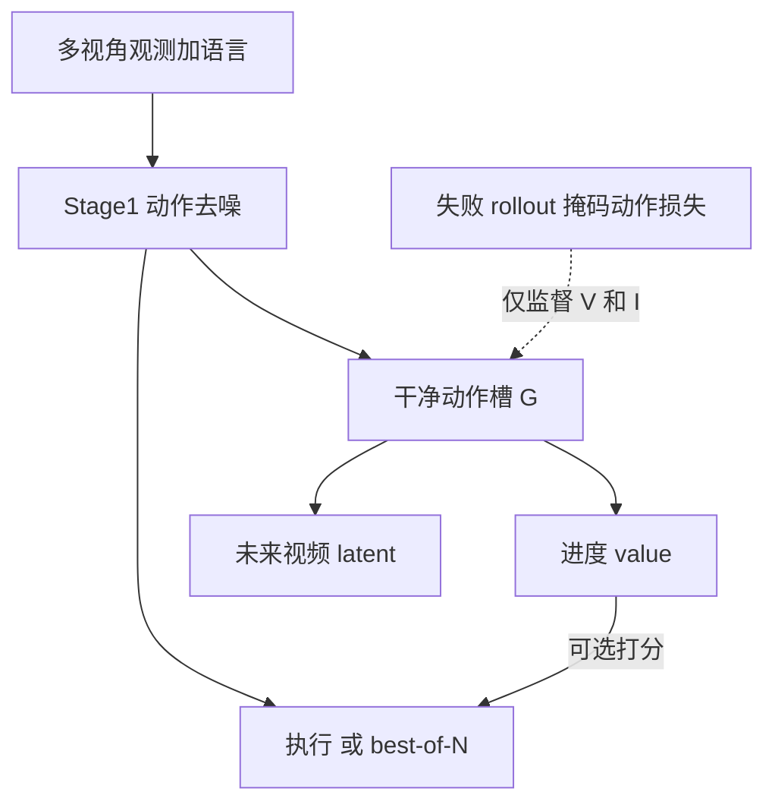
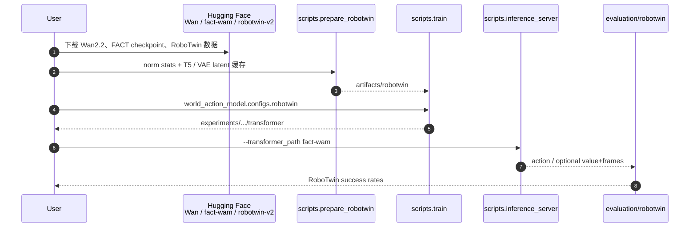

# FACT（Failure-Aware Causal Training · arXiv:2608.10232）

**FACT**（*FACT: Failure-Aware Causal Training for World-Action Models*，[arXiv:2608.10232](https://arxiv.org/abs/2608.10232)）由 **加州大学圣地亚哥分校（UCSD）** 提出（Peng\* / Liang\* / Yan / Hansen / Wang）：把 WAM 的未来预测改成 **动作条件后果建模**，使失败 rollout 监督「坏动作导致什么」，而不是污染策略模仿。[项目页](https://fact-wam.github.io/) · [代码](https://github.com/Bariona/FACT) · [权重](https://huggingface.co/Bariona/fact-wam)。本页数字均来自论文 v1（2026-08-10），为作者自报，未见独立复现。

> **同名缩写说明：** 本页是 Failure-Aware Causal Training（arXiv:2608.10232）；另有一项独立的 [FACT（EgoForce · 力–动作联合精修，arXiv:2610.19155）](./paper-fact-egoforce-human-dexterity.md)，主题是人类触觉示范与灵巧操作。

## 一句话定义

**失败不是坏演示，而是后果标签：先采样动作，再以干净动作为条件预测未来视频与任务进度；失败 rollout 的动作模仿损失被掩码，只教世界支路（论文 §1、§3.3）。**

## 英文缩写速查

| 缩写 | 英文全称 | 简要说明 |
|------|----------|----------|
| WAM | World Action Model | 联合未来预测与动作生成的策略族 |
| FACT | Failure-Aware Causal Training | 本工作的失败感知因果训练配方 |
| IDM | Inverse Dynamics Model | 视频优先 WAM 常见的二阶段动作解码（§1） |
| MoT | Mixture-of-Transformers | 动作与世界分设独立专家的架构；FACT 改用共享骨干加 adapter（§3.2） |
| PSNR / SSIM | Peak Signal-to-Noise Ratio / Structural Similarity | 失败想象诊断用的未来帧保真度指标（表 4、表 8） |
| RoboTwin | — | 双臂仿真基准；本文 50 任务主评测（§4.1） |

## 为什么重要

- **对准 WAM 的 success bias：** 作者指出，只在成功演示上训未来，测试时坏动作仍可能被配上成功的未来（§1）；FACT 用失败后果监督去纠正，并在留出样本上测到失败窗口 PSNR 19.51 提升到 25.92（表 4）。
- **失败数据用法清晰：** 失败样本掩码 \(L_{act}\)、保留 value 与 video（式 9），而不是把失败当负样本 BC；真机上把失败动作加回模仿损失只有 63%（表 2）。
- **可选部署接口：** 进度头可对 \(N\) 个候选打分（式 10）；无失败共训的 scoring 反而 79% 低于不打分的 82%（表 2，作者解读为 value 头靠后果监督才有用）。
- **开源：** 项目页列出论文、代码与模型；仓库与权重许可证见 [仓库归档](../../sources/repos/fact.md)（本次未重新核对）。

## 核心原理与流程总览

### 因果 token 序与注意力（§3.2）

token 序 \(z=[P\|A\|G\|V\|I]\)：观测前缀 \(P\)、noisy 预测动作 \(A\)、teacher-forced 干净动作 \(G\)、进度 \(V\)、未来视频 \(I\)。训练时 \(V/I\) 只看 \(G\)，\(A\) 看不到 \(G\)；推理时无 \(G\)：Stage 1 由 \([P,A]\) 去噪出动作，Stage 2 把该动作填入 \(G\) 去噪 value 与（可选）未来视频。共享一个视频扩散 Transformer，在每个 block 的 FFN 后挂轻量 action adapter（对比 MoT 的独立世界专家）。

### 失败感知目标（§3.3，式 6–9）

| 数据 | 监督 |
|------|------|
| 成功演示 \(D_s\) | \(w_aL_a+w_vL_v+w_IL_I\)，进度目标 \(p_{t+H}\) |
| 失败 rollout \(D_f\) | 仅 \(w_vL_v+w_IL_I\)；进度目标 \(\mathrm{clip}(p_{t+H}-\lambda_{fail}\mathbb{1}_{fail},0,1)\) |

统一用 flow matching。论文设置：WAN2.2-5B 初始化、\(w_a=20,\ w_v=w_I=1\)、\(H=48\)、\(\lambda_{fail}=1\)、20 步 flow-Euler；实验中进度奖励取均匀，\(p_t=t/T\)（§3.3）。每个 episode 标注最终结果，失败 episode 另标失败起点（§3.3）。

### 流程总览

## 源码运行时序图

下图沿用 [仓库归档](../../sources/repos/fact.md) 的入口描述（环境、数据、训练、推理服务与 RoboTwin 评测）。本次只通读论文，未核对源码，脚本名与参数以仓库为准。

## 工程实践

| 项 | 论文说法（带出处） |
|----|----------|
| 失败数据来源 | 主要来自模型自身 rollout（§4）；RoboTwin 约 1.3K 条失败（§4.1）；真机每个 cube 任务约 30 条，其余任务未写（§4.2） |
| 失败 rollout 收集 | 先在 \(D_s\) 上训初始策略，rollout 后筛出失败并标注起点，再在 \(D_s\cup D_f\) 上继续训练（附录 A 算法 2） |
| 真机平台 | 双 YAM 臂，1 个 D435 主视角加 2 个 D405 腕部相机，GELLO 遥操；三路视频打包进一张画布（附录 C） |
| 数据规模 | RoboTwin clean 50 条/任务、randomized 500 条/任务（附录 D）；真机 cube 任务 200 条示范，其余 50 条（§4.2） |
| 动作-only 部署 | Stage 1 后即返回；动作-only 下可缓存共享前缀 KV（§3.3）；RTX PRO 6000 上 380 ms，Motus 1220 ms，π0.5 47 ms（附录 E 表 7） |
| 候选数 | 真机取 N=4；N 更大收益递减、延迟上升（§4.3 图 7） |
| 基线公平性 | 所有真机基线只在同样的成功示范上微调（附录 C），即基线没有用失败数据 |
| 复现路径 | `setup_env.sh`、`prepare_robotwin`、`train` 或直接挂 `Bariona/fact-wam` 做 `inference_server`（来自仓库归档，未核对） |

## 实验与评测

| 设定 | 关键数字（论文出处） |
|------|----------|
| RoboTwin 50 任务平均 | 去视频共训 81.8 → Ours 85.6 → w/ failure 87.5；Motus 87.8，Gigaworld-Policy 86.0，π0.5 79.8（§4.1 表 1） |
| 真机 seen 平均 | Ours 82 → w/ failure 89 → +scoring 92；π0.5 88，Motus 64（表 2，每格 20 次试验） |
| 真机 unseen 平均 | Ours 67 → w/ failure 77 → +scoring 82；π0.5 85，Motus 62（表 3） |
| 真机消融（seen） | 去视频共训 58，去因果掩码 77，失败动作加入模仿损失 63，仅 scoring 无失败共训 79（表 2） |
| 失败想象 | 失败窗口 PSNR 19.51→25.92（+6.4 dB），成功窗口 26.12→26.08；SSIM 失败窗口 0.7461→0.8290（表 4、表 8，512 个留出样本各半） |
| 失败数据 scaling | 3 个 RoboTwin clean 任务，失败占比 0/50/100% 时平均 32.7%→57.3%，100% 时失败约占训练集 45%（图 6） |
| 价值轨迹 | 抓取失败时 value 下降、重抓后回升（图 8，Pick Cubes 单条 rollout 的定性图） |

## 与清单说法的核对

清单（Berseth CoRL 2026 阅读清单，第 077/101 篇，P2）的一句话摘要（作者说由 LLM 据摘要起草）：「Action-conditioned world-action model that learns from failure rollouts, so it predicts the consequences of bad actions.」

| 清单说法 | 论文核对 |
|----------|----------|
| action-conditioned WAM | 成立：世界支路（未来视频与进度）条件于干净动作槽 \(G\)，Stage 1 先出动作（§3.2） |
| learns from failure rollouts | 成立，但要加限定：失败数据主要来自模型自己的 rollout，规模较小（RoboTwin 约 1.3K 条，真机每 cube 任务约 30 条，§4.1–4.2）；且仅用于世界支路，动作模仿损失被掩码 |
| so it predicts the consequences of bad actions | 有证据但限于离线指标和定性图：留出样本上失败窗口 PSNR/SSIM 提升（表 4、表 8），图 5 为定性对比；没有看到在线「预测后果后避免失败」的因果检验，打分带来的真机增益见表 2/3（+3 到 +5 个点，每格仅 20 次试验） |
| 摘要未涉及的重点 | 论文的策略成功率主张（RoboTwin 87.5%，真机 89%）依赖含失败共训加可选 N=4 打分；RoboTwin 结果并未超过 Motus 87.8%，作者强调约 3 倍更快（附录 E） |

清单排序来自作者自己的兴趣模型，不是论文质量评价。

## 结论

**FACT 的核心贡献是「失败→后果」接口：让世界支路学会坏动作的结果，进度头才可能用来筛候选；这是作者的主张，证据主要是两个基准上的小幅提升和一组离线预测指标。**

1. **读失败共训与失败想象表（表 2–4），不要只看 RoboTwin 与 Motus 差 0.3 个点。**
2. **因果掩码与失败动作掩码都有消融支持（表 2）：** 去因果掩码 77，失败动作进模仿损失 63（均对比 82 或 89 的基线，见限制一节关于试验数的说明）。
3. **部署默认可 action-only：** Stage 2 视频与 value 是可选开销（§3.3、§5）。
4. **选型坐标（本页判断，非论文结论）：** 要失败感知后果看 FACT；要 beyond-RGB 结构化未来看 [DreamWAM](./paper-dreamwam.md)；要推理算力柔性多流看 [Flex-π](./paper-flex-pi.md)；要部署候选筛选外挂看 [DreamSteer](./paper-dreamsteer-vla-deployment-steering.md)。

## 局限与风险

**论文自述（§5）：**

- 可扩展到更大的机器人与人类交互数据，以提升未来预测的物理合理性与 value head 的区分力。
- value head 可换成更强的进度估计器。
- best-of-N 以算力换可靠性，打分需对每批候选额外一次前向；对延迟敏感时可用 action-only。

**本页看到的未验证之处（判断）：**

- 真机每格只有 20 次试验（§4.2），差值常是 5 个点的整数倍；seen 的 82→89、unseen 的 67→77 未给置信区间或多种子，消融差异（如 77 对 82）可能落在噪声内（推测）。
- 失败与成功数据量不同（真机 cube 任务约 30 条失败，另有额外模型 rollout 时间），论文的「Ours」与「Ours w/ failure」不是等数据量对照，增益里混有更多数据的效应（推测）；图 6 的 scaling 只在 3 个 RoboTwin clean 任务上做。
- 进度奖励取均匀 \(p_t=t/T\)（§3.3），\(\lambda_{fail}=1\)，value 更像「进度加失败惩罚」的代理，而非校准的成功概率。
- 价值轨迹（图 8、12）与热力图（图 13）是定性案例；scoring 的收益仅在真机 5 个 seen 与 3 个 unseen 任务上报告，RoboTwin 上没有 scoring 结果。
- 评测以桌面双臂为主，没有全身 loco-manip；基线均无失败数据且部分用大规模机器人预训练（π0.5，§4.2 作者也承认）。
- 失败标注依赖 episode 结果与失败起点人工 / 规则标注（§3.3 算法 2「when available」）。

## 与其他工作对比

| 工作 | 关系 |
|------|------|
| 视频优先加 IDM / 未来条件动作 | 论文 §1：成功演示驱动未来，缺少坏动作后果；FACT 强调动作条件的失败后果 |
| [DreamWAM](./paper-dreamwam.md) | 改「未来长什么样」；FACT 改「失败怎么进损失」（本页判断） |
| [DreamSteer](./paper-dreamsteer-vla-deployment-steering.md) | 外挂筛选；FACT 的 value 与世界支路共训（本页判断） |
| Motus / π0.5 | 论文中的强基线：RoboTwin Motus 87.8，真机 seen π0.5 88、unseen 85 |

## 关联页面

- [World Action Models](../concepts/world-action-models.md)
- [VLA](../methods/vla.md)
- [生成式世界模型](../methods/generative-world-models.md)
- [Flow Matching 具身策略](../methods/flow-matching-embodied-policy.md)
- [操作任务](../tasks/manipulation.md)
- [DreamWAM](./paper-dreamwam.md)
- [Flex-π](./paper-flex-pi.md)
- [DreamSteer](./paper-dreamsteer-vla-deployment-steering.md)
- [同名缩写 FACT（EgoForce）](./paper-fact-egoforce-human-dexterity.md)
- [动作后果技术地图](../overview/robot-world-models-action-consequence-technology-map.md)

## 参考来源

- [FACT 论文归档（含核对范围与通读记录）](../../sources/papers/fact_arxiv_2608_10232.md)
- [Bariona/FACT 仓库归档](../../sources/repos/fact.md)
- [fact-wam.github.io 项目页归档](../../sources/sites/fact-wam-github-io.md)
- Peng, Liang et al. *FACT: Failure-Aware Causal Training for World-Action Models*, arXiv:2608.10232v1, 2026

## 继续阅读

- 项目页真机与失败想象对照：<https://fact-wam.github.io/>
- 论文 HTML：<https://arxiv.org/html/2608.10232>
