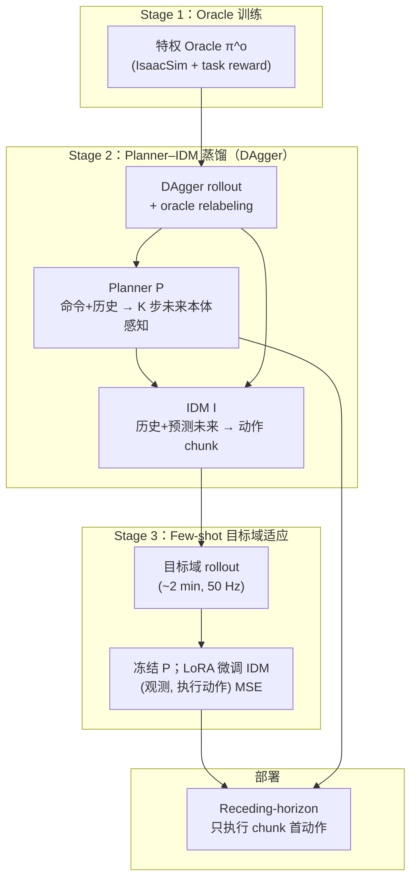
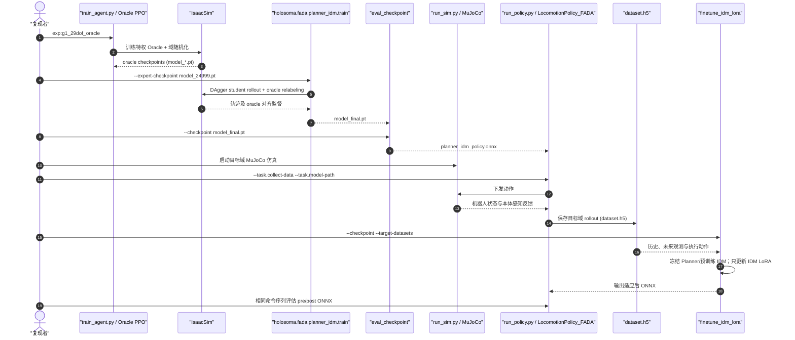

# FADA：通过动力学对齐实现人形控制少样本域适应（Few-Shot Domain Adaptation via Dynamics Alignment for Humanoid Control）

## 一句话定义

**FADA** 是 CMU LeCAR-Lab 提出的 **人形控制少样本域适应** 框架（arXiv:2606.28476，[项目页](https://lecar-lab.github.io/FADA-humanoid/)）：把策略分解为 **Planner（命令→短视界本体感知意图）** 与 **IDM 逆动力学模型（意图+历史→动作）**，源域用特权 oracle + DAgger 训练；部署时 **冻结 planner**，仅用约 **2 分钟** 目标域 rollout 的 **(观测, 执行动作)** 对 **LoRA 微调 IDM**，使「如何把意图执行出来」对齐新动力学，而无需目标奖励、专家演示或仿真重标定。

## 英文缩写速查

| 缩写 | 英文全称 | 简要说明 |
|------|----------|----------|
| FADA | Few-Shot Domain Adaptation via Dynamics Alignment | 本文提出的动力学对齐少样本适应框架 |
| IDM | Inverse Dynamics Model | 由预测未来与历史映射到动作的逆动力学模块 |
| WBC | Whole-Body Control | 人形全身协调控制任务层 |
| LoRA | Low-Rank Adaptation | 目标域仅更新 IDM 低秩适配器 |
| DR | Domain Randomization | 源域 IsaacSim 训练中的物理参数随机化 |
| ONNX | Open Neural Network Exchange | 源域与适应后模型在推理端的导出格式 |

## 为什么重要

- **切中 sim2real 的「执行层」失配**：地形、载荷、执行器响应变化时，**任务意图往往仍合理**，但 **实现同一意图所需动作** 会变——FADA 把适应集中在 **IDM（plan→action）** 而非重学整个策略或拟合仿真器。
- **极少数据、极轻监督**：约 **2 min @ 50 Hz** 的普通 rollout（不必最优）即可；监督仅为 rollout 上 **实际执行的首动作**，不要 reward、不要 oracle 标签、不要 SysID。
- **真机验证覆盖全身高精度任务**：G1 斜坡行走、非对称载荷 loco、软垫功夫、T1 拉 6 kg 篮等；成功率任务平均 **20%→90%**，跟踪误差平均 **降 27.4%**（相对零样本 FADA-zs）。
- **与 in-context 适应（RMA 等）正交**：RMA 类方法 **不改权重**，只改输入 latent；FADA **冻结 planner、更新 IDM 权重**，让目标 rollout 直接改动作生成映射——sim2sim 上 TF-CoPred-ft（只微调未来观测预测）反而变差，印证 **应适应执行模块**。

## 流程总览

## 源码运行时序图

截至 **2026-11-23**，[官方 FADA 仓库](https://github.com/LeCAR-Lab/FADA) 已发布训练、适应及 locomotion 推理入口。以下按官方 README 六步流程、实际 `train.py` / `eval_checkpoint.py` / `finetune_idm_lora.py` / `run_policy.py` 入口整理（不是抽象部署模板）。

真机采集使用同一 `run_policy.py` 和 FADA locomotion preset，把仿真运行替换为按硬件文档配置的机器人接口；**请先在 MuJoCo 验证起身、安全与动作空间**。本次未实际运行上述代码，也不将论文的全身跟踪实验等同于已发布的 whole-body tracking 源码。

## 核心机制（归纳）

### 1）Planner–IDM 接口

时刻 $t$：

$$
\hat{Y}_t^K = P(\mathcal{O}_t^H, c_t), \quad \hat{U}_t^K = I(\mathcal{O}_t^H, \mathcal{A}_t^H, \hat{Y}_t^K), \quad \hat{a}_t = \pi_1(\hat{U}_t^K)
$$

- $H=30$ 历史长度，$K=6$ 预测视界（默认）；双 **Transformer**。
- **Planner** 预测未来为 **相对最新观测的残差**；**IDM** 对未来 token 做全注意力 + 对历史 cross-attention，并行解码 $K$ 步动作。

### 2）源域训练目标

**IDM**（Eq. 4.2）：用 rollout **实际执行** 的 $(Y_{exec}^K, U_{exec}^K)$ 监督首动作——含学生次优执行，故同样适用于不完美目标 rollout。

**Planner**（Eq. 4.3）：经 **stop-gradient IDM** 优化，使 $P$ 预测的未来经 $I$ 后 **首动作匹配 oracle 动作**——学的是 **可被 IDM 执行的意图**，而非回归 oracle 观测轨迹。

**Oracle relabeling**：学生 rollout 存状态快照，事后恢复并 roll oracle $K$ 步得 shadow 对供 planner 训练。

### 3）Few-shot 目标适应

从目标 rollout 提取 $\mathcal{W}_{tgt}$，冻结 $P$ 与 $I$ 预训练权重，仅优化 IDM 上 [LoRA](../concepts/lora.md) $\Delta\psi$：

$$
\ell_{adapt}(\Delta\psi) = \mathbb{E}\left[\left\|\pi_1(I_{\psi+\Delta\psi}(\cdot)) - \pi_1(U_{exec}^K)\right\|_2^2\right]
$$

部署策略 $(P, I_{\psi+\Delta\psi})$，接口与命令层 **完全不变**。

### 4）设计验证（固定基座臂 + 腕载 0–5 kg）

载荷改变 **所需力矩** 但不改变 **到达目标的关节构型**；实验显示 **冻结 planner** 后各载荷 planner RMSE 仅差 **≈7%**，而 IDM 适应使跟踪误差 **≈24%↓**、planner–执行一致性 gap **≈54%↓**——支持 **planner=运动学意图、IDM=动力学执行** 的分解假设。

## 主要量化结果

### 真机（Table 1，5 trials/task）

| 任务 | 指标 | TF-DAgger | FADA-zs | FADA |
|------|------|-----------|---------|------|
| G1 斜坡行走 | Success | 0% | 20% | **80%** |
| G1 载荷 loco | $\bar{E}_v$ ↓ | 1.000 | 1.289 | **0.797** |
| G1 软垫功夫 | $\bar{E}_{mpjpe}$ ↓ | 1.00 | 1.18 | **0.86** |
| T1 臂载 loco | $\bar{E}_v$ ↓ | 1.000 | 1.043 | **0.866** |
| T1 拉篮 | Success | 0% | 20% | **100%** |

- 成功率任务：**20% → 90%** 平均；跟踪任务：相对 FADA-zs **−27.4%** 误差。
- IDM loss 在五任务上 **一致下降**，与硬件性能提升相关。

### Sim-to-sim（IsaacSim → MuJoCo，5 任务）

- FADA 平均归一化误差较 FADA-zs **−24.7%**、较 TF-DAgger **−26.8%**。
- T1 Falcon（外力牵引 loco）增益最大：MuJoCo 误差 **0.347**（FADA）vs **0.880**（FADA-zs）。
- TF-CoPred-ft 劣于零样本 → **只改未来预测不够，须改动作生成**。

### 跨条件适应边界（arXiv v2 §5.3）

在 Booster T1 携载 20 kg 的 MuJoCo 实验中，**FADA** 归一化速度误差/存活率 **1.28 / 0.94**，而 **FADA-zs** 为 **2.44 / 0.43**；当携载增至 30 kg 时，FADA 仅达到 **2.40 / 0.36**。论文说明：即使零样本 rollout 发生跌倒，跌倒前轨迹依然可以用于监督，但严重失配导致轨迹过短时适应能力会下降。这里的改进不应被推广为所有负载都能恢复。

### 关键消融

| 因素 | 结论 |
|------|------|
| 预测视界 $K$ | $K=6$ 优于 $K=1$（约 18%）；更长无额外收益 |
| LoRA vs 全参 IDM FT | LoRA 稳定；全参易过拟合小数据 |
| 目标数据量 | 6000 步达平台（≈2 min） |

## 与其他工作的关系

- **相对 [RMA](./paper-rma-rapid-motor-adaptation.md)**：RMA **推理时改 latent、权重固定**；FADA **改 IDM 权重、planner 固定**——适应 taxonomy 中「更新执行模块 vs 更新输入上下文」的分支。
- **相对 [BFM-Zero](./paper-bfm-zero.md)**：同 **LeCAR-Lab / CMU** 人形线；BFM-Zero 学 **可提示行为潜空间**；FADA 专注 **sim→target 动力学对齐** 的工程分解，可与之 **上下叠加**（高层 prompt / 参考 + FADA 式执行适应）。
- **相对残差/ASAP 类**：残差多在 **最终动作或模型层** 加修正；FADA 在 **因子化策略内部** 只动 IDM，保留命令接口。
- **相对 [SLowRL](./paper-slowrl-safe-lora-locomotion-sim2real.md)**：同为 **LoRA 真机适应**；SLowRL 用 **reward + Recovery 安全壳** 微调四足策略；FADA 用 **无 reward 监督 IDM** 做人形全身任务。

## 结论

**FADA 的判断是 sim2real 失配主要发生在「执行」而不是「意图」：冻结 planner、只用约 2 分钟目标域 rollout 对 IDM 做 LoRA 微调，就能把人形高精度全身任务从勉强能跑推到可用。**

- 起作用的是 **Planner–IDM 分解 + 无 reward 监督**：监督信号仅为 rollout 上 **实际执行的首动作**，不要奖励、专家演示或 SysID，因此不完美的目标域数据同样可用。
- 分解假设有直接证据支撑：载荷 0–5 kg 下各 planner RMSE 仅差 **≈7%**，而 IDM 适应使跟踪误差 **≈24%↓**、planner–执行一致性 gap **≈54%↓**；sim2sim 上只微调未来预测的 **TF-CoPred-ft 反而劣于零样本**。
- 关键量纲：真机成功率任务平均 **20% → 90%**，跟踪误差相对 FADA-zs **−27.4%**；$K=6$ 优于 $K=1$，LoRA 比全参微调更稳，目标数据约 **6000 步（≈2 min）** 即达平台。
- 边界：适应前的策略必须 **能跑够长** 以收集 rollout（FADA-zs 多项真机任务仅 **20%**）；未覆盖全身人–物交互与视觉/触觉条件；源域 oracle RL + DAgger + 域随机化的前置成本一分未省。
- 定位上与 [RMA](./paper-rma-rapid-motor-adaptation.md) 的「不改权重、只改输入 latent」构成适应 taxonomy 的两支，与 [BFM-Zero](./paper-bfm-zero.md) 的可提示行为潜空间则可 **上下叠加**。

## 常见误区或局限

- **不是零样本万能**：FADA-zs 在多项真机任务仍仅 **20%** 成功率；适应前策略须 **能跑够长** 以收集 rollout。
- **不是 SysID / 仿真对齐**：不改仿真器参数；直接在 **部署控制器** 上对齐动力学。
- **未覆盖 HOI**：论文明确 **全身人–物交互** 与 **视觉/触觉条件** 为未来方向。
- **源训练仍有成本**：oracle RL + DAgger 蒸馏与域随机化仍是前置投入。
- **任务模块开源未齐全**：官方代码仓库当前尚未标记 whole-body tracking 部分为已发布；同时只有部分目标动力学条件能提供足够有信息量的安全 rollout。

## 工程实践

- **约 2 分钟实机微调清单：** 部署期保持 Planner 完全冻结（避免微调破坏全局任务结构），仅收集几段真实交互下的 `(o_t, a_t)` 轨迹以自监督逆动力学损失对 IDM 施加低秩 LoRA 微调，使 Unitree G1 / Booster T1 快速吸收负载或软地面失配。
- **公开代码入口：** 官方仓库基于 Holosoma（Apache-2.0），主要入口为 `src/holosoma/holosoma/train_agent.py` → `holosoma.fada.planner_idm.train` → `holosoma.fada.planner_idm.eval_checkpoint` → `run_policy.py` 采集 `dataset.h5` → `holosoma.fada.planner_idm.finetune_idm_lora`；复现参数见[源码归档](../../sources/repos/fada-humanoid.md)。
- **论文附录 B.3 参考设置：** LoRA rank 8、alpha 16、dropout 0.05；离线更新 800 step、学习率 3e-4、batch size 4096。这是论文实验配置，不保证直接适配其他硬件。
- **开源边界（2026-11-23）：** 官方 README 已发布 oracle PPO、DAgger 蒸馏、LoRA、sim2sim、sim2real locomotion 与 G1/T1 oracle 权重；**whole-body tracking 项仍未勾选开放**，相关复现实验不能标注为全部可运行；[项目主页核对](../../sources/sites/fada-humanoid.md)。
- **前后对照：** README 要求在相同 seed、命令与初始条件下运行适应前、后的 ONNX，并分别采集 `mocap_unified.npz`；官方流程只输出轨迹文件，具体指标需额外计算。

## 关联页面

- [残差策略学习](../methods/residual-policy-learning.md) — 对照只适配逆动力学模块与在动作输出端叠加残差两种迁移方式。
- [Sim2Real](../concepts/sim2real.md)
- [Privileged Training](../concepts/privileged-training.md)
- [Whole-Body Control](../concepts/whole-body-control.md)
- [DAgger](../methods/dagger.md)
- [Sim2Real 方法横向对比](../comparisons/sim2real-approaches.md)
- [RMA（Rapid Motor Adaptation）](./paper-rma-rapid-motor-adaptation.md)
- [BFM-Zero](./paper-bfm-zero.md)
- [Unitree G1](./unitree-g1.md)
- [Sim2Real 纵深路线](../../roadmap/depth-sim2real.md) — 少样本适应与真机安全微调阶段已有本页入口

## 参考来源

- [论文归档：FADA arXiv:2606.28476v2](../../sources/papers/fada_arxiv_2606_28476.md)
- [官方项目页开放资源核查](../../sources/sites/fada-humanoid.md)
- [官方 FADA 源码及运行入口](../../sources/repos/fada-humanoid.md)
- Xie, Sobanbabu, Shikhare, Wang, Simchowitz, Shi. *FADA: Few-Shot Domain Adaptation via Dynamics Alignment for Humanoid Control*. arXiv:2606.28476, 2026. <https://arxiv.org/abs/2606.28476>
- [FADA 项目页](https://lecar-lab.github.io/FADA-humanoid/)

## 推荐继续阅读

- [机器人论文阅读笔记：FADA](https://imchong.github.io/Robot_Learning_Paper_Notebooks/papers/10_Sim-to-Real/FADA__Few-Shot_Domain_Adaptation_via_Dynamics_Alignment_for_Humanoid_Control/FADA__Few-Shot_Domain_Adaptation_via_Dynamics_Alignment_for_Humanoid_Control.html)
- [FADA 项目页交互 demo](https://lecar-lab.github.io/FADA-humanoid/) — G1 臂腕载载荷 before/after 对比
- [Sim2Real 概念页](../concepts/sim2real.md) — 迁移工程总览
- [RMA 论文实体](./paper-rma-rapid-motor-adaptation.md) — in-context teacher–student 对照
- [BFM-Zero 项目页](https://lecar-lab.github.io/BFM-Zero/) — 同实验室行为基础模型线
