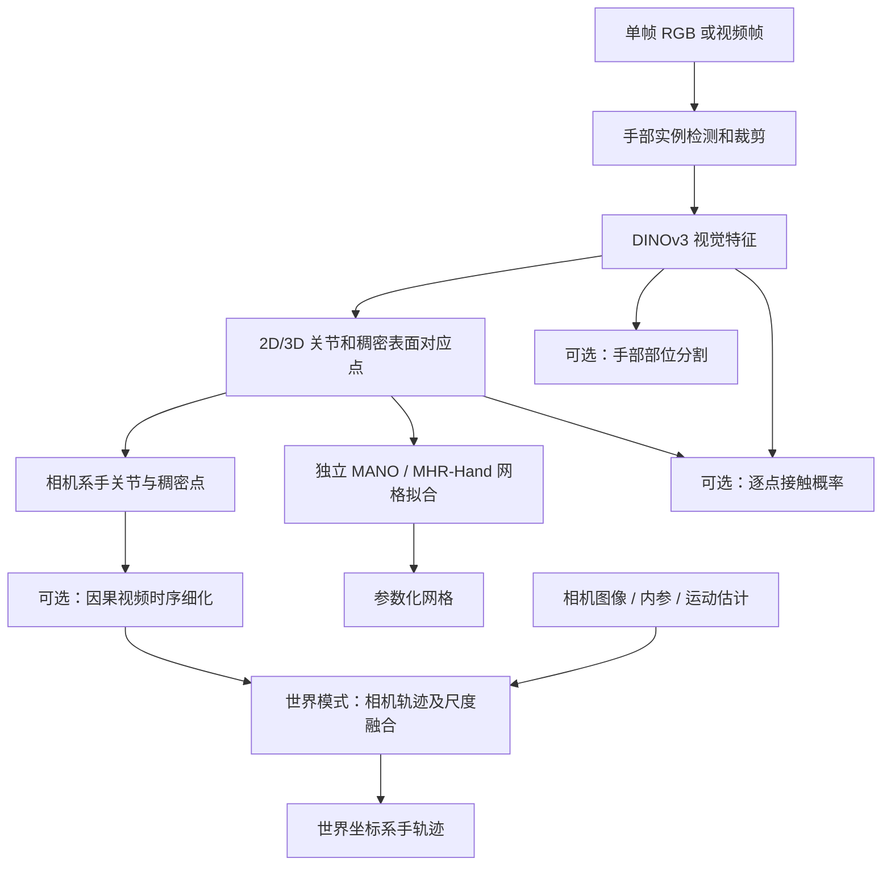
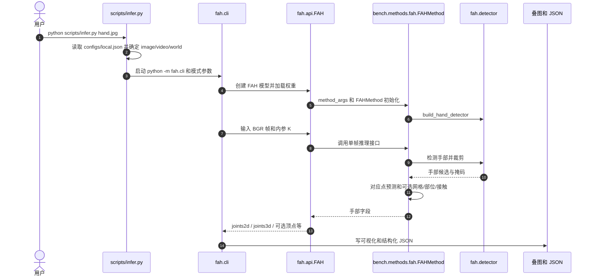

# FAH：快速准确的手部估计 / Fast and Accurate Hand Estimation in Pixels, Interaction and World Space

**论文：** [arXiv:2611.07711v1](https://arxiv.org/abs/2611.07711)（2026-11-05） · **作者：** Jinkun Cao · **项目：** [FAH](https://www.jinkuncao.com/FAH/) · **官方代码：** [noahcao/FAH](https://github.com/noahcao/FAH) · **核对：** 2026-11-10。

## 一句话定义

**FAH 将手部 2D/3D 关节与表面点的直接预测作为主表征，再用独立网格拟合恢复 MANO/MHR-Hand；同时复用几何表示服务分割、接触估计和因果视频/世界坐标跟踪。**

## 英文缩写速查

| 缩写 | 英文全称 | 简要说明 |
|---|---|---|
| FAH | Fast and Accurate Hand Estimation | 本文高精度实时手部估计系统 |
| MANO | Hand Model with Articulated and Non-rigid Deformations | 21 关节/778 顶点的参数化手模型与拟合目标 |
| MHR | Momentum Human Rig | 可选 MHR-Hand 网格表示 |
| PA-MPJPE | Procrustes-Aligned Mean Per Joint Position Error | 最优刚体对齐后的 3D 关节平均位置误差 |
| PA-MPVPE | Procrustes-Aligned Mean Per Vertex Position Error | 最优刚体对齐后的网格顶点误差 |
| FPS | Frames Per Second | 每秒处理帧数，必须注明后端与可选功能 |
| HOT3D | Hand-Object Tracking in 3D | 第一视角手物跟踪基准 |
| SLAM | Simultaneous Localization and Mapping | 世界系相机轨迹估计/尺度恢复相关组件 |

## 为什么重要

- **让几何可被复用：** 2D/3D 点对应同时服务关节、稠密网格、部位分割和接触，而非以 MANO 参数作为所有任务共同的间接监督。
- **速度与精度分别量化：** 4.31 mm 是 HOT3D 上的 PA-MPJPE；65 FPS 是 RTX 4070 Ti SUPER 上 TensorRT 且包含网格拟合的单帧配置，不是全部模态并发速度。
- **机器人数据价值：** 可为人类演示视频中的手指状态、手物近接触和运动轨迹提供视觉标签；仍需下游 retarget、物体状态与控制闭环。

## 核心信息

| 项 | 内容 |
|---|---|
| 作者 | Jinkun Cao |
| 输入 | 单帧 RGB；可选连续视频与相机内参 |
| 模型 | 手部检测 → DINOv3 视觉骨干/对应点预测 → MANO/MHR-Hand 拟合 |
| 默认几何 | 21 关节、骨骼与稠密手表面 2D/3D 对应点 |
| 可选模态 | 手部部位、手物接触概率、因果视频跟踪、世界系手轨迹 |
| 实现 | PyTorch、TensorRT；另有 Core ML 路线 |
| 开放程度 | **代码和权重已公开但许可不同**：代码 Apache-2.0、FAH 权重研究/非商用；外部模型资产独立授权 |

## 核心原理

1. **手部检测与特征：** 检测到左右手后裁剪图像，DINOv3 骨干与特征蒸馏构建视觉表征，SAM 3D Body 手部网络作为训练监督来源。
2. **像素—三维对应：** 网络直接预测 21 个手关节、40 个骨架采样点和 400 个表面采样点的像素坐标与 3D 坐标，再以 Laplacian 低维基重建密集表面；避免仅从 MANO 参数间接生成所有关节与像素。
3. **单独拟合参数网格：** 从点对应生成 MANO / MHR-Hand 初值，结合可微几何拟合和局部优化得到参数化网格，可选掩码辅助指尖延伸。论文消融把同一网络的网格 PA-MPVPE 从直接 MANO 回归的 6.79 mm 降到点预测+拟合的 4.09 mm。
4. **接触与分割：** 部位头读共享手部特征；接触头输出逐点或逐顶点概率。**构造训练标签使用物体几何，在线推理不要求物体网格**；也不等于估计了接触力大小。
5. **时序/世界空间：** 因果视频 refinement 与关联补全跨帧轨迹；世界模式使用相机运动估计、深度尺度与坐标变换生成世界系结果，另有更慢的离线相机方案。

## 流程总览

图示为论文系统的数据依赖关系：**相机世界系模块与时序处理是可选路径**，不在 65 FPS 的单帧默认测量配置内。

## 源码运行时序图

经核对 [官方 README](../../sources/repos/fah.md)、[scripts/infer.py](https://github.com/noahcao/FAH/blob/main/scripts/infer.py)、[fah/cli.py](https://github.com/noahcao/FAH/blob/main/fah/cli.py)、[fah/api.py](https://github.com/noahcao/FAH/blob/main/fah/api.py) 和 [bench/methods/fah.py](https://github.com/noahcao/FAH/blob/main/bench/methods/fah.py)：

- 上述为**图像推理主链**；视频模式在每个 clip 先 reset，再逐帧执行与因果 refinement；world 模式进一步调用 fah.world 的相机估计与放置接口。
- 官方最短入口：安装依赖 → 下载 FAH 权重和授权的第三方资产 → 复制 configs/local.example.json → 运行 scripts/infer.py。未声称已在本仓库复现实测。

## 工程实践

| 使用场景 | 建议与输出 |
|---|---|
| 单图 3D 手 | python scripts/infer.py hand.jpg；默认相机系 joints3d 为米，joints2d 为像素 |
| 视频轨迹 | python scripts/infer.py clip.mp4；按帧处理，每个 clip 前重置状态 |
| 手物接触/分割 | 开启 --contact / --parts；监控误检及性能变化 |
| 参数化网格 | 默认 MANO；可选 MHR-Hand/both，先处理模型与许可资产 |
| 世界坐标 | 使用 mode=world 及额外相机/尺度组件，单独验证漂移和帧率 |
| 加速与模型选型 | TensorRT FP16 + GPU；先用 FAH-S/B 评估实时预算，L/H 优先精度 |
| 下游机器人使用 | 先检查与目标机器人关节映射、遮挡/置信度及时间同步，不能直接当力控反馈 |

## 实验与评测

| 模型/配置 | HOT3D PA-MPJPE（mm） | FPS（作者报告） |
|---|---:|---:|
| FAH-S 单帧 | 5.25 | 101 |
| FAH-B 单帧 | 4.57 | 89 |
| **FAH-L 单帧** | **4.31** | **65** |
| FAH-H 单帧 | 4.12 | 27 |

速度在 RTX 4070 Ti SUPER / TensorRT / WSL2 下测得，含网格拟合，不含部位/接触；测量不是所有场景的统一吞吐值。FAH-L **开启部位 54 FPS、部位+接触 49 FPS、因果视频 59 FPS**（官方 README）。世界模式在另一个 EgoStandard 配置下，因果相机 29 FPS（无网格拟合/部位/接触），离线相机 7.1 FPS（含 MANO 拟合），不可与上表直接视作同设置。

- **网格消融（论文 Table 5）：** 同一网络的 MANO 参数直接回归 6.79 mm → 对应点后拟合 4.09 mm，指标为 PA-MPVPE，**不是**上表的关节 PA-MPJPE。
- **接触（论文 Table 4）：** FAH-L HOT3D 顶点接触 F1 0.80、AP 0.85；由距离定义的接触标签不等同真实接触力标签。
- **对齐误差：** PA-MPJPE 消除全局刚体变换，不衡量世界空间相机定位误差，更不能据此推断机器人末端绝对定位有同等精度。

## 结论

**FAH 的核心贡献是把可复用的 2D/3D 点几何作为主输出，再用轻量网格拟合和按需模块取得手部精度、交互表征与实时性的不同权衡。**

1. **不要混用两个毫米数字**：4.31 mm 是 HOT3D FAH-L PA-MPJPE；6.79→4.09 mm 是网格 PA-MPVPE 的方法消融。
2. **先定功能再比较 FPS**：单帧 65、部位+接触 49、因果视频 59、世界系另算，硬件/后端/网格配置必须对齐。
3. **点表征有利于复用**：稠密对应点既可拟合网格，也可给分割与接触头提供输入。
4. **世界系误差不由 PA-MPJPE 保证**：需额外评价相机轨迹、尺度、遮挡与跨帧抖动。
5. **工程复现先检查许可证**：代码可用 Apache-2.0，模型权重及 MANO/SAM 等上游资产有独立条款。

## 与其他工作对比

| 相关方案 | 区别 |
|---|---|
| [WiLoR](../methods/wilor.md) | 检测 + 参数化重建思路；FAH 强调直接 2D/3D 对应点与独立拟合，并提供可选接触头 |
| [ViDiHand](./paper-vidihand.md) | 侧重视频扩散先验的时序 4D 手部重建；FAH 更偏可分级实时推理和多任务点表示 |
| [Hand Visibility Detector](./paper-hand-visibility-detector.md) | 输出各关节可见概率，用于筛除遮挡观测；FAH 输出几何和可选接触，任务不同 |
| [MINT](./paper-mint-ego-world-space-camera-hand-motion.md) | 世界坐标相机—手联合重建；FAH 通过附加相机模块把因果手部跟踪映射到世界系 |

## 局限与风险

- **指标定义：** PA 对齐量不是世界系绝对误差；接触预测是概率标签，无法替代力传感器。
- **遮挡与混淆：** 交叉双手、微小手和严重交互遮挡仍有检测/姿态误差；遮挡下手-物与手-手接触存在歧义。
- **世界系依赖：** 相机轨迹与尺度误差会主导世界系结果，离线估计显著降低 FPS。
- **运行成本：** 权重、TensorRT 引擎、第三方 MANO/SAM 配置等需要手工准备，65 FPS 不能概括全配置。
- **许可边界：** FAH 代码 Apache-2.0，但作者权重研究/非商用，相关上游模型和数据各有许可；商业落地需逐项审查。

## 关联页面

- [WiLoR：单图手部 3D 定位](../methods/wilor.md)
- [ViDiHand：视频扩散手部重建](./paper-vidihand.md)
- [Hand Visibility Detector：手部关键点可见性](./paper-hand-visibility-detector.md)
- [HOT3D 数据集](./dataset-hot3d.md)
- [MINT：世界空间相机与手运动](./paper-mint-ego-world-space-camera-hand-motion.md)
- [机器人操作任务](../tasks/manipulation.md)

## 参考来源

- [FAH 论文全文核对](../../sources/papers/fah_arxiv_2611_07711.md)
- [FAH 官方项目页](../../sources/sites/fah.md)
- [FAH 官方源码/复现路径](../../sources/repos/fah.md)
- [arXiv:2611.07711v1 原文](https://arxiv.org/html/2611.07711v1)
- [作者代码 noahcao/FAH](https://github.com/noahcao/FAH)

## 推荐继续阅读

- [官方项目展示与视频](https://www.jinkuncao.com/FAH/)
- [作者代码与模型表、部署说明](https://github.com/noahcao/FAH)
- [模型权重](https://huggingface.co/noahcao/FAH)
- [HOT3D 数据集官方主页](https://facebookresearch.github.io/hot3d/)
