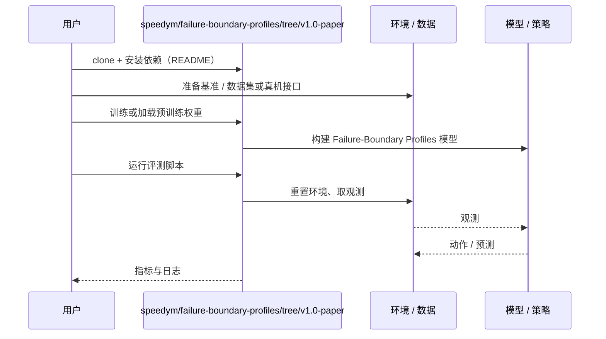

# Failure-Boundary Profiles（arXiv:2611.06453）

**Failure-Boundary Profiles**（*Beyond Infraction Scores: Failure-Boundary Profiles for Closed-Loop Evaluation of Driving and Robot Navigation Agents*，[arXiv:2611.06453](https://arxiv.org/abs/2611.06453)，[代码](https://github.com/speedym/failure-boundary-profiles/tree/v1.0-paper)）来自 [具身智能小站 2026-11-06 盘点](../../sources/blogs/wechat_embodied_station_20_papers_curobov2_fast_halo_humanwam_2026-11-06.md)，属「导航与闭环评测」组。

## 一句话定义

**逐步收窄通道，分别记录策略尝试通过和无碰撞通过的概率。**

## 英文缩写速查

| 缩写 | 英文全称 | 简要说明 |
|------|----------|----------|
| Failure-Boundary Profiles | Beyond Infraction Scores: Failure-Boundary Profiles for Closed-Loop Evaluation of Driving and Robot Navigation Agents | 本文方法 / 基准的简称 |

## 为什么重要

- 遇到窄道，分开测机器人敢不敢走、能不能过。在 CARLA 的堵路场景里，擦碰着挤过去有时比停车得分更高。
- 开源结论：**已开源**（步骤 2.5，2026-11-06）。资源入口 speedym/failure-boundary-profiles（v1.0-paper 标签）经 git ls-remote 可达；无项目页。
- 同期同组工作见 [按路段调速的规划、虚拟房间到真机的人形动作与人类视频缩放：具身智能小站 11-06 期 20 篇阅读坐标](../overview/embodied-station-2026-11-06-20-papers-technology-map.md)。

## 核心机制

| 项 | 内容 |
|----|------|
| **arXiv** | [2611.06453](https://arxiv.org/abs/2611.06453) |
| **开源** | **已开源** |
| **要点** | 逐步收窄通道，分别记录策略尝试通过和无碰撞通过的概率。 |
| **文内指标** | 公众号转述：两条曲线能看清总分掩盖的差别。 |

## 方法与评测协议

- 一个场景族只扫一个实测因子（走廊自由宽度或对向车流时间间隙），每变体由几何测量或间隙证书认证为应通过 / 应停。
- commitment = P(尝试通过)，competence = P(无接触通过)，取 p=0.5 处为边界，区间为 bootstrap；run 间非确定，故多种子合并。
- 决策准确率 = 应通过侧干净通过率与应停侧停车率的平衡准确率，总是停或总是走至多 0.5。

## 源码运行时序图

以下为按仓库入口（`speedym/failure-boundary-profiles/tree/v1.0-paper`）推断的通用运行链路；入库日仅核实仓库可达，未逐文件阅读，具体脚本名以 README 为准。

## 实验与评测

- 公众号转述：两条曲线能看清总分掩盖的差别。
- 论文 Table 2（决策准确率 DA / 均分 DS）：专家 0.74 / 79.8，TFv6 0.60 / 75.5（学习型最高），PlanT 2.0 ckpt1 0.56，TF++ 0.49，HiP-AD 0.44，SimLingo 0.28，BridgeDrive 0.26（DS 71.8 排第四却从不停车）。
- Charger 走廊阻塞宽度均分：擦碰通过的 SimLingo 52.2，全部停车者 37.8 至 40.6；TFv6 的 commitment / competence 边界分别为 2.82 / 2.84 m，BridgeDrive、SimLingo 全宽度都尝试，2.90 m、3.38 m 以上才干净通过。
- 对向车流 29 个等待窗口：专家等 13 次、TFv6 6 次、BridgeDrive 3 次，其余学习型 0 次。
- 仓库机器人 X-Mobility（Isaac Sim）DA 0.34；全模型微调使可通过间隙全部干净通过、DA 升至 0.50，但阻塞间隙停车从 15/15 降为 0/15。
- **读法：** 以上数字出自 arXiv v1 全文（2026-11-06 通读）；平台为 CARLA 与 Isaac Sim 仿真。

## 工程实践

- 评测自家导航或驾驶策略时，对每个场景族固定其余条件、只扫一个量，每个变体至少 3 个种子（论文 CARLA 用 3，Isaac Sim 用 5 次策略采样），把每次 run 当独立抽样。
- 同时报 commitment 与 competence 两条曲线以及 DA；不要只看均分，驾驶分会奖励挤过去的行为。
- 应停变体必须有明确认证（政策下限、间隙证书余量），并包含故意不可通过的变体，防止「处处冲」刷分。
- 复现需自备 CARLA 地图、各智能体检查点与仓库运行器，仓库 v1.0-paper 只含测量认证、场景族与 campaign 记录，模拟输出在 Hugging Face。
- 同一 Isaac Sim 版本、同一 GPU 内比较，不跨版本合并。

## 局限

- 全部结果来自仿真，不能说明真车 / 真机是否出现同样边界。
- 「应停 / 应通过」是声明的约定（政策下限 2.30 m、证书余量 0.5 s），改动后中间排名会换序，两端稳定。
- 汇总 DA 仅基于 3 个含停车侧的族，对比的专家是脚本规划器；等待窗口是规则不是物理不可能，证书只能跑完后给出。
- 若干变体因场景缺陷被排除（0.45 s 间距变体、0.99 m 贩卖机倒下）；机器人从不尝试绕行相邻通道，未评估绕行能力。

## 与其他工作对比

- 横向索引见 [按路段调速的规划、虚拟房间到真机的人形动作与人类视频缩放：具身智能小站 11-06 期 20 篇阅读坐标](../overview/embodied-station-2026-11-06-20-papers-technology-map.md)；同 arXiv 不重复造页。

## 结论

**遇到窄道，分开测机器人敢不敢走、能不能过：两条曲线能看清总分掩盖的差别。**

1. 开源边界：**已开源** — 资源入口 speedym/failure-boundary-profiles（v1.0-paper 标签）经 git ls-remote 可达；无项目页。
2. 核心机制：逐步收窄通道，分别记录策略尝试通过和无碰撞通过的概率。
3. 复现与选型前核对任务协议、硬件与基准口径，勿直接横比公众号摘录数字。

## 关联页面

- [simulation-evaluation-infrastructure](../concepts/simulation-evaluation-infrastructure.md)
- [vision-language-navigation](../tasks/vision-language-navigation.md)
- [manipulation](../tasks/manipulation.md)
- [embodied-station-2026-11-06-20-papers-technology-map](../overview/embodied-station-2026-11-06-20-papers-technology-map.md)
- [具身大模型评测基准选型闭环](../queries/embodied-eval-benchmark-selection-loop.md) — 归其 ③ 策略任务成功率层：用「尝试通过 / 无碰撞通过」两条概率曲线替代单一总分，提示总分会掩盖安全性差异

## 参考来源

- [failure_boundary_profiles_arxiv_2611_06453.md](../../sources/papers/failure_boundary_profiles_arxiv_2611_06453.md)
- [wechat_embodied_station_20_papers_curobov2_fast_halo_humanwam_2026-11-06.md](../../sources/blogs/wechat_embodied_station_20_papers_curobov2_fast_halo_humanwam_2026-11-06.md)
- [arXiv:2611.06453](https://arxiv.org/abs/2611.06453)

## 推荐继续阅读

- [arXiv PDF](https://arxiv.org/pdf/2611.06453)
- [https://github.com/speedym/failure-boundary-profiles/tree/v1.0-paper](https://github.com/speedym/failure-boundary-profiles/tree/v1.0-paper)
