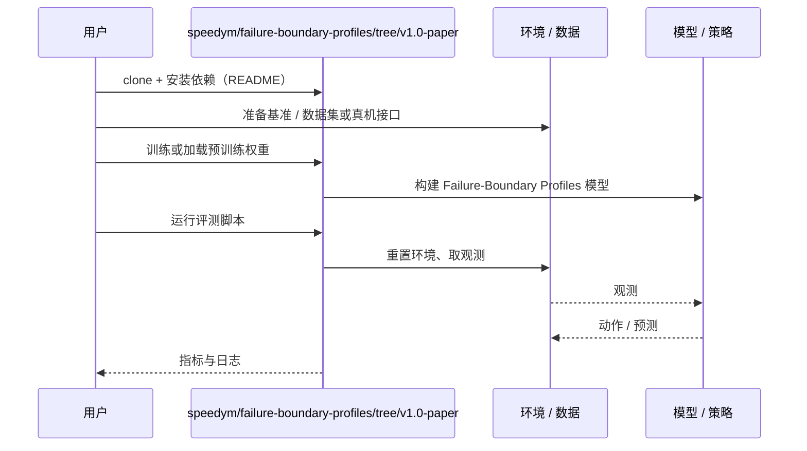

# Failure-Boundary Profiles（arXiv:2611.06453）

**Failure-Boundary Profiles**（*Beyond Infraction Scores: Failure-Boundary Profiles for Closed-Loop Evaluation of Driving and Robot Navigation Agents*，[arXiv:2611.06453](https://arxiv.org/abs/2611.06453)，[代码](https://github.com/speedym/failure-boundary-profiles/tree/v1.0-paper)）来自 [具身智能小站 2026-11-06 盘点](../../sources/blogs/wechat_embodied_station_20_papers_curobov2_fast_halo_humanwam_2026-11-06.md)，属「导航与闭环评测」组。

## 一句话定义

**逐步收窄通道，分别记录策略尝试通过和无碰撞通过的概率。**

## 英文缩写速查

| 缩写 | 英文全称 | 简要说明 |
|------|----------|----------|
| Failure-Boundary Profiles | Beyond Infraction Scores: Failure-Boundary Profiles for Closed-Loop Evaluation of Driving and Robot Navigation Agents | 本文方法 / 基准的简称 |

## 为什么重要

- 遇到窄道，分开测机器人敢不敢走、能不能过。在 CARLA 的堵路场景里，擦碰着挤过去有时比停车得分更高。
- 开源结论：**已开源**（步骤 2.5，2026-11-06）。资源入口 speedym/failure-boundary-profiles（v1.0-paper 标签）经 git ls-remote 可达；无项目页。
- 同期同组工作见 [按路段调速的规划、虚拟房间到真机的人形动作与人类视频缩放：具身智能小站 11-06 期 20 篇阅读坐标](../overview/embodied-station-2026-11-06-20-papers-technology-map.md)。

## 核心机制

| 项 | 内容 |
|----|------|
| **arXiv** | [2611.06453](https://arxiv.org/abs/2611.06453) |
| **开源** | **已开源** |
| **要点** | 逐步收窄通道，分别记录策略尝试通过和无碰撞通过的概率。 |
| **文内指标** | 公众号转述：两条曲线能看清总分掩盖的差别。 |

## 源码运行时序图

以下为按仓库入口（`speedym/failure-boundary-profiles/tree/v1.0-paper`）推断的通用运行链路；入库日仅核实仓库可达，未逐文件阅读，具体脚本名以 README 为准。

## 实验与评测

- 公众号转述：两条曲线能看清总分掩盖的差别。
- **读法：** 本页为索引级摘要，依据公众号转述的官方摘要与仓库信息整理；逐项数字与 baseline 以原文 PDF 为准。

## 与其他工作对比

- 横向索引见 [按路段调速的规划、虚拟房间到真机的人形动作与人类视频缩放：具身智能小站 11-06 期 20 篇阅读坐标](../overview/embodied-station-2026-11-06-20-papers-technology-map.md)；同 arXiv 不重复造页。

## 结论

**遇到窄道，分开测机器人敢不敢走、能不能过：两条曲线能看清总分掩盖的差别。**

1. 开源边界：**已开源** — 资源入口 speedym/failure-boundary-profiles（v1.0-paper 标签）经 git ls-remote 可达；无项目页。
2. 核心机制：逐步收窄通道，分别记录策略尝试通过和无碰撞通过的概率。
3. 复现与选型前核对任务协议、硬件与基准口径，勿直接横比公众号摘录数字。

## 关联页面

- [simulation-evaluation-infrastructure](../concepts/simulation-evaluation-infrastructure.md)
- [vision-language-navigation](../tasks/vision-language-navigation.md)
- [manipulation](../tasks/manipulation.md)
- [embodied-station-2026-11-06-20-papers-technology-map](../overview/embodied-station-2026-11-06-20-papers-technology-map.md)
- [具身大模型评测基准选型闭环](../queries/embodied-eval-benchmark-selection-loop.md) — 归其 ③ 策略任务成功率层：用「尝试通过 / 无碰撞通过」两条概率曲线替代单一总分，提示总分会掩盖安全性差异

## 参考来源

- [failure_boundary_profiles_arxiv_2611_06453.md](../../sources/papers/failure_boundary_profiles_arxiv_2611_06453.md)
- [wechat_embodied_station_20_papers_curobov2_fast_halo_humanwam_2026-11-06.md](../../sources/blogs/wechat_embodied_station_20_papers_curobov2_fast_halo_humanwam_2026-11-06.md)
- [arXiv:2611.06453](https://arxiv.org/abs/2611.06453)

## 推荐继续阅读

- [arXiv PDF](https://arxiv.org/pdf/2611.06453)
- [https://github.com/speedym/failure-boundary-profiles/tree/v1.0-paper](https://github.com/speedym/failure-boundary-profiles/tree/v1.0-paper)
