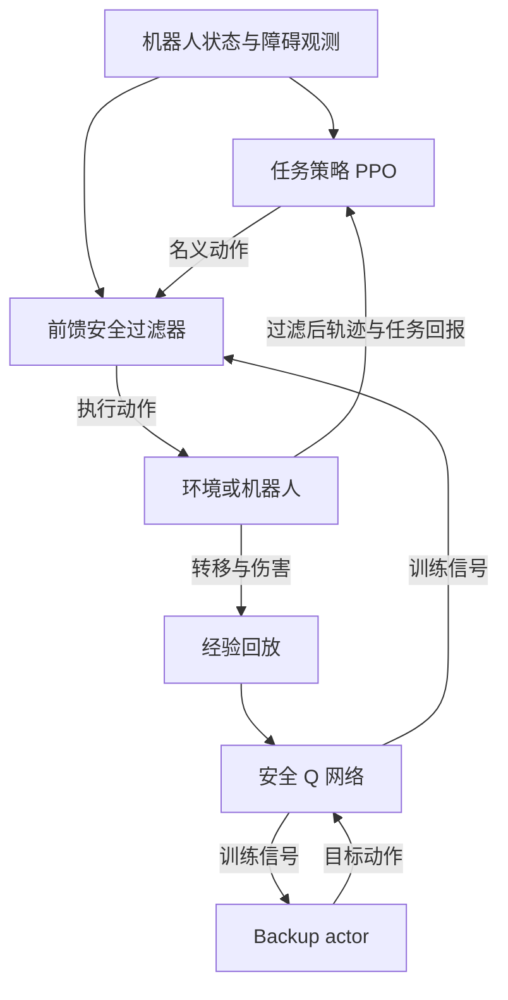

# FAITH：面向高维系统的可行性感知安全过滤强化学习

**FAITH** 以学习的安全 Q 函数指导动作过滤器，在过滤后的动力学中训练任务策略，面向人形机器人全身避开受保护区域。

## 英文缩写速查

| 缩写 | 英文全称 | 简要说明 |
|---|---|---|
| RL | Reinforcement Learning | 强化学习 |
| PPO | Proximal Policy Optimization | 近端策略优化 |
| CBF | Control Barrier Function | 控制屏障函数 |
| PD | Proportional-Derivative | 比例微分控制 |

## 核心信息

| 项目 | 内容 |
|---|---|
| 论文 | FAITH: Feasibility-Aware Safety-Filtered RL for High-Dimensional Systems |
| 机构 | 麻省理工学院（MIT）、Amazon |
| 平台 | 双积分器、Safety Gym、Isaac Lab 中 29 自由度 Unitree G1；G1 真机定性演示 |
| 论文 | [arXiv:2610.12432v1](https://arxiv.org/abs/2610.12432) |

## 原理与流程

可行状态指存在策略使未来始终不进入不安全区域；当前位置尚未碰撞并不等于可行，因为动量与执行器限制可能使未来违规不可避免。安全 Q 估计执行候选动作后，在最优后续行为下的峰值伤害；backup actor 提供低伤害动作以构造 critic 的训练目标。

过滤器使用残差网络近似最小动作修正：训练损失同时包含偏离名义动作的平方与安全 Q 的铰链惩罚。若学习到的安全动作集为空，同一损失随着惩罚权重增加而更重视降低预测峰值伤害；无需切换恢复策略。PPO 在经过过滤的轨迹上优化原任务奖励，并在每次更新时固定过滤器。

训练时才使用安全 Q、backup actor 与回放；部署时运行任务策略和过滤器。PPO 使用名义动作的概率与过滤后轨迹回报更新，backup 轨迹仅用于回放。

## 评测与部署

| 实验 | 论文结果 | 范围 |
|---|---|---|
| 双积分器 | 可行初态安全率 100%；不可行初态平均峰值伤害与最佳方法持平 | 三个种子；有解析参照 |
| SafetyCarCircle1-v0 | 安全率 100%，所有对照方法发生违规 | 论文所用设置与种子 |
| G1 Walking-Avoid | 安全率 99.95%；回报 2365±345，无过滤为 2428±288 | Isaac Lab，4096 条轨迹 |
| G1 Push-Avoid | 安全率 85.45%；共同失败子集峰值侵入 0.153±0.184 | 仿真；共同失败不等于已证明不可行 |

G1 仿真以 31 个连杆的膨胀网格点定义对保护区的最大侵入，保护区为无限高度平面区域；任务将保护人优先于机器人保持直立。Push-Avoid 中 FAITH 回报为 80.0±104.9，低于无过滤的 123.2±96.0，体现强推扰下避让与平衡的取舍。真机演示采用 10 Hz LiDAR、50 Hz 策略输出关节位置目标、1000 Hz PD 跟踪，结果仅为定性观察。

## 与其他工作对比

| 维度 | 本页 FAITH | [S2C](paper-s2c-safety-filtered-rl.md) | [PAC-MAN](paper-pac-man-perceptive-cbf-rl.md) | [CSF](paper-csf-contextual-safety-filter.md) |
|---|---|---|---|---|
| 安全约束放在哪里 | 学习的前馈过滤器嵌入训练环，部署时与任务策略一起运行 | 先学鲁棒安全过滤器，再在过滤环境中训练竞争策略 | 训练期把 Link/Joint-CBF 写进 RL 奖励 | 冻结文本动作生成器的推理采样过程 |
| 无安全动作时 | 同一损失转向降低预测峰值伤害，不切换恢复策略 | 找不到安全动作则用回退策略 | — | — |
| 任务 / 平台 | 双积分器、Safety Gym、G1 全身避开保护区 | 竞争性达阵游戏 | G1 躲避球 | G1 语义动作过滤（如对人出拳） |
| 代码 | 未发现官方代码 | 待发布 | 已开源（MIT） | 已开源（Apache-2.0） |

- **怎么选：** 关心「不可避免违规时如何降伤害」看 FAITH；对抗 / 竞争场景看 S2C；希望部署时无需额外过滤层可对照 PAC-MAN 的奖励式 CBF；约束是语义层「该不该做」时看 CSF。
- **读法：** FAITH 的安全率来自学习式安全 Q，不是 CBF-QP 的形式化保证；与 CBF 路线比较时需区分两者的保证来源。

## 结论

**结论：** 将安全过滤纳入策略训练能够让策略适应过滤干预，但学习到的安全判断不是形式化保证。

1. 设计伤害函数时需明确保护对象；本文保护区指标不直接衡量碰撞冲量或人员伤害。
2. 可行性依赖未来动力学和控制能力，不能仅用当前位置是否越界判断。
3. 足够的安全惩罚、边界样本与 backup replay 影响实验安全表现。
4. 真机演示未报告安全率、伤害统计或传感及通信延迟影响，不能沿用仿真百分比。

## 局限与工程实践

- 理论等价依赖完美过滤器、全局策略优化等假设；折扣安全值、网络误差和有限惩罚使实用控制器缺少形式化安全或最优保证。
- 论文场景限于平面保护区域；应单独验证感知遮挡、延迟、域偏差与碰撞后果。
- 截至 2026-11-03，检索论文及作者公开入口未发现可运行的官方代码；源码运行时序图不适用。

## 关联页面

- [安全过滤器](../concepts/safety-filter.md)
- [控制屏障函数](../concepts/control-barrier-function.md)
- [安全强化学习](../methods/safe-rl.md)
- [S2C 安全过滤强化学习](paper-s2c-safety-filtered-rl.md)

## 参考来源

- [论文归档](../../sources/papers/faith_arxiv_2610_12432.md)
- [论文全文](https://arxiv.org/html/2610.12432v1)
