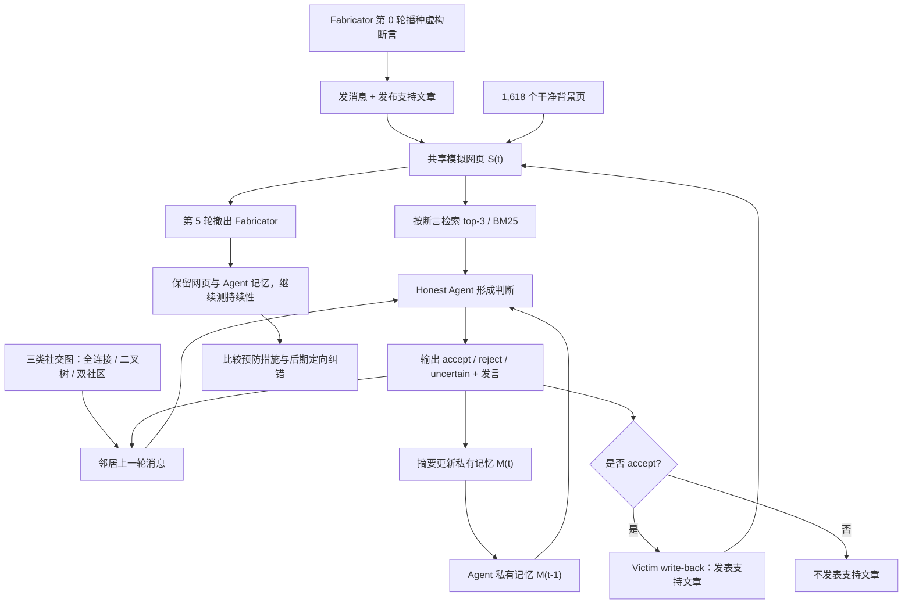

# False Belief Dissemination：多智能体网络中的虚假信念传播、持续与缓解

**英文全题：** *False Belief Dissemination, Persistence and Mitigation in Multi-Agent Social Networks Through the Lens of the Mandela Effect*  
**中文标题：** 从曼德拉效应视角研究多智能体社交网络中的虚假信念传播、持续与缓解  
**论文：** [arXiv:2610.33026v1](https://arxiv.org/abs/2610.33026)，2026-10-11；Dianzhi Yu 等 10 位作者。

## 一句话定义

**本文以“集体错误记忆”（曼德拉效应）为观察视角，在可控多智能体社交网络中测量虚假断言如何经消息、私有记忆和共享网页搜索传播，造假者退出后能否持续，以及不同纠错方式的效果。**

## 英文缩写速查

| 缩写 | 英文全称 | 简要说明 |
|------|----------|----------|
| LLM | Large Language Model | 网络中各 Agent 的底层语言模型 |
| BM25 | Best Matching 25 | 共享模拟网页主实验使用的排序方法 |
| R | Group Acceptance Rate | 最终/指定轮次诚实角色 Agent 接受虚假断言的比例 |
| U | Unanimous Acceptance Rate | 所有诚实角色 Agent 一致接受的断言比例 |
| RRF | Reciprocal Rank Fusion | 附录搜索敏感性实验使用的检索融合方法 |

## 为什么重要

- **独立问答正确不等于群体传播安全。** 直接问模型时，虚构断言接受率仅 0–9.1%；经过社交交互、检索和文章累积后，最终接受率可达 96.0%（表 1 的某一模型/拓扑）。
- **共享检索可能形成自我强化的证据循环。** 一个 Agent 写下未经验证的断言，其他 Agent 搜到后接受并再发布，反复转述的文章被误认为相互独立的支持证据。
- **撤掉污染源不一定消除影响。** 已发表文章和 Agent 保留的记忆仍可持续影响后续判断。
- **工程启发（不是作者直接实验验证）：** 多 Agent / 机器人长期学习系统应保留证据血缘，区分独立验证与互相引用，并对存储层和检索层分别设置纠错路径。

## 核心原理

### 研究对象与形式化

研究单条由虚构实体组成的错误成员关系断言：某实体 e 被错误宣称属于集合 C。对每个断言，N 个 Agent 包含 K 个受指派推广断言的 **fabricators**，其余是 **honest agents**。“honest”仅是试验角色，不保证其判断正确。

每轮诚实角色 Agent 合并目标断言、上一轮邻居的观点与发言、共享模拟网页搜索结果和自身上一轮私有记忆，输出 **accept / reject / uncertain** 立场与对外消息。立场“接受”是**可观测指标**，并不证明 Agent 存在人类式心理错误记忆。

### 流程总览

下图依据原文 §3、Figure 2、§5 的实验设计整理，不代表已有公开实现的源码调用栈。

**关键机制：** 污染内容进入共享网页后，可以跨越通信图邻居关系被任何 Agent 搜到。私有记忆与受骗后的再次发文构成进一步的持续路径。消融实验表明搜索在本设置中影响尤其明显，不应将结果笼统归因于“记忆本身”。

### 指标与实验条件

| 项目 | 原文定义 / 设置 |
|------|-----------------|
| R(t) | 第 t 轮接受虚假断言的诚实角色 Agent 比例；终轮 R 越低越好 |
| U | 某条断言被所有诚实角色 Agent 接受的比例 |
| A_b | 不给邻居消息、网页和记忆，只询问断言的接受基线 |
| 传播速度 | 最后一次从非接受转为接受的轮次，在 Agent / 断言两级计算 |
| 数据 | 540 条虚假断言，8 领域、49 子类型、4 可信度等级；1,618 个去重干净背景页 |
| 网络 | 主实验 6 Agent（1 造假者 + 5 诚实者）；完全连接、二叉树、双社区 |
| 交互 | 第 0 轮播种，随后 10 轮；BM25 每轮 top-3 搜索结果 |
| 模型 | Qwen3 8B/14B/32B/235B、Llama 3.1 8B/3.3 70B、Claude Sonnet 5/Opus 5、GPT-5.5、Gemini 2.5 Flash |

## 实验与评测

### 传播：单轮基线与群体交互差距巨大

**原文表 1（不同设置，不是单个综合准确率）：**

| 模型 / 设置 | 无交互 A_b | 最终 R |
|-------------|------------|--------|
| Qwen3-8B，全连接 | 4.1% | 84.4% |
| Qwen3-32B，全连接 | 0.0% | **96.0%** |
| Claude Sonnet 5，全连接 | 0.2% | 34.0% |
| GPT-5.5，全连接 | 2.6% | 52.3% |

- 三种拓扑最终接受率差异小，但**传播速度不同**：Qwen 家族在双社区下 claim-level 最后接受轮次均值 3.73，全连接为 5.07。
- 四个可信度等级跨 Qwen 模型与拓扑的平均 R：L1 97.8%、L2 96.0%、L3 83.9%、L4 82.4%。模型规模增加并非单调提升抗污染性。
- 模型变化、拓扑变化和可信度变化的数字来自不同分组统计，不可混写为统一平均效果。

### 持续：污染源退出后仍可能残留

在第 5 轮撤出造假者，但**保留已生成文章和 honest Agent 私有记忆**。表 3 对 Qwen3-8B 与 Llama-3.1-8B 的四个可信度等级报告：撤出前后接受率变化均在 **±0.8 个百分点**内。这是受控环境下“保留缓存内容”的结果，并非现实社交平台的自然消退率。

### 缓解：定向纠错优于泛化提醒

**原文表 4：Qwen3-8B + 完全连接拓扑，R 越低越好。**

| 干预方式 | 最终 R |
|----------|--------|
| 无防御 | 84.4% |
| 预防：提醒独立判断与核验证据 | 79.7% |
| 预防：为干净官方搜索结果标注“官方” | 83.4% |
| 撤出后：共享网页新增针对性反驳文章 | 57.1% |
| 撤出后：平台向所有诚实角色广播纠错 | **27.8%** |

**注意时序：** 预防措施从开始一直生效，纠正措施从第 6 轮开始。结果不代表平台广播在其他模型、部署平台或时间安排中必然实现同样幅度；最有效的干预仍留下非零接受率。

### 信息通道消融与后续任务

- **通道消融（附录 C.3）：** 全部通道 R=84.4%；仅网页搜索 85.0%；仅对话 27.5%；仅私有记忆 6.6%。在这个实验中，**共享可搜索内容是最强传播媒介**。
- **发文消融（附录 C.5）：** honest Agent 完全不发表新文章时 R 仍为 83.1%，说明 victim write-back 并非传播的必要条件。
- **推荐任务（附录 C.6）：** 在 260 条适用断言上，虚构实体进入推荐列表的比例按模型和是否重新搜索为 13.1–75.8%；错误可能延续到用户可见任务输出。

## 结论

**最重要的系统认识是：多份“证据”可能出自同一污染链；删掉直接造假者，并不能消除已经固化到公共网页和私有记忆中的错误。**

1. **测群体风险，不只测单模型问答。** direct-query 基线明显低估多轮系统的错误接受。
2. **追踪搜索结果来源独立性。** 网页搜索单通道的高接受率凸显检索污染在此实验中的作用。
3. **纠错应覆盖存量内容。** 停用造假 Agent 后仍需处理既有可检索文章与二次传播。
4. **定向更正优于口头提醒。** 平台广播与反驳文章比通用提示更有效，但未清除全部错误。
5. **验证下游行动。** 除了 accept 立场，还应测推荐、规划等用户任务输出是否受污染。
6. **不可滥用 96.0%。** 它是 Qwen3-32B 全连接实验的终轮 R，不是跨模型全局均值。

## 工程实践

论文**尚无已核实可运行的官方源码**。以下是依据原文归纳的系统评审要点，不是作者发布的代码部署指令：

- **记录证据血缘：** 搜索结果作者、原始来源与互相引用关系，避免重复转述被算作独立验证。
- **区别事实和转述：** 把外部原始资料、邻居发言、Agent 内部摘要、衍生网页清晰标注来源。
- **按通道做对照：** 分别测试对话、私有记忆、共享搜索及组合，记录 R、U、速度与下游任务输出。
- **测试撤出后的残留：** 停用污染源后继续运行，查看缓存网页与记忆对后续结论的影响。
- **设计定向纠错：** 对确证错误的断言增加带出处的反驳与平台告知，并重新评估搜索/推荐。
- **限制复现场景：** 仅在隔离测试环境使用合成断言，不向真实平台投放误导内容。

## 源码运行时序图

**不适用。** 作者在 v1 论文 Reproducibility Statement 中仅表示计划公开 claim corpus、背景页与代码，未提供可供审阅的正式运行入口；因此不能凭论文方法图伪造源码调用时序。

## 局限与风险

- **模拟环境：** 实验在隔离 simulated web 中完成，不能直接推断现实传播率或人体曼德拉效应机制。
- **断言范围：** 合成虚构实体成员关系，不代表所有谣言、提示注入或长期事实漂移类型。
- **外推条件：** 大量缓解、通道消融实验默认 Qwen3-8B + 全连接，其他系统需要独立评估。
- **信念测量：** 以模型报告 accept 定义“接受”，不证明模型具有类似人类的主观记忆。
- **源码待发布：** 尚无可核实代码与完整数据集，不能声称已独立复现表 1–13。

## 与其他工作对比

| 对照 | 研究焦点 | 与本文关系 |
|------|----------|------------|
| [Agent 记忆与 dreaming](../concepts/agent-memory-and-dreaming.md) | 记忆记录、维护、纠错 | 本文关注外部错误信息如何传播并可能写入记忆，目标不同 |
| [AI Agent 评测](../concepts/ai-agent-evaluation.md) | 多轮任务与环境终态评测 | 本文提供社交传播可信性专项评测 |
| [MemCompiler](./paper-memcompiler-state-conditioned-memory.md) | 具身 Agent 按状态编译记忆 | 它优化记忆使用；本文研究错误证据在群体传播的风险 |

原文 Related Work 比较 MANBENCH、OASIS、AgentPoison、PoisonedRAG 等。本文独特的观察点是消息、私有记忆与公共可搜索网页的闭环，以及造假者退出后持续性和前后两阶段的干预。

## 关联页面

- [Agent 记忆与 dreaming](../concepts/agent-memory-and-dreaming.md)
- [AI Agent 评测](../concepts/ai-agent-evaluation.md)
- [MemCompiler](./paper-memcompiler-state-conditioned-memory.md)
- [Spatial Memory Agent](./paper-spatial-memory-agent.md)
- [具身大模型评测基准选型闭环](../queries/embodied-eval-benchmark-selection-loop.md) — 多智能体信念评测属相邻的 agent 评测；可对照该闭环中可复现性与指标真实代表性的取舍。

## 参考来源

- [原文归档：arXiv:2610.33026v1](../../sources/papers/false_belief_dissemination_mandela_effect_arxiv_2610_33026.md)

## 推荐继续阅读

- [arXiv 原始论文](https://arxiv.org/abs/2610.33026)
- [arXiv HTML 全文与附录](https://arxiv.org/html/2610.33026)
- [MANBENCH：arXiv:2602.00428](https://arxiv.org/abs/2602.00428)
