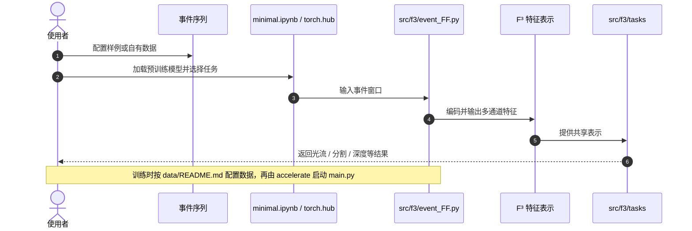

# Fast Feature Field (F³)：面向机器人感知的事件预测表示

**Fast Feature Field (F³)**（Richeek Das、Kostas Daniilidis、Pratik Chaudhari，宾夕法尼亚大学 GRASP Laboratory；*Science Robotics*, Vol. 11, Issue 119, 2026-10-14，[DOI:10.1126/scirobotics.aec8218](https://doi.org/10.1126/scirobotics.aec8218)；预印本 [arXiv:2509.25146](https://arxiv.org/abs/2509.25146)）从过去事件学习可预测未来事件的通用特征表示，并将同一表示用于多种机器人视觉任务；官方代码已公开。

## 一句话定义

**F³ 把过去一段时空窗口中的异步事件压成保留场景结构与运动信息的特征图，使同一表示支持未来事件预测及多种下游感知任务。**

## 英文缩写速查

| 缩写 | 英文全称 | 简要说明 |
|------|----------|----------|
| F³ | Fast Feature Field | 从过去事件构造、用于预测未来事件的表示 |
| DVS | Dynamic Vision Sensor | 以亮度变化异步输出事件的视觉传感器 |
| HD | High Definition | 项目页报告的高分辨率事件数据设置 |
| VGA | Video Graphics Array | 项目页报告的低分辨率事件数据设置 |
| AOTI | Ahead-Of-Time Inductor | 仓库提供的 PyTorch 2 导出部署路径 |

## 为什么重要

- **表示与任务解耦：** F³ 输出多通道特征图，可供常见视觉网络使用；下游任务不必都从原始事件重新设计编码。
- **利用事件稀疏性：** 多分辨率哈希编码结合 Deep Sets 式排列不变处理，面向异步、稀疏事件集合。
- **覆盖多种机器人感知：** 同一表示用于光流、分割、立体匹配和单目度量深度，项目展示汽车、四足及飞行平台数据。
- **具有开源复现入口：** 官方仓库含预训练推理、训练、任务实现和 AOTI 导出，可从 notebook 快速入门。

## 核心原理（方法栈）

F³ 以时间窗口内的事件集合为输入。模型根据过去事件预测未来事件，并学习可供下游任务复用的特征场。项目页将输出表示为多通道图像；模型利用事件稀疏性，并对输入事件的排列保持不变。

### 表示与任务分离

- **表示学习：** 以未来事件预测为学习目标，保留可用于推断场景结构和运动的特征。
- **下游适配：** F³ 特征供任务专用网络使用；仓库提供光流、分割、深度与匹配相关实现。
- **频率解读：** 表示计算速度与完整任务速度是不同指标，项目页分别给出 HD 120 Hz / VGA 440 Hz 与 HD 下游约 25–75 Hz。

## 源码运行时序图

仓库提供 minimal.ipynb、hubconf.py、src/f3/event_FF.py、src/f3/tasks/ 与 _aoti_pt2/；训练入口为 main.py。

可先运行 minimal.ipynb 或用 torch.hub 加载预训练模型；训练数据准备见仓库 data/README.md，部署导出见 _aoti_pt2/README.md。

## 实验与评测

| 维度 | 项目页报告 |
|------|------------|
| 表示计算速度 | HD 120 Hz；VGA 440 Hz |
| 下游任务速度 | HD 约 25–75 Hz |
| 任务 | 监督语义分割、无监督光流、无监督立体匹配、监督单目度量深度 |
| 平台 | 汽车、四足机器人、飞行平台 |
| 变化条件 | 昼夜、室内外、城市与非铺装环境，不同事件率与传感器分辨率 |
| 相对结果 | 多项任务达到先进性能；项目页报告 HD 推理约比此前事件方法快 2–5 倍 |

具体指标和实验设置应以期刊论文正文及补充材料为准；表示编码速度不能当作完整任务或控制回路频率。

## 与其他工作对比

| 维度 | F³ | 单任务事件视觉方法 |
|------|-----|--------------------|
| 学习目标 | 从过去事件预测未来事件并构造共享表示 | 通常围绕单项任务设计表示 |
| 输出接口 | 可作为标准视觉网络的多通道输入 | 依方法而异，可能与任务模型绑定 |
| 任务覆盖 | 一个表示用于四类感知任务 | 常见为单任务专用实现 |
| 选型侧重 | 多任务复用、跨任务表示研究 | 单一任务和明确的指标优化 |

此处对比的是表示设计定位，不意味着 F³ 在每项任务上都优于专用算法；实际选择需按数据、延迟预算与任务指标评测。

## 结论

**F³ 的核心价值是形成可复用的预测性事件特征；速度应按表示层和下游任务分别解读。**

1. 复用起点是事件特征图，它可接入常见视觉网络，降低多任务共享表示的接入成本。
2. HD 120 Hz / VGA 440 Hz 是表示计算速度，HD 下游任务约 25–75 Hz；不能混为端到端频率。
3. 光流、分割、立体匹配、单目深度覆盖运动、语义与几何任务，但任务头仍需单独训练和评价。
4. 汽车、四足与飞行平台展示了跨平台潜力；新事件传感器仍要检查分辨率、事件率、时间窗和噪声分布。
5. 仓库提供预训练、训练和 AOTI 部署路径；复现时需记录数据版本、事件窗口与任务头配置。

## 工程实践

- **快速试跑：** 从 minimal.ipynb 开始；也可通过 torch.hub 加载预训练 F³。
- **训练复现：** 按 data/README.md 准备 M3ED、DSEC 或 MVSEC，再调用 main.py 与相应配置。
- **任务适配：** 对照 src/f3/tasks/ 中各任务 README，分清表示模型与任务头。
- **边缘部署：** _aoti_pt2/ 提供 PyTorch 2 AOTI 导出与 C++ 推理路径；README 中 Orin VGA 的任务头速度仍标为 TBD。
- **测量方法：** 分开测预处理、事件编码、任务头及传输时延，注明分辨率、事件批次和事件率。

## 局限与风险

- 需要事件数据；只有 RGB 相机的系统需增加事件传感器或另行建立数据转换路径。
- 项目页报告跨平台结果，但新传感器和新环境仍需验证事件率、噪声和时间窗变化。
- 共享表示不代表各任务无需单独配置或评测；监督与无监督任务的训练要求不同。
- 仓库提供可运行代码，但复现实验仍需准备对应数据集；部署设备上需重新测量端到端延迟。
- 项目页和 README 的吞吐量是特定设置下的报告值，不构成所有硬件的性能保证。

## 关联页面

- [AMI-EV：微扫视启发的事件相机系统](./paper-microsaccade-inspired-event-camera.md) — 从传感器层增强事件，与表示学习互补
- [SSLA-Det：低延迟事件目标检测](./paper-sa-2603-06228-low-latency-event-based-object-detection-with.md) — 事件检测的任务专用方法
- [机器人感知栈选型分析](../queries/robot-perception-stack-selection-loop.md) — 传感器与感知模型的系统选型

## 参考来源

- [Science Robotics 论文归档](../../sources/papers/fast_feature_field_f3_scirobotics_2026.md)
- [官方项目页核查](../../sources/sites/fast-feature-field-f3.md)
- [官方代码仓库导航](../../sources/repos/fast-feature-fields.md)
- [Science Robotics DOI 页面](https://doi.org/10.1126/scirobotics.aec8218)
- [arXiv 预印本](https://arxiv.org/abs/2509.25146)

## 推荐继续阅读

- [F³ 项目页（架构与跨平台演示）](https://www.seas.upenn.edu/~richeek/f3/)
- [官方仓库 Quickstart](https://github.com/grasp-lyrl/fast-feature-fields#quickstart)
- [arXiv 论文全文](https://arxiv.org/abs/2509.25146)
