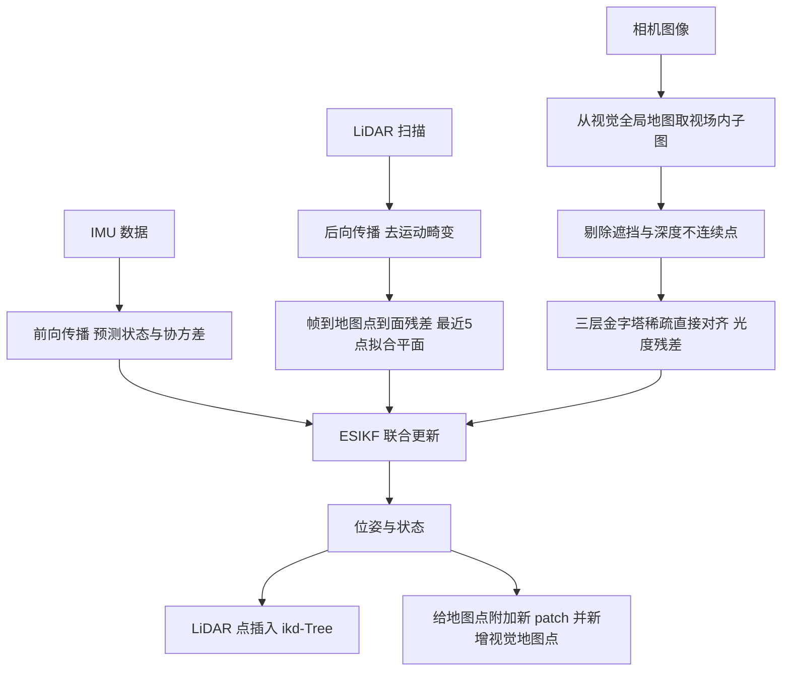

# FAST-LIVO（arXiv:2203.00893）

**FAST-LIVO**（*FAST-LIVO: Fast and Tightly-coupled Sparse-Direct LiDAR-Inertial-Visual Odometry*，[arXiv:2203.00893](https://arxiv.org/abs/2203.00893)）来自香港大学机械工程系 Fu Zhang 组（MARS 实验室）。本页只讲 **FAST-LIVO 一代**；后续版本见本库 [FAST-LIVO2 节点](./paper-rcl-2408-14035-fast-livo2-fast-direct-lidar-inertial-visual-odo.md)，二者为不同论文，勿混。

## 一句话定义

**在 FAST-LIO2 的直接法激光惯性里程计之上，再挂一个稀疏直接法视觉惯性子系统：视觉直接把 LiDAR 地图点投到图像上对齐 patch，不提取视觉特征，两路测量在同一个误差状态迭代卡尔曼滤波里联合更新。**（论文摘要、贡献 1–2）

## 英文缩写速查

| 缩写 | 英文全称 | 简要说明 |
|------|----------|----------|
| LIVO | LiDAR-Inertial-Visual Odometry | 激光-惯性-视觉里程计 |
| LIO | LiDAR-Inertial Odometry | 激光-惯性里程计，本文取自 FAST-LIO2 |
| VIO | Visual-Inertial Odometry | 视觉-惯性里程计，本文为稀疏直接法 |
| ESIKF | Error-State Iterated Kalman Filter | 误差状态迭代卡尔曼滤波，等价于高斯-牛顿 MAP（IV-E） |
| ikd-Tree | incremental k-d tree | 增量 k-d 树，存 LiDAR 全局地图 |
| IMU | Inertial Measurement Unit | 惯性测量单元 |
| RMSE | Root Mean Square Error | 均方根误差，Table II 的指标 |
| FoV | Field of View | 视场 |

## 为什么重要

- 作者要解决的问题（I）：此前 R2LIVE、LVI-SAM 等 LIVO 的 LIO 与 VIO 只在状态向量层面合并、各自处理数据，缺少测量层面耦合，且算力占用大。FAST-LIVO 的设计目标是在更低计算量下得到同等或更好的精度。
- 对本库激光 SLAM 线：它是 [FAST-LIO](./fast-lio.md) 系的「加相机」一支，与 [LVI-SAM](./paper-lvi-sam.md)（因子图平滑）形成滤波式 vs 优化式的对照。
- 综述文章《激光雷达 SLAM 算法最新综述》对它的说法与论文的核对见下文「局限与未验证之处」。

## 核心机制

流程总览（III、IV、V，均为论文自述）：

1. **状态**（IV-B）：SO(3)×R^15，18 维，含姿态、位置、速度、两个零偏、重力。假设传感器时间偏移已知、外参已标定，三者刚性连接。
2. **到达即更新**（IV-C）：不要求 LiDAR 与图像同时到达，任一到达都做一次更新；只有 LiDAR 时令视觉项为空，只有图像时令 LiDAR 项为空（IV-E 式 7）。
3. **LiDAR 项**（IV-D.1）：沿用 FAST-LIO2 的原始点配准与 ikd-Tree，不提特征。
4. **视觉项**（IV-D.2）：从视觉地图取视场内点，选观测角最接近当前帧的历史 patch 作参考，三层由粗到细最小化光度误差。深度来自 LiDAR 点本身，因此省去视觉特征提取、三角化、深度滤波与滑窗后端（II-A、II-B）。
5. **视觉地图**（V-B）：体素哈希组织；每点挂多帧 8×8 patch 金字塔与对应位姿；用 40×40 网格取最低深度点、用最近 LiDAR 点做 9×9 邻域遮挡检查，剔除遮挡与深度不连续点；新增点选网格内梯度最大且非高曲率边缘的点。

## 实验与结果（作者报告）

| 项 | 内容 | 出处 |
|----|------|------|
| 公开数据 | NTU-VIRAL 全部 9 条序列（eee / nya / sbs 各 3 条），OS1 16 线 LiDAR + 左相机 + 内置 IMU | VI-A |
| 对比方法 | FAST-LIO2、SVO2.0、R2LIVE、去回环的 DVL-SLAM；各方法全序列同一参数；SVO2.0 参数经作者调优 | VI-A |
| RMSE 结果 | FAST-LIVO 8/9 序列最低（0.17~0.29 m）；sbs_01 为 0.29，FAST-LIO2 为 0.25 | Table II |
| 失败情形 | SVO2.0 在 eee_01、eee_02、sbs_02、sbs_03 失败 | VI-A |
| LiDAR 退化 | 约 30 m 长墙，FAST-LIVO 端到端漂移 0.05 m，最优 | VI-B.2 |
| 视觉挑战 | 室内外切换、两次剧烈运动、无纹理白墙，79.52 m 路程端到端误差 0.04 m | VI-B.3 |
| 耗时 | Intel i7 桌面机总 36.75 ms（VIO 10.23 + LIO 26.52）；RB5 ARM 上 VIO 13.82 + LIO 51.51 ms；R2LIVE 为 45.16 + 59.27 ms | VI-C，Table III |

## 工程实践

- 代码：[hku-mars/FAST-LIVO](https://github.com/hku-mars/FAST-LIVO)（README 称依赖 ROS、PCL、Eigen、OpenCV、Sophus，Ubuntu 16.04~20.04；本次仅读 README 前部，未核后续章节与源码）。
- 数据采集硬件（VI-B.1）：LiDAR 与相机用 STM32 定时器产生 10 Hz 触发信号硬同步。论文假设时间偏移已知，所以实际复现要先解决硬同步 / 标定，这是使用前提而非可选项（据 IV-B 假设，工程含义为本页判断）。
- 支持多线旋转与固态 LiDAR（摘要）；论文实验中私有数据用 Livox Avia，公开数据用 OS1 16 线。
- 延伸：本库 [LiDAR SLAM 选型对比](../comparisons/lidar-slam-lio-vio-selection.md) 可对照其他 LIO / VIO 路线。

## 局限与未验证之处

**论文自己承认的：**

- 快速运动导致图像严重模糊时，融合视觉没有帮助：sbs_01 上略差于 FAST-LIO2（VI-A）。
- 直接法依赖较好的状态初始化（II-A 对直接法的总述，本文方法沿用该思路）。
- 假设时间偏移已知、外参预标定（IV-B）。

**我读到但论文没做的（未验证，本页判断）：**

- 只有里程计，无回环与全局优化；NTU-VIRAL 评测也只比较无回环的系统，且 DVL-SLAM 被作者去掉回环模块后对比（VI-A）。
- 公开数据只有 NTU-VIRAL 一个、一种 LiDAR（OS1 16 线）；固态 LiDAR 的支持在摘要中声明，量化结果仅来自私有数据，无同口径对比。
- 没有单独的「关掉视觉」「关掉遮挡剔除」类消融表；outlier rejection 的收益只有 Fig. 3 的可视化，没有数字（本次所读 v1 中未见）。
- 光照剧变没有被单独设计成实验：VI-B.3 只包含室内外切换场景，未给光照强度或曝光变化的量化。
- 耗时对比里 R2LIVE 与 FAST-LIVO 同在私有数据上比，但机器在正文写作 8 核 Intel Core i7-10700U，数据采集机载电脑却是 i7-8550U（VI-B.1 与 VI-C），两处不同；ARM 平台 Table III 无 R2LIVE 对照。
- 「计算余量」是作者的话；以 10 Hz 传感器计，ARM 上 LIO+VIO 之和约 65 ms，小于 100 ms 帧间隔，是本页由 Table III 与 VI-B.1 的 10 Hz 触发推算，论文并未这样写。

**与综述文章《激光雷达 SLAM 算法最新综述》的逐句核对：**

| 文章说法 | 核对 |
|----------|------|
| 在 FAST-LIO2 的 LIO 基础上加 VIO 子系统，测量层面耦合 | 成立（II-A、贡献 2） |
| 激光雷达退化场景下可靠 | 有直接实验：长墙场景漂移 0.05 m（VI-B.2） |
| 光线变化剧烈场景下可靠 | 论文无专门的光照剧变实验，最接近的是 VI-B.3 的室内外切换，且未量化光照；说法比论文证据强 |
| 剧烈运动场景融合模糊图像无帮助 | 论文只在 sbs_01 一条序列上这样解释（0.29 vs 0.25 m），且在 VI-B.3 的两次剧烈运动中系统能完成轨迹；「剧烈运动无帮助」是对单条序列的推广 |
| 低速运动更能体现优势 | 论文原文没有这句话，也没有按速度分层的实验，属于文章的推断 |
| 在 Intel 和 ARM 上实时运行并有显著计算余量 | 成立，出自 VI-C 与 Table III；ARM 为 Qualcomm RB5 |
| （文章未提）发表信息 | arXiv v1 无会议名；README 称 IROS 2022 |

## 关联页面

- [FAST-LIO](./fast-lio.md)：本文 LIO 子系统的来源（FAST-LIO2 直接法，另见 FAST-LIO）。
- [FAST-LIVO2 节点](./paper-rcl-2408-14035-fast-livo2-fast-direct-lidar-inertial-visual-odo.md)：后续独立论文。
- [LVI-SAM](./paper-lvi-sam.md)：论文列为对比对象的因子图式 LIVO 路线。
- [LIO-SAM](./lio-sam.md)、[LeGO-LOAM](./lego-loam.md)、[Cartographer](./cartographer.md)、[Point-LIO](./point-lio-unilidar.md)：同一领域的其他 SLAM 节点。
- [传感器融合](../concepts/sensor-fusion.md)、[状态估计](../concepts/state-estimation.md)、[LiDAR 感知](../concepts/lidar-sensing.md)。
- [LiDAR SLAM 选型对比](../comparisons/lidar-slam-lio-vio-selection.md)。

## 参考来源

- [fast-livo_arxiv_2203_00893.md](../../sources/papers/fast-livo_arxiv_2203_00893.md)
- [arXiv:2203.00893](https://arxiv.org/abs/2203.00893)
- [GitHub hku-mars/FAST-LIVO](https://github.com/hku-mars/FAST-LIVO)

## 推荐继续阅读

- [FAST-LIO](./fast-lio.md) 与 FAST-LIO2 论文：理解本文 LIO 部分。
- [FAST-LIVO2 节点](./paper-rcl-2408-14035-fast-livo2-fast-direct-lidar-inertial-visual-odo.md)：看后续版本相对一代的改动。
- [arXiv PDF](https://arxiv.org/pdf/2203.00893v1)
