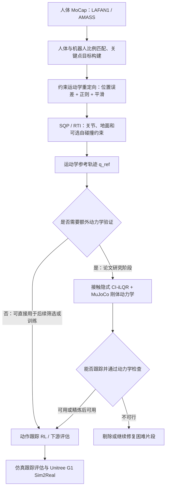
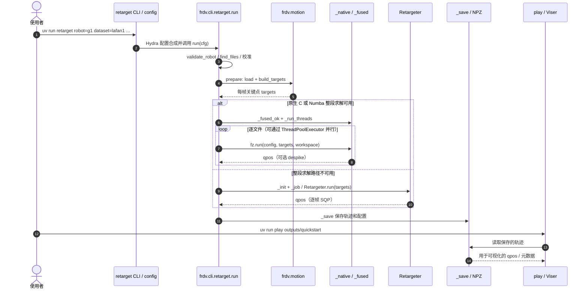

# FRDV：给动作重定向加一道物理体检 / Fast Motion Retargeting Pipeline for Scalable Humanoid Robot Learning

## 一句话定义

**FRDV（Fast Retargeting with Dynamics Validation）**将人体 MoCap 转成人形机器人关节参考动作：先以约束逆运动学高速对齐身体，再在论文提出的**可选**动力学验证阶段，通过接触隐式 iLQR 测试可执行性、识别并修正部分悬脚／滑脚伪影。**截至 2026-11-12，官方仓库只发布了运动学阶段。**

## 英文缩写速查

| 缩写 | 英文全称 | 简要说明 |
|---|---|---|
| FRDV | Fast Retargeting with Dynamics Validation | 快速重定向与动力学验证框架 |
| MoCap | Motion Capture | 人体动作捕捉输入 |
| IK | Inverse Kinematics | 依据目标关键点求机器人关节配置 |
| SQP | Sequential Quadratic Programming | 带约束运动学重定向的逐次二次规划 |
| RTI | Real-Time Iteration | 后续帧以上帧结果热启动、每帧少量优化步 |
| QP | Quadratic Programming | SQP 内部求解的二次规划子问题 |
| CI-iLQR | Contact-Implicit Iterative Linear Quadratic Regulator | 论文中通过完整动力学测试与修正动作的优化控制 |
| RL | Reinforcement Learning | 将参考动作交给下游跟踪策略训练 |

## 为什么重要

人体轨迹在人体比例和关节空间中合理，并不代表机器人具有足够的关节活动范围、接触条件和驱动力矩执行它。单纯逐帧 IK 可能产生穿地、碰撞、脚悬空或脚滑。FRDV 将**大规模高吞吐的运动学转换**与**选择性、昂贵的动力学可行性验证**分层，便于先生成参考库、再筛选或改进困难动作。

## 核心原理

### 论文方法（FRDV 1.0，arXiv:2610.28470v1）

1. **目标构建：** 从人体运动提取关键点，按目标机器人身体比例缩放；对各机器人 site 的位置跟踪误差加权。
2. **约束运动学优化：** 跟踪目标与姿态正则、相邻帧平滑联合成目标；施加关节角限制、脚和胶囊碰地约束，以及可选自碰撞约束。浮动基座的旋转通过流形上的增量更新。
3. **快速逐帧求解：** 自定义 Gauss–Newton SQP 将局部问题转成 QP，用上帧解热启动；冷启动前若干帧增加迭代，随后采用 RTI。**论文 1.0 的 QP 实现使用 OSQP**。
4. **并行批处理：** 1.0 将长动作分段并行，在拼接边界上可选修正；不修正通常吞吐更高，但可能带来边界伪影。
5. **动力学验证（论文中的可选第二阶段）：** 以运动学结果为参考，在 MuJoCo 完整刚体动力学下，使用 CI-iLQR 与接触隐式动力学约束检查跟踪、接触和执行可行性；对部分异常参考作进一步精炼。不可把它等同于仅检测关节限位的 IK 校验。

### 流程总览



**图的边界：** 动力学验证及策略训练属于论文的研究流程，**不在公开的 2.0 重定向 CLI 中**；公开代码的实线运行路径只到运动学参考轨迹保存和浏览器回放。

### 与 FRDV 2.0 的区别

公开的 **FRDV 2.0** 不再沿用旧版 `pixi run retarget` 和 `src/mocap_retargeting/*` 路径。当前 `pyproject.toml` 版本为 `2.0.0`，入口是 `frdv.cli.retarget:main`；默认多动作文件走**逐文件并行**（`mode=files`），不是默认把单个文件拆成时间块。优先使用 `frdv._native` 原生 C 整段求解器，失败时回退 Numba／NumPy 路径。显式 `mode=chunks` 才走 `ParallelRetargeter` 的边界 handoff 修复。

2.0 的 `src/frdv/qp.py` 使用 **Goldfarb–Idnani 双主动集 QP**，带热启动；这是与论文 1.0 的 OSQP **不同的软件版本**，不能把两者描述成相同的求解器配置。

## 工程实践

官方 2.0 README 的可复现命令（这里列的是**官方命令，未在当前环境执行**）：

```bash
# 在 DARoSLab/FRDV 仓库根目录
uv sync --locked --extra fast --extra cli --extra vis

# 对官方附带的 LAFAN1 样本前 300 帧重定向至 G1
uv run retarget robot=g1 dataset=lafan1 data=assets/mocap/sample/walk3_subject5.bvh end=300 out=outputs/quickstart

# 用 Viser 浏览已保存结果
uv run play outputs/quickstart
```

- **输入：** LAFAN1 BVH；AMASS 需单独获取 SMPL+H 模型并配置路径。官方目前附带 G1、LAFAN1、AMASS presets。
- **输出：** `<out>/<clip>.npz` 中包含 `qpos`、`fps`、跟踪目标和机器人元数据，另存 `frdv_config.yaml`。G1 示例 `qpos` 为根位置 3 + 四元数 4 + 29 个关节角（36 维）。
- **参数：** `workers=8` 使用多工作线程处理多个动作；`mode=chunks` 才切单条动作；`scaling=manual` 可以使用保存的身体缩放 profile；`solver` 控制正则、平滑及约束。
- **检查：** 使用 `uv run check` 预览映射与误差；检查足底接触、穿地、自碰撞、关节跳变、帧率、参考跟踪误差和输出四元数连续性。运动学检查**不是**动力学可行性证明。

## 源码运行时序图

以下依据**现有 2.0 源码** `pyproject.toml`、`src/frdv/cli/retarget.py`、`src/frdv/motion/*`、`src/frdv/_native.py`、`src/frdv/retarget.py` 与 `src/frdv/parallel.py`；图中不虚构未开放的 CI-iLQR 实现。



显式 `mode=chunks` 是额外分支：`ParallelRetargeter.run` 分段求解，`handoff` 从真实前驱状态重算接缝，**不是**混合两段关节角；默认 `mode=auto` 多文件优先文件级并行。

## 实验与评测

| 来源与版本 | 设定 | 公开报告 | 应如何解读 |
|---|---|---|---|
| 论文 FRDV 1.0 | LAFAN1，20 workers，不做边界修正 | **9,156 FPS** | 运动学重定向吞吐，不包含 CI-iLQR 验证 |
| 官方 2.0 基准（2026-11-08） | Apple M1 8 核 / 8 GiB；LAFAN1 **77 段、496,672 帧**；8 个 file workers | **503,288.6 FPS**，热运行处理 0.987 s | 处理吞吐包含加载、目标生成、重定向及启用的清理；**排除保存、共享初始化和编译** |
| 同一官方 2.0 基准 | 同上，8 workers | 热运行处理+保存 **1.079 s**；首次完整 **3.750 s** | 编译与缓存是否已就绪会改变端到端耗时 |
| 同一官方 2.0 基准 | LAFAN1，1 worker | **105,126.8 FPS**（热运行处理） | 不同并行规模的报告值，非单帧时延 |
| 论文 CI-iLQR 个案 | Dance1-S1 前 26 秒 | 平均全局位置误差 **103.12→86.58 mm**；平均 anchor-relative 误差 **29.26→30.57 mm** | 修正不保证每一指标都变好，不代表所有动作都能被修正 |

以上为作者测量及论文报告，**本站未独立复现**；不能将 2.0 的 503k FPS 用作动力学闭环“物理体检”速度，也不应只凭吞吐在不同约束与质量设置的算法之间下结论。

## 结论

**FRDV 的核心工程价值是把批量几何重定向与昂贵的物理可行性验证解耦；目前公开代码仅覆盖前者。**

1. **数据入库：** 先用 2.0 的整段 C 求解器处理 MoCap 动作库，再单独评估 IK 约束、接触与真实可跟踪性。
2. **性能报告：** 标出版本、机器、worker、是否预热、是否保存，避免把“aggregate FPS”写成单帧控制频率。
3. **对比公平性：** 把论文 1.0 的 chunk 并行和 2.0 默认的 file 并行区分开；OSQP 与主动集 QP 属于不同版本。
4. **应用边界：** 不应把“保存成功 .npz”当成满足关节力矩、接触稳定性的证明；需要进一步仿真或真机安全验证。
5. **复现安排：** 公开仓库可直接重定向 LAFAN1→G1；论文的 CI-iLQR 动力学验证模块仍无法按官方源码直接复现。

## 与其他工作对比

| 对照对象 | 核心区别 |
|---|---|
| [GMR](../methods/motion-retargeting-gmr.md) | 同属 IK 重定向范式；FRDV 优化重点是约束求解吞吐和论文中的可选动力学验证 |
| [DynaRetarget](../entities/paper-notebook-dynaretarget-dynamically-feasible-retargeting-us.md) | 侧重动态可行轨迹优化，公开代码覆盖的子阶段与 FRDV 不同 |
| [重定向与跟踪关系总览](../overview/retargeting-vs-general-tracking-speedup-2026-11.md) | 将 FRDV 放在执行反馈与物理修正的技术路径上 |

## 局限与风险

- **部分开源（核对日期 2026-11-12）：** MIT 许可下发布的 2.0 是运动学流水线；**论文 CI-iLQR 动力学验证、训练与真机验证管线没有包含在该仓库内**。
- **运动学约束不等于动力学可行：** 接触切换、摩擦、驱动力矩和摔倒风险仍需后续检查。
- **高吞吐有测量前提：** 2.0 官方数字使用 Apple M1 8 workers 预热后整库统计；不能作为不同机器、单帧在线延迟或物理闭环性能的承诺。
- **数据与机器人许可独立：** LAFAN1、AMASS、SMPL+H、机器人模型需分别遵守原许可；AMASS 模型需从官方渠道获取。
- **软件更新：** 本页明确区分 arXiv v1 方法与 2.0 仓库当前实现；后续求解器、配置和开源范围可能变化。

## 关联页面

- [Motion Retargeting](../concepts/motion-retargeting.md)
- [Motion Retargeting Pipeline](../concepts/motion-retargeting-pipeline.md)
- [重定向与通用跟踪加速的关系](../overview/retargeting-vs-general-tracking-speedup-2026-11.md)
- [Humanoid Locomotion](../tasks/humanoid-locomotion.md)
- [Reinforcement Learning](../methods/reinforcement-learning.md)

## 参考来源

- [论文全文归档：arXiv:2610.28470v1](../../sources/papers/fast-motion-retargeting-pipeline-humanoid_arxiv_2610_28470.md)
- [FRDV 官方项目页归档](../../sources/sites/frdv-project.md)
- [DARoSLab/FRDV 2.0 源码归档](../../sources/repos/frdv.md)
- [论文 PDF（原始研究）](https://arxiv.org/pdf/2610.28470)
- [官方 2.0 基准原表](https://github.com/DARoSLab/FRDV/blob/main/benchmarks/benchmark_nov_8_2026.md)

## 推荐继续阅读

- [FRDV 项目主页及演示](https://daroslab.github.io/frdv/)
- [FRDV 2.0 README 和源码](https://github.com/DARoSLab/FRDV)
- [官方 Python API、scaling 和 AMASS 文档](https://github.com/DARoSLab/FRDV/tree/main/docs)
