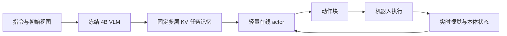
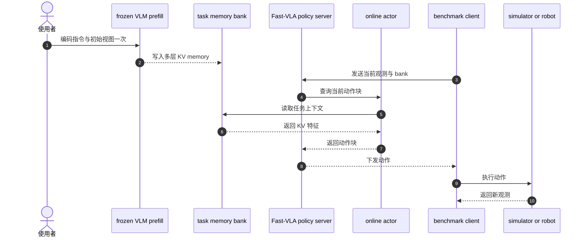

# Fast-VLA：每个操作回合只思考一次

## 一句话定义

**Fast-VLA 将慢速任务理解放在 episode 开始时运行一次，之后由轻量 actor 用当前观测查询固定 KV 任务记忆并持续输出动作块。**

## 英文缩写速查

| 缩写 | 英文全称 | 简要说明 |
|------|----------|----------|
| VLA | Vision-Language-Action | 视觉、语言到动作策略 |
| VLM | Vision-Language Model | 编码语言指令与视觉上下文的模型 |
| KV | Key-Value Cache | Transformer 注意力的键值缓存 |
| LIBERO | Lifelong Robot Learning Benchmark | 长时程操作仿真基准 |

## 为什么重要

不少 VLA 在每次预测动作块时都重新运行大模型，重复计算变化较慢的任务上下文。Fast-VLA 把初始指令和画面编码成固定任务记忆，保留闭环 actor 对新视觉和本体状态的响应，减少每步推理成本。

## 核心原理

1. 冻结的 4B VLM 在 episode 开始时读取指令和初始视角，生成多层 KV task memory。
2. actor 接收当前头部/腕部图像与本体状态，并组合时间、手臂索引查询。
3. actor cross-attend 固定 task memory，输出下一段动作；执行后继续用新观测预测，不重新调用 VLM。
4. 记忆只在 episode 初始化，不随回合内场景变化刷新；效果依赖初始信息是否充分。

## 源码运行时序图

仓库包含 first-frame cache 构建、policy server、训练代码及评测客户端：

## 实验与评测

- RoboTwin 2.0 Clean/Randomized 成功率 92.46%/92.40%，摘要均值 92.43%；同硬件摊销推理为 1.437 ms/step，在线常驻内存 1.22 GiB。
- LIBERO/LIBERO-Plus 成功率为 95.95%/79.11%，摊销推理为 3.975 ms/step。
- 相同硬件和计量口径下，相对所选连续条件化基线推理时间降低 10.9–17.1 倍；初次 VLM prefill 的时间和峰值内存仍须计入 episode 总成本。

## 工程实践与局限

- 官方仓库含训练代码、first-frame cache builder、policy server、RoboTwin/LIBERO 客户端和两个 checkpoint。
- 固定任务记忆减少重算，但场景中途出现新目标、遮挡变化或任务阶段切换时，策略可能缺少刷新机制。
- 在线常驻内存不等于初始化峰值；项目页分别报告 prefill 时间和峰值内存，系统选型需同时看两者。

## 与其他工作对比

| 工作 | 大模型调用频率 | 任务上下文来源 | 与 Fast-VLA 的差异 |
|------|----------------|----------------|--------------------|
| 连续条件化 VLA（论文基线） | 每个动作块 | 每次重新编码当前观测与指令 | 论文报告同硬件下 Fast-VLA 推理时间降低 10.9–17.1 倍 |
| [REKI](./paper-reki-vla-register-memory.md) | 每帧 | VLM 表征写入 register 缓存 | REKI 保留回合内变化的近期记忆；Fast-VLA 记忆固定在初始帧 |
| [DSWAM](./paper-dswam-dual-system-wam.md) | 可选 System 2 VLM 拆分子任务 | System 1 执行器直出动作块 | 同为快慢分离，DSWAM 以子任务拆分衔接两系统；Fast-VLA 只在回合开始调用一次 VLM |
| [VaM](./paper-vam-value-as-memory.md) | 价值模型异步逐步 | 价值历史作为进度记忆 | VaM 跟踪任务进度；Fast-VLA 不显式表示进度 |

Fast-VLA 的取舍是用“记忆不刷新”换低摊销延迟；在场景中途变化或多阶段任务上，应与带刷新机制的记忆方案同协议对比成功率，而不只比较 ms/step。

## 结论

**Fast-VLA 用“每回合一次大模型 + 每步轻量 actor”拆开慢变任务语义和快变控制反馈，在多个基准上报告较低摊销延迟。**

1. 延迟对比统一计入 episode 初始化成本和 action chunk 执行比例。
2. 检查初始视图是否足以建立任务记忆，以及回合中是否需要记忆刷新。
3. 区分在线常驻内存和 VLM prefill 峰值显存/内存。
4. 在长时程任务上同时测量任务成功率、扰动泛化和记忆失配影响。

## 关联页面

- [VLA 方法](../methods/vla.md)
- [Transformer](../concepts/transformer.md)
- [LIBERO-PeRM 个性化基准](./paper-libero-perm-personalized-manipulation.md)

## 参考来源

- [Fast-VLA 论文归档](../../sources/papers/fast_vla_arxiv_2610_21389.md)
- [项目页与资源](../../sources/sites/fast-vla.md)
- [官方代码仓库](../../sources/repos/fast-vla.md)

## 推荐继续阅读

- [Fast-VLA 项目页](https://garfield-kh.github.io/FastVLA/)
- [Fast-VLA 代码与模型](https://github.com/Garfield-kh/FastVLA)
