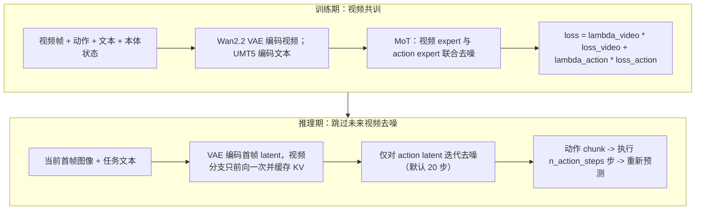
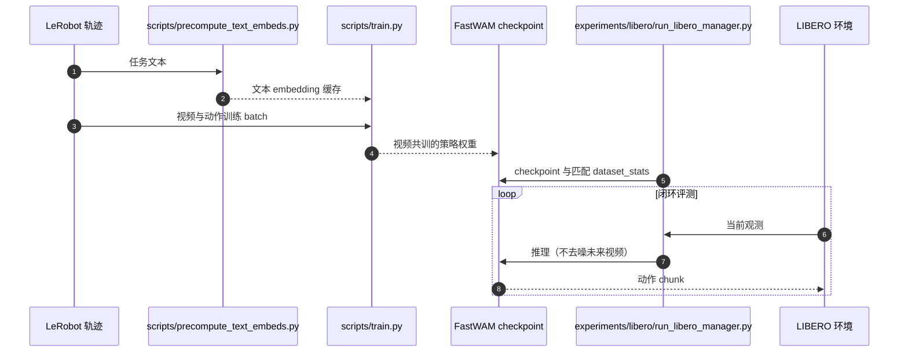
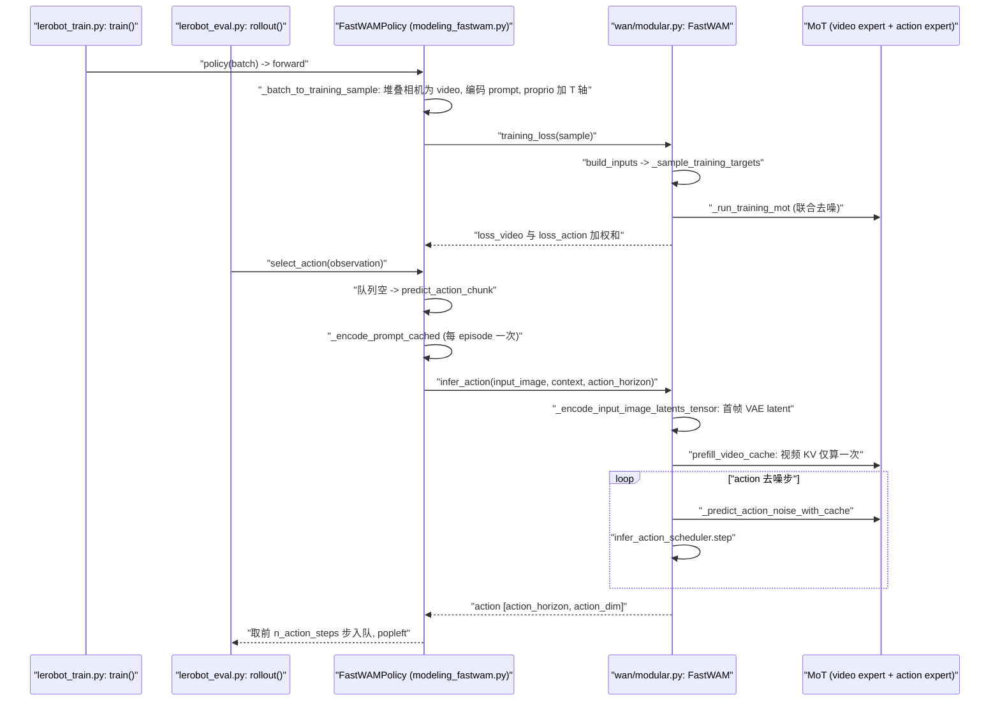

# Fast-WAM（arXiv:2603.16666）

**Fast-WAM**（*Fast-WAM: Do World Action Models Need Test-time Future Imagination?*，[arXiv:2603.16666](https://arxiv.org/abs/2603.16666)，[项目页](https://yuantianyuan01.github.io/FastWAM/)，[代码](https://github.com/yuantianyuan01/FastWAM)）来自 [机器人研发工程师 · 前沿算法盘点](../../sources/blogs/wechat_robot_engineer_embodied_frontier_algorithms_2026-09-23.md)。

## 一句话定义

**训练期保留视频共训、推理期跳过未来视频去噪，190 ms 延迟（>4× 快于 imagine-then-execute WAM）；LIBERO 97.6% / RoboTwin 91.8%。**

## 英文缩写速查

| 缩写 | 英文全称 | 简要说明 |
|------|----------|----------|
| Fast-WAM | Fast World Action Model | 本文低延迟 WAM |
| WAM | World Action Model | 世界–动作联合模型 |
| DiT | Diffusion Transformer | 扩散 Transformer |
| LIBERO | Lifelong Robot Learning Benchmark | 操作基准 |

## 为什么重要

- WAM 测试时迭代视频生成是延迟主因；需分离「训练表征收益」与「推理想象必要性」。
- 开源结论：**已开源**（步骤 2.5，2026-09-23）。
- 与 [具身前沿算法技术地图](../overview/embodied-frontier-algorithms-technology-map.md) 同路线条目可横向对照。

## 流程总览

图依据：论文摘要（训练保留视频共训、测试跳过未来预测），LeRobot `wan/modular.py` 的 `FastWAM.training_loss` / `infer_action`。

## 核心机制

| 项 | 内容 |
|----|------|
| **arXiv** | [2603.16666](https://arxiv.org/abs/2603.16666) |
| **开源** | **已开源** |
| **要点** | Wan2.2-TI2V 视频骨干 + Action DiT；推理只过一遍 clean latent 直接出动作 chunk。 |
| **文内指标** | 仿真与真机折毛巾等；无具身预训练仍 competitive（作者报告）。 |

## 源码运行时序图

图下说明：复现以 [`sources/repos/fast_wam.md`](../../sources/repos/fast_wam.md) 与官方 README 为准。

### LeRobot 移植的运行时序（固定提交 `9e5ee98`）

来源：`src/lerobot/policies/fastwam/modeling_fastwam.py` 与 `wan/modular.py`。

## LeRobot 实现

- **身份核对**：arXiv 2603.16666 标题 *Fast-WAM: Do World Action Models Need Test-time Future Imagination?*，作者 Tianyuan Yuan、Zibin Dong、Yicheng Liu、Hang Zhao，2026-03-17（arXiv API 核对），与本页一致；摘要明确 190 ms 延迟、比 imagine-then-execute WAM 快 4 倍以上。
- **配置**：`policy.type=fastwam`；视觉骨干默认 `Wan-AI/Wan2.2-TI2V-5B`；默认单图 `observation.images.image`，形状 `(3, 224, 448)`，多相机宽度需拼成 448；`action_horizon` 与 `n_action_steps`（须 <= horizon）分开配置（文档）。
- **预处理注意**：官方 LIBERO 检查点用 `VISUAL: IDENTITY`，图像在模型内部缩放到 [-1, 1]，再做图像归一化会重复归一化（文档）。
- **注意力**：全部使用 PyTorch SDPA，不用 FlashAttention，因为 MoT 路由需要任意布尔掩码（文档）；可选 `compile_action_infer` 编译动作推理图。
- **LIBERO 夹爪**：`toggle_action_dimensions=[-1]`（`processor_fastwam.py: FastWAMActionToggleProcessorStep`）。
- **相对动作**：`use_relative_actions=true` 时预测相对当前 `observation.state` 的偏移，夹爪默认保持绝对。
- **文本编码器**：冻结 UMT5-XXL 约 11 GB，可 `text_encoder_device=cpu`；推理时任务嵌入缓存到 `reset()`。
- **LeRobot 文档结果**：`lerobot/fastwam_libero_uncond_2cam224` 在 LIBERO 四套件各 500 episode：spatial 97.6%、object 99.0%、goal 95.0%、libero_10 94.0%，平均 96.4%（文档）。**不一致提示**：本页顶部引用的 `LIBERO 97.6%` 来自公众号二手摘录（作者表述，未核实），LeRobot 文档中的 97.6% 对应的是 `libero_spatial` 单套件，平均为 96.4%，两者口径不同，勿混用。
- **代码中的相邻工作**：`modeling_fastwam.py` 注释提到可选的 Faster-WAM（arXiv 2608.02365）选项（`lite_kv_fusion`、`retracted_1d_rope`，默认关闭）；库内节点见 [Faster-WAM](./paper-rcl-2608-02365-faster-wam-do-world-action-models-need-deep-acti.md)，本页不展开。

## 实验与评测

- 仿真与真机折毛巾等；无具身预训练仍 competitive（作者报告）。
- **读法：** 索引级摘要；逐项 baseline 以原文 PDF 为准。

## 与其他工作对比

| 维度 | Fast-WAM（本文） | imagine-then-execute 式 WAM | [MemoryWAM](./paper-memorywam.md) / [TempoWAM](./paper-tempowam.md) |
|------|-------------------|------------------------------|---------------------------------------------------------------------|
| 推理时是否生成未来视频 | **否**，只过一遍 clean latent 直出动作 chunk | 是，先去噪出未来帧再解动作 | 是（各自在记忆/时序维度上扩展） |
| 训练时是否用视频 | **是**，保留视频共训 | 是 | 是 |
| 报告延迟 | **190 ms**（作者报告，>4× 快于 imagine-then-execute） | 受去噪步数支配 | 未在本页口径下对齐 |
| 主张 | 未来想象的收益可在 **训练期** 吃掉，推理期不必再付 | 想象是能力来源 | 想象 + 记忆/时序结构 |

- **这是「把代价挪到训练期」，不是砍能力：** 视频共训仍在，被去掉的只是 **test-time 的未来去噪**；因此复现时若连训练期视频一起省掉，结论不成立。
- **数值口径：** LIBERO 97.6% / RoboTwin 91.8%（作者报告）属 [评测闭环](../queries/embodied-eval-benchmark-selection-loop.md) 的 ③ 仿真策略成功率层，**跨基准不可直接比榜**，也不蕴含真机成功率。
- **与同族页的读法：** [MemoryWAM](./paper-memorywam.md)、[TempoWAM](./paper-tempowam.md)、[DreamZero](./paper-notebook-dreamzero-world-action-models-are-zero-shot-poli.md) 与本文同属 [World-Action Models](../concepts/world-action-models.md) 谱系，但各自动的是不同旋钮（记忆 / 时序 / 零样本 / 延迟），**不是同一条曲线上的强弱关系**。

## 结论

**Fast-WAM 证明 WAM 价值可在训练期视频建模中兑现，推理不必每步想象；TempoWAM/MemoryWAM 是互补层。**

1. 开源边界：**已开源** — 以项目页/仓库实际链接为准（入库日 2026-09-23）。
2. 核心机制：Wan2.2-TI2V 视频骨干 + Action DiT；推理只过一遍 clean latent 直接出动作 chunk。…
3. 部署前核对硬件栈与评测协议，勿直接横比公众号摘录数字。

## 关联页面

- [DiffWAM](./paper-diffwam.md) — 首帧几何条件下直接读出 UAV 相机轨迹；FastDreamer 区分模型推理与异步飞行交接。

- [world-action-models](../concepts/world-action-models.md)
- [paper-memorywam](./paper-memorywam.md)
- [paper-tempowam](./paper-tempowam.md)
- [paper-notebook-dreamzero-world-action-models-are-zero-shot-poli](./paper-notebook-dreamzero-world-action-models-are-zero-shot-poli.md)

## 参考来源

- [`sources/repos/lerobot.md`](../../sources/repos/lerobot.md) — LeRobot 固定提交上的 `fastwam` 移植与文档
- [fast-wam_arxiv_2603_16666.md](../../sources/papers/fast-wam_arxiv_2603_16666.md)
- [wechat_robot_engineer_embodied_frontier_algorithms_2026-09-23.md](../../sources/blogs/wechat_robot_engineer_embodied_frontier_algorithms_2026-09-23.md)
- [arXiv:2603.16666](https://arxiv.org/abs/2603.16666)

## 推荐继续阅读

- [arXiv PDF](https://arxiv.org/pdf/2603.16666)
- [项目页](https://yuantianyuan01.github.io/FastWAM/)
- [代码](https://github.com/yuantianyuan01/FastWAM)
