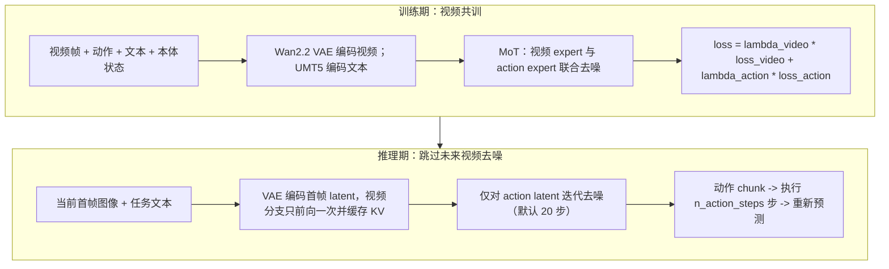
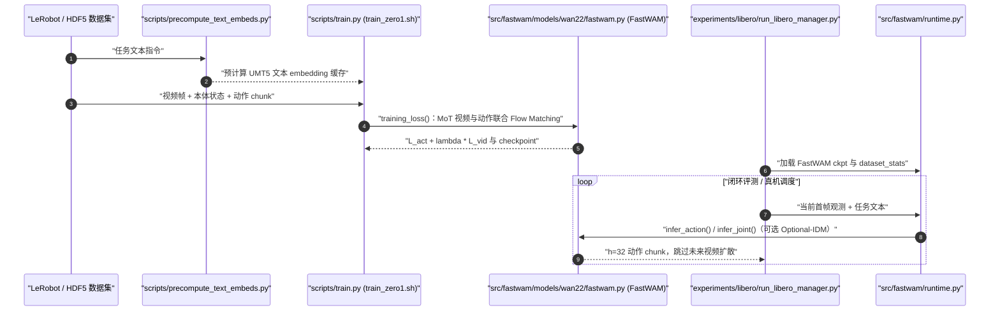
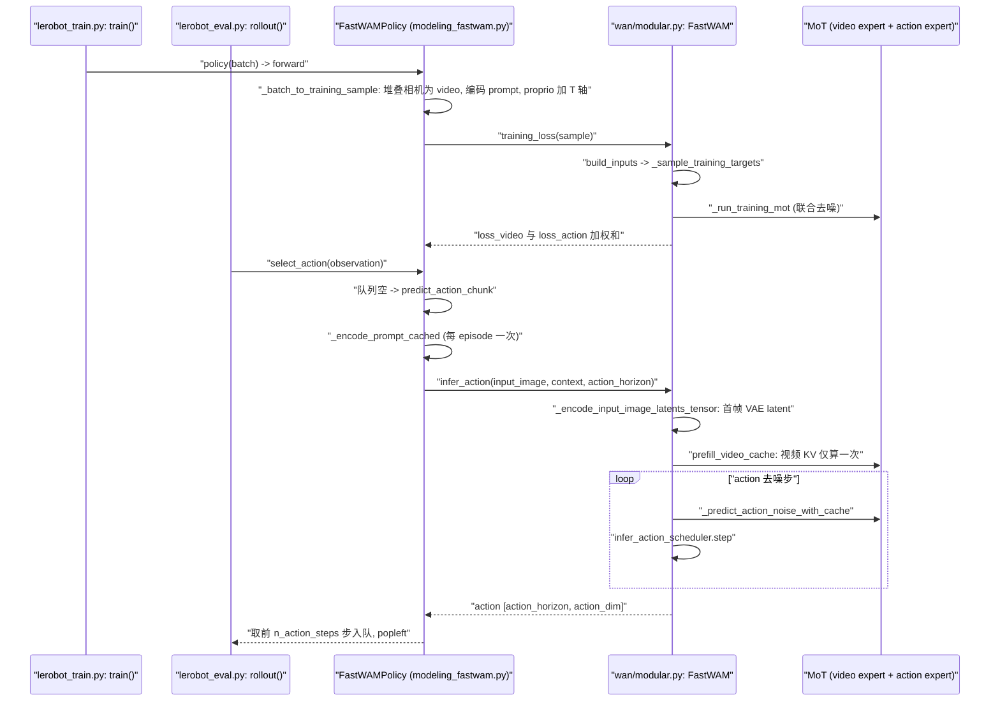

# Fast-WAM（arXiv:2603.16666）

**Fast-WAM**（*Fast-WAM: Do World Action Models Need Test-time Future Imagination?*，[arXiv:2603.16666](https://arxiv.org/abs/2603.16666)，[项目页](https://yuantianyuan01.github.io/FastWAM/)，[代码](https://github.com/yuantianyuan01/FastWAM)）来自 [机器人研发工程师 · 前沿算法盘点](../../sources/blogs/wechat_robot_engineer_embodied_frontier_algorithms_2026-09-23.md)。

## 一句话定义

**训练期保留视频共训、推理期跳过未来视频去噪，190 ms 延迟（>4× 快于 imagine-then-execute WAM）；LIBERO 97.6% / RoboTwin 91.8%。**

## 英文缩写速查

| 缩写 | 英文全称 | 简要说明 |
|------|----------|----------|
| Fast-WAM | Fast World Action Model | 本文低延迟 WAM |
| WAM | World Action Model | 世界–动作联合模型 |
| DiT | Diffusion Transformer | 扩散 Transformer |
| LIBERO | Lifelong Robot Learning Benchmark | 操作基准 |

## 为什么重要

- WAM 测试时迭代视频生成是延迟主因；需分离「训练表征收益」与「推理想象必要性」。
- 开源结论：**已开源**（步骤 2.5，2026-09-23）。
- 与 [具身前沿算法技术地图](../overview/embodied-frontier-algorithms-technology-map.md) 同路线条目可横向对照。

## 流程总览

图依据：论文摘要（训练保留视频共训、测试跳过未来预测），LeRobot `wan/modular.py` 的 `FastWAM.training_loss` / `infer_action`。

## 核心机制

| 项 | 内容 |
|----|------|
| **arXiv / 代码** | [2603.16666v2](https://arxiv.org/abs/2603.16666) · [`yuantianyuan01/FastWAM`](https://github.com/yuantianyuan01/FastWAM)（**已开源**） |
| **骨干与参数** | Wan2.2-TI2V-5B 视频 DiT + 1B Action Expert（`d_a=1024`，总约 6B），采用 Mixture-of-Transformers (MoT) 共享全注意与结构化因果/非因果掩码 |
| **训练与推理解耦** | **训练期**保留联合 Flow Matching（$\mathcal{L}=\mathcal{L}_{\text{act}}+\lambda \mathcal{L}_{\text{vid}}$）强迫中间层隐状态保留时空动态表征，且禁止动作 token 注意未来视频 token；**测试期**仅编码首帧 clean latent 缓存视频 KV，直接对 `h=32` 动作 chunk 执行 10 步去噪（CFG=1.0），延迟 **190 ms**（RTX 5090D V2，vs Fast-WAM-IDM 810 ms） |

## 源码运行时序图

入口：`scripts/precompute_text_embeds.py` → `scripts/train.py`（或 `bash scripts/train_zero1.sh`）训练 `src/fastwam/models/wan22/fastwam.py`（`FastWAM`），评估调用 `experiments/libero/run_libero_manager.py` 或 `src/fastwam/runtime.py`。

> 图依据：[`yuantianyuan01/FastWAM@7faa711`](https://github.com/yuantianyuan01/FastWAM) `README.md`、`scripts/precompute_text_embeds.py`、`scripts/train.py`、`scripts/train_zero1.sh`、`experiments/libero/run_libero_manager.py`、`src/fastwam/runtime.py`、`src/fastwam/models/wan22/fastwam.py`。

### LeRobot 移植的运行时序（固定提交 `9e5ee98`）

来源：`src/lerobot/policies/fastwam/modeling_fastwam.py` 与 `wan/modular.py`。

## LeRobot 实现

- **身份核对**：arXiv 2603.16666 标题 *Fast-WAM: Do World Action Models Need Test-time Future Imagination?*，作者 Tianyuan Yuan、Zibin Dong、Yicheng Liu、Hang Zhao，2026-03-17（arXiv API 核对），与本页一致；摘要明确 190 ms 延迟、比 imagine-then-execute WAM 快 4 倍以上。
- **配置**：`policy.type=fastwam`；视觉骨干默认 `Wan-AI/Wan2.2-TI2V-5B`；默认单图 `observation.images.image`，形状 `(3, 224, 448)`，多相机宽度需拼成 448；`action_horizon` 与 `n_action_steps`（须 <= horizon）分开配置（文档）。
- **预处理注意**：官方 LIBERO 检查点用 `VISUAL: IDENTITY`，图像在模型内部缩放到 [-1, 1]，再做图像归一化会重复归一化（文档）。
- **注意力**：全部使用 PyTorch SDPA，不用 FlashAttention，因为 MoT 路由需要任意布尔掩码（文档）；可选 `compile_action_infer` 编译动作推理图。
- **LIBERO 夹爪**：`toggle_action_dimensions=[-1]`（`processor_fastwam.py: FastWAMActionToggleProcessorStep`）。
- **相对动作**：`use_relative_actions=true` 时预测相对当前 `observation.state` 的偏移，夹爪默认保持绝对。
- **文本编码器**：冻结 UMT5-XXL 约 11 GB，可 `text_encoder_device=cpu`；推理时任务嵌入缓存到 `reset()`。
- **数据与官方口径对齐**：`arXiv:2603.16666` Table 2 报告 Fast-WAM 在 LIBERO 四套件分别为 Spatial **98.2%**、Object **100.0%**、Goal **97.0%**、Long **95.2%**，四套件均值正是 **97.6%**（非公众号虚构数字）；上游仓库 `yuantianyuan01/FastWAM` 更新版 First-frame 模式达到 **97.75%**（启用 Optional-IDM 后 **98.55%**）。`lerobot/fastwam_libero_uncond_2cam224` 为 LeRobot 社区独立移植权重，其四套件（97.6% / 99.0% / 95.0% / 94.0%，平均 **96.4%**）与上游论文权重不可直接混为同一版本。
- **代码中的相邻工作**：`modeling_fastwam.py` 注释提到可选的 Faster-WAM（arXiv 2608.02365）选项（`lite_kv_fusion`、`retracted_1d_rope`，默认关闭）；库内节点见 [Faster-WAM](./paper-rcl-2608-02365-faster-wam-do-world-action-models-need-deep-acti.md)，本页不展开。

## 实验与评测

| 基准 / 设置 | Fast-WAM | 关键消融 / 对照组 | 依据 |
|-------------|----------|-------------------|------|
| **RoboTwin 2.0（50 任务）** | **91.8%**（Clean 91.88% / Rand 91.78%） | Joint **90.6%**；Fast-WAM-IDM **91.3%**；**w/o video co-training 83.8%**（下降 8.0 pts） | arXiv Table 1 |
| **LIBERO（4 套件均值）** | **97.6%**（Spatial 98.2 / Object 100.0 / Goal 97.0 / Long 95.2） | Joint **98.5%**；Fast-WAM-IDM **98.0%**；**w/o video co-training 93.5%** | arXiv Table 2 |
| **真机 Galaxea R1 Lite（叠毛巾等）** | 60h 遥操作、30k 步训练可稳定完成长程柔性物体操作 | **w/o video co-training 跌至 10%**（无具身预训练前提下视频共训决定接触后迁移） | arXiv §4 |
| **单步推理延迟** | **190 ms**（RTX 5090D V2，10 步去噪 CFG=1.0）；上游编译优化后 **110 ms**（RTX 4090）/ **210 ms**（H20） | Fast-WAM-IDM（先生成未来视频再过 IDM）**810 ms**（>4× 更慢） | arXiv Table 3 & README |

- **读法**：以上数字均已在 `arXiv:2603.16666v2` 原文与 `yuantianyuan01/FastWAM@7faa711` README 核对；跨方法比较须保持相同推理分辨率、去噪步数与是否使用额外具身预训练。

## 工程实践

1. **权重预处理与文本缓存**：训练前先使用官方 `preprocess_action_dit_backbone.py` 合并/切分 Wan2.2-TI2V-5B 骨干权重，并用 `scripts/precompute_text_embeds.py` 离线缓存冻结 UMT5-XXL 文本嵌入，以节省显存并支持 `scripts/train_zero1.sh` 多卡 ZeRO-1 训练。
2. **模式与超参对齐**：论文默认 First-frame clean latent 模式，而仓库最新更新支持 **Optional IDM（`infer_joint`）** 开关；另外需注意原生仓库与 LeRobot 移植在扩散 `sigma_shift`（如 1.0 vs 5.0）和图像归一化（`VISUAL: IDENTITY` 内部放缩至 `[-1, 1]`）上的配置差异。
3. **推理延迟优化**：通过单次首帧 KV Prefill + `torch.compile` 动作推理图可将端到端单块延迟压至 **110–190 ms**，结合 `h=32` 动作块与 `runtime.py` 满足多数准高频双臂真机控制需求。

## 局限与风险

- **结构化掩码制约**：为防止测试时信息泄漏，训练时禁止动作 token 注意未来噪声视频 token；若下游任务高度依赖长时程物理反演（多跳阻挡预测），显式未来想象分支（Optional-IDM）仍可能带来小幅精度上限增益（如 LIBERO 97.75% → 98.55%）。
- **模型体量与显存门槛**：核心骨干仍为 5B Wan2.2-TI2V + 1B Action DiT（约 6B 参数），即便推理跳过视频扩散，多卡微调与显存占用（含 11 GB 冻结 UMT5-XXL）仍高于轻量级 DP/VLA。
- **物理真实世界与跨版本可比性**：真机实验仅基于特定 60h 遥操作集合，未涵盖全量开放词汇泛化；本文档未在本地 GPU 实际复现训练与真机评测。

## 与其他工作对比

| 维度 | Fast-WAM（本文） | imagine-then-execute 式 WAM | [MemoryWAM](./paper-memorywam.md) / [TempoWAM](./paper-tempowam.md) |
|------|-------------------|------------------------------|---------------------------------------------------------------------|
| 推理时是否生成未来视频 | **否**，只过一遍 clean latent 直出动作 chunk | 是，先去噪出未来帧再解动作 | 是（各自在记忆/时序维度上扩展） |
| 训练时是否用视频 | **是**，保留视频共训 | 是 | 是 |
| 报告延迟 | **190 ms**（作者报告，>4× 快于 imagine-then-execute） | 受去噪步数支配 | 未在本页口径下对齐 |
| 主张 | 未来想象的收益可在 **训练期** 吃掉，推理期不必再付 | 想象是能力来源 | 想象 + 记忆/时序结构 |

- **这是「把代价挪到训练期」，不是砍能力：** 视频共训仍在，被去掉的只是 **test-time 的未来去噪**；因此复现时若连训练期视频一起省掉，结论不成立。
- **数值口径：** LIBERO 97.6% / RoboTwin 91.8%（作者报告）属 [评测闭环](../queries/embodied-eval-benchmark-selection-loop.md) 的 ③ 仿真策略成功率层，**跨基准不可直接比榜**，也不蕴含真机成功率。
- **与同族页的读法：** [MemoryWAM](./paper-memorywam.md)、[TempoWAM](./paper-tempowam.md)、[DreamZero](./paper-notebook-dreamzero-world-action-models-are-zero-shot-poli.md) 与本文同属 [World-Action Models](../concepts/world-action-models.md) 谱系，但各自动的是不同旋钮（记忆 / 时序 / 零样本 / 延迟），**不是同一条曲线上的强弱关系**。

## 结论

**Fast-WAM 证明：世界动作模型（WAM）的视频建模收益主要来自训练期联合动态表征监督，推理期直接读取首帧 clean latent 并跳过未来视频扩散即可达到与慢速想象策略持平甚至更优的操作成功率，同时将延迟压低 >4× 至 110–190 ms。**

1. **核心机制**：6B 参数 MoT 架构（Wan2.2-TI2V-5B 视频骨干 + 1B Action Expert）+ 因果掩码解耦训练/推理；视频共训在 RoboTwin 2.0 带来 +8.0 pts（83.8% → 91.8%）、真机叠毛巾带来 10% → 稳定收敛的关键增益。
2. **开源与工程就绪度**：**已开源**（[`yuantianyuan01/FastWAM`](https://github.com/yuantianyuan01/FastWAM) 原生仓库及 Hugging Face 权重/数据集，另已有 LeRobot 社区移植），支持 `precompute_text_embeds`、ZeRO-1、编译加速及可选 Optional-IDM 模式。
3. **选型边界**：高实时闭环场景优先用 Fast-WAM First-frame 模式（190 ms 内出块）；仅在可容忍 ~4× 延迟的离线评测中考虑 Optional-IDM / 想象分支；记忆与超长程时序扩展可搭配 [MemoryWAM](./paper-memorywam.md) 与 [TempoWAM](./paper-tempowam.md)。

## 关联页面

- [Generative World Models (生成式世界模型)](../methods/generative-world-models.md) — 训练保留视频共训而推理跳过未来视频去噪，需区分表征监督和在线想象开销。
- [VLA（Vision-Language-Action）](../methods/vla.md) — Action DiT 输出动作块用于策略执行，评估延迟时须对齐动作时域与任务协议。

- [DiffWAM](./paper-diffwam.md) — 首帧几何条件下直接读出 UAV 相机轨迹；FastDreamer 区分模型推理与异步飞行交接。

- [world-action-models](../concepts/world-action-models.md)
- [paper-memorywam](./paper-memorywam.md)
- [paper-tempowam](./paper-tempowam.md)
- [paper-notebook-dreamzero-world-action-models-are-zero-shot-poli](./paper-notebook-dreamzero-world-action-models-are-zero-shot-poli.md)

## 参考来源

- [`sources/repos/lerobot.md`](../../sources/repos/lerobot.md) — LeRobot 固定提交上的 `fastwam` 移植与文档
- [fast-wam_arxiv_2603_16666.md](../../sources/papers/fast-wam_arxiv_2603_16666.md)
- [wechat_robot_engineer_embodied_frontier_algorithms_2026-09-23.md](../../sources/blogs/wechat_robot_engineer_embodied_frontier_algorithms_2026-09-23.md)
- [arXiv:2603.16666](https://arxiv.org/abs/2603.16666)

## 推荐继续阅读

- [arXiv PDF](https://arxiv.org/pdf/2603.16666)
- [项目页](https://yuantianyuan01.github.io/FastWAM/)
- [代码](https://github.com/yuantianyuan01/FastWAM)
