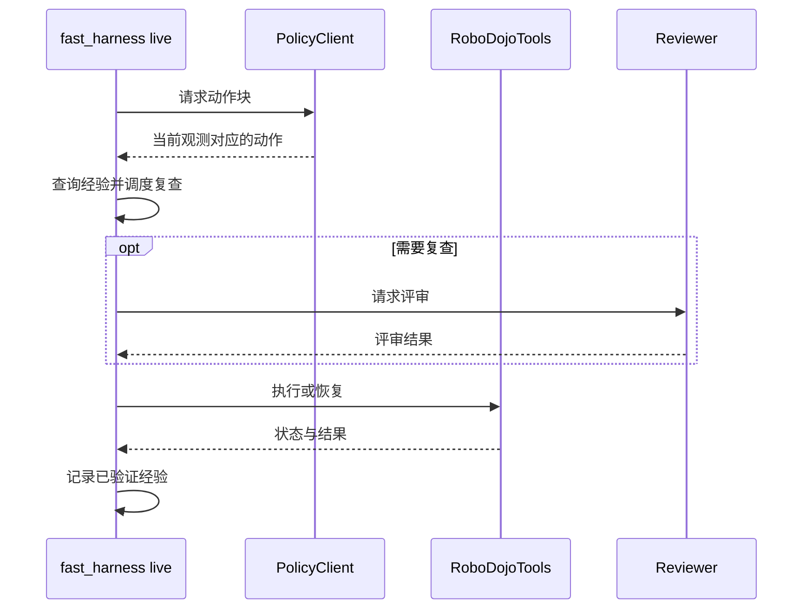

# FastHarness：面向视觉语言动作策略的经验驱动复查调度

**FastHarness**（*FastHarness: Experience-Driven Review Scheduling for Vision-Language-Action Policies*，[arXiv:2610.31427](https://arxiv.org/abs/2610.31427)）收录于 senlanke「具身运控lab」10-19–10-23 前沿论文动态（Manipulation）。本页依据**周报条目 + arXiv 摘要页**整理，未逐页核对正文 PDF；指标与结论以论文为准。

## 一句话定义

**FastHarness：面向视觉语言动作策略的经验驱动复查调度——FastHarness 将历史执行经验引入复查调度，研究如何根据经验决定何时重新评估 VLA 的执行状态。**

## 英文缩写速查

| 缩写 | 英文全称 | 简要说明 |
|------|----------|----------|
| VLA | Vision-Language-Action | 视觉–语言–动作模型 |
| IL | Imitation Learning | 模仿学习 |
| VLM | Vision-Language Model | 视觉语言模型，用作评审器 |

## 为什么重要

- 周报所述待解决的问题：长程机器人执行过程中，需要适时检查任务状态。频繁检查会增加计算开销，检查过少又可能导致错误积累。

## 核心机制

| 项 | 内容 |
|----|------|
| **arXiv** | [2610.31427](https://arxiv.org/abs/2610.31427) · [PDF](https://arxiv.org/pdf/2610.31427) |
| **作者（arXiv）** | Tao Lin, Yuxin Du, Haoxiao Wang, Zile Zhong, Bo Zhao |
| **机构（周报所述，未逐条核实）** | 待核实（作者：Tao Lin、Yuxin Du、Haoxiao Wang、Bo Zhao 等）。 |
| **arXiv 评论栏** | Github:this https URL |
| **开源** | [官方代码](https://github.com/FastHarness/fast-harness)以 MIT 许可证发布；RoboDojo、策略服务器和评审模型需自行提供。项目页本次无法打开，数据开放状态未核实。 |
| **周报所述创新点** | FastHarness 将历史执行经验引入复查调度，研究如何根据经验决定何时重新评估 VLA 的执行状态。 |

### arXiv 摘要节选（英文原文）

> Agentic robot systems combine language-model reasoning with robot policies to monitor execution and recover from failures. However, reviewing every action chunk incurs substantial overhead, even in familiar situations.

经验记录已验证阶段和评审结果；熟悉的动作块可走免调用的快速路径，陌生、危险或曾失败的情形触发复查，错误则进入有界恢复。策略保持冻结，不通过训练更新。

## 源码运行时序图

以 README 的 `live` 入口为准：

离线 `demo` 使用符号后端；真实仿真复现需配置独立策略、仿真服务与评审接口。

## 实验与评测

- 论文摘要报告四项仿真操作任务中，首次评测到最后五次均值，评审 token 按任务平均下降 57.2%，每次任务平均时间从 85.5 分钟降至 52.0 分钟。
- 同一组任务中，论文报告 GPT-as-Policy 基线平均成功率为 80%，FastHarness 为 97.19%；此比较与上述冷启动到热运行的开销比较口径不同。
- 读法：先对齐任务设定、传感器与成功定义（仿真/真机），再解读 headline 数字，勿跨论文直接比较。

## 与其他工作对比

| 维度 | 读法 |
|------|------|
| **同周对照** | 见 [Manipulation周报技术地图](../overview/senlanke-weekly-2026-10-19-23-manipulation-technology-map.md)，按方向浏览同期论文 |
| **开源状态** | 代码公开；外部策略、仿真和评审服务需另行配置 |

## 结论

**FastHarness：面向视觉语言动作策略的经验驱动复查调度。**

1. 固定策略持续从当前观测生成动作，经验用于调度评审而非重新训练策略。
2. 复查节省应同时结合成功率、错误发现延迟和恢复动作衡量。
3. 结果来自仿真；部署前需评估任务变化和真机安全边界。

## 关联页面

- [senlanke-weekly-2026-10-19-23-manipulation-technology-map](../overview/senlanke-weekly-2026-10-19-23-manipulation-technology-map.md)
- [manipulation](../tasks/manipulation.md)
- [vla](../methods/vla.md)

## 参考来源

- [fastharness-experience-driven-review-scheduling_arxiv_2610_31427.md](../../sources/papers/fastharness-experience-driven-review-scheduling_arxiv_2610_31427.md)
- [wechat_senlanke_weekly_manipulation_2026-10-19_23.md](../../sources/blogs/wechat_senlanke_weekly_manipulation_2026-10-19_23.md)
- [官方代码归档](../../sources/repos/fastharness.md)
- [项目页归档](../../sources/sites/fastharness.md)
- [arXiv:2610.31427](https://arxiv.org/abs/2610.31427)

## 推荐继续阅读

- [arXiv PDF](https://arxiv.org/pdf/2610.31427)
