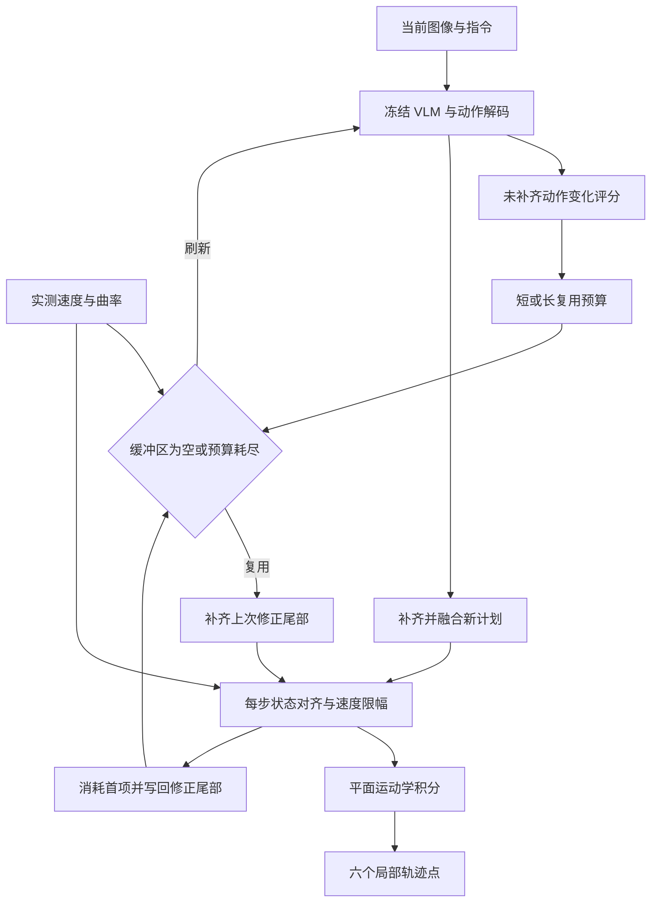
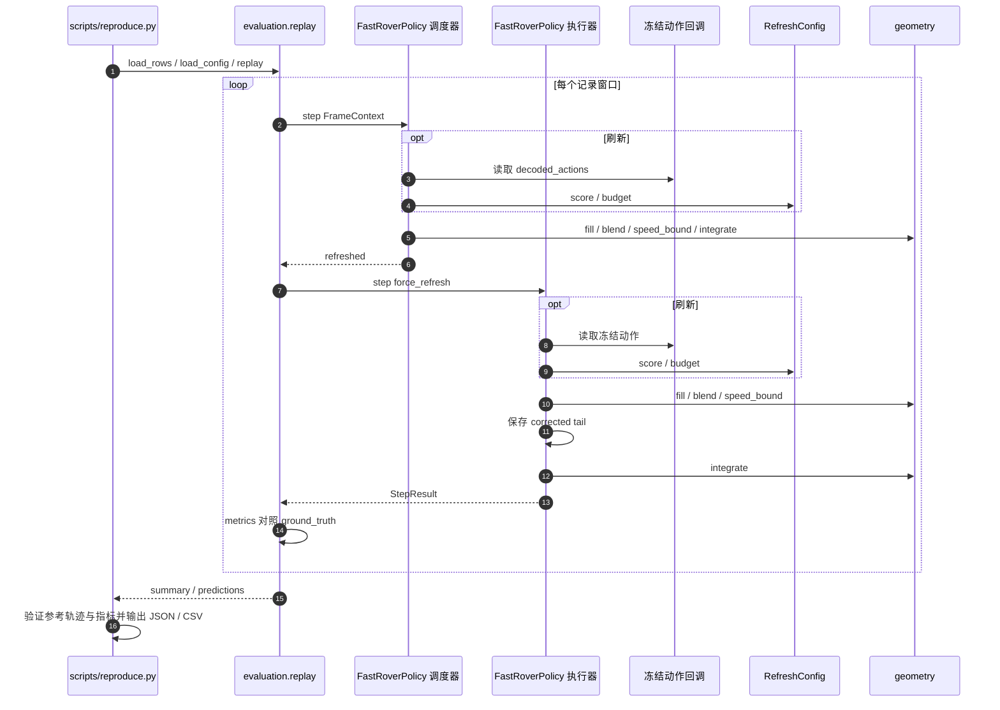

# FastRoverVLA：面向越野自动驾驶的快速视觉–语言–动作执行 / Fast Vision-Language-Action Execution for Off-Road Autonomous Driving

## 一句话定义

FastRoverVLA 是免训练的解码动作维护接口：在稀疏视觉刷新之间，以实测自车运动更新速度–曲率缓冲区并保留修正，连续输出局部轨迹。

## 英文缩写速查

| 缩写 | 英文全称 | 简要说明 |
|---|---|---|
| VLA | Vision-Language-Action | 视觉语言动作规划 |
| VLM | Vision-Language Model | 冻结视觉语言规划骨干 |
| ADE | Average Displacement Error | 预测点平均位移误差 |
| FDE | Final Displacement Error | 预测终点位移误差 |
| RMSE | Root Mean Squared Error | 坐标均方根误差 |
| BEV | Bird's-Eye View | 鸟瞰视角 |

## 为什么重要

模型推理不必与每个轨迹更新绑定；复用动作也不能仅播放旧序列。本文将复用中的运动修正作为持久状态，不修改骨干权重或增加学习型控制策略。

## 核心信息

| 字段 | 内容 |
|---|---|
| 作者 | Changtao Zhao, Yingxue Guan, Li Wang, Shijie Zhao, Yuhang Zhang, Shengkai Zhang, Qing Wang, Ziying Song |
| 机构 | 北京理工大学、长安大学、北京交通大学、燕山大学 |
| 通讯作者 / 项目负责人 | Li Wang / Ziying Song |
| 论文 | arXiv:2611.26242v1，2026-11-19 |
| 输入 | 视觉、指令、实测速度与曲率 |
| 输出 | 速度–曲率动作及自车坐标系的六个轨迹点 |
| 训练 | 免训练执行适配，冻结 VLM |
| 数据 | ORAD-3D、RELLIS-3D |

## 核心原理

设实测动作 a0=(v,κ)，预测视野 H=6、Δt=0.5 s。

- 刷新时解析预测并补足 H 项（短输出重复末项，空输出用实测动作），以 α 融合新计划与 a0；复用时补足上次修正后尾部。
- 每步按 β 将活动计划与 a0 加权，再从实测速度起限制相邻速度差、保持非负；曲率不受该速度限幅约束。
- 平面运动学积分：x[h]=x[h−1]+v[h]cos(ψ[h−1])Δt，y 同理使用 sin，ψ[h]=ψ[h−1]+κ[h]v[h]Δt。
- 消耗首项，将余下 H−1 项写回，而不是丢弃历史修正。
- 对补齐前速度、曲率的平均绝对相邻变化分别做验证集尺度归一化，取最大值 z。z≥阈值选短预算，否则选长预算。K 仅计复用次数，完整刷新间隔 K+1；预测视野与刷新间隔独立。

## 流程总览



此图对应论文 §3；轨迹是评测输出，不表示已实现车辆执行器闭环。

## 源码运行时序图



基于官方 `scripts/reproduce.py`、`evaluation.py` 和 `execution.py` 的 full control 路径；其他消融可走独立分支。回放中的回调不是 GPU 推理。

## 实验与评测

Qwen3-VL-2B，3 s 开放环，ORAD-3D 636 窗口/11 序列，RELLIS-3D 650 窗口/3 序列。

| 协议与方法 | ORAD ADE / FDE (m) | RELLIS ADE / FDE (m) |
|---|---|---|
| 冻结预测，每步刷新 | 0.384 / 0.726 | 0.387 / 0.820 |
| 冻结预测，固定周期 | 0.330 / 0.599 | 0.289 / 0.584 |
| 冻结预测，自适应 | 0.327 / 0.593 | 0.266 / 0.526 |
| 独立请求，每步刷新 | 0.385 / 0.727 | 0.391 / 0.831 |
| 独立请求，自适应 | 0.328 / 0.596 | 0.266 / 0.526 |

独立请求比例 6.0% / 4.8%，每更新请求处理成本 355.4→21.4 ms / 443.9→21.3 ms（16.6× / 20.8×）。冻结预测重放刷新率 5.8% / 4.8%，模型请求为零。

表3：取消对齐 FDE 0.852 / 0.844 m，取消写回 0.728 / 0.738 m；持续纯运动对照 0.599 / 0.515 m，后者在 RELLIS 优于完整方法。表5：等预算均匀刷新 FDE 与自适应相差不超过 0.004 m。表7：past-only heading 复评分 RELLIS FDE 0.903→0.606 m。四种冻结骨干均显示相对逐步刷新误差下降。

## 结论

主要贡献在解码后的持久运动修正，不是更快的单次 VLM 前向。

- 首先用匹配刷新消融检查对齐和写回是否各自有效。
- 单独测量单次请求时间、请求频率与端到端响应时间。
- 对照纯运动基线，避免把局部轨迹收益归因于视觉语义。
- 复用预算与动作视野分别选型，不能把 K 当作轨迹点数。
- 部署前必须独立验证环境变化、状态估计误差与闭环控制安全。

## 与其他工作对比

| 对照 | 机制差异与证据边界 |
|---|---|
| 逐步刷新 / 固定周期刷新（本文基线） | 自适应方法减少模型请求；冻结预测协议下两数据集 FDE 分别为 0.593 / 0.526 m，固定周期为 0.599 / 0.584 m。等预算均匀刷新与自适应差距很小，不宜把主要收益归于调度评分。 |
| [Action Chunking](../methods/action-chunking.md) | 通用动作块部署可直接消费序列或在重规划时替换尾部；本文每步利用实测速度和曲率修正活动计划，将修正后尾部持续写回。 |
| [Real-Time Chunking](./paper-real-time-chunking.md) | RTC 在执行期间异步生成下一动作块，以已提交前缀约束生成；FastRoverVLA 在刷新间复用已解码计划，做运动学状态修正，官方回放为串行回调。 |
| [DriveTeach-VLA](./paper-driveteach-vla.md) | 前者侧重视觉与轨迹条件，本文侧重冻结预测后的执行适配。 |

以上为机制对照；不同数据、任务、硬件和评测协议的结果不能直接排序，尤其不能用开放环轨迹误差推断真机任务成功率。

## 工程实践

已公开 MIT 执行核心、配置与 1286 窗口数值重放，未打包原始数据集、骨干权重和原始多骨干 GPU 推理运行时。Python 3.10+ CPU 路径：

```bash
git clone https://github.com/ADEPT-ORG/FastRoverVLA.git
cd FastRoverVLA
python -m pip install --no-deps -e .
python scripts/reproduce.py --verify
```

官方预期自适应 admissions 37/31、轨迹差小于 1e-12；本次未执行实验。接口为串行 callback，仅刷新调用模型；并非异步 RTC 实现。

## 局限与风险

- 开放环日志的后续状态独立于预测，不验证车辆闭环稳定性、碰撞或任务成功。
- 复用时不读取新图像；动作变化评分不是突发障碍检测器。
- 平面运动学不显式模拟滑移与崎岖地形车辆动力学。
- 独立 GPU 请求成本不能解释为传感器到执行器的端到端延迟。
- RELLIS 主评测的参考 heading 采用归档约定；past-only 复评分需单独报告。

## 关联页面

- [VLA](../methods/vla.md)
- [Action Chunking](../methods/action-chunking.md)：动作预测视野、消费步数与刷新策略的分离。
- [控制与推理频率解耦](../concepts/control-inference-frequency-decoupling.md)
- [VLA 加速方法比较](../comparisons/vla-acceleration-25-methods-2026.md)
- [DriveTeach-VLA](./paper-driveteach-vla.md)：改善视觉与轨迹条件，FastRoverVLA 则维护解码动作。
- [VLA 纵深路线](../../roadmap/depth-vla.md)

## 推荐继续阅读

- [论文全文](https://arxiv.org/html/2611.26242v1)
- [官方项目](https://adept-org.github.io/FastRoverVLA/)
- [源码](https://github.com/ADEPT-ORG/FastRoverVLA)

## 参考来源

- [论文归档](../../sources/papers/fastrovervla_arxiv_2611_26242.md)
- [项目页归档](../../sources/sites/fastrovervla.md)
- [源码归档](../../sources/repos/fastrovervla.md)
