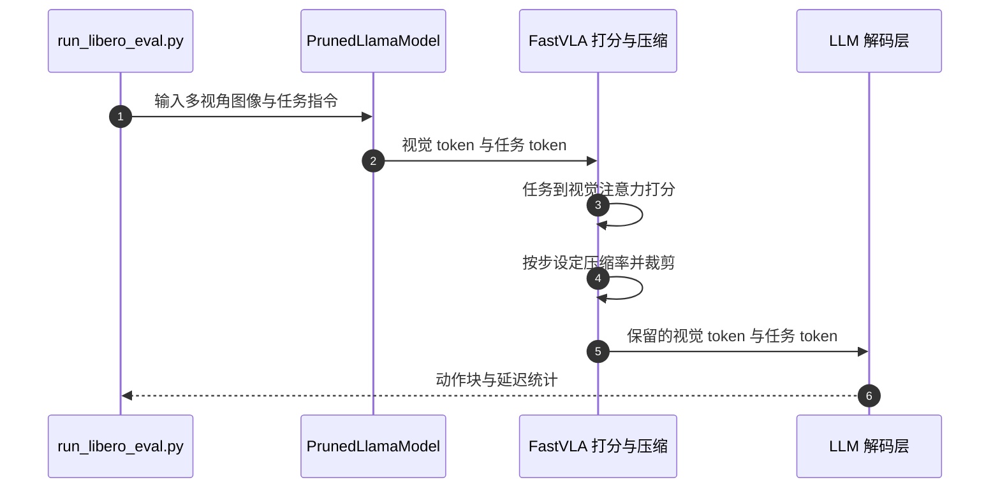

# FastVLA：任务条件与时间自适应的视觉 Token 压缩

**FastVLA 在 VLA 推理时按任务与当前步的视觉信息删减视觉 token，不训练、不缓存，目标是在闭环控制中降低动作生成延迟。**

## 英文缩写速查

| 缩写 | 英文全称 | 简要说明 |
|------|----------|----------|
| VLA | Vision-Language-Action | 视觉–语言–动作策略 |
| LIBERO | Lifelong Robot Learning Benchmark | 常用的机器人操作仿真基准，含多个任务套件 |
| FLOPs | Floating-Point Operations | 浮点运算次数，常用于衡量计算量 |

## 为什么重要

高分辨率、多视角图像会被编码成数百个视觉 token，主导 Transformer 的计算与延迟。摘要指出，这类压缩在 VLA 中有两个难点：决定动作的 token 由任务决定，而非通用显著性；且每一步需要保留的 token 数量变化很大。FastVLA 针对这两点设计在线压缩。

## 核心信息

| 项目 | 内容 |
|------|------|
| arXiv | [2610.22146](https://arxiv.org/abs/2610.22146) |
| 作者 | Jiuyi Xu, Chengyuan Qian, Zhengzhong Tu, Yang Sui, Yangming Shi（arXiv 作者列表） |
| 机构 | 未核实（摘要页未列） |
| 会议 | 据公众号转述：WACV 2027 接收 |
| 开源状态 | **已开源**（2026-10-21 核查：arXiv 摘要页链接 github.com/jiuyixu25/FastVLA 对应仓库，`git ls-remote` 可达；README 含 LIBERO 评测与部署脚本，本次未克隆运行） |

## 核心原理

- **打分：** 每个动作预测步，用任务文本到视觉 token 的注意力给 token 打重要性分。
- **自适应压缩率：** 按当前步的重要性分布设定保留比例，并参考近期步的一致性（README 描述为相对近期历史的偏离程度）。
- **免训练、无缓存：** 仅保存最近 `window` 步的一致性统计，步间不共享其他状态。
- **接入位置：** 在 LLM 解码层之前裁剪视觉 token（OpenVLA-OFT 为 `PrunedLlamaModel`）。

## 工程实践

- **已有入口（据 README）：** `experiments/robot/libero/run_libero_eval.py` 带 `--fastvla_*` 参数做 LIBERO 评测；`vla-scripts/deploy.py` 提供真机策略服务；`integrations/openvla` 与 `integrations/cogact` 分别接入 OpenVLA 与 CogACT。
- **运行需求（据 README）：** 约 16 GB 显存的单卡即可跑 LIBERO 评测；需要按 README 安装对应版本依赖。
- **源码运行时序图：**

复现路径：先用 `--fastvla_enable False` 跑未压缩基线，再对比成功率、动作预测延迟与保留 token 比例（README 说明结果写入 `experiments/logs/`）。

## 结论

**一句话总判：FastVLA 提供了一个可直接替换的免训练推理加速方案，但效果需要在目标任务与基线上按成功率和延迟一起核对。**

1. **压缩应按任务而非通用显著性** — 摘要明确指出决定动作的 token 由任务决定。
2. **压缩率应随步变化** — 摘要强调 token 预算在不同步之间差异很大，固定预算会浪费计算或丢掉关键 token。
3. **先看闭环成功率再看延迟** — 压缩可能同时影响成功率与延迟，两者需要成对报告。
4. **仓库已可跑通评测链路** — 对需要快速试验的团队，README 给出的 LIBERO 与部署入口可以直接复用。

## 局限与风险

- 论文摘要与公众号未给出具体加速倍数与成功率，本页不引用未核验的数字。
- 结果覆盖 OpenVLA-OFT、CogACT 等已有 VLA，对其他架构的适用性未知。
- 免训练方法的上限受原模型能力限制（推测）。

## 关联页面

- [VLA 方法总览](../methods/vla.md)
- [操作任务](../tasks/manipulation.md)
- [仿真评测基础设施](../concepts/simulation-evaluation-infrastructure.md)

## 参考来源

- [FastVLA 论文归档](../../sources/papers/fastvla_arxiv_2610_22146.md)
- [公众号综述摘录（33 篇 Manipulation）](../../sources/raw/wechat_senlanke_manipulation_33_papers_2026-10-12_16.md)

## 推荐继续阅读

- [arXiv:2610.22146 — FastVLA](https://arxiv.org/abs/2610.22146)
- [FastVLA 官方仓库](https://github.com/jiuyixu25/FastVLA)
