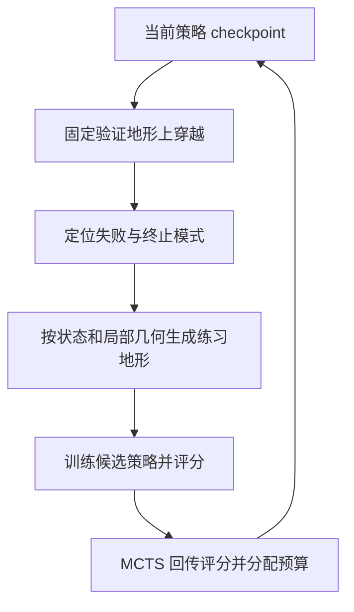

# FCTS：失败引导的地形课程树搜索

**FCTS**（Failure-Guided Curriculum Tree Search；[arXiv:2610.22619](https://arxiv.org/abs/2610.22619)，[项目页](https://narayananpp.github.io/fcts/)）让策略的局部穿越失败决定下一轮训练的地形，并在固定预算内搜索多条课程演进路线，目标是改善四足机器人在工业与灾害现场复杂组合地形中的跑酷泛化。

## 英文缩写速查

| 缩写 | 英文全称 | 简要说明 |
| --- | --- | --- |
| FCTS | Failure-Guided Curriculum Tree Search | 以失败信号和树搜索构造地形课程的框架。 |
| MCTS | Monte Carlo Tree Search | 在有限训练预算中探索替代课程分支的搜索方法。 |
| PUCT | Predictor + Upper Confidence bound applied to Trees | 项目页用于平衡树搜索探索与利用的规则。 |
| RL | Reinforcement Learning | 课程分支边所代表的策略训练过程。 |

## 为什么重要

规则障碍课程通常只覆盖少量手工地形；把目标现场重建出来直接训练，也未必能覆盖导致穿越失败的局部几何和身体状态。FCTS 将失败位置、终止模式、机器人状态与邻近地形一起作为下一批地形的条件，使训练问题围绕当前策略的具体弱点展开；树搜索则在总训练预算固定时比较课程选择，而非把预算全押在一条手工安排的课程上。

## 核心原理

搜索树的节点对应策略 checkpoint，边对应一次完整训练轮次。每轮先在固定验证地形上执行策略，记录失败发生的位置、终止原因、机器人状态和附近几何；这些信息条件化地形生成器，产出后续练习地形。训练后的策略在验证集评分，并将结果沿树回传；项目页称 FCTS 用 PUCT 平衡探索与利用，价值以最大值回传，最终沿根节点下最高 backed-up Q 的分支选策略。

项目页报告并行搜索 24 小时完成 25 次扩展，约为顺序速率的 5.3 倍。该数值是课程搜索吞吐，不是机器人运行速度或策略控制频率。

## 实验与评测

| 评测 | 报告结果 | 读法 |
| --- | --- | --- |
| 扫描施工场地 medium course | 成功率 28.4% → 85.8% | 相对最强跑酷或 LLM 课程 baseline；路线由真实场地几何重建。 |
| 扫描施工场地 hard course | 成功率 14.9% → 44.7% | 仍显示极难地形的绝对成功率有明显上限。 |
| 极端地形 | 相比基线保持更高 traversal progress | 全程成功较少时，进度指标补充成功率，但不能替代成功率。 |
| 四足真机 | Jetson AGX Orin 上 50 Hz，深度与本体感知；策略部署不再调参 | 证明硬件迁移可行，不代表多场地统计稳健性。 |

项目页说明评测路线来自扫描几何重建，在课程生成和训练期间 held out；路线事先固定，并按机器人 0.4 m 足迹内的局部 relief 分层。结果来自少量路线和独立随机种子，比较时应同时报告路线难度与统计设置。

## 与其他工作对比

| 路线 | 课程如何产生 | 主要适用面 |
| --- | --- | --- |
| 手工地形课程 | 研究者预设少量地形族与难度顺序 | 易于控制，但覆盖范围取决于手工设计。 |
| 直接在目标重建地形训练 | 使用目标场地几何训练策略 | 可贴近场景，但仍可能无法跨越目标路线。 |
| [FCTS](./paper-fcts-failure-guided-curriculum.md) | 局部失败条件化生成地形，并搜索课程分支 | 适合复杂、不规则跑酷地形上的定向改进。 |
| [Better Curriculum](./paper-better-curriculum.md) | 控制器塑形触觉敏感抓取示范课程 | 面向接触操作，不是跑酷地形搜索。 |

## 结论

**FCTS 的关键贡献是把局部失败变成下一轮地形课程的生成信号，再用搜索在固定训练预算中挑选改进路径。**

1. 复现时要记录失败位置、终止原因、状态和局部几何；仅以 episode 成败为条件会丢掉其细粒度课程信号。
2. 对比课程方法时固定训练总预算，另外报告树搜索扩展数与并行吞吐，避免把额外算力误认作课程本身收益。
3. medium / hard course 成功率与极端地形 progress 是不同指标，应分开报告。
4. 真机控制 50 Hz 和 held-out 扫描路线结果分别代表可部署性与泛化评测，不相互替代。
5. 截至 2026-10-20，项目页未列公开代码或数据集；可据论文理解方法，但当前公开入口不足以支持端到端复现。

## 工程实践与局限

- **条件地形生成依赖失败信号质量：** 需要将机器人状态和局部地形坐标对齐，避免把传感器或定位误差当作策略弱点。
- **搜索开销仍高：** 一条边代表完整训练轮次；MCTS 更有效地分配预算，但没有消除策略训练本身的成本。
- **评估范围有限：** 扫描施工地点和四足硬件为重要证据，但不能直接外推到其他机器人本体、地形生成器或任务分布。
- **源码开放状态：** 官方项目页截至入库日未列代码链接；源码运行时序图不适用，因公开页面未提供可运行实现入口。

## 源码运行时序图

**不适用：** 截至 2026-10-20，项目页没有公开代码仓库链接，无法依据官方实现绘制运行时序。

## 参考来源

- [FCTS 官方论文摘录](../../sources/papers/fcts_failure_guided_curriculum_tree_search_arxiv_2610_22619.md)
- [FCTS 官方项目页核查](../../sources/sites/fcts-project.md)

## 关联页面

- [Locomotion](../tasks/locomotion.md)
- [楼梯、障碍与感知运动](../tasks/stair-obstacle-perceptive-locomotion.md)
- [Better Curriculum](./paper-better-curriculum.md)
- [Deep Whole-body Parkour](./paper-deep-whole-body-parkour.md)

## 推荐继续阅读

- [FCTS 项目页](https://narayananpp.github.io/fcts/)
- [arXiv 论文](https://arxiv.org/abs/2610.22619)
