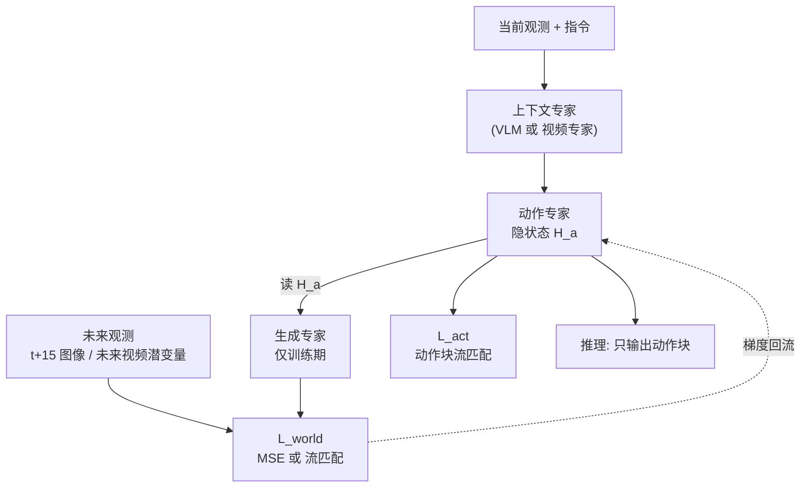
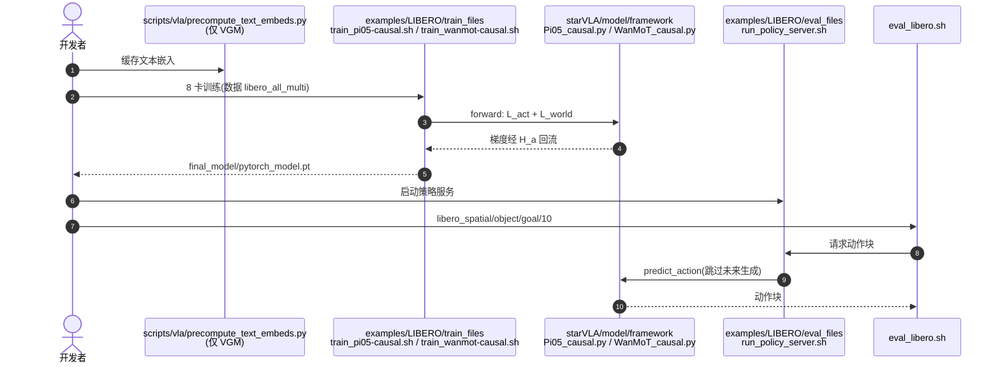

---

type: entity
tags: [paper, vla, world-action-model, video-generation, flow-matching, libero, robotwin, bimanual, fudan, shanghai-innovation-institute, imperial-college, surrey]
status: complete
updated: 2026-10-12
arxiv: "2610.13117"
project_id: fdm-forward-dynamics-models
project: https://logosroboticsgroup.github.io/FDM/
code: https://github.com/LogosRoboticsGroup/FDM
related:
  - ../overview/embodied-station-34-papers-spatial-grounding-technology-map.md
  - ../concepts/world-action-models.md
  - ../methods/vla.md
  - ../methods/generative-world-models.md
  - ../methods/star-vla.md
  - ../tasks/bimanual-manipulation.md
  - ./libero-benchmark.md
  - ./robotwin.md
  - ./paper-pi05-open-world-vla.md
sources:
  - ../../sources/blogs/wechat_embodied_station_34_papers_spatial_grounding_2026-10-12.md
  - ../../sources/papers/fdm_arxiv_2610_13117.md
  - ../../sources/sites/fdm-logosroboticsgroup-github-io.md
  - ../../sources/repos/fdm.md
summary: "FDM（arXiv:2610.13117，复旦/上海创智/帝国理工/萨里）：让生成专家读取动作专家的隐状态预测未来、动作支路读不到未来，训练时用真实未来监督策略、部署时跳过未来生成；VLM(π0.5)与VGM(Wan2.2-5B)两版，LIBERO 99.4% / 98.1%，ARX-X5 真机 5 任务 96% / 83%；代码已开源，无权重。"
---

# FDM：动作到未来的前向动力学策略

**FDM**（*Forward Dynamics Models*；[arXiv:2610.13117](https://arxiv.org/abs/2610.13117)，[项目页](https://logosroboticsgroup.github.io/FDM/)，[代码](https://github.com/LogosRoboticsGroup/FDM)）由复旦大学、上海创智学院、帝国理工学院与萨里大学（通讯 Li Zhang）提出：把“未来预测”接在动作特征之后，用未来真值监督动作表征，但让动作预测读不到未来 token，因而**部署时不必生成未来**。

## 一句话定义

**生成专家读取动作专家的隐状态去预测未来观测（action-to-future）；未来损失的梯度回流进动作特征，动作分支自身不依赖任何未来内容，推理时只跑动作分支。**

## 英文缩写速查

| 缩写 | 英文全称 | 简要说明 |
|------|----------|----------|
| FDM | Forward Dynamics Models | 本文方法：动作 → 未来 的前向动力学监督 |
| WAM | World Action Model | 先预测未来再条件化动作的策略范式（基线类别） |
| VLM | Vision-Language Model | FDM w/ VLM 的骨干（π0.5 的 Gemma） |
| VGM | Video Generation Model | FDM w/ VGM 的骨干（Wan2.2-TI2V-5B） |
| MoT | Mixture-of-Transformers | 多专家共享层间注意力、参数独立 |
| VAE | Variational Autoencoder | Wan VAE 潜变量，用作未来目标空间 |

## 为什么重要

- **WAM 的部署成本问题：** WAM 推理要多生成一次未来，且预测误差会传入动作；论文测得 FastWAM-Joint 在未来扰动 α=1.0 下动作误差上升 4.44%（LIBERO）与 5.52%（RoboTwin），FDM 按构造不受影响。
- **VGM 路线推理省近一半时间：** 每个动作块 253.45 ms 对 FastWAM-Joint 446.55 ms（1.76×）。
- **统一范式：** 同一思路适用于 VLM 与视频生成模型两类骨干。

## 核心信息

| 项 | 内容 |
|----|------|
| **机构** | 复旦大学；上海创智学院；帝国理工学院；萨里大学 |
| **骨干** | FDM w/ VLM：π0.5（Gemma-2B + Gemma-300M 动作专家）；FDM w/ VGM：Wan2.2-TI2V-5B |
| **训练** | 8 张 H100；LIBERO、RoboTwin 2.0、ARX-X5 真机 |
| **开源** | 代码已开源（MIT，基于 StarVLA）；数据集与 FDM checkpoint 未随仓库发布（截至 2026-10-12） |

## 方法栈 / 流程总览

## 方法

**输入 / 输出：** 输入当前观测与任务指令，输出动作块；训练期额外有未来观测目标。

1. **单向信息流：** 生成专家可读取动作专家的隐状态 H_a，动作专家无法读生成分支 token（含间接路径）。因此推理时可整体丢掉生成分支。
2. **FDM w/ VLM：** 在 π0.5（pi05_base_pytorch）上加一个随机初始化、与动作专家同架构的生成专家；未来图像损失是 Wan VAE 潜变量上的 MSE（用 t−15 与 t 帧预测 t+15 帧，单次回归，不做视觉去噪）。
3. **FDM w/ VGM：** 在 Wan2.2-TI2V-5B 上加随机初始化的动作专家；两专家均 30 层，隐层 3072（视频）/ 1024（动作）；未来视频用流匹配速度损失，仅作用于未来潜变量。
4. **损失：** L_total = λ_a·L_act + λ_v·L_world，两者权重均为 1；动作用动作块流匹配。
5. **对照变体：** A 仅动作；B 未来仅作上下文；C stop-gradient（前向同、梯度不回流）；D 完整 FDM。

## 实验与评测

- **LIBERO（成功率，FDM 无机器人预训练）：** FDM w/ VLM 平均 **99.4**（Spatial 99.2 / Object 100.0 / Goal 99.8 / Long 98.6），高于 π0.5 的 96.9 和 π0 的 94.1；FDM w/ VGM 98.1，对 Motus 97.7、LingBot-VA 98.5（VGM 平均略低于 LingBot-VA，Long 94.2 低于 Motus 与 LingBot-VA）。
- **RoboTwin 2.0（50 任务 clean / randomized / 平均）：** FDM w/ VLM 81.54 / 80.86 / 81.20（π0.5：82.74 / 76.76 / 79.75，clean 上低于 π0.5）；FDM w/ VGM 88.84 / 89.62 / 89.23（Motus 87.8，LingBot-VA 92.20，仍低于后者）。
- **真机（双臂 ARX-X5，Drawer/Box/Shuttlecock/Cup/Block，各 150 条示范，每方法每任务 20 次）：** FDM w/ VLM 平均 96% 对 π0.5 83%；FDM w/ VGM 83% 对 FastWAM-Joint 78%、DreamZero 71%；两版在 Cup 与 Block 均为 100%。
- **真机消融（平均）：** VLM 83 → 87 → 89 → 96（A→D），VGM 66 → 72 → 78 → 83；反向监督（D 对 C）+7 / +5 点。
- **效率：** VLM 训练步时 +42.14%（0.4436→0.6305 s）、峰值显存 67.08→72.04 GiB，推理与 π0.5 基本持平（202.98 对 203.77 ms/chunk）；VGM 训练步时与 FastWAM-Joint 持平，推理 1.76× 更省。
- 梯度余弦对齐只在图中；HTML 末尾约 1.3 万字符（含 RoboTwin 逐任务表）未读到。

## 源码运行时序图

官方仓库 [LogosRoboticsGroup/FDM](https://github.com/LogosRoboticsGroup/FDM)（归档：[sources/repos/fdm.md](../../sources/repos/fdm.md)）以 LIBERO 为例：

## 工程实践

- **开源核查（2026-10-12）：** 项目页与仓库均已发布，代码含训练、评测、`deployment/` 部署；仓库自述“数据集、FDM checkpoint 不随仓库发布，也尚无公开 checkpoint 下载链接”。项目页没有 arXiv 链接。
- **环境：** Python 3.10、PyTorch 2.7.0、CUDA 12.8；需 flash-attn、特定 LeRobot commit 与 decord；VLM 版需 π0.5 PyTorch 权重、PaliGemma tokenizer 与 Wan2.2 VAE。
- **复现提醒：** README 称基础 YAML 与启动脚本的部分默认值和论文不同；RoboTwin 需按论文关闭本体状态。VLM 版训练成本较高（+42% 步时）。
- **评测：** 默认 LIBERO 每任务 50 episode、种子 42、10 步去噪、每次执行 10 个动作。

## 结论

**FDM 的实用价值在于“训练期付一次未来预测的账，部署期不再付”，但在强基线上并非处处领先。**

1. 在 VGM 路线上，推理成本比联合生成式 WAM 低 43.24%，动作不受未来预测误差影响。
2. 反向监督有增益：真机上完整 FDM 对 stop-gradient 变体 +7（VLM）/ +5（VGM）点，对仅动作变体 +13 / +17 点。
3. VLM 版训练步时 +42.14%，部署成本与 π0.5 基本持平。
4. 仿真不是全面最优：RoboTwin 上 VLM 版 clean 低于 π0.5，VGM 版低于 LingBot-VA（89.23 对 92.20）。
5. 真机结论来自 5 个任务、每任务 20 次，样本偏少。
6. 复用时先复现 VLM 版 LIBERO 流程，再迁移骨干。

## 局限与风险

- 论文没有单列局限节；仿真单种子（42），真机每任务仅 20 次。
- 代码已开源，但无公开 checkpoint 与数据，复现需自备 8 张级别 GPU 与数据。
- 附录末尾与 RoboTwin 逐任务表未读到。

## 与其他工作对比

- **π0 / π0.5：** 见 [π0.5](./paper-pi05-open-world-vla.md)；FDM w/ VLM 在其上增加训练期生成专家。
- **WAM 类（FastWAM-Joint、DreamZero、Motus、LingBot-VA）：** 联合预测未来，推理成本高；概念背景见 [World Action Models](../concepts/world-action-models.md)；相关页：[Motus](./paper-sa-2512-13030-motus-a-unified-latent-action-world-model.md)、[LingBot-VA](./paper-sa-2601-21998-lingbot-va-causal-video-action-world-model-for-g.md)、[DreamZero](./paper-notebook-dreamzero-world-action-models-are-zero-shot-poli.md)。
- 基准页：[LIBERO](./libero-benchmark.md)、[RoboTwin](./robotwin.md)。

## 关联页面

- [34 篇空间落地技术地图（汇总页）](../overview/embodied-station-34-papers-spatial-grounding-technology-map.md)
- [World Action Models](../concepts/world-action-models.md)
- [VLA 方法](../methods/vla.md)
- [生成式世界模型](../methods/generative-world-models.md)
- [StarVLA](../methods/star-vla.md)
- [双臂操作](../tasks/bimanual-manipulation.md)

## 参考来源

- [具身智能小站 34 篇盘点（2026-10-12）](../../sources/blogs/wechat_embodied_station_34_papers_spatial_grounding_2026-10-12.md)
- [FDM 论文来源归档](../../sources/papers/fdm_arxiv_2610_13117.md)
- [FDM 项目页核查](../../sources/sites/fdm-logosroboticsgroup-github-io.md)
- [FDM 仓库归档](../../sources/repos/fdm.md)

## 推荐继续阅读

- [FDM arXiv 原文](https://arxiv.org/abs/2610.13117)
- [FDM 官方仓库](https://github.com/LogosRoboticsGroup/FDM)
- [FDM 项目页](https://logosroboticsgroup.github.io/FDM/)
