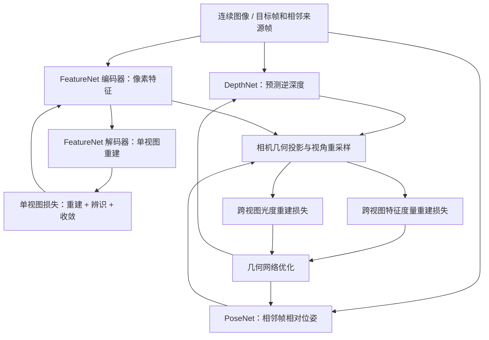
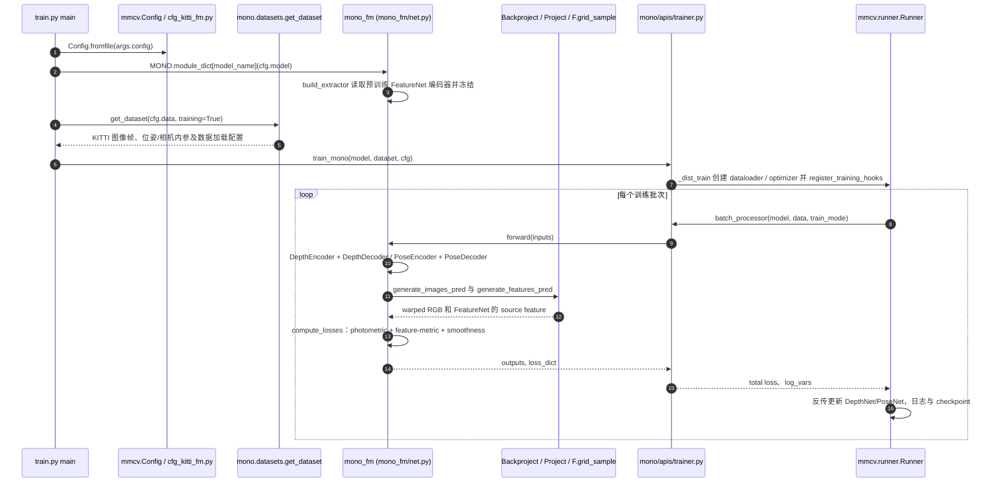

# FeatDepth：特征度量损失的自监督深度与自运动估计 / Feature-metric Loss for Self-supervised Learning of Depth and Egomotion

## 一句话定义

FeatDepth 用自监督训练的 FeatureNet 构造比原始像素光度误差更适于优化的**特征度量重投影损失**，联合约束 DepthNet 与 PoseNet 的深度和相邻帧运动估计。

## 英文缩写速查

| 缩写 | 英文全称 | 简要说明 |
|------|----------|----------|
| FM | Feature-Metric | 根据学习到的特征而非仅原始像素比较跨视角对应 |
| SfM | Structure from Motion | 从图像运动恢复三维几何和相机位姿 |
| VO | Visual Odometry | 通过相邻图像估计相机运动 |
| SSIM | Structural Similarity Index Measure | 与像素 L1 组合构成光度重建损失 |
| KITTI | Karlsruhe Institute of Technology and Toyota Technological Institute | 论文使用的自动驾驶深度/里程计评测数据集 |
| RMSE | Root Mean Square Error | 深度/运动评测常见误差量 |
| OR | Online Refinement | 推理阶段继续优化模型，改变实验设置和资源开销 |
| MS | Monocular-Stereo | 论文表格表示用标定双目视频训练 |
| M | Monocular | 论文表格表示仅单目视频训练 |
| SE(3) | Special Euclidean Group in Three Dimensions | 三维刚体位姿变换群 |

## 为什么重要

常规自监督深度学习使用相邻帧图像重投影的**光度损失**。在无纹理墙壁、光照变化、低辨识度区域，不正确的深度也可能得到较小光度损失，优化出现平坦区域或局部极小值。本文同时学习特征和几何，让特征空间更利于梯度下降，区别于只在深度输出上添加平滑正则的办法。

## 核心原理与方法

### 三个子网络及双重重建

- **DepthNet**：由目标帧预测逆深度；论文使用 ResNet-50 编码器和逐尺度细化的深度解码器。
- **PoseNet**：由目标与来源相邻图像对预测 SE(3) 相对位姿；论文采用 ResNet-18，旋转以轴角表示。
- **FeatureNet**：自编码器重建单帧图像，提取低纹理区域仍具辨识度的特征；论文对特征加入一阶导数相关的 **discriminative loss** 和二阶导数相关的 **convergent loss**。
- 由 `DepthNet + PoseNet + K` 通过反投影/再投影生成对应点，使用 `FeatureNet` 输出的特征图计算跨视角 feature-metric 损失，同时保留 L1+SSIM photometric loss。
- 遮挡处理采用多来源帧重投影最小损失；相机运动、动态物体、遮挡均会影响几何重建假设。

论文 §3 中单视图总损失 `L_s = L_rec + α L_dis + β L_cvt`，其中 α、β 实验选用 `10^-3`；跨视图损失联合 feature-metric 与 photometric 两项；总体自监督优化含这两个分支。对 FeatureNet 的**预训练后冻结模式**和三网络**联合训练模式**应分开考虑。

## 流程总览（依据论文 Fig.1 和 §3）

图针对论文方法。官方标准 `cfg_kitti_fm.py` 的 FeatureNet 特征提取器来自预训练 checkpoint 并冻结；并非该配置每步都训练 FeatureNet 的全部三种单视图损失。

## 源码运行时序图

**官方入口：** README 推荐 PyTorch distributed launcher 调用 `train.py --config config/cfg_kitti_fm.py --work_dir …`；不要直接照搬仓库 `run.py` 里的作者本地硬编码 Python 路径。代码依据：`sconlyshootery/FeatDepth@550420b`，`train.py`、`config/cfg_kitti_fm.py`、`mono/apis/trainer.py`、`mono/model/mono_fm/net.py`、`mono/mono_autoencoder/net.py`、`mono/datasets/kitti_dataset.py`。

上述时序图针对 `mono_fm` 固定特征提取器的 KITTI 配置；另一配置 `cfg_kitti_fm_joint.py` 改变优化模块，不能直接共用完全相同的反向传播叙述。尚未实际启动模型。

## 实验与评测

原论文 §4 KITTI Eigen 测试划分 697 张单帧用于深度评测；KITTI odometry 训练 00–08、评测 09–10；双目监督与 online refinement 必须与纯单目训练分开报告。

| 原论文 Table 2 | 条件 | Abs Rel ↓ | δ1 ↑ |
|---|---|---:|---:|
| Monodepth2 | 单目视频训练（M） | 0.115 | 0.879 |
| FeatDepth | 单目视频训练（M） | 0.104 | 0.893 |
| FeatDepth | 双目视频训练（MS） | 0.099 | 0.889 |
| FeatDepth | 双目视频训练且在线 refinement（MS*） | **0.079** | **0.925** |

论文摘要提及 δ1 由约 0.885 提高到 0.925，但 **0.925 不是纯单目离线测试结果**。MS* 的在线 refinement 在测试样本上额外优化，论文示例为 20 次迭代；因此不能与无在线优化设置简单等价比较。

论文 Table 3 在 KITTI odometry Seq.09 / Seq.10 报告 FeatDepth translational drift `8.75 / 10.67`；论文明确提示其旋转精度仍不及传统 ORB-SLAM，不能概括成“VO 全指标胜过传统 SLAM”。

## 结论

**总判：学习更适合重投影优化的视觉特征，能改善低纹理区域下的自监督深度与自运动估计，但在线细化、尺度与几何假设必须作为独立代价报告。**

1. 光度重建的低损失不必然表示深度和位姿正确，纹理不足是典型失败条件。
2. FeatureNet 的辨识正则和收敛正则分工不同：增大响应与使梯度方向平滑不能互相替代。
3. 部署时如果使用标准 `cfg_kitti_fm.py`，FeatureNet 是预训练冻结的 extractor，不能误写成每个批次联合更新全网络。
4. KITTI δ1=0.925 属于 **MS*（双目训练+在线 refinement）**；普通单目离线 M 配置为 0.893。
5. 单目深度存在尺度歧义；论文单目深度评测使用 median scaling，应与双目训练的尺度恢复区分。
6. 即便 VO 平移指标有所改善，长序列旋转漂移不自动达到带 BA 的传统 SLAM 水平。

## 与其他工作对比

| 方法 | 核心区别 | 适用性 |
|------|----------|--------|
| SfMLearner | 通过单目图像对光度一致性学习深度和姿态 | 结构简单但低纹理区域梯度弱 |
| Monodepth2 | 光度重投影、遮挡/自动掩码等自监督策略 | 常用基线，FeatDepth 在其上增加特征空间几何监督 |
| [LVI-SAM](./paper-lvi-sam.md) | 视觉、激光、IMU 多传感器里程计与因子图 | 在线多传感器 SLAM，不应和视频离线自监督深度训练混为一谈 |

## 工程实践

1. 旧版依赖以 README 为准：Python 3.7、PyTorch 1.1+、CUDA 10 时代和 `mmcv==0.4.4`；如今环境下可能不直接兼容，不可未经测试声称支持 ROS2/GPU 新栈。
2. 准备 KITTI 数据并修改 `config/cfg_kitti_fm.py` 的 `data.in_path`、`gt_depth_path`、`depth_pretrained_path`、`pose_pretrained_path` 和 `extractor_pretrained_path`。源配置保留作者机器的绝对路径，需替换。
3. `train.py` 读取 `cfg.model.name = "mono_fm"`、创建数据集、调用 `train_mono`；`mono_fm/net.py` 将 inverse depth 通过 `disp_to_depth` 转换为深度参与几何投影。
4. 官方 `scripts/eval_depth.py` 与 `scripts/eval_pose.py` 分别评测深度/里程计；README 提醒网络输出 inverse depth、双目 metric scale 还需按其数据约定转换。单目尺度需遵照论文评估方式。
5. 记录训练模式 M/MS、是否 online refinement、KITTI split、帧间尺度处理，否则实验对比没有意义。

## 局限与风险

- 依赖相邻视图的可见性、静态场景/近似 Lambertian 成像假设；动态物体、遮挡和光照变化影响监督信号。
- 论文的在线 refinement 会在测试时继续训练，需额外计算，不能混用“单帧前向推理性能”表述。
- 开源实现由旧版 mmcv/PyTorch 构建，配置路径与权重处理有工程移植成本；**未实际运行**，复现需核对版本与显存。
- 对连续视觉定位的旋转漂移，作者承认相对传统 BA/SLAM 方法仍有不足。

## 关联页面

- [LVI-SAM](./paper-lvi-sam.md)
- [VINS-Fusion](./vins-fusion.md)
- [KITTI Stereo Benchmark](./kitti-stereo-benchmark.md)

## 参考来源

- [FeatDepth 论文归档](../../sources/papers/vision3d_featdepth_20261108.md) — arXiv 2007.10603v1，16 页（正文 1–13、参考文献 14–16）
- [FeatDepth 官方仓库归档](../../sources/repos/vision3d_featdepth_20261108.md)
- [原论文 PDF](https://arxiv.org/pdf/2007.10603)
- [论文作者官方源码](https://github.com/sconlyshootery/FeatDepth)（master `550420b`，按 README、训练入口、数据/损失路径核对）

## 推荐继续阅读

- [FeatDepth 论文全文](https://arxiv.org/abs/2007.10603)
- [FeatDepth 官方训练说明](https://github.com/sconlyshootery/FeatDepth/blob/master/README.md)
- [Monodepth2 官方代码](https://github.com/nianticlabs/monodepth2)
