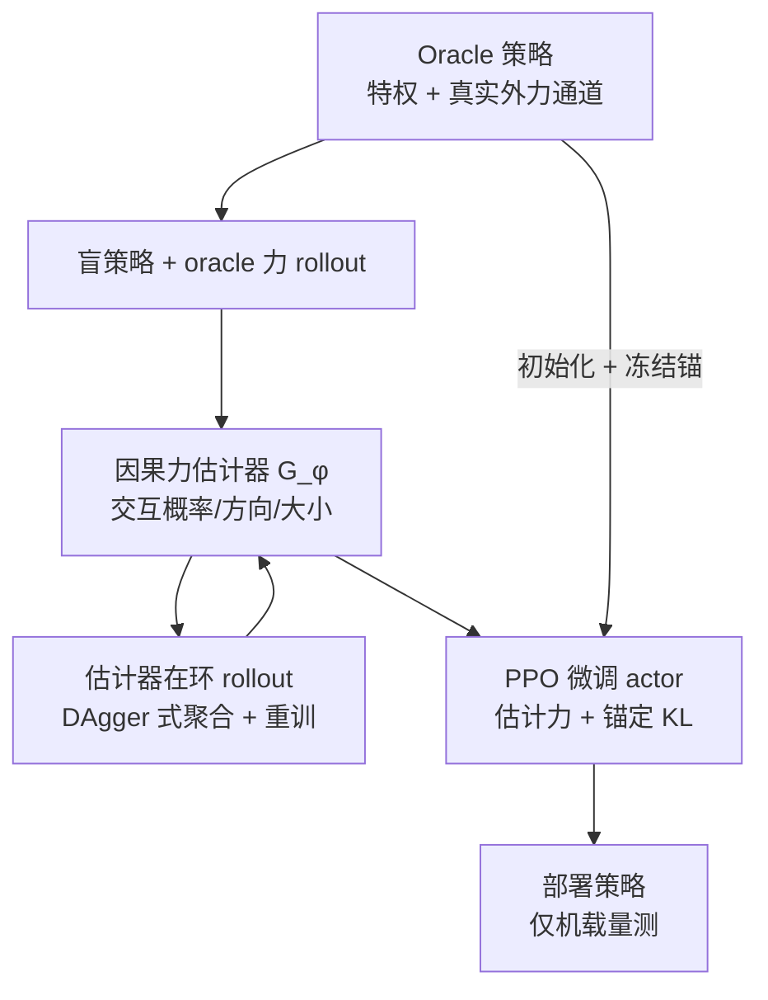

# Feeling Through the Load：载荷交互下的四足柔顺运动

论文 *Feeling Through the Load: Compliant Quadruped Locomotion under Payload Interactions*（[arXiv:2610.08637](https://arxiv.org/abs/2610.08637)）来自 **富士通美国研究院（Fujitsu Research of America）** 与 **卡内基梅隆大学（CMU）AirLab**：人可以直接推拉四足背上的未固定载荷，机器人需要从自身感知中“感觉”到这个力，并顺从地改变运动。

## 一句话定义

**把载荷上的人为推拉当作“塑造运动的指令”：先学一个柔顺的载运策略，再学一个只靠机载量测的因果力估计器，并把估计器放进环路里微调策略。**

## 英文缩写速查

| 缩写 | 英文全称 | 简要说明 |
|------|----------|----------|
| DAgger | Dataset Aggregation | 估计器在环的数据聚合，修正训练/部署分布偏移 |
| PPO | Proximal Policy Optimization | 策略训练与微调算法 |
| KL | Kullback–Leibler Divergence | 微调时约束 actor 贴近 oracle actor 的锚定项 |
| FACET | 论文沿用的奖励框架名（原文缩写，展开未核实） | 基线 Facet / Facet-L 对应的奖励 |
| ρ_cmd | 指令响应比（论文指标） | 越高表示越准确执行外力引导的指令 |

## 为什么重要

- 人与载荷共处时，区分“载荷自己滑动”和“人在引导”是安全交互的前提，而盲策略只能被动稳定。
- 不加力传感器：估计只依赖本体感知与足端法向载荷，可迁移到现有平台。
- 同周 [PAMORT](./paper-pamort-stacked-payload-quadruped-morl.md) 解决地形上的载荷稳定，本文解决人对载荷施力的响应，二者互补。

## 核心信息

| 项 | 内容 |
|----|------|
| **机构** | 富士通美国研究院（匹兹堡）；卡内基梅隆大学 AirLab / Robotics Institute |
| **平台** | Unitree Go2 + 躯干支撑 + 未固定刚性载荷 |
| **项目页** | [feelthroughload.github.io](https://feelthroughload.github.io/)（归档见 [sources/sites](../../sources/sites/feelthroughload.md)） |
| **开源** | 项目页标 “Code (coming soon)”，GitHub 仓库仅静态站与 README，截至 2026-10-12 未发布 |

## 方法栈 / 流程总览

## 方法

- **交互模型：** 虚拟质量-弹簧-阻尼 M_v ẍʳ = K_p(xᵈ − xʳ) + K_d(ẋᵈ − ẋʳ) + F_L，外力 F_L 改变参考；原文称为阻抗式响应而非严格导纳。
- **策略：** PPO 非对称 actor-critic。actor 观测阻抗指令、投影重力、关节位置/速度历史、上一动作、IMU、执行器力矩、3 维力通道与特权潜变量；critic 另看完整特权状态；递归适应模块恢复潜变量。
- **奖励：** FACET 奖励 + 载荷余量、滑移、保持、等级项（权重未公布）。
- **力估计器：** 递归编码器，输入去掉力通道的策略观测、足端法向载荷与接触状态；输出交互概率、单位方向与大小，带因果滞回门；训练时另有质量头。
- **在环训练：** 先用盲策略与 oracle 力 rollout 训练初始估计器，再做一轮估计器在环数据聚合并在并集上重训；actor 由 oracle 初始化，在估计力 rollout 下 PPO 微调，并对冻结 oracle actor 加锚定 KL。仿真器、环境数与 PPO 超参原文未报告。

## 源码运行时序图

**不适用** — 截至 2026-10-12 项目页写 coming soon，仓库只有 docs 与 README，无训练或推理入口，无法对齐目录与脚本。

## 实验与评测

- **仿真设置：** 载荷 2/4/6 kg，力 6–30 N 持续 2 s、恢复 3 s，K_p ∈ {6,8,16,30}，M_v = 4 kg，每条件 32 个随机实例、5 个种子。
- **Table I（ρ_cmd↑ / 姿态误差 e_θ°↓ / 终止%↓）：** Oracle 0.865/1.77/19.13；Facet 0.252/8.99/52.91；Facet-L 0.702/7.27/21.57；Ours-Analytic 0.602/3.37/33.48；Ours 0.826/3.73/19.84。
- **估计器（学习 vs 解析）：** 幅值比 0.886 vs 0.445，方向误差 10.87° vs 14.24°，检测率 98.90% vs 86.84%，起始延迟 0.175 s vs 0.433 s。
- **避障（通过/联合成功/目标误差）：** Oracle 92.4%/92.4%/0.038 m；Facet-L 0%/0%/0.093 m；Ours-Analytic 34.8%/34.3%/0.055 m；Ours 77.1%/76.9%/0.068 m。
- **真机（Go2，K_p = 8，标称 0.25 m/s 走 6 m，每方法 10 次）：** 直线任务 Facet-L 与 Ours 速度均约 0.25 m/s，路径偏差 0.025 vs 0.045 m，平均/峰值倾角 2.05/6.14° vs 1.70/7.40°；人引导任务 Ours 平均/峰值倾角 3.45/13.37°（Facet-L 2.07/8.38°），目标误差 0.045 vs 0.089 m，侧向位移 0.345 ± 0.081 m。真机载荷质量在原文写作 “44 kg”，疑似笔误，原文未核实。

## 结论

**把估计器放进环路并锚定微调，使纯机载估计的策略接近 oracle 的指令响应（0.826 vs 0.865），代价是被引导时倾角更大。**

1. 关键指标是 ρ_cmd 与终止率：Ours 0.826 / 19.84% 几乎追平 oracle 的 0.865 / 19.13%。
2. 学习式估计器优于解析估计器（检测 98.90% vs 86.84%，延迟 0.175 s vs 0.433 s），差距直接转化为避障成功率 76.9% vs 34.3%。
3. 真机人引导时倾角显著增大（峰值 13.37° vs 8.38°），是柔顺响应的代价，需结合载荷余量评估。
4. 只测平面交互，三维推拉和更大载荷未覆盖。
5. 复现门槛高：估计器结构、窗口、奖励权重与仿真器均未公开，等待官方代码。

## 与其他工作对比

| 对照 | 差异读法 |
|------|----------|
| [PAMORT](./paper-pamort-stacked-payload-quadruped-morl.md) | 地形上多目标折中；本文是人施力下的柔顺响应 |
| [四足本体力估计](./paper-proprioceptive-force-estimation-for-quadruped.md) | 该文做通用本体力估计；本文把估计耦合进策略微调 |
| [Teacher–Student / DAgger](../methods/teacher-student-dagger-training.md) | 本文把 DAgger 用在估计器上而不是策略蒸馏 |
| [阻抗控制](../concepts/impedance-control.md) | 本文把虚拟阻抗当作策略学习目标，而非固定控制器 |
| [非抓取运输](./paper-quadruped-nonprehensile-object-transport.md) | 模型化规划无外力，本文面向人为外力 |

## 局限与风险

- 仅平面交互，假设载荷始终接触支撑；大力仍会使载荷脱落。
- 方法细节与超参缺失，真机载荷质量存在疑似印刷错误。
- 开源状态：项目页 “coming soon”，截至 2026-10-12 无代码。

## 关联页面

- [人形与四足周报 2026-10-05 至 10-09](../overview/frontier-humanoid-quadruped-2026-10-05-10-09.md)
- [Locomotion 任务页](../tasks/locomotion.md)
- [Loco-manipulation 任务页](../tasks/loco-manipulation.md)
- [阻抗控制](../concepts/impedance-control.md)
- [PAMORT](./paper-pamort-stacked-payload-quadruped-morl.md)
- [四足本体力估计](./paper-proprioceptive-force-estimation-for-quadruped.md)

## 参考来源

- [论文归档](../../sources/papers/feeling_through_the_load_arxiv_2610_08637.md)
- [项目页归档](../../sources/sites/feelthroughload.md)
- [人形/四足周报来源](../../sources/blogs/frontier_humanoid_quadruped_2026_10_05_10_09.md)
- [arXiv:2610.08637](https://arxiv.org/abs/2610.08637)

## 推荐继续阅读

- [arXiv HTML 全文](https://arxiv.org/html/2610.08637v1)
- [项目页](https://feelthroughload.github.io/)
- [DAgger 原论文](https://arxiv.org/abs/1011.0686)
