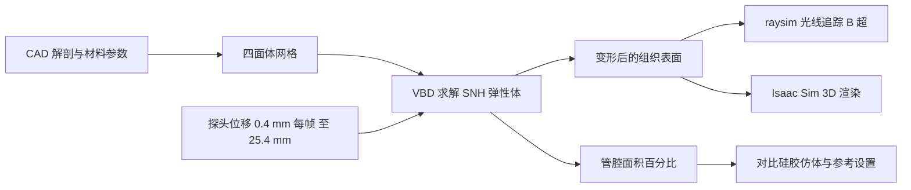

# 股静脉压缩仿真（arXiv:2611.12818）

**股静脉压缩仿真**（*Simulating Vein Compressibility for Ultrasound-Guided Femoral Access: Speed, Accuracy, and Phantom Validation*，[arXiv:2611.12818](https://arxiv.org/abs/2611.12818)，明尼苏达大学 Kowalewski 组与 Lightside Surgical）。正文与仓库中的补充材料（S1–S3、表 S1–S9）均已读，范围与缺项见 [来源归档](../../sources/papers/femoral-vein-compressibility-sim_arxiv_2611_12818.md)。

## 一句话定义

**用 GPU 上的可变形组织有限元仿真，让机器人超声探头按压股部，检验「静脉先于动脉塌陷」这一临床信号能否在足够快的速度下复现，并测量求解器设置对速度与精度的影响（作者自述为可行性测试）。**

## 英文缩写速查

| 缩写 | 英文全称 | 简要说明 |
|------|----------|----------|
| VBD | Vertex Block Descent | 逐顶点牛顿步、按图着色并行的 GPU 求解器（§2.2） |
| FEM | Finite Element Method | 有限元，此处用四面体网格 |
| B-mode | Brightness mode | 超声灰度成像，文中不假设可用彩色多普勒（§1） |
| CFA | Common Femoral Artery | 股总动脉 |
| CFV | Common Femoral Vein | 股总静脉 |
| SD | Standard Deviation | 标准差 |
| i4h | Isaac for Healthcare | NVIDIA 医疗仿真工作流，含 raysim 超声光线追踪 |

## 为什么重要

- 机器人超声策略多在静态图像体或刚体场景里训练，可变形求解器的真实组织标定很少被报告（§1，作者自述）。
- 论文回答的问题是：复现一个有临床意义的信号，到底需要多少算力。结论是工作量增加并不改善精度，选定设置比参考设置快约 977 倍（§3.3），但这个倍数里含约 3 倍的 CUDA Graph 收益（表 S3、S4）。
- 对自主股动静脉穿刺这类急救场景，仿真若能以接近控制频率运行，才可能用于强化学习训练或在线仿真（摘要，作者的可行性判断，论文没有做强化学习实验）。

## 核心原理与流程总览

组织是四面体网格，Stable Neo-Hookean 本构（§2.2 式 1），每步最小化惯性项、弹性能与接触能之和（式 2）。探头面与组织节点之间是线性罚弹簧，ke = 2000 N/m（式 3）；血管对侧壁用二次罚加对数势垒防止贴合（式 4），因此网格无法表示低于「闭合下限」的管腔面积（§2.3、§3.4）。

校准与验证分三层（§2.4、§2.6）：先在低保真仿体上对比（输入不对仿体调整），再在切片与腿模型上扫描单元尺寸、时间步、迭代数（以数值参考设置为准，容差 3 点），最后换文献参数检查静脉与动脉的分离。

## 工程实践

- **运行条件：** 单工作站 RTX 5090；Newton 1.2.1、Warp 1.13.0、Isaac Sim 6.0.1；超声光线追踪在另一容器里跑（§2.2）。
- **选定设置（表 3）：** 腿模型血管附近 1.5 mm 单元，其余 30 mm，股骨 5 mm；时间步 8.33 ms（每帧 2 步）；每步 35 次迭代；约 23,688 节点、129,783 四面体。
- **速度（§3.3）：** 仅求解器 30.4 ms 每帧；含超声与 3D 渲染 56.4 ms（一次运行）；实时线 16.7 ms 未达到，但文中称在扩散策略控制器 43 至 100 ms 的动作间隔内（§4.3，该间隔取自其引用文献）。
- **CUDA Graph：** 在同设置下约 3 倍加速（§3.3，表 S3）。摘要的 29,700 ms 是不用 CUDA Graph 的参考设置；同样开 CUDA Graph 时参考为 9,302 ms，选定设置帧加速 306 倍（表 S4）。
- **实际速度：** 补充材料视频段称整段运行约 0.29 倍实时（表 S9，一次运行）。
- **失败模式：** 时间步 0.249 与 0.980 ms 在部分深度未收敛，作者对应到接触弹簧周期 0.258 ms（§3.2）。
- **复现入口：** 仓库 README 称代码在 `i4h-phantom/`，需另克隆 NVIDIA 三个仓库并构建打补丁的超声容器。本页未运行代码，未核实可复现性。

## 与文章说法的核对

对象是公众号文章对该论文的描述（49 条）。

| 文章说法 | 与论文对照 |
|----------|-----------|
| 在 GPU 上模拟软组织与血管受压 | 符合。单张 RTX 5090，VBD 求解 SNH 四面体网格（§2.2）。 |
| 用实体仿体校准压缩响应 | 偏弱。§2.4 写明「没有对仿体调整任何输入」，仿体对比是验证；被「校准」的是数值参数（单元尺寸、时间步、迭代数），对象是数值参考设置而非真实组织（§2.6、§4.3）。 |
| 连接了仿真性能和形变误差 | 符合。工作量与墙钟线性、精度不随工作量上升（§3.3）；误差以管腔面积百分点衡量，不是位移或力。 |
| 验证仍是低保真仿体 | 符合，且更窄：仅一个仿体、一个层面、三次按压，供应商模量，面积由单个内高度推算（§4.4）。 |
| 不含血流、脉动等完整生理条件 | 符合。血管无血压、血流、搏动（§4.4）；另外论文还说明未报告探头力、未与临床图像对比声学（§4.4）。 |
| （未写但易被读出）静脉先塌陷已被验证 | 不成立。物理仿体上两种血管都没分开（§3.1），「静脉远比动脉压缩」只出现在用文献参数的腿模型里，是模型性质而非患者（§3.4、§4.2）。 |

## 局限

作者自述（§4.4、§3.4）：

- 血管无血压、血流和搏动；休克与心脏骤停下的表现未知。
- 无已发表刚度是在此加载下测得；脂肪、肌肉刚度为在体大腿中位数的约 2 倍与 4 倍；静脉壁取 20 kPa，对拉伸测试 5,700 kPa 差约 285 倍。
- 不报告探头力，且力从未用已知载荷标定。
- 仿体验证规模小，仿体与仿真几何不同（动脉孔径 9.00 与 6.96 mm，表 2）；从 15 mm 起仿真静脉始终比仿体塌得多；模拟图像未与临床图像比较。
- 精度是相对数值参考设置，不是相对真实组织（§4.3）；更细网格仍会改变结果（§3.2）。
- 部分单元反转：25.4 mm 处最多 859 个（0.67%），未发生在血管壁内（§3.4）。

本页读者的判断（推测）：

- 摘要提到可用于强化学习，但全文没有强化学习实验，完整回路 56.4 ms 对大规模并行训练是否够用，论文没有测。
- 摘要写 976 倍而正文写 977 倍（29,700 / 30.4 约 977），属摘要笔误或舍入，不影响结论；但「快 976 倍」是与不开 CUDA Graph 的参考相比，纯求解器工作量削减对应的是 306 倍（表 S4）。
- 表 S1：切片上单元尺寸 1.5 mm 时 25.4 mm 处余量只比闭合下限高 11.2 点，更细网格仍会改变结果；表 S2 与 §S2-C：单元反转随压深增加，力平衡误差在 25.4 mm 达探头力读数的 28%（切片、参考步长）。
- 表 S8：动脉在 3 与 7 mm 读到略高于 100%，作者称尚不能判定是横向变宽还是测量误差。
- 作者与 Lightside Surgical 有利益关系，论文已声明（Conflict of Interest）。
- 补充材料取自仓库 main 分支，未核对是否与投稿版一致。

## 关联页面

- [Isaac Sim](../entities/isaac-sim.md)
- [Isaac Lab](../entities/isaac-lab.md)
- [Newton 物理引擎](../entities/newton-physics.md)
- [NVIDIA Warp](../entities/nvidia-warp.md)
- [Sim2Real](../concepts/sim2real.md)
- [物理保真度与 sim2real 差距](../concepts/physics-fidelity-sim2real-gap.md)
- [US-VLA 超声论文](../entities/paper-us-vla-ultrasound.md)

## 参考来源

- [femoral-vein-compressibility-sim_arxiv_2611_12818.md](../../sources/papers/femoral-vein-compressibility-sim_arxiv_2611_12818.md)
- [arXiv:2611.12818](https://arxiv.org/abs/2611.12818)
- [femoral-sim-calibration 仓库](https://github.com/MRDLab/femoral-sim-calibration)

## 继续阅读

- [arXiv PDF](https://arxiv.org/pdf/2611.12818v1)
- [Isaac Sim](../entities/isaac-sim.md)
- [Sim2Real 概念页](../concepts/sim2real.md)
