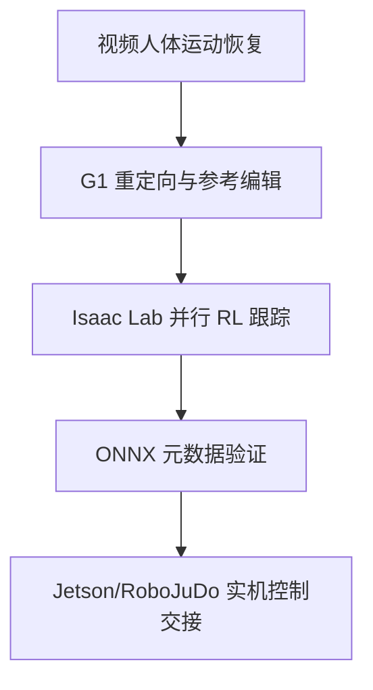

# 节庆视频到人形机器人长时舞台表演的 Sim2Real 阶梯（From Festival Video to the Stage: A Sim-to-Real Ladder for Long-Horizon Expressive Whole-Body Dance on a Commercial Humanoid）

**机构：** Arithmer 株式会社研发部  
**论文：** [arXiv:2611.11127](https://arxiv.org/abs/2611.11127)

## 一句话定义

**单目视频人体姿态恢复、G1 运动重定向与参考动作编辑后，在 Isaac Lab 2048 环境训练 BeyondMimic 风格 RL；导出含关节 PD 增益与默认姿态的 ONNX，由 RoboJuDo 在出厂行走与舞蹈控制器间交接，通过 choreographed settle 段缓解软硬控制器增益突变。**

## 英文缩写速查

| 缩写 | 英文全称 | 简要说明 |
|---|---|---|
| RL | Reinforcement Learning | 运动跟踪训练 |
| ONNX | Open Neural Network Exchange | 模型与元数据部署格式 |
| PD | Proportional Derivative | 关节低层控制增益 |

## 为什么重要

仿真能跟踪动作不等于实机能连续演出；部署的 ONNX 元数据、估计器漂移和控制器增益切换同样关键。

## 核心原理

单目视频人体姿态恢复、G1 运动重定向与参考动作编辑后，在 Isaac Lab 2048 环境训练 BeyondMimic 风格 RL；导出含关节 PD 增益与默认姿态的 ONNX，由 RoboJuDo 在出厂行走与舞蹈控制器间交接，通过 choreographed settle 段缓解软硬控制器增益突变。

### 流程总览

以下根据论文方法整理，箭头表示控制/数据流向。

## 实验与评测

v5 真机无安全绳 3/3 次完成 43 s；v6 完成含结束与自动交接的 46 s；v10/v11 完成连续 9.7 min 演出。最终仿真 timeout 比例约 99.7% 来自 10 s episode，并非同口径真机成功率；9.7 min 实机有约 1.5 m 的位置漂移。

## 与其他工作对比

单目视频人体姿态恢复、G1 运动重定向与参考动作编辑后，在 Isaac Lab 2048 环境训练 BeyondMimic 风格 RL；导出含关节 PD 增益与默认姿态的 ONNX，由 RoboJuDo 在出厂行走与舞蹈控制器间交接，通过 choreographed settle 段缓解软硬控制器增益突变。 与传统同方向方法的主要区别见以上控制接口及研究动机；跨论文统计结果不具有相同测试协议。

## 结论

**节庆视频到人形机器人长时舞台表演的 Sim2Real 阶梯 的实际价值在于明确研究对象与实验边界，而非脱离原文场景比较单个成功率。**

1. 检查 ONNX 中关节顺序、默认姿态与 PD 增益。
2. 必须分开统计 10 s 仿真超时与多分钟实机演出。
3. 柔顺地面和控制器切换仍需部署级安全评估。

## 工程实践

实际验证时先检查任务接口与坐标系，再按论文试验复现主指标；记录 RL / ONNX / PD 相关状态、控制采样与异常回退路径，不能以论文中的概念图代替可执行模块证明。

**源码开放状态：** 本次核对的论文未发现可核实的作者算法运行入口，不臆测代码接口。

## 源码运行时序图

**不适用**：尚无可确认的官方完整算法运行入口；以上主干流程是论文方法图，不是虚构源码调用。

## 局限与风险

仅 G1 与特定舞蹈路线；泡棉地面使全版本失败，持续位置漂移未消除。公开依赖组件不等于作者发布了整套运行入口。

## 关联页面

- [motion retargeting](../concepts/motion-retargeting.md)
- [sim2real](../concepts/sim2real.md)
- [humanoid locomotion](../tasks/humanoid-locomotion.md)
- [11.09–11.13 29 篇总览](../overview/humanoid_quadruped_2026_11_09_13_29_papers.md)

## 参考来源

- [arXiv v1 原文核对归档](../../sources/papers/festival-video-stage-dance_arxiv_2611_11127.md)
- [arXiv v1 HTML 全文](https://arxiv.org/html/2611.11127v1)

## 推荐继续阅读

- [论文 PDF](https://arxiv.org/pdf/2611.11127v1)
