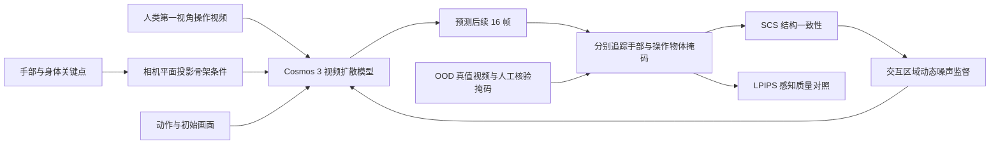

# What 30,000 Hours of Ego-centric Video Does Not Teach（Fidelity Gap）

**What 30,000 Hours of Ego-centric Video Does Not Teach**（arXiv:2610.12464，项目名常称 **Fidelity Gap**）研究：把大量人类第一视角操作视频用于视频世界模型预训练后，模型究竟学会了人的动作，还是也学会了动作对物体造成的变化。作者来自 UIUC、CMU、Johns Hopkins 与 Toyota Research Institute 等单位。

## 一句话定义

**把“手移动得像”与“物体按接触和动作正确变化”拆开评测；30,000 小时视频能让前者接近饱和，却没有让后者追上。**

## 英文缩写速查

| 缩写 | 英文全称 | 简要说明 |
|------|----------|----------|
| SCS | Structural Consistency Score | 对手部或物体掩码逐帧计算 IoU，评估动作后的结构变化是否正确 |
| OOD | Out-of-Distribution | 测试采集人员、地点、相机等与训练数据分离 |
| LPIPS | Learned Perceptual Image Patch Similarity | 作为视觉感知质量对照，避免把结构保真度提升误当成画质变化 |
| VAE | Variational Autoencoder | 将 Cosmos 3 视频编码到时空 latent，供扩散模型预测 |
| D4RT | Dynamic 4D Reconstruction and Tracking | 用点轨迹和 3D 位移帮助定位动态交互区域 |

## 为什么重要

世界模型常被当作策略训练/评测的可扩展模拟器，或供规划器比较未来动作的预测器。对于这两种用途，“画面连续、手的位置正确”都不够：机器人抓取或推动物体时，物体是否真的随接触改变，才决定预测能否用于操作。

该工作把 **agent fidelity（主体/手部忠实度）** 和 **object-interaction fidelity（物体交互忠实度）** 分开看，显示只堆人类视频和模型规模会造成能力错位。它为评测世界模型时增加了一个关键问题：不仅问“动作主体去哪里”，还要问“它造成了什么可验证的物理后果”。

## 方法栈 / 流程总览

### 核心机制

1. **控制生成主体与未来视频。** 以 Cosmos 3 为基础，输入初始 RGB 帧、文本描述与动作序列，预测未来视频帧。模型输入包含相机、手腕、手指和上半身状态；论文定义的完整状态为 159 维。
2. **骨架条件降低“猜手”的负担。** 把视频中的 3D 手/身体关键点投影到图像平面，编码后作为额外视觉条件，让模型直接知道主体姿态，不必完全从像素与动作 token 中重建人体位置。
3. **用 SCS 拆分主体与物体。** SAM 2 生成并跟踪手和每个操作物体的掩码，人工核验后，计算未来帧的掩码 IoU 均值；手、物体分别报告。LPIPS 作为画质控制指标。
4. **把扩散监督偏向交互区域。** D4RT 点轨迹、3D 位移可靠性和手部邻域先验组成动态区域图；在这些 latent 区域提高噪声，让模型不能只复制局部外观，而需要根据上下文预测交互动态。区域损失重加权提供少量额外收益。

## 实验与评测

| 实验 | 设置 | 主要观察 |
|------|------|----------|
| 数据规模 | 300 / 3k / 30k 小时；Edge 4B、Nano 16B、Super 64B 等模型变体 | 规模增加改善手和物体，但手部更快饱和；Super 相对 Nano 放大 4× 后，物体拟合上限只升约 0.034 SCS |
| OOD 视频评测 | 独立采集活动操作片段；150 段、每段 32 帧、10 fps，含 11,328 个实例掩码 | 测试人员、地点、采集平台与训练集不同；手与物体逐项测 SCS，LPIPS 控制感知质量 |
| 骨架条件 | 投影人体关键点作为条件 | Nano 约 300 小时即可达到无骨架基线约 15k 小时的手部忠实度，约 50× 数据效率 |
| 动态区域监督 | 在 10k 小时消融、最多 30k 小时规模对比 | 30k 时 object SCS 从骨架条件基线 0.527 升至 0.546（+3.7%）；LPIPS 基本不变，但物体与主体差距仍然明显 |
| 人形迁移 | 11 个双臂仿真任务，在 EgoVLA 策略 rollout 上评估 | Ours 的手部 / 物体 SCS 为 0.88 / 0.79，成功判定与模拟器一致率 0.81；均高于原始 Cosmos 3（0.63 / 0.70 / 0.67） |

**读数边界：** 人形结果来自简化仿真环境，物体较大且刚性更强，因此不能直接等同于真实手物接触的泛化表现；作者也指出这一环境条件会显著影响物体忠实度。

## 结论

**规模化人类视频能学会“人怎么动”，但不足以让生成式世界模型可靠学会“接触如何改变物体”。**

1. **评测要拆开主体与物体。** 整帧观感或手部轨迹不能替代物体交互忠实度指标。
2. **先给定主体运动，才能看清物体上限。** 投影骨架条件大幅减少模型学习手部运动所需的数据，帮助隔离 object fidelity 瓶颈。
3. **关键是训练目标如何分配。** 数据与模型扩张收益有限；把扩散噪声监督移向交互区域，才让物体拟合上限有可测提升。
4. **视频本身看不到力和遮挡下的接触几何。** 仅靠图像，很难唯一确定质量、摩擦、刚度或手下物体形状；模拟器能提供部分物理监督，但它自身也有模型误差。
5. **人形迁移仍是仿真证据。** 成功判定一致率提高说明预测可作为评测线索，但不是闭环真机操作能力已解决的证据。

## 代码与数据可用性

- **代码：未公开。** 项目页当前将 Paper Code 标为 Soon；没有可运行的官方入口，因此源码运行时序图不适用。
- **基准：尚未公开。** 论文承诺公开 OOD 评测集；截至 2026-10-13，项目页未提供下载地址。
- **训练视频：不可据此认定公开。** 论文感谢 Mecka 提供约 30k 小时人类 egocentric 视频，但没有提供本文训练数据的开放下载入口。
- **许可：** arXiv 标注 CC BY 4.0 适用于论文文本；不能推导代码、权重或视频数据使用相同许可。

## 局限与风险

- 数据量和优化预算一起增长，因此曲线反映联合 scaling，不是完全隔离的数据因果效应。
- 150 段 OOD 评测样本有限，训练与测试都来自单一采集协议；对更广的人类活动视频能否推广仍待验证。
- 掩码跟踪的可达上限低于 1.0；SCS 衡量结构一致，不直接测量力、摩擦或可供机器人执行的接触动力学。
- 实验针对像素生成式世界模型；是否适用于不渲染像素的 latent-predictive 模型，论文没有结论。
- 物体交互提升是相对有限的上限移动（30k 小时下 0.527 → 0.546），不应概括为已弥合 fidelity gap。

## 与其他工作对比

| 工作 | 与本研究的关系 |
|------|----------------|
| [EgoWM](./paper-egowm-egocentric-world-model.md) | 同属第一视角视频世界模型；EgoWM 强调动作条件和结构一致性评测，本研究进一步拆分手部与物体交互，并系统测量数据/模型规模效应 |
| [1XWM](./paper-1xwm-redwood-world-model.md) | 同样关注预测是否能支持具身策略评估；本研究直接追踪手和物体像素结构，1XWM 更偏策略成功价值评测 |
| [世界动作模型](../concepts/world-action-models.md) | 本文不是 WAM 策略，重点是诊断通用生成式世界模型能否模拟动作后果 |
| [仿真评测可复现性与真实代表性](../concepts/sim-vs-real-eval-gap.md) | 本文的 SCS 体现结构保真度测量；人形仿真迁移结果仍须与真实交互区分 |

## 关联页面

- [EgoWM](./paper-egowm-egocentric-world-model.md)
- [1XWM](./paper-1xwm-redwood-world-model.md)
- [World Action Models](../concepts/world-action-models.md)
- [仿真评测可复现性与真实代表性](../concepts/sim-vs-real-eval-gap.md)
- [生成式世界模型](../methods/generative-world-models.md)

## 参考来源

- [论文来源归档](../../sources/papers/fidelity_gap_arxiv_2610_12464.md)
- [项目页核查](../../sources/sites/fidelity-gap-project.md)
- [arXiv 论文](https://arxiv.org/abs/2610.12464)
- [论文 HTML](https://arxiv.org/html/2610.12464v1)
- [项目页](https://fidelity-gap.github.io/)

## 推荐继续阅读

- [EgoWM 项目页](https://egowm.github.io/)
- [SCS 结构一致性说明](https://fidelity-gap.github.io/)
- [arXiv:2610.12464](https://arxiv.org/abs/2610.12464)
