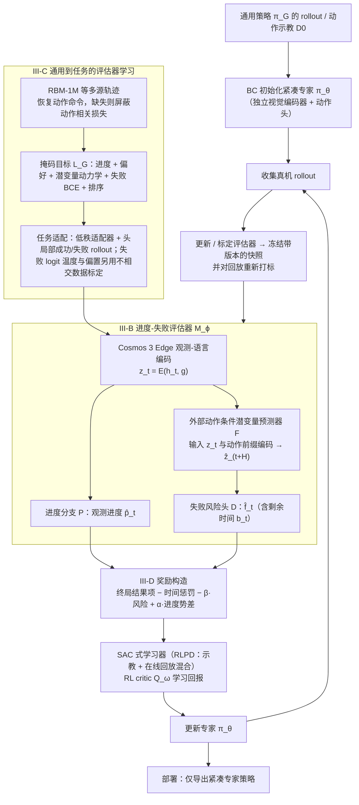

# FIERCE（arXiv:2609.18651）

**FIERCE**（*From Generalist Robot Policies to Fast Specialists via Progress–Failure Feedback*，[arXiv:2609.18651](https://arxiv.org/abs/2609.18651)，[GitHub](https://github.com/ar-mine/FIERCE)）来自 [具身智能小站 9 篇盘点](../../sources/blogs/wechat_embodied_station_9_papers_perception_action_transfer_2026-09-17.md)。

## 一句话定义

**通用策略当初始化，用「任务进展 + 动作条件失败风险」共同塑造 RL 奖励，蒸馏出适合重复插入/对齐/放置的紧凑专才策略。**

## 英文缩写速查

| 缩写 | 英文全称 | 简要说明 |
|------|----------|----------|
| RL | Reinforcement Learning | 强化学习微调 |
| VLA | Vision-Language-Action | 视觉–语言–动作通用策略 |
| SR | Success Rate | 任务成功率 |

## 为什么重要

- 部署瓶颈常是 **延迟与重复精度**，而非通用语义理解；需要可解释的专才化路径。
- Progress 与 failure 双反馈比纯回报更贴近「插/放/对齐」类接触任务。
- 开源结论：**部分开源**（仓已建，README 称实现准备中，2026-09-17）。

## 流程总览

图依据：论文 §III（A–D）与 Fig. 1–2、式 (1)–(6)

## 核心机制

| 项 | 内容 |
|----|------|
| **arXiv** | [2609.18651](https://arxiv.org/abs/2609.18651) |
| **开源** | **部分开源** |
| **要点** | 通用策略初始化 → RL 专才；反馈同时看 observed progress 与 action-conditioned failure risk |
| **评测** | 仿真 + 插销入孔 + 叠杯等重复精度任务 |

## 源码运行时序图

**不适用**（截至 2026-09-17 官方仓尚无完整训练/推理入口，仅 placeholder README）。

## 实验与评测

- 强调 **低延迟专才** 相对通用策略在重复操作上的优势（细节以 PDF 为准）。
- **读法：** 与 [Real-Time EXPO-FT](./paper-real-time-expo-ft.md) 同属「通用→可部署专才」谱系，但 FIERCE 侧重 progress–failure 奖励塑形。

## 与其他工作对比

| 对照对象 | 差异 |
|----------|------|
| 直接部署通用 VLA | 语义泛化强但推理慢、重复精度不稳；FIERCE 用通用策略做 **初始化** 而非终态 |
| 纯回报 RL 微调 | 稀疏成功/失败信号在插销入孔类接触任务上样本效率低；本文把奖励拆成 **observed progress** + **action-conditioned failure risk** 两路 |
| 从零训小模型 | 丢掉通用先验，重新采数据；FIERCE 走 **蒸馏式专才化**，上限受 generalist 质量约束 |
| [Real-Time EXPO-FT](./paper-real-time-expo-ft.md) | 同属「通用→可部署」谱系但正交：EXPO-FT 在线 **编辑动作** 对抗延迟，FIERCE 离线 **改结构 + 奖励塑形** 降延迟 |

定量对照（延迟、重复成功率、消融）以原文 PDF 为准；代码仓当前仅 placeholder README，无法独立复现。

## 结论

**FIERCE 把专才化问题从「再训一个小模型」改写成「用进展与失败信号引导的 RL 蒸馏」——值得跟踪代码落地后的奖励实现细节。**

1. 仓已公开但实现未齐，复现前关注 GitHub 更新。
2. 专才策略评估应报告 **延迟 + 重复成功率**，勿只报仿真均值。
3. 通用策略质量仍是上限；弱 generalist 可能无法提供有效初始化。
4. 与 EXPO-FT 类实时修正正交：一个改结构/蒸馏，一个改在线 edit。

## 关联页面

- [vla](../methods/vla.md)
- [reinforcement-learning](../methods/reinforcement-learning.md)
- [Real-Time EXPO-FT](./paper-real-time-expo-ft.md)
- [9 篇技术地图](../overview/perception-action-transfer-9-papers-technology-map.md)

## 参考来源

- [fierce_arxiv_2609_18651.md](../../sources/papers/fierce_arxiv_2609_18651.md)
- [wechat_embodied_station_9_papers_perception_action_transfer_2026-09-17.md](../../sources/blogs/wechat_embodied_station_9_papers_perception_action_transfer_2026-09-17.md)
- [arXiv:2609.18651](https://arxiv.org/abs/2609.18651)
- [arXiv PDF](https://arxiv.org/pdf/2609.18651)：已通读方法部分（实验与附录以略读为准）：摘要、§I 引言、§III 方法 A–D（实验与附录以略读为准）

## 推荐继续阅读

- [arXiv PDF](https://arxiv.org/pdf/2609.18651)
- [GitHub: ar-mine/FIERCE](https://github.com/ar-mine/FIERCE)
