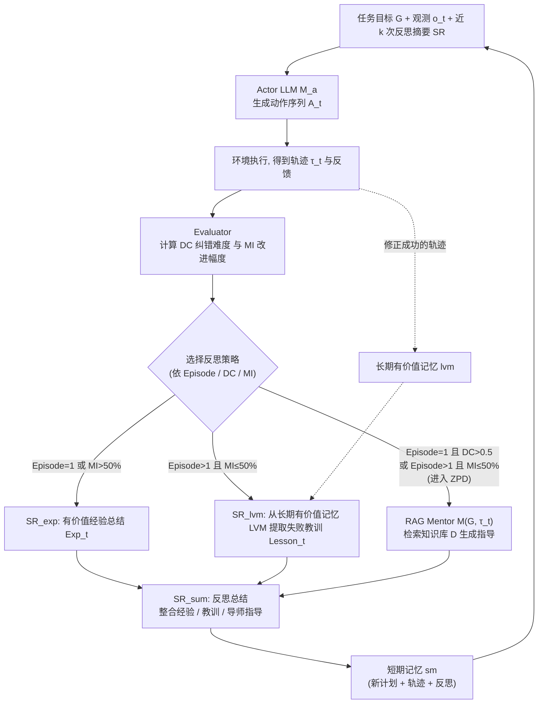

# FISRF（arXiv:2610.35686）

**FISRF**（*FISRF: Flexible Instructional Scaffolding Reflection Framework for Robotics Task Planning with Large Language Model*，[arXiv:2610.35686](https://arxiv.org/abs/2610.35686)，[项目页](https://fisrfplanning.github.io/)）来自 [具身智能小站 2026-10-28 盘点](../../sources/blogs/wechat_embodied_station_59_papers_human_video_to_robot_experience_2026-10-28.md)，属「VLA 与策略后训练」组。

## 一句话定义

**由智能体与导师协作估计当前规划能力，动态选择反思策略与指导强度，减少早期错误经验积累。**

## 英文缩写速查

| 缩写 | 英文全称 | 简要说明 |
|------|----------|----------|
| FISRF | FISRF: Flexible Instructional Scaffolding Reflection Framework for Robotics Task Planning with Large Language Model | 本文方法 / 基准的简称 |

## 为什么重要

- 反思规划需要按能力给予指导。在 ALFWorld 与真机中考察纠错效率，适合研究交互式任务规划。
- 开源结论：**项目页未列 GitHub**（步骤 2.5，2026-10-28）。项目页 HTTP 200，未见 GitHub 链接或 coming soon 字样。
- 同期同组工作见 [潜在动作、免渲染事件仿真与机器人评测：具身智能小站 10-28 期 59 篇阅读坐标](../overview/embodied-station-2026-10-28-59-papers-technology-map.md)。

## 流程总览

图依据：论文 §IV-A 至 §IV-E / Fig.2 / Fig.3

## 核心机制

| 项 | 内容 |
|----|------|
| **arXiv** | [2610.35686](https://arxiv.org/abs/2610.35686) |
| **开源** | **项目页未列 GitHub** |
| **要点** | 由智能体与导师协作估计当前规划能力，动态选择反思策略与指导强度，减少早期错误经验积累。 |
| **文内指标** | 公众号转述：在 ALFWorld 与真机中考察纠错效率，适合研究交互式任务规划。 |

## 源码运行时序图

**不适用（项目页未列 GitHub）** — 项目页 HTTP 200，未见 GitHub 链接或 coming soon 字样。 不编造运行脚本；代码公开后再补。

## 实验与评测

- 公众号转述：在 ALFWorld 与真机中考察纠错效率，适合研究交互式任务规划。
- **读法：** 本页为索引级摘要，依据公众号转述的官方摘要与仓库信息整理；逐项数字与 baseline 以原文 PDF 为准。

## 与其他工作对比

- 横向索引见 [潜在动作、免渲染事件仿真与机器人评测：具身智能小站 10-28 期 59 篇阅读坐标](../overview/embodied-station-2026-10-28-59-papers-technology-map.md)；同 arXiv 不重复造页。

## 结论

**反思规划需要按能力给予指导：在 ALFWorld 与真机中考察纠错效率，适合研究交互式任务规划。**

1. 开源边界：**项目页未列 GitHub** — 项目页 HTTP 200，未见 GitHub 链接或 coming soon 字样。
2. 核心机制：由智能体与导师协作估计当前规划能力，动态选择反思策略与指导强度，减少早期错误经验积累。
3. 复现与选型前核对任务协议、硬件与基准口径，勿直接横比公众号摘录数字。

## 关联页面

- [vla](../methods/vla.md)
- [imitation-learning](../methods/imitation-learning.md)
- [reinforcement-learning](../methods/reinforcement-learning.md)
- [llm-robotics-control-interfaces](../concepts/llm-robotics-control-interfaces.md)
- [embodied-station-2026-10-28-59-papers-technology-map](../overview/embodied-station-2026-10-28-59-papers-technology-map.md)

## 参考来源

- [fisrf_arxiv_2610_35686.md](../../sources/papers/fisrf_arxiv_2610_35686.md)
- [wechat_embodied_station_59_papers_human_video_to_robot_experience_2026-10-28.md](../../sources/blogs/wechat_embodied_station_59_papers_human_video_to_robot_experience_2026-10-28.md)
- [arXiv:2610.35686](https://arxiv.org/abs/2610.35686)
- [arXiv PDF](https://arxiv.org/pdf/2610.35686)：已通读方法部分（实验与附录以略读为准）：摘要、§I、§III、§IV（Actor、短长期记忆、RAG Mentor、自反思、ZPD 触发条件）、§V 实验设定

## 推荐继续阅读

- [arXiv PDF](https://arxiv.org/pdf/2610.35686)
- [项目页](https://fisrfplanning.github.io/)
