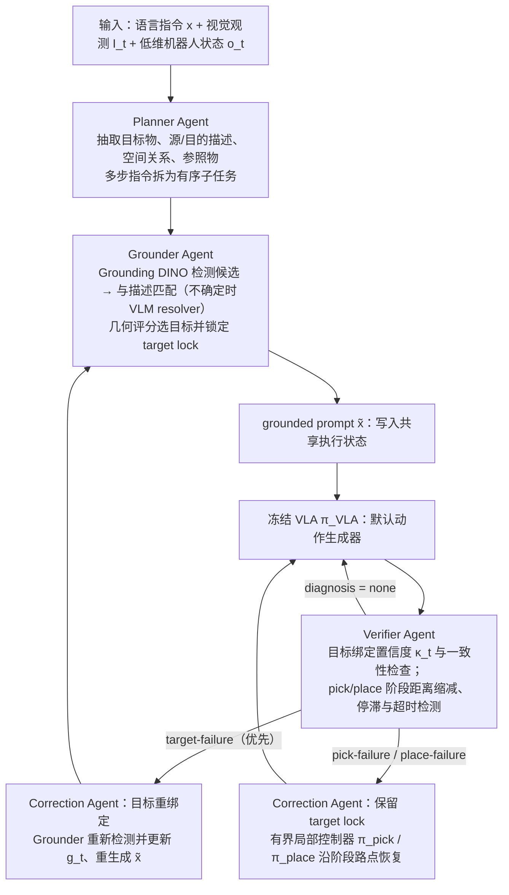

# FIT-MAC（arXiv:2610.28109）

**FIT-MAC**（*FIT-MAC: A Closed-Loop Multi-Agent Framework for Robust Vision-Language-Action Models*，[arXiv:2610.28109](https://arxiv.org/abs/2610.28109)，[项目页](https://fitmac-research.pages.dev/)）来自 [具身智能小站 2026-10-31 盘点](../../sources/blogs/wechat_embodied_station_50_papers_scenerig_photo_to_sim_2026-10-31.md)，属「评测、基准与可靠性」组。

## 一句话定义

**FIT-MAC在冻结VLA外增加规划、定位、核验与纠错层，按失败类型介入；LIBERO-PRO仿真验证扰动恢复，额外干预开销仍待压低。**

## 英文缩写速查

| 缩写 | 英文全称 | 简要说明 |
|------|----------|----------|
| FIT-MAC | FIT-MAC: A Closed-Loop Multi-Agent Framework for Robust Vision-Language-Action Models | 本文方法 / 基准的简称 |
| VLA | Vision-Language-Action | 视觉–语言–动作策略 |

## 为什么重要

- 先分清选错目标，还是执行失败。
- 开源结论：**部分开源**（步骤 2.5，2026-10-31）。公众号代码入口为 anonymous.4open.science 匿名链接（HTTP 401，无法核查）；项目页 HTTP 200，未见 GitHub 链接。
- 同期同组工作见 [单图重建仿真、VLA 适配评测与跨形态世界模型：具身智能小站 10-31 期 50 篇阅读坐标](../overview/embodied-station-2026-10-31-50-papers-technology-map.md)。

## 流程总览

图依据：论文 §3.1–3.5 与 Fig. 2。

## 核心机制

| 项 | 内容 |
|----|------|
| **arXiv** | [2610.28109](https://arxiv.org/abs/2610.28109) |
| **开源** | **部分开源** |
| **要点** | FIT-MAC在冻结VLA外增加规划、定位、核验与纠错层，按失败类型介入；LIBERO-PRO仿真验证扰动恢复，额外干预开销仍待压低。 |
| **文内指标** | 公众号未给具体数字，本页不引用。 |

## 源码运行时序图

**部分开源** — 公众号代码入口为 anonymous.4open.science 匿名链接（HTTP 401，无法核查）；项目页 HTTP 200，未见 GitHub 链接。 待可运行代码公开后补图。

## 实验与评测

- 公众号未给具体数字，本页不引用。
- **读法：** 本页为索引级摘要，依据公众号转述的官方摘要与仓库信息整理；逐项数字与 baseline 以原文 PDF 为准。

## 与其他工作对比

- 横向索引见 [单图重建仿真、VLA 适配评测与跨形态世界模型：具身智能小站 10-31 期 50 篇阅读坐标](../overview/embodied-station-2026-10-31-50-papers-technology-map.md)；同 arXiv 不重复造页。

## 结论

**先分清选错目标，还是执行失败：FIT-MAC在冻结VLA外增加规划、定位、核验与纠错层，按失败类型介入；LIBERO-PRO仿真验证扰动恢复，额外干预开销仍待压低。**

1. 开源边界：**部分开源** — 公众号代码入口为 anonymous.4open.science 匿名链接（HTTP 401，无法核查）；项目页 HTTP 200，未见 GitHub 链接。
2. 核心机制：FIT-MAC在冻结VLA外增加规划、定位、核验与纠错层，按失败类型介入；LIBERO-PRO仿真验证扰动恢复，额外干预开销仍待压低。
3. 复现与选型前核对任务协议、硬件与基准口径，勿直接横比公众号摘录数字。

## 关联页面

- [simulation-evaluation-infrastructure](../concepts/simulation-evaluation-infrastructure.md)
- [vla](../methods/vla.md)
- [manipulation](../tasks/manipulation.md)
- [embodied-station-2026-10-31-50-papers-technology-map](../overview/embodied-station-2026-10-31-50-papers-technology-map.md)
- [具身大模型评测基准选型闭环](../queries/embodied-eval-benchmark-selection-loop.md) — 评测基准在选型闭环中的定位与取舍

## 参考来源

- [fit_mac_arxiv_2610_28109.md](../../sources/papers/fit_mac_arxiv_2610_28109.md)
- [wechat_embodied_station_50_papers_scenerig_photo_to_sim_2026-10-31.md](../../sources/blogs/wechat_embodied_station_50_papers_scenerig_photo_to_sim_2026-10-31.md)
- [arXiv:2610.28109](https://arxiv.org/abs/2610.28109)
- [arXiv PDF](https://arxiv.org/pdf/2610.28109)：已通读全文：§3 方法（Planner / Grounder / Verifier / Correction Agent）、§4 实验设定（LIBERO-PRO）

## 推荐继续阅读

- [arXiv PDF](https://arxiv.org/pdf/2610.28109)
- [项目页](https://fitmac-research.pages.dev/)
