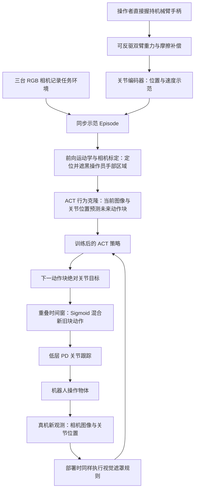
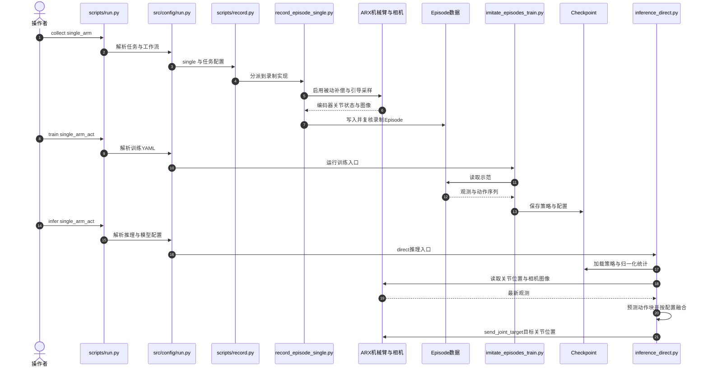

# Flash ALOHA：学习高速精准的机器人操作（Flash ALOHA: Learning Fast and Precise Manipulation）

## 一句话定义

**Flash ALOHA**（早期名 **ALOHA Lightning**，斯坦福团队、ICRA 2026）把人直接握臂示范、**关节编码器读位置**、视觉手部遮罩、ACT 动作块与推理时平滑连成一套高速双臂模仿学习系统：在五个指定操作任务中，每个任务只用 50 条示范，作者报告成功率均达到 80%–100%。

## 英文缩写速查

| 缩写 | 英文全称 | 简要说明 |
|---|---|---|
| ALOHA | A Low-cost Open-source Hardware System for Bimanual Teleoperation | 本研究所对比的双臂遥操作体系名称 |
| ACT | Action Chunking Transformer | 对图像与本体感知预测未来关节动作块的模仿学习策略 |
| RGB | Red, Green, Blue | 三相机图像；基于运动学的手部遮罩将部分像素置零 |
| FK | Forward Kinematics | 根据关节编码器与相机外参确定需要遮罩的操作员手部区域 |
| PD | Proportional–Derivative | 低层关节位置跟踪控制，执行预测的目标位置 |
| CVAE | Conditional Variational Autoencoder | 原版 ACT 的训练组件；本研究采用去掉 CVAE encoder 的 ACT 变体 |

## 核心信息

| 项目 | 一手核对 |
|---|---|
| 作者 | John Hua Yao、Qi Wu、Yihuai Gao、Chelsea Finn、Zipeng Fu |
| 机构 | 斯坦福大学（Stanford University） |
| 发表情况 | ICRA 2026；早期论文题名为 ALOHA Lightning；截至 2026-11-13 项目页 arXiv 仍标记 coming soon，不杜撰 arXiv ID |
| 原文 | [Flash ALOHA 官方论文 PDF，12 页](https://johnyao93.github.io/static/files/flash-aloha.pdf?v=2)，[项目主页](https://johnyao93.github.io/flash-aloha/) |
| 实现 | [JohnYao93/flash-aloha](https://github.com/JohnYao93/flash-aloha)，MIT 开源；支持示范采集、ACT/Flow 训练与真机推理，但论文定量实验使用 ACT |
| 硬件 | ARX 轻型双臂用于四项桌面任务；HESSIAN 双臂用于抛接球；均不是完整人形移动平台 |
| 示范 | 各任务 50 条；多数任务数据频率 50 Hz，抛接球双臂频率分别 100 Hz 与 200 Hz（论文 Appendix V） |

## 为什么重要

通常高成功率的模仿学习策略仍可能执行得远慢于人类。论文指出一个容易忽视的上限：**如果专家遥操作时因主从控制不直觉等原因只能慢速演示，机器人很难单靠事后加速就变快**。让操作者直接握住可反驱机械臂提供人体动作速度的轨迹，再把高速动作特有的视觉与控制问题单独处理，比简单把慢轨迹加倍播放更有效。

它是**数据采集、人机交互与执行协议的协同设计**，并非新的 VLA 基座模型，也不以未来视频生成作监督。

## 流程总览

## 核心原理

**1. 动觉示教（Kinesthetic Teaching）**：操作者直接握着末端剪刀状手柄带动关节；轻量、可反驱机械臂用力矩控制减轻重力和摩擦，编码器记录真实关节轨迹，避免高速手持设备的外部视觉惯性跟踪漂移。此法采集的是**机器人关节空间动作**，不需要先把人视频重定向成机器人动作。

**2. 几何视觉遮罩（Visual Masking）**：论文 §IV 用已知机械臂运动学和相机标定将人手附近图像区域置黑。示范训练时遮掉入镜操作者手部，推理时使用一致图像规则，减小观测分布变化。它是**几何置零**，不是额外训练的扩散修图器（Diffusion Inpainting 是论文对照）。

**3. ACT 与动作块（Action Chunking）**：输入三个视角和当前关节位置；策略输出长度 50 的**绝对关节目标位置**，由低层 PD 执行。根据策略延迟使用动作 lookahead，跳过新预测动作块前部不再适用的目标。论文的 ACT 变体不含原版 CVAE encoder，ResNet-18 视觉主干，200k 训练步（Table VI）；虽然录制了关节速度，训练输入不包括关节速度。

**4. 推理时平滑（Test-Time Smoothing）**：对新旧动作块**同一时间索引**的重叠目标按 Sigmoid 权重插值，减小 chunk 接头的目标跳变；不需要再训练独立平滑模型。与每步重新推理的 Temporal Ensembling 不同，该方法只在相邻块交接时融合。

## 源码运行时序图

以下为 **2026-11-13 开源仓库的可核对 ARX 工作流**，根据 `scripts/run.py`、`src/config/run.py::build_plan`、`scripts/record.py`、`src/recording/record_episode_single.py`、`src/policy/imitate_episodes_train.py`、`scripts/infer.py` 和 `src/inference/inference_direct.py::blend_actions` 绘制。图中以单臂配置名示范入口解析，不代表论文五项双臂任务可以无配置直接复现。

**源码边界：** `inference_direct.py` 可确认 `blend_actions(..., interp_type='sigmoid')` 的重叠块插值和关节目标下发；训练入口可确认 ACT/Flow 两个策略类别。论文几何手部遮罩的**完整计算与投影函数**尚未在当前代码逐函数定位，不能把 `standard_image_processing.py` 的普通图像规范误认为该功能已由源码独立复核。具体文件与路径见[官方源码归档](../../sources/repos/flash-aloha.md)。

## 工程实践

- **复现入口：** `python scripts/run.py collect single_arm`、`python scripts/run.py train single_arm_act`、`python scripts/run.py infer single_arm_act`（依赖已配置的 ARX SDK、相机、任务 YAML、数据及检查点；命令映射见[源码档案](../../sources/repos/flash-aloha.md)）。
- **训练与推理区分：** 论文的数值来自 ACT；当前代码额外支持 Flow、RTC、异步/远程策略服务，但不能把其新功能误写进论文主实验。
- **硬件核对：** ARX 与 HESSIAN 实验使用不同机械臂，抛接球还采用异步高频采样；不能把 ARX 推理示例直接当作 HESSIAN 抛接球完整复现脚本。
- **开放程度（2026-11-13）：** 官方 GitHub 已公开采集/训练/推理实现及 MIT 许可；尚未从项目页核实原始五任务 50 条轨迹与所有论文 checkpoints 的直接下载入口，复现仍需要准备硬件与数据。

## 实验与评测

**论文主结果（Table I–III，作者报告；各任务 50 条示范）**

| 任务 | Flash ALOHA 成功率 | 本方法耗时 | ALOHA 2 主从遥操作对照 |
|---|---:|---:|---|
| 拆叠杯（Unstack Cups） | 90% | 3.97 s | 75%，8.84 s |
| 遥控器装电池（Battery Insertion） | 85% | 5.70 s | 55%，17.87 s |
| 收拾餐具（Bus Table） | 100% | 6.81 s | 90%，16.05 s |
| 折叠短裤（Fold Shorts） | 100% | 5.94 s | 对照值不在本表明确报告 |
| 抛接球（Toss & Catch） | 80% | 1.85 s | 无可比主从遥操作结果 |

注：折短裤论文 Table I/II 列 5.94 s，Fig. 1 图注约 5.91 s；这里优先采用实验表格。对照基线与 Flash ALOHA 采用不同示范与系统设置，**不应把耗时差解释为只由平滑模块导致**。

**关键消融**：装电池的遮罩消融为无遮罩 75%、扩散修复 65%、几何遮罩 85%（Table I）；平滑消融为无平滑 75%、Temporal Ensembling 55%、本文平滑 85%（Table II）。拆杯对应平滑成功率 65% / 35% / 90%。简单将慢示范翻倍播放，装电池成功率由主从原始 55% 降至 15%；跳步播放为 30%（Table III）。这说明速度与轨迹连续性、数据分布同时相关。

**数据采集人因实验（Fig. 7）**：7 名新手对照动觉示教和主从臂操作，经过短练习与任务示范各完成多次装电池试验；作者报告动觉示教可使示范采集用时接近三倍提速。这里与机器人**独立部署**成功率不可混同。

## 与其他工作对比

以下比较依据[官方论文全文归档](../../sources/papers/flash_aloha_icra2026.md)的 §IV–V 与 Tables I–III：

| 对照 | Flash ALOHA 的区别 | 选型与归因边界 |
|---|---|---|
| [ALOHA 2 主从遥操作](./aloha-2.md) | 直接握持可反驱机械臂采集高速关节轨迹，配合几何视觉遮罩与动作块平滑 | 装电池为 85%、5.70 s，对照为 55%、17.87 s；示范与系统设置均不同，不能视作单一算法模块的增益 |
| [ACT](./paper-act.md) 的 Temporal Ensembling | 使用无 CVAE encoder 的 ACT 变体，在相邻动作块的重叠窗口按 Sigmoid 混合；不在每一步重新推理并集成多个块 | 本文装电池平滑消融中，Temporal Ensembling 为 55%、10.18 s，本文平滑为 85%、5.70 s；该结论限于本文设置，不代表所有 ACT 任务 |
| 扩散修复手部遮罩对照 | 依据运动学和相机标定将操作者手部区域置零，不生成补全图像 | Table I 装电池为几何遮罩 85%、扩散修复 65%、无遮罩 75%；收餐具三组均 100%，不能把差距外推到全部任务 |

## 结论

**Flash ALOHA 的关键不是“ACT 本身提速”，而是从源头采集高速、可执行的机器人动作，再用几何遮罩和重叠动作块平滑控制部署损失。**

1. 先查**示范速度分布**：慢遥操作数据不能简单靠倍速回放补救，装电池倍频的成功率仅 15%。
2. 采集阶段优先对齐**本体感知与可执行轨迹**，直接用编码器获得关节状态，减少跟踪漂移与重定向误差。
3. 视觉遮罩针对**手部入镜分布差异**；遮罩会吞掉局部视觉线索，不能无条件推广。
4. 对高速 ACT 分别测**动作块边界跳变、成功率与任务耗时**；仅比较每秒推理频率不充分。
5. 不把**单任务 50 条示范**误解为无需新数据即可完成新任务；也不把作者五项封闭任务成果等同开放场景可靠性。
6. 复现时核对**相机布局、机械臂型号和动作频率**，尤其抛接球的 100/200 Hz 特例。

## 局限与风险

- 论文评测只有五项具体双臂任务和两类机械臂，样本量与执行环境有限；“跟人的速度”是**特定任务上的实测耗时接近人类**，不是普遍速度保证。
- 几何手部遮罩可能删除需要的对象交互细节；系统依赖视觉和关节本体感知，缺少显式触觉反馈，对复杂接触状态感知有限（§VI）。
- 开源 repo 的实际支持范围随版本演进；当前核对未确证完整论文手部遮罩实现位置与公开训练数据，不把部分可运行代码等同完整论文复现。
- 五项成功率 80%–100% 并不表示所有高速操作都达到此成功率。

## 关联页面

- [双臂协调操作](../tasks/bimanual-manipulation.md)
- [遥操作](../tasks/teleoperation.md)
- [Action Chunking](../methods/action-chunking.md)
- [模仿学习](../methods/imitation-learning.md)
- [ACT 论文](./paper-act.md)
- [ALOHA 平台](./aloha.md)

## 参考来源

- [Flash ALOHA 论文 PDF 全文及表格核对归档](../../sources/papers/flash_aloha_icra2026.md)
- [斯坦福 Flash ALOHA 项目主页核查](../../sources/sites/flash-aloha.md)
- [官方代码与运行入口核查](../../sources/repos/flash-aloha.md)

## 推荐继续阅读

- [Flash ALOHA 官方项目及演示视频](https://johnyao93.github.io/flash-aloha/)
- [Flash ALOHA 官方论文（12 页）](https://johnyao93.github.io/static/files/flash-aloha.pdf?v=2)
- [JohnYao93/flash-aloha 官方实现](https://github.com/JohnYao93/flash-aloha)
