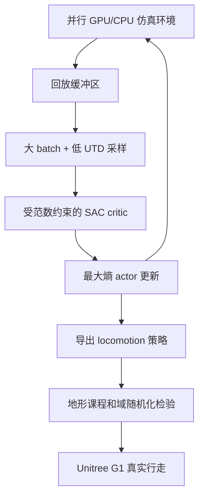
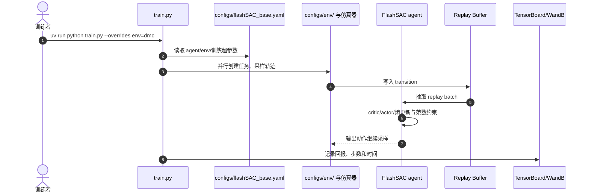

# FlashSAC：面向高维机器人控制的高速稳定离策略强化学习

**英文：** FlashSAC: Fast and Stable Off-Policy Reinforcement Learning for High-Dimensional Robot Control · [原论文](https://arxiv.org/abs/2604.04539) · [官方项目](https://holiday-robot.github.io/FlashSAC/) · [官方代码](https://github.com/Holiday-Robot/FlashSAC)

## 一句话定义

以少更新、大网络、高吞吐的 SAC 扩展配方配合权重、特征和梯度范数约束，缓解高维机器人离策略训练的 bootstrap 不稳定。

## 英文缩写速查

| 缩写 | 英文全称 | 简要说明 |
|---|---|---|
| SAC | Soft Actor-Critic | FlashSAC 所扩展的最大熵离策略算法 |
| PPO | Proximal Policy Optimization | 常见 on-policy 参照 |
| UTD | Update-to-Data Ratio | 梯度更新与新采样比例 |
| DR | Domain Randomization | 真机迁移前的物理域随机化 |
| GPU | Graphics Processing Unit | 并行仿真与训练设备 |

## 为什么重要

PPO 训练稳定但采样复用受限；标准 SAC 过多 critic 更新会使 bootstrap 估计误差积累。FlashSAC 将策略学习效率从单纯样本数转到墙钟性能，同时保留 off-policy 经验回放。

## 核心信息

| 维度 | 内容 |
|---|---|
| 论文身份 | arXiv:2604.04539（v2（2026-05-15）） |
| 奖项 | RSS 2026 Outstanding Paper Award（[2026 四大顶会策展索引](../../sources/blogs/wechat_shenlan_four_robotics_conferences_12_awards_2026_11_17.md)） |
| 源码/数据 | 已开源：完整训练框架、Agent、环境适配与 Hydra 配置；部分环境 extras 互相冲突需分开安装 |
| 研究定位 | FlashSAC：面向高维机器人控制的高速稳定离策略强化学习 |

## 流程总览

## 核心原理与方法

同时扩大环境并行数量（GPU 环境默认 1024）、模型和批量，每收集大量数据仅执行少量更新；critic 采用权重/特征/梯度范数限制以缓解值函数外推误差；统一熵探索与重复动作噪声覆盖高维状态动作空间。G1 迁移采用非对称 actor-critic、context estimator、地形 curriculum 和 domain randomization，不能把训练加速归因于单独网络规模。

## 源码运行时序图

官方入口 `uv sync`（额外仿真环境要 `uv sync --extra <environment>`）后执行 `uv run python train.py --overrides env=dmc --overrides env.env_name=humanoid-walk`；根目录 `configs/flashSAC_base.yaml` 是 Hydra 主配置，`scripts/run_isaaclab.sh` 可批量训练。README 明确 IsaacLab 与 Genesis / HumanoidBench 依赖冲突，需环境隔离。

## 工程实践

官方入口 `uv sync`（额外仿真环境要 `uv sync --extra <environment>`）后执行 `uv run python train.py --overrides env=dmc --overrides env.env_name=humanoid-walk`；根目录 `configs/flashSAC_base.yaml` 是 Hydra 主配置，`scripts/run_isaaclab.sh` 可批量训练。README 明确 IsaacLab 与 Genesis / HumanoidBench 依赖冲突，需环境隔离。

## 实验与评测

论文 v2 摘要称跨 **10 个仿真器 60+ 个任务**，高维灵巧操作和人形任务收益尤其明显；Unitree G1 29 DoF 盲行走仿真训练大约 **20 分钟**，相同 sim2real 设置的 PPO 基线约 **3 小时**（硬件、设置按原文）。代码仓库 README 后续扩展到 100+ 任务，不等同论文评测集合。

## 结论

**总判：以少更新、大网络、高吞吐的 SAC 扩展配方配合权重、特征和梯度范数约束，缓解高维机器人离策略训练的 bootstrap 不稳定。**

1. 比较训练速度时使用同一任务、奖励、sim2real 配方和墙钟，而不只比迭代数。
2. 高维任务优先检查 replay 覆盖、critic 范数与更新频率的联合稳定性。
3. 单独增加 SAC 网络宽度不足以复现完整方法，还需规范化及探索策略。
4. 代码 README 的任务数量与论文 v2 评测数量口径不同，应分别注明。

## 与其他工作对比

相对 PPO 以经验重放提高样本利用，同时保留大规模并行；相对经典 SAC 重点限制 critic 误差积累。方法解释见独立的 [FlashSAC 算法页](../methods/flashsac.md)，该算法页不另算一篇论文。

## 局限与风险

性能增益依赖大量并行仿真和适当稳定化；不同 GPU、仿真器、batch 与 UTD 不能简单照搬；真机效果仍受状态估计、接触建模和随机化范围制约。

## 关联页面

- [2026 顶会论文：通用能力五条技术路径](../comparisons/robotics-2026-awards-five-capability-paths.md) — 从训练吞吐延伸到现场执行与持续验收。
- [FlashSAC 方法页](../methods/flashsac.md)
- [Camera Conditioning](./paper-know-your-camera.md)
- [SymSkill](./paper-symskill.md)
- [强化学习](../methods/reinforcement-learning.md)
- [RL 运控纵深路线](../../roadmap/depth-rl-locomotion.md)

## 参考来源

- [原始论文阅读归档](../../sources/papers/flashsac_arxiv_2604_04539.md)（v2（2026-05-15）；已标注方法、评测和局限）
- [2026 四大顶会获奖综述（仅用于奖项线索）](../../sources/blogs/wechat_shenlan_four_robotics_conferences_12_awards_2026_11_17.md)
- [官方项目页](https://holiday-robot.github.io/FlashSAC/)
- [官方实现](https://github.com/Holiday-Robot/FlashSAC)

## 推荐继续阅读

- [原论文全文（arXiv HTML）](https://arxiv.org/html/2604.04539)
- [官方项目页与实验资源](https://holiday-robot.github.io/FlashSAC/)

