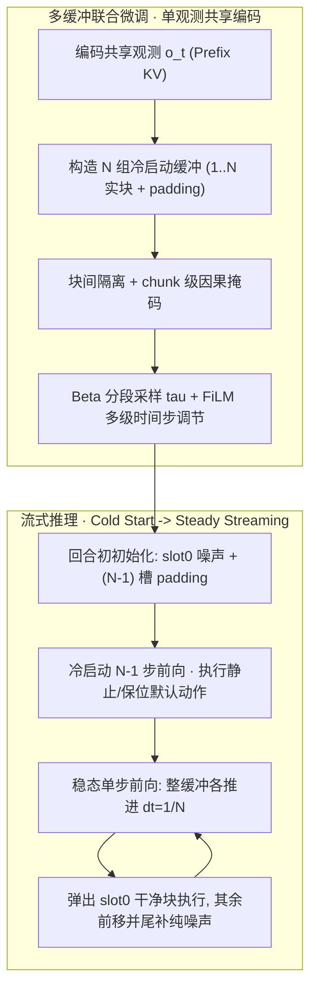
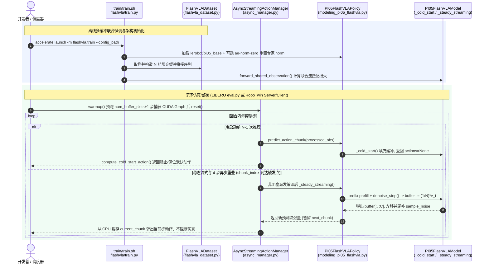

# FlashVLA：流式异步 VLA 动作解码

**FlashVLA**（*Streaming Action Decoding for Fast and Asynchronous VLA Inference*，[arXiv:2608.27384](https://arxiv.org/abs/2608.27384)，[代码](https://github.com/z-lab/flashvla)）由 **加州大学圣地亚哥分校（UCSD）** 与 **麻省理工学院（MIT）** 提出：将长视频生成中的 **交错噪声流式扩散** 引入流匹配 VLA 动作专家，用一个带 chunk 级因果掩码的动作块缓冲同时压缩 **单步解码延迟** 与 **异步观测错配**，无需额外的未来状态预测器。

## 一句话定义

**在推理期维护交错噪声水平的 \(N\) 槽动作块缓冲，并用 chunk 级因果注意力一次前向联合推进整缓冲，稳态每步弹出一块可执行动作——以同一结构同时完成去噪摊销与在飞轨迹连续性条件化。**

## 英文缩写速查

| 缩写 | 英文全称 | 简要说明 |
|------|----------|----------|
| VLA | Vision-Language-Action | 视觉–语言–动作控制策略 |
| FM | Flow Matching | \(\pi_{0.5}\) 等连续动作专家的速度场迭代去噪 |
| FiLM | Feature-wise Linear Modulation | 由多级时间步嵌入生成缩放/平移/门控条件（如 adaRMSNorm） |
| TTFA | Time-to-First-Action | 观测输入到首个可用动作输出的单步策略响应延迟 |
| TTR | Time-to-React | 考虑推理延迟与半个执行窗的闭环期望反应时间 |
| RTC | Real-Time Chunking | 异步执行时按在飞前缀重对齐或补全边界的对照路线 |
| CUDA Graph | CUDA Graph | 稳态静态图捕获优化，消除异步调度下的核函数发射阻塞 |

## 为什么重要

- **揭示延迟与异步错配同源：** \(\pi_{0.5}\) 在 RTX 4090 上 10 步动作解码占推理耗时 **75%**；同步执行在块边界停顿，异步执行则因陈旧观测产生状态偏移。作者指出根因均为「每个块从纯噪声孤立解码」。
- **单一结构同时破局：** 不依赖额外未来状态头（对比 VLASH），也不靠强行减少总去噪步（对比步数蒸馏）；每个动作块仍经历完整 \(N\) 步去噪，但被摊销到连续 \(N\) 次推理中。
- **长程任务收益突出：** 在 RoboTwin 2.0 50 任务多任务评测中，长程子集平均成功率由 53.0% 跃升至 **89.6%（+36.6 pt）**；LIBERO-Long 由 92.4% 升至 **96.2%（+3.8 pt）**，缓冲充当了跨块切换的隐式短期轨迹记忆。
- **可落地的开源参考：** Apache-2.0 代码仓已开放 \(\pi_{0.5}\)、\(\pi_0\)、SmolVLA、LingBot-VLA 适配、多缓冲 FSDP2 训练与 LIBERO/RoboTwin 异步调度代码及权重；单卡 RTX A4000 上以 \(d{=}2\) 维持真机 **30 Hz** 控制。

## 核心信息

| 项 | 内容 |
|----|------|
| **机构** | 加州大学圣地亚哥分校（UCSD）；麻省理工学院（MIT） |
| **主基座与泛化** | 主基座 \(\pi_{0.5}\)；跨架构验证 SmolVLA（0.5B）与 LingBot-VLA（4B） |
| **缓冲超参** | LIBERO：\(C{=}10, N{=}4\)（执行窗 \(E{=}5\)）；RoboTwin 2.0：\(C{=}20, N{=}4\)（执行窗 \(E{=}16\)） |
| **训练硬件与步数** | 8×H200；LIBERO 50K 步（lr `1e-4`）；RoboTwin 2.0 多任务 100K 步（lr `5e-5`，global batch 256） |
| **开源边界** | **已开源（Apache-2.0）**：[z-lab/flashvla](https://github.com/z-lab/flashvla) 与 HF 权重；**未随仓**：Franka 真机硬件驱动及 Gello 遥操作数据集 |

## 核心原理

### 方法栈与流程总览

流匹配 [VLA](../methods/vla.md) 沿速度场 \(v_\theta(\mathbf{x}_\tau, \tau \mid o_t)\) 从高斯噪声解码动作块。FlashVLA 不再将 \(N\) 次迭代集中在单块上，而是维护按噪声严格递增排列的流式缓冲：

\[
\mathbf{B}_t = \big[\mathbf{x}^{(1)}_{\tau_1},\, \mathbf{x}^{(2)}_{\tau_2},\, \ldots,\, \mathbf{x}^{(N)}_{\tau_N}\big], \qquad \tau_1 < \tau_2 < \cdots < \tau_N,
\]

其中槽位 1 最接近干净并即将执行，槽位 \(N\) 为刚注入的高斯噪声。在注意力设计上施加以 chunk 为粒度的 **单向因果掩码**：高噪未来块只能 attend 更干净的近执行块，禁止干净块反向看未来噪声块——避免「即将执行的动作被未收敛未来噪声污染」，同时让未来块在无显式未来状态预测器的情况下自动条件化于在飞轨迹（[Action Chunking](../methods/action-chunking.md)）。

**多缓冲联合微调（§3.3 / App. A.4）：** 预训练 VLA 从未见过部分填充缓冲与块间因果模式。FlashVLA 在单条训练样本中打包同一观测 \(o_t\) 下的全部 \(N\) 种冷启动填充态（第 \(j\) 组含 \(j\) 个真块与 \(N{-}j\) 个 padding 块），各槽位独立按分段 Beta 分布（\(u_i\sim\mathrm{Beta}(1.5,1.0)\)，\(\tau_i=0.001+0.999\frac{i-1+u_i}{N}\)）采样时间步。通过共享 VLM 前缀并利用 `cross_offset_mask` 隔离不同配置间的交叉注意力，单次微调前向即同时教会模型处理冷启动与稳态。动作专家通过 FiLM（\(\pi_{0.5}\) 复用 adaRMSNorm，SmolVLA 新增 `LlamaAdaRMSNorm`）注入每个 chunk 槽位的差异化时间步信息。

## 源码运行时序图

以下时序严格对齐 [`sources/repos/flashvla.md`](../../sources/repos/flashvla.md) 中 `train/train.sh`、`sim_eval/libero/eval.sh`、`sim_eval/robotwin/` 与 `benchmarks/benchmark_latency.py` 源码：

## 工程实践

- **多缓冲微调稳定性（`flashvla_init`）：** 将动作专家从单一去噪时间步改写为多级 chunk 时间步条件时，预训练权重里的归一化层在多任务大数据下可能数值爆炸。`flashvla/train.py` 的 `apply_flashvla_training_init`（配置文件中 `mode: ae-norm-zero`）可在保留其余预训练权重的条件下重置时间 MLP 与动作专家归一化层，RoboTwin 50 任务训练默认启用。
- **异步非阻塞与 CUDA Graph 预热：** `AsyncStreamingActionManager.act()` 刻意将正在消费的 `current_chunk` 留在 CPU NumPy 数组中执行逐步弹窗，只在块切换点才同步 `next_chunk.detach().cpu().numpy()`；同时要求 `eval.sh` 在 `OVERLAP_STEPS > 0` 时开启 `compile_model=true` 与 QKV/MLP `fuse` 打包，并通过 `warmup()` 在首回合前完成静态图捕获，避免首步触发 10–30 s 编译尖刺。
- **跨度对齐原则：** 经验最佳点为 \(N\times C\) 贴近基座原生 chunk 长度（\(\pi_{0.5}\) 原生 50；LIBERO 用 \(C{=}10,N{=}4\)，RoboTwin 用 \(C{=}20,N{=}4\)）。若固定 \(N{=}5\) 强行将 \(C\) 扩至 15–20，在短视界 LIBERO 上会因被迫外推至 100 步而掉成功率。
- **RoboTwin 双环境与系统优化区分：** RoboTwin 因 SAPIEN 仿真与 `flashvla` PyTorch 依赖冲突，仓内强制采用 Socket `policy_model_server.py`（服务端）+ `eval_policy_client.py`（客户端）并配置 `TCP_NODELAY`；做延迟横评时需将硬件系统优化（CUDA Graph + 算子融合）单独记账，在基线与 FlashVLA 双方同配下对比。

## 评测与对比

以下数值均核对自论文 [arXiv:2608.27384](https://arxiv.org/abs/2608.27384)（Tab. 1–5、Fig. 1b/3–8）及官方仓库基准：

### LIBERO 四套件异步与同步评测（\(C{=}10, N{=}4, E{=}5\)，5 轮 2,000 回合均值）

| 方法 | Spatial | Object | Goal | Long | Avg (%) | Time/Step (ms) |
|------|---------|--------|------|------|---------|----------------|
| \(\pi_{0.5}\)（sync） | **98.8** | 98.2 | **98.0** | 92.4 | 96.9 | 53.8 |
| + VLASH（\(d{=}1\)） | **98.8** | 99.2 | 96.7 | 94.4 | 97.2 | 46.8 (1.15×) |
| + VLASH（\(d{=}4\)） | 92.5 | 96.9 | 93.3 | 89.6 | 93.1 | 32.8 (1.64×) |
| + StreamingVLA（\(d{=}1\)） | 96.6 | 96.6 | 95.4 | 91.0 | 94.9 | 31.6 (1.70×) |
| **+ FlashVLA（\(d{=}0\) sync）** | 98.6 | 99.0 | 97.8 | **96.2** | **97.9 (+1.0)** | — |
| **+ FlashVLA（\(d{=}1\)）** | **98.8** | **99.6** | 97.6 | 95.4 | **97.8 (+0.9)** | **22.1 (2.43×)** |
| **+ FlashVLA（\(d{=}2\)）** | **99.0** | **99.8** | 97.2 | **97.4** | **98.3 (+1.4)** | **20.6 (2.62×)** |

### RoboTwin 2.0 50 任务与视界拆分（\(C{=}20, N{=}4, E{=}16\)）

- **总体异步表现（Fig. 3 & Tab. 3）：** \(\pi_{0.5}\) 同步均值 86.0%（47.4 ms/step）；FlashVLA 在 \(d{=}0/1/2\) 分别达 **90.5% / 90.6% / 90.6%**，且在 \(d{=}4\) 仍保持 **89.8%**（同延迟下 VLASH 85.1%）。\(d{=}1\) 时端到端逐步耗时降至 **43.8 ms**（增速看似温和是因为 SAPIEN 渲染独占 36.8 ms、Socket 通信 2.5 ms，策略仅占原耗时 17%）。
- **视界拆分（Tab. 4 同步）：** 短程 93.9%→93.2%（-0.7）；中程 81.1%→85.4%（+4.3）；**长程 53.0%→89.6%（+36.6 pt，Clean 54.2%→90.8%，Random 51.8%→88.4%）**。

### 单步延迟、反应速度、跨架构与真机评测

| 评测维度 | 核心对比结果 |
|----------|--------------|
| **推理延迟（Tab. 2，同配 CUDA Graph）** | RTX 4090 (2/3 视角)：\(\pi_{0.5}\) 45.8/55.4 ms → Realtime-VLA 29.2/38.9 ms → **FlashVLA 26.7/36.8 ms**；RTX 5090：37.0/44.8 → 26.6/34.2 → **20.3/27.1 ms**（单卡 50 Hz 级） |
| **动作解码与反应（Fig. 1b / Fig. 4）** | 无优化剖分中动作解码墙钟降 **19.9×**（GPU 计算 9.3×），整体 3.5×；30 Hz 目标下 TTFA **37.1 ms**（vs \(\pi_{0.5}\) 80.0 / FASTER 62.1，**1.7×** FASTER）、期望 TTR **70.4 ms**（vs 130.0 / 112.1，**1.6×**） |
| **跨架构泛化（Tab. 5）** | **SmolVLA**（LIBERO, \(N{=}5\)）：基线 80.1% / 19.7 ms → FlashVLA \(d{=}0\) **80.1%** / **10.1 ms（1.95×）**、\(d{=}1\) 79.5%；**LingBot-VLA 4B**（RoboTwin）：85.2% / 70.6 ms → \(d{=}0\) 88.6% / **25.1 ms（2.81×）**、\(d{=}1\) **89.3%** |
| **Franka 真机 30 Hz（§5 Fig. 5）** | 单卡 RTX A4000 推理 67.3 ms，配 \(d{=}2\) 实现 30 Hz（\(E{=}16\)）；三任务（Pick & Place / Whiteboard Wiping / Table Cleaning）各 15 次测试均分 **84.4%**（vs 同步 80.0% / 朴素异步 75.6% / RTC 80.0%），成功回合耗时平均快 **1.3×**（vs 同步）/ **1.2×**（vs RTC） |
| **因果掩码消融（Fig. 6）** | 保留多槽缓冲、微调与推理循环但移除 chunk 级因果掩码：LIBERO 异步平均成功率骤降约 **10 pt** |

### 与其他工作对比

| 对照方法 | 核心机制差异 | 实验读数对照 |
|----------|--------------|--------------|
| **VLASH** | 依赖显式未来状态条件化来对冲异步陈旧观测 | 同 \(\pi_{0.5}\) 基座在 LIBERO \(d{=}1\) 仅 1.15× 加速，\(d{=}4\) 成功率跌至 93.1% |
| **StreamingVLA** | 动作流匹配 + 自适应早观测机制 | LIBERO \(d{=}1\) 1.70× 加速，但平均成功率低于基线 2.0 pt（94.9%） |
| **Realtime-VLA / FASTER** | 优化单次前向核函数或调整反应调度，不改「单块孤立去噪循环」 | RTX 4090/5090 单次推理慢于 FlashVLA，30 Hz 反应 TTFA/TTR 慢 1.6–1.7× |
| **[ForeTime-VLA](./paper-foretime-vla.md)** | 将世界动作模型未来 token 蒸馏进 \(\pi_{0.5}\) 增强状态预测 | FlashVLA 改的是 **多块联合流式解码结构**，解决解码耗时与异步连续性 |

## 结论

**FlashVLA 证明流匹配 VLA 的高延迟与异步错配同源于「单块孤立解码」，用交错噪声缓冲与 chunk 级因果注意力在无需显式未来状态头的前提下同时实现低延迟稳态流式输出与无损异步连续性。**

1. **chunk 级因果掩码是异步连续的必要条件** — 保留缓冲与联合训练但拿掉因果注意力，异步成功率掉约 10 pt，说明隐式在飞轨迹条件化来自高噪块向低噪块的单向关注。
2. **核心收益不仅在速度更在长程稳定性** — 缓冲构成跨块短期记忆，在 RoboTwin 长程子集带来 +36.6 pt 提升并在 \(d{=}1..4\) 下守住基线之上。
3. **缓冲区总跨度 \(N\times C\) 须匹配预训练先验** — 围绕基座原生 chunk（如 \(\pi_{0.5}\) 的 50）设计 \((C,N)\) 远比盲目增大 \(C\) 稳健，且 \(N\in\{4,5,6\}\) 对性能不敏感。
4. **工程部署需将算法与系统编译配合但分开记账** — 异步掩盖延迟依赖 `torch.compile` + CUDA Graph 消除主机阻塞与 GPU kernel bubble，横向评测应保持基线同配编译。
5. **仓库现阶段聚焦仿真与核心调度模块** — \(\pi_{0.5}\)/SmolVLA/LingBot-VLA 多缓冲训练与仿真评测可直接复现，真机端需自行补齐硬件控制器与 Gello 采集链路。

## 局限与风险

- **仍受限于基座的孤立预训练目标：** 论文将预训练权重的单块独立目标迁移为后训练流式微调，作者指出从零按 chunk 级因果目标预训练 VLA 仍是待验证方向。
- **回合初冷启动开销：** 每个回合开始必须付出 \(N{-}1\) 步静止/保位默认暖机动作，长轨迹可摊销，但极短视界或高频急起任务受影响更显著。
- **仿真加速会被渲染开销掩盖：** 在 RoboTwin 2.0 等渲染占比超 75% 的仿真器里，端到端 `Time/Step` 仅能呈现 1.08–1.10×，需配合纯推理延迟表读出策略侧加速。
- **真机评测样本与开源边界：** 真机每任务仅 15 次 rollout、三分制打分，且完成时间只计成功回合；此外 `z-lab/flashvla` 仓内未包含 Franka 实机驱动代码与 50 条/任务遥操作原数据。

## 关联页面

- [\(\pi_{0.5}\)](./paper-pi05-open-world-vla.md) — 主干流匹配 VLA 基座
- [VLA](../methods/vla.md) — 视觉–语言–动作模型与流匹配动作头
- [Action Chunking](../methods/action-chunking.md) — 动作分块执行、停顿与异步重叠机制
- [\(\pi_0\) Policy](../methods/π0-policy.md) — 流匹配连续动作策略脉络
- [LingBot-VLA](./lingbot-vla.md) — 4B 基座跨架构泛化验证对象
- [ForeTime-VLA](./paper-foretime-vla.md) — 同基座上的未来表征蒸馏对比工作
- [Manipulation](../tasks/manipulation.md) — 桌面操作仿真与真机任务语境
- [LeRobot](./lerobot.md) — 数据格式与训练/评测基础设施依赖

## 参考来源

- [flashvla_arxiv_2608_27384.md](../../sources/papers/flashvla_arxiv_2608_27384.md) — 论文全文（arXiv:2608.27384v1 §§1–6 与附录 A.1–A.4）核对归档
- [flashvla.md](../../sources/repos/flashvla.md) — 官方开源仓库（`z-lab/flashvla`）入口与核心源码核对归档

## 推荐继续阅读

- 论文 — <https://arxiv.org/abs/2608.27384>
- 代码 — <https://github.com/z-lab/flashvla>
- LIBERO 权重 — <https://huggingface.co/z-lab/flashvla-pi05-libero>
- RoboTwin 权重 — <https://huggingface.co/z-lab/flashvla-pi05-robotwin>
- VLASH（异步未来状态条件对照）— <https://arxiv.org/abs/2512.01031>
