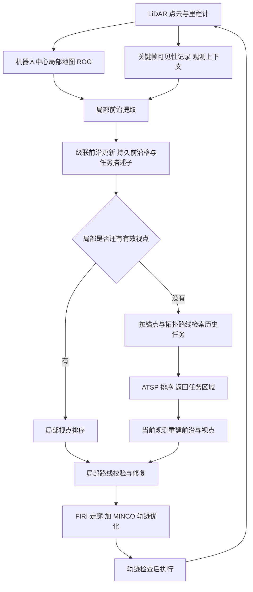

# FLAVOR：层级时空地图表示（arXiv:2611.11489）

**FLAVOR**（*Beyond Memory Limits: A Hierarchical Spatio-Temporal Map Representation for Large-Scale 3D Autonomous Exploration*，[arXiv:2611.11489](https://arxiv.org/abs/2611.11489)，Zhang 等，武汉大学与南洋理工大学）。论文全文已通读，见 [来源归档](../../sources/papers/flavor-hierarchical-spatio-temporal-map-exploration_arxiv_2611_11489.md)。

## 一句话定义

**一种 UAV 探索用的地图表示：稠密度量几何只存在于以机器人为中心、大小固定的局部地图里，窗口之外只保留紧凑的「观测上下文」（LiDAR 关键帧可见性记录）和「任务上下文」（未完成前沿、里程计锚点、稀疏拓扑路线），回到任务区域时再由当前观测重建前沿与视点。**

## 英文缩写速查

| 缩写 | 英文全称 | 简要说明 |
|------|----------|----------|
| FLAVOR | Frontier tasks, Local map, Anchors, historical Visibility, Odometry, topological Routing | 论文方法名，§1 给出的六要素首字母拼写 |
| UAV | Unmanned Aerial Vehicle | 无人机 |
| LiDAR | Light Detection and Ranging | 激光雷达 |
| ROG-Map | Robo-centric Occupancy Grid Map | 机器人中心占据栅格，环形缓冲实现滑动局部窗口（§3.2.1，引用 Ren 等 2024） |
| ikd-tree | incremental k-d tree | 增量 k-d 树，EPIC 与真机对照用它存显式全局点云（§4.2.2、§4.3） |
| EPIC | lightweight LiDAR-based AAV exploration framework | 仿真中唯一完成三场景的基线（§4.2.1，Geng 等 2025） |
| MARSIM | LiDAR-based UAV simulator | 仿真平台（§4.1） |
| FIRI | Fast Iterative Region Inflation | 在局部路线周围构造凸自由空间走廊（§3.4.2） |
| MINCO / GCOPTER | minimum-control polynomial trajectory / geometrically constrained trajectory optimization | 轨迹参数化与优化器（§3.4.2） |
| ATSP | Asymmetric Traveling Salesman Problem | 历史任务访问顺序，用 LKH 启发式求解（§3.4.1） |
| FoV | Field of View | 传感器视场 |

## 为什么重要

- 论文的出发点（摘要、§1）：机载内存与算力受限时，维护全局可查询几何地图会让内存与空间查询开销随探索面积增长；只用固定窗口的局部地图又会丢掉区分「已观测边界」与「未完成任务」的证据。
- 作者自述的关键洞察（§1）：历史几何与历史探索状态支撑不同决策，不必以同一保真度保留；因此把细节几何留在近处，把紧凑的历史交给长期决策。
- 作者自述的结果（摘要、§4）：在 MARSIM 三个大型点云场景里对 EPIC 缩短 31.98–41.88% 完成时间、地图表示内存少 94–99%；真机在两处场景上对显式点云 ikd-tree 少 92.67% 与 62.42%。
- 我的判断：这是「探索规划里的内存预算问题」的一个具体解法，与 [自主探索任务页](../tasks/autonomous-exploration.md) 中分层规划思路相邻；但证据以单一基线（EPIC）为主，见下文「局限」。

## 核心原理与流程总览

**表示（§3.1.2，式 3）。** 状态由三部分组成：机器人中心局部度量地图 `M^L_t`；探索状态 `E_t`（可见性记录构成观测上下文，持久前沿格、历史簇描述子与里程计锚点构成任务上下文）；稀疏拓扑图 `G_t`。上标 G 表示在世界系中持久，不是全局度量栅格。

**局部地图（§3.2.1）。** 沿用 ROG-Map 的三维环形缓冲，容量 `N_L = n_x n_y n_z` 只由窗口大小与分辨率决定，与飞行距离无关；窗口在 UAV 偏离中心超过阈值时重定位，重叠区原地保留，离开的存储复用于进入的格子（设为未知）。

**观测上下文（§3.2.2）。** 每个选中的 LiDAR 关键帧存位姿与 B 个方位–俯仰扇区，每扇区记录已观测空闲前缀、占据表面区间与其后「保护带」长度；角度部分每描述子 4B 字节。重新进入窗口的历史区域产生的候选前沿，若被某区间直接覆盖或其 26 邻域有历史空闲或占据支持，就被剔除（防止把已看过的边界当成新边界）。

**任务上下文（§3.2.3、§3.3）。** 新前沿格要经足够观测支持才激活，激活后跨地图平移持续存在，直到被当前证据消解。每个簇有紧凑任务描述子（式 4，含中心、法向、包围盒、活跃格数、锚点与缓存调度位姿）。拓扑图由区域骨架顶点（递归球覆盖）、历史里程计锚点与当前里程计顶点组成，边保存路线折线，锚点在间距超过 δ_a 且净空足够时新增。

**规划（§3.4）。** 本地优先：先处理局部有效视点；没有时按式 13 的代价 `d_G(o, a_i) + ||p_{a_i} - v̂_i||` 预筛历史任务，A* 求路线、ATSP + LKH 求顺序；执行前先对路线的局部初始段用当前地图校验与修复，再用 FIRI + MINCO/GCOPTER 生成并检查轨迹。

## 实验结果

**仿真（MARSIM 三个大型点云场景 Cave / Forest / Lava Tube，§4.1–4.2）。** 基线为 TARE、ERRT、FALCON、EPIC；只有 EPIC 与 FLAVOR 在三个场景都完成（表 3）。指标为完成时间、地图表示内存与规划时延：

| 指标 | Cave | Forest | Lava Tube | 出处 |
|------|------|--------|-----------|------|
| 完成时间 FLAVOR / EPIC（s） | 845.20 / 1242.50（−31.98%） | 276.87 / 476.40（−41.88%） | 152.30 / 259.27（−41.26%） | 表 3 |
| 地图内存 FLAVOR / EPIC（MB） | 41.93 / 1510.69（−97.22%） | 13.48 / 1341.21（−99.00%） | 14.56 / 242.89（−94.00%） | 表 4 |
| 规划时延均值降幅 | 44.10% | 29.42% | 7.92% | 表 5 |

**真机（§4.3，表 6）。** 森林与施工现场两处，飞行 248.18 m 与 259.22 m；内存对显式点云 ikd-tree 为 3.71 对 50.64 MB（−92.67%）、7.44 对 19.80 MB（−62.42%）。真机未与其他规划器比较完成时间。

## 与其他工作对比

| 工作 | 关注点 | 与本文的区别 |
|------|--------|--------------|
| [TARE Planner](./tare-planner.md) | 局部稠密 + 全局稀疏的分层探索规划，双层 TSP | 同为分层思路，但 TARE 仍保留全局几何表示；在本文 Cave 场景无法初始化、Forest 与 Lava Tube 未完成（§4.2.1） |
| [FAR Planner](./far-planner.md) | 基于可见图的大尺度路线规划 | 关注已知 / 部分已知环境中的路径搜索；FLAVOR 的拓扑图只为回访历史前沿服务，不是通用导航图 |
| EPIC（Geng 等 2025，本库暂无页面） | 轻量 LiDAR 探索框架，ikd-tree 存显式全局点云 | 本文唯一完成三场景的基线；FLAVOR 以可见性记录与任务上下文替代全局点云，换来 94–99% 内存下降（表 4） |

## 结论

**FLAVOR 表明大范围 UAV 探索不必保留全局稠密几何：固定大小的局部地图加紧凑的观测与任务上下文，就足以区分已看过的边界与未完成任务。**

1. 稠密地图容量只由窗口与分辨率决定，全局部分只存可见性扇区、持久前沿与稀疏拓扑（§3.1.2、§5.3）。
2. 仿真中对 EPIC 完成时间缩短 31.98–41.88%，地图内存少 94–99%（表 3、表 4）。
3. 真机在 Intel N305 机载完成全部探索管线，内存较 ikd-tree 少 62–93%（表 6）。
4. 局限：无消融、无重复运行方差、完成时间只对单一基线，真机尺度小且速度保守，全局部分仍随探索增长。

## 工程实践

- **实现栈（论文自述）：** 局部地图用 ROG-Map，仿真用 MARSIM，真机状态估计用改版 FAST-LIO2，视点覆盖与骨架沿用 EPIC 的递归球覆盖思路（§3.3.1），轨迹用 FIRI 与 GCOPTER。相邻的 LiDAR 里程计背景见 [LiDAR 里程计融合](../methods/lidar-odometry-fusion.md)，轨迹优化背景见 [轨迹优化](../methods/trajectory-optimization.md)。
- **关键参数（表 2，仿真）：** 局部窗口 Cave 40×40×36 m、Forest 36×36×10 m、Lava Tube 48×48×16 m，分辨率 0.4 m；可见性分辨率 2°，范围 0.1–16 / 18 / 19 m。
- **真机平台（§4.3）：** 自制 UAV，Intel N305 边缘计算机、Livox MID360（水平 360°，垂直 −7° 到 52°，安装俯仰 −30°）、NxtPX4v2 飞控、STM32 通信模块；最大速度 1.2 m/s；窗口 24×24×10 m（森林）与 36×36×10 m（施工现场）；全部探索管线在机载处理器上运行，全局点云只用于离线可视化。
- **开源状态：** 文章未给代码；项目页有指向 `github.com/yizhezhang0418/FLAVOR` 的图标，但该仓库 README 请求返回 404，内容**未核实**，故 frontmatter 不写 `code:`。
- **复现要点（我的判断）：** 依赖外部提供的位姿与注册点云（§3.1.1），换传感器或里程计需重新调窗口、可见性范围等参数；论文未给出这些参数的敏感性分析。

## 与文章说法的核对

对照公众号文章《机器人动作块太长，什么时候该重新规划？》（2026-11-11 的 53 篇论文速览）第 40 条的说法：

| 文章说法 | 核对结果 |
|----------|----------|
| 「用局部稠密地图和全局关键帧结构分工」 | 基本属实。局部稠密地图是 ROG 滑窗（§3.2.1）；窗口外保留的是关键帧可见性记录、持久前沿格与任务描述子、里程计锚点和拓扑路线（§3.1.2）。但「全局关键帧结构」说窄了：关键帧只是观测上下文，任务上下文与拓扑图同样是全局部分。 |
| 「压缩长期探索所需的地图记忆」 | 属实，数字见表 4：对 EPIC 少 94.00–99.00%。限定：只对「地图表示」内存，且基线是 EPIC 的 ikd-tree 全局点云（§4.2.2）；摘要所说「最佳基线」是指唯一完成三场景的 EPIC，TARE、ERRT、FALCON 在 Forest、Lava Tube 未完成，Cave 中 TARE 与 FALCON 无法初始化（§4.2.1，表 3）。 |
| 「包含大型仿真及实地测试」 | 属实但需限定。仿真是 MARSIM 中的三个大型**点云**场景（§4.1，非物理引擎的动力学全仿真）；真机为森林与施工现场两处，探索区域约 60×27×3 m 与 50×27×3.5 m，累计 507.40 m，最大速度 1.2 m/s（§4.3、§6），尺度远小于仿真场景。真机只和显式点云 ikd-tree 比内存，没有与其他规划器比较完成时间（表 6）。 |
| 「固定的是局部地图规模」 | 属实：稠密地图容量 `O(N_L)` 只由窗口与分辨率决定（§3.1.2、§5.3）。 |
| 「全局信息仍会随探索增长」 | 属实，论文自己也这么写：可见性描述子 `O(N_D B)`，前沿、任务记录与路线随保留内容增长（§3.1.2、§5.3）。论文给出了理论分析与内存曲线（图 8，「modest growth」），但没有在更大场景上外推测量其增长斜率。 |

文章未提及、但读者可能误解的点：文章未写数字，论文数字均与摘要一致；完成时间的 31.98–41.88% 缩短是相对 EPIC 的单一对比（表 3）。

## 局限

**论文自己承认的：**
- 施工现场旋翼扬尘产生瞬态 LiDAR 回波，偶发急停（§4.3）；论文称滑窗局部地图会丢弃离窗的几何，限制假障碍的持久性，但并未显式检测或跟踪动态物体。
- 论文没有单独的局限小节；§1 与 §2.1 承认纯局部地图缺全局表示时对大规模探索支持有限，这正是本文要解决的问题。

**我看到的未验证之处（推测与观察，非论文结论）：**
- 论文没有消融实验：可见性记录、级联前沿、锚点规划各自的贡献没有被单独量化。
- 论文未说明每个场景重复运行的次数，表 3 完成时间没有方差，只能当作单次结果；表 5 才给出规划时延的均值与标准差。
- 唯一有完成时间对照的基线是 EPIC；TARE 与 FALCON 在 Cave 无法初始化，是否有配置或兼容性原因论文未讨论。
- 表 5 中 Lava Tube 的均值时延只降 7.92%，且 Forest 与 Lava Tube 的标准差高于 EPIC（§4.2.2，论文自述），时延优势不如内存优势稳固。
- 真机内存对照对象是显式点云 ikd-tree（表 6），而 FLAVOR 一侧只统计了可见性表示与局部 ROG 缓冲（表 6 题注），未包含拓扑图与前沿记录的占用，对比口径不完全对等（推测）。
- 真机速度 0.778–0.813 m/s、仿真中 FLAVOR 平均速度 2.40–3.26 m/s（表 3），说明真机实验在较保守设置下进行，尚不能说明高速大范围场景的表现。
- 假设外部定位与注册点云可靠（§3.1.1），论文未讨论里程计漂移对锚点与历史路线有效性的影响。
- 性质说明：本文是 UAV 地图与探索规划方法论文，不含学习环节，也不涉及机器人策略，与本库其他 VLA 与强化学习论文的评测口径不可直接类比。

## 关联页面

- [自主探索任务](../tasks/autonomous-exploration.md)
- [TARE Planner](./tare-planner.md)：论文基线之一，分层探索规划
- [FAR Planner](./far-planner.md)
- [EGO-Planner-Swarm](./ego-planner-swarm.md)：UAV 局部轨迹规划相邻页
- [LiDAR 传感](../concepts/lidar-sensing.md)
- [LiDAR 里程计融合](../methods/lidar-odometry-fusion.md)
- [轨迹优化](../methods/trajectory-optimization.md)
- [移动机器人导航规划方法对比](../comparisons/mobile-robot-navigation-planning-methods.md)

## 参考来源

- [FLAVOR 论文来源归档](../../sources/papers/flavor-hierarchical-spatio-temporal-map-exploration_arxiv_2611_11489.md)
- [arXiv:2611.11489](https://arxiv.org/abs/2611.11489)
- 项目页：<https://yizhezhang0418.github.io/flavor.github.io/>

## 继续阅读

- [arXiv PDF（v1）](https://arxiv.org/pdf/2611.11489v1)
- [自主探索任务](../tasks/autonomous-exploration.md)
- [TARE Planner](./tare-planner.md)
