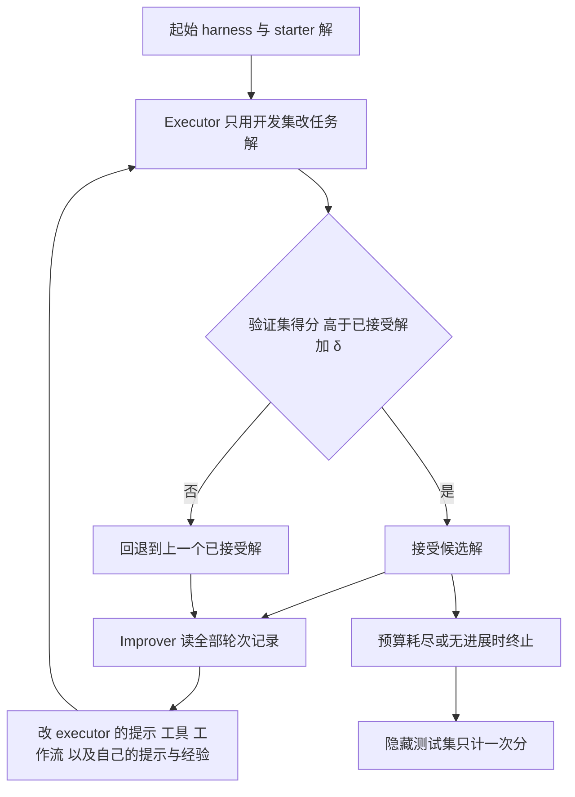

# Flex-RSI（arXiv:2611.08946）

**Flex-RSI**（*Flex-RSI: Benchmarking Recursive Self-Improvement of Frontier Agents*，[arXiv:2611.08946](https://arxiv.org/abs/2611.08946)，2026-11-06 v1）由 Texas A&M、剑桥、新加坡国立、NVIDIA、MIT 等机构的社区团队提出（首页署名 Flex-RSI Team，组织者为 Jingdong Zhang、Jionghao Wang、Zhengming Yu，§7）。项目页 <https://flex-rsi.github.io>，代码 <https://github.com/flex-rsi/rsi-bench>。

## 一句话定义

**一个测「智能体能否在固定预算内既改进任务解、又改写自己的 harness（提示、工具、控制循环）」的基准：开发集上改、验证集上筛、隐藏测试集上计分，模型权重全程不变。**

## 英文缩写速查

| 缩写 | 英文全称 | 简要说明 |
|------|----------|----------|
| RSI | Recursive Self-Improvement | 递归自我改进；本文里指 harness 层面，不含权重 |
| harness | agent harness | 模型外围的提示、工具、记忆与控制循环（§1） |
| E / I | Executor / Improver | 改任务解的一方 / 改 harness 的一方，调用同一模型（§3.2） |
| SPL | Success weighted by Path Length | Active Search 的指标（Table 1） |
| MRA | Mean Relative Accuracy | Kinematics、Mass 的指标 |
| RHAE | Relative Human Action Efficiency | ARC-AGI-3 官方分，按相对人类基线的动作效率给每关打分（附录 A.2） |
| SRCC | Spearman Rank Correlation Coefficient | Video Quality 的指标之一 |
| VLM | Vision-Language Model | 视觉语言模型，部分任务的评审器 |

## 为什么重要

- 作者指出多数已有基准固定 harness、只给产出打分，且集中在机器学习研究任务（§1）；Flex-RSI 把任务面扩到感知、推理、机器人动作、3D 重建、视觉创作和基础设施。
- 对机器人方向：Action 域含 RoboDojo（双臂）、RoboCasa365（移动操作）、RoboLab、LIBERO-MAX/PRO、Active Search 等，多数任务里被改写的是「用大模型驱动策略的程序」，不是训练神经策略（附录 A；RoboDojo 卡片写明 No policy is trained）。
- 它提供了「没有改进器的冻结 harness」对照（§5.4），可把任务解的提升和 harness 改写的提升分开看。

## 核心原理与流程总览

每轮五步（附录 B.1）：executor 出候选解 → 还原越权改动 → 验证集评测 → 按式 (2) 接受或回退 → improver 改 harness。改动在下一轮生效。

关键设定（作者原文，带章节）：

| 项 | 内容 |
|----|------|
| 数据切分 | 开发集（带标签、智能体可见）/ 验证集（隐藏，决定保留）/ 测试集（隐藏，最后用一次），§3.1 |
| 接受规则 | 候选解验证分须超过已接受解加 δ；起始 δ 为 starter 验证分标准差的 2 倍，σ 未测的任务取 0，improver 可修改规则，附录 B.4 |
| improver 权限 | 可改 executor 的提示、设置、控制循环、工具，以及自己的提示、设置、接受规则和经验文件；单次最多改 400 行，每 4 轮复盘一次自身流程，附录 B.3 |
| 完整性 | 阶段结束后越权路径改动被还原并记录为违规；评测器、切分和预算计量不可被智能体修改，附录 B.6 |
| 预算 | 墙钟时间、GPU 时数、token、美元、验证评测次数、轮数上限共同限制；各任务数值见 Table 10 |
| 任务规模 | 24 任务六个领域；主结果仅含被至少 6 个模型评测的 20 个，另 4 个任务只有 2 个模型（§4.1、Table 12） |

## 主要结果（均来自论文）

| 结论 | 数据与出处 |
|------|-----------|
| 总榜 | 分数为「击败其他模型的比例」的领域平均：Claude Opus 5.5 91.6、Gemini 4 Argon 89.0（仅跑 9 个任务）、GPT-6.1 Sol 77.0、GPT-6 Astra 65.5；最佳开源权重 Qwen3.8-Flash-Next 49.1 排第 5（§4.2、Figure 2） |
| 提升面 | 177 次运行中 150 次验证分提升，中位 +10.4；闭源 94% 且中位 +14.9，开源 76% 且中位 +8.5（§4.3） |
| 发现 1 | 自己构建解的任务提升最大并拉开模型：按量表打分的 9 个任务上，模型起点相差 0.9 分、终点相差 38.8 分；单答案任务两端差距基本不变（§5.1） |
| 发现 2 | 反馈粒度：按量表打分时开源中位增益 9.9、闭源 28.4；只记成败的 4 个任务上开源 1.6、闭源 16.9；RoboCasa 5.6 对 51.2（§5.2） |
| 发现 3 | 严格检查差距最大：RoboCasa 闭源最好比开源最好高 50.0，RoboLab 40.3，RoboDojo 37.3，ARC-AGI-2 49.2；Scene from Video 中 4 个开源模型的 Physics 分全为 0.0，Opus 70.7（§5.3） |
| 发现 4 | 7 对配对运行中 6 对测试分更高（+2.0 至 +40.0），1 对持平；Active Search 上 Qwen3.8-Flash-Next 由 21.0 到 59.3（§5.4、Table 8） |
| 跨模型迁移 | 把强模型的最终 harness 给弱模型，4 个任务里 2 个有提升（Open Drawer +20.0、3D Tracking +1.4），均未接近强模型（Table 9） |
| 成本 | 单次运行 token 中位 49.7M；相对 token 用量与得分的秩相关 −0.05（§4.5） |
| 任务实现细节 | RoboDojo 与 RoboCasa 的 starter 是「每个动作块调一次模型」的程序，不训练策略；LIBERO-MAX/PRO 的 starter 直接执行冻结的 X-VLA 策略动作块、不调模型（附录 A.1） |
| 收益到达时间 | 中位运行在 Perception、Reasoning 第 3 轮、Creation 第 4 轮就拿到 90% 的增益，Action、Reconstruction 要到第 6、第 8 轮（§4.4） |

## 工程实践

- 仓库提供 `rsib` 命令行：`rsib run new --task <task> --model <model> --mode full`，再 `rsib run start`，`rsib report` 汇总（仓库 README，仅静态阅读，未运行）。
- 5 个任务的切分在 Hugging Face 数据集 `Flex-RSI/RSI-Dataset`，其余任务需自行 `rsib task prepare`（README）。
- 提交结果进入排行榜的通道在 README 里写的是「将尽快开放」；是否已开放 **未核实**。
- 评分依赖冻结的评审模型：创作类任务用 GLM-4.5V，Video Generation 用 T2V-CompBench 原评测器（附录 A.3）；评审偏差论文没有单独评估。
- 机器人任务依赖 Isaac Sim / Isaac Lab、MuJoCo 等仿真与较大算力（Table 10 里 RoboDojo、RoboCasa 单任务 256 GPU 小时上限）。

## 局限

论文自己承认的：
- 只衡量 harness 层面：权重不变，多数任务不训练模型，部分任务允许在开发集上训练或微调辅助模型，因此不衡量模型修改自身参数（§6）。
- 4 个任务目前只有 2 个模型，不进主结果（§4.1、Table 12）。
- 每个模型在每个任务上只跑一次，重复运行时报告最新一次（§4.1 "How results are reported"）。

我读到的未验证之处（我的判断，不是作者自述）：
- 单次运行加 `σ` 多数取 0（Table 10），模型间差距与「开源/闭源」归因的统计不确定性论文里没有给置信区间。
- 总榜分数是基于排名的相对值且各模型任务覆盖不同（Opus 20 个任务，Argon 只有 9 个），Figure 2 的分数不能直接跨模型当绝对能力比较（推测：覆盖任务不同会影响名次）。
- 机器人任务全部在仿真里，且多为「大模型在环调用的程序」，结论是否外推到训练式策略或真机，论文未涉及。
- 逐任务表（附录 C）里有最终测试分不高于 starter 的运行：Video Quality 的 GPT-6 Astra 82.1 对 starter 82.6，Kinematics 的 Grok 4.6 37.2 对 47.2，LIBERO-PRO 六个模型中只有 Opus 5.5 高于 starter 的 53.3（Table 18、20、32）。所以「自我改进有效」是总体统计，不是每次运行都成立。
- Scene from Video 里 Qwen3.8-Flash-Next 验证分始终 17.3、测试分 34.5 却高于 starter 的 26.7（Table 30），论文正文未解释；推测是最终提交的解与 starter 不同但没通过验证筛选，未核实。
- 定性例子（§4.6、附录 D）是作者挑选的前后对比，不能当作整体表现。
- 我读了论文全部正文与附录，但没有读参考文献列表，也没看图像像素。

## 关联页面
- [具身智能小站 11-09：29 篇论文阅读坐标](../overview/embodied-station-2026-11-09-29-papers-technology-map.md)

- [递归自我改进（RSI）](../concepts/recursive-self-improvement.md)
- [AI 自动研究](../concepts/ai-auto-research.md)
- [AI 智能体评测](../concepts/ai-agent-evaluation.md)
- [仿真与真机评测差距](../concepts/sim-vs-real-eval-gap.md)
- [真机策略自动研究 harness（查询）](../queries/real-robot-policy-autoresearch-harness.md)
- [RRSI（arXiv:2609.24972）](./paper-rrsi-2609-24972.md)：Flex-RSI 相关工作里讨论 harness 进化过拟合的工作
- [EmbodiedRSI](./paper-embodiedrsi.md)
- [EmbodiedSWE](./paper-embodiedswe.md)：Flex-RSI 的 Embodied-SWE 任务来源于 EmbodiedSWE-Bench
- [LIBERO 基准](./libero-benchmark.md)
- [RoboCasa](./robocasa.md)
- [Awesome RSI](./awesome-rsi.md)

## 参考来源

- [flex-rsi_arxiv_2611_08946.md](../../sources/papers/flex-rsi_arxiv_2611_08946.md)
- [arXiv:2611.08946](https://arxiv.org/abs/2611.08946)
- [项目页](https://flex-rsi.github.io)
- [rsi-bench 仓库](https://github.com/flex-rsi/rsi-bench)

## 推荐继续阅读

- [arXiv PDF v1](https://arxiv.org/pdf/2611.08946v1)
- [递归自我改进（RSI）](../concepts/recursive-self-improvement.md)
