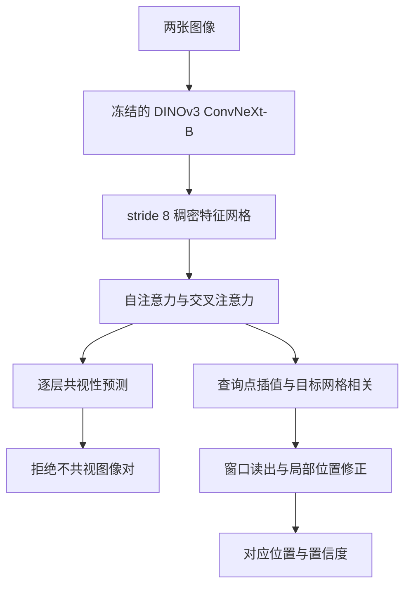
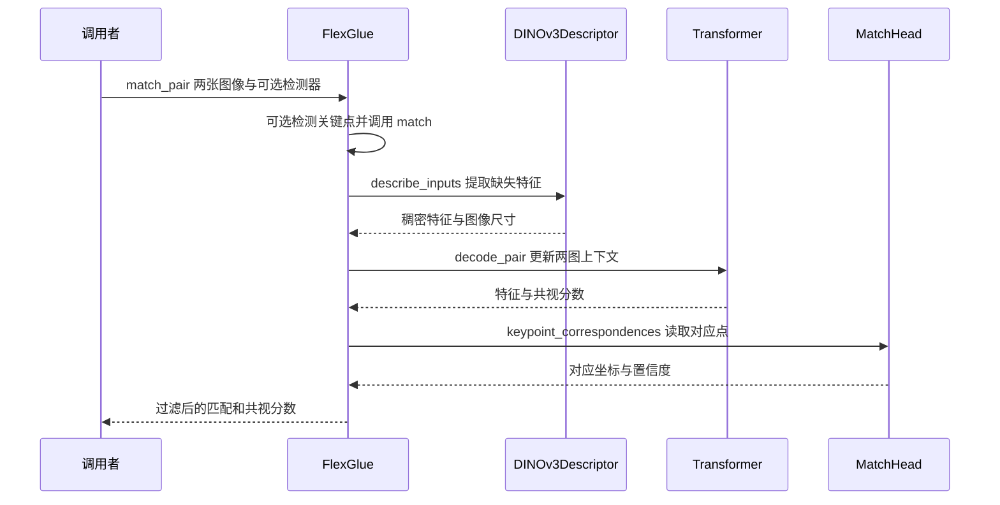

# FlexGlue：稀疏到稠密特征匹配与视觉消歧

## 一句话定义

FlexGlue 用稠密图像上下文为稀疏查询点预测对应位置，同时判断图像对是否共视，以降低视觉相似场景导致的错误匹配。

## 英文缩写速查

| 缩写 | 英文全称 | 简要说明 |
|---|---|---|
| SfM | Structure from Motion | 从多视图恢复结构和相机位姿 |
| CNN | Convolutional Neural Network | 卷积神经网络 |
| AUC | Area Under the Curve | 曲线下面积，需结合指标与阈值阅读 |
| PCK | Percentage of Correct Keypoints | 指定误差阈值内的正确匹配比例 |

## 核心信息

| 项目 | 内容 |
|---|---|
| 论文 | [arXiv:2610.32976v1](https://arxiv.org/abs/2610.32976v1)（2026-10-23） |
| 作者 | Philipp Lindenberger、Paul-Edouard Sarlin、Ondrej Miksik、Marc Pollefeys |
| 机构 | 苏黎世联邦理工、谷歌、微软 Spatial AI Lab |
| 代码 | [cvg/FlexGlue](https://github.com/cvg/FlexGlue) |

## 流程总览

训练使用网格采样查询点，推理时可使用不同检测器。匹配头对查询特征和目标网格做相关计算，以 1.5-entmax 和局部窗口读出粗位置，轻量 MLP 再修正；点可匹配性与图像对共视性是不同尺度的预测。共视性由两图 token 的投票平均得到，开启提前停止可减少明显负样本的计算。

## 源码运行时序图

基于官方 README 的 `match_pair` 入口及 `flexglue/flexglue.py`，图示有关键点的默认匹配路径；可选精修、双向最近邻和无关键点采样路径未展开。

## 实验与评测

- ETH3D 非标定 SfM，SuperPoint + FlexGlue：论文表 4 中，加入共视过滤后姿态 AUC@5° 从 83.5 提升至 92.3；提前停止设置为 91.6、45 对/秒。数值仅适用于论文评测配置。
- InLoc：论文表 6 的 DUC2 在 0.25 m、10° 阈值下为 77.9%，报告匹配吞吐 32 对/秒；DUC1 同阈值为 62.6%。
- LaMAR-DG：三个场景各含 500 对正例和 500 对相似但不重叠的困难负例；室内消歧以零样本测试跨域表现。

## 结论

FlexGlue 将点匹配与图像对消歧结合，适合评估用于定位和重建的前端。

1. 根据下游是否需要离散特征轨迹，选择稀疏到稠密或稀疏到稀疏模式。
2. 针对重复场景测试共视阈值；默认 `min_covisibility=0`，不能假设默认启用图像对拒绝。
3. 论文指出粗网格插值使查询误差相关，深度不连续处精度下降；在简单图像对上 RoMa v2 的精修可更精确。
4. 仓库发布推理代码与权重；DINOv3 主干有单独许可，部署前须审查。

## 工程实践与局限

默认描述器输入为 512×512；可提高分辨率或启用可选 RoMa v2 精修，代价是额外计算。关键点坐标采用角点坐标约定，左上像素中心为 (0.5, 0.5)；与 LightGlue 检测器配合时注意坐标原点。论文原文的方法、实验和局限已核对，全文附录尚未逐段通读；代码仅静态阅读，未实际运行。

## 关联页面

- [CoReMatch](paper-corematch.md)
- [机器人视觉感知栈选型闭环](../queries/robot-perception-stack-selection-loop.md)

## 参考来源

- [论文归档](../../sources/papers/flexglue.md)
- [官方仓库归档](../../sources/repos/flexglue.md)

## 推荐继续阅读

- [论文原文](https://arxiv.org/abs/2610.32976v1)
- [官方仓库](https://github.com/cvg/FlexGlue)
