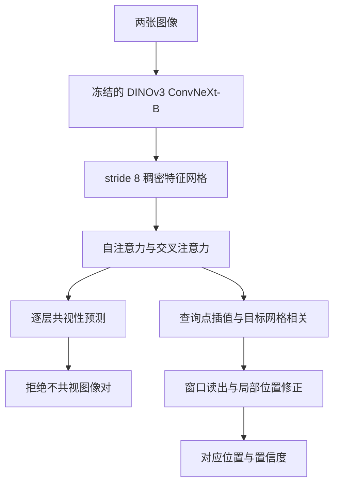
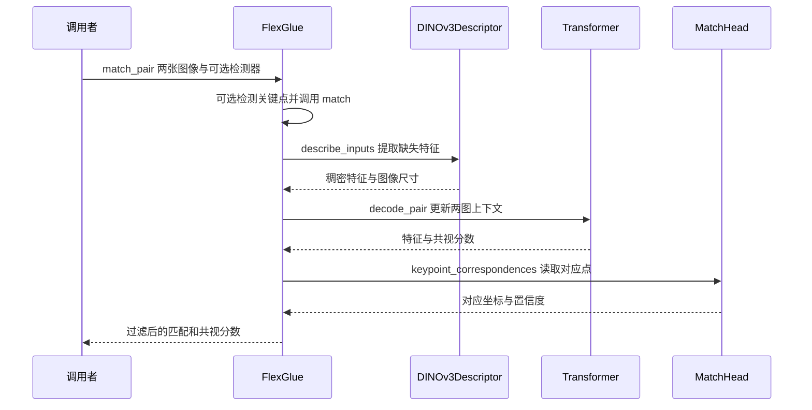

# FlexGlue：稀疏到稠密特征匹配与视觉消歧

## 一句话定义

FlexGlue 用稠密图像上下文为稀疏查询点预测对应位置，同时判断图像对是否共视，以降低视觉相似场景导致的错误匹配。

## 英文缩写速查

| 缩写 | 英文全称 | 简要说明 |
|---|---|---|
| SfM | Structure from Motion | 从多视图恢复结构和相机位姿 |
| CNN | Convolutional Neural Network | 卷积神经网络 |
| AUC | Area Under the Curve | 曲线下面积，需结合指标与阈值阅读 |
| PCK | Percentage of Correct Keypoints | 指定误差阈值内的正确匹配比例 |
| DINOv3 | DINOv3 self-supervised vision backbone | 自监督视觉基础模型，本文冻结其 ConvNeXt-B 主干 |
| MLP | Multi-Layer Perceptron | 多层感知机，用于局部位置修正与共视性相关头 |
| mAA | mean Average Accuracy | 平均准确率，HardMatch 等基准以 mAA@10px 报告 |
| AUROC | Area Under the ROC Curve | ROC 曲线下面积，用于衡量共视/非共视分类能力 |

## 核心信息

| 项目 | 内容 |
|---|---|
| 论文 | [arXiv:2610.32976v1](https://arxiv.org/abs/2610.32976v1)（2026-10-23） |
| 作者 | Philipp Lindenberger、Paul-Edouard Sarlin、Ondrej Miksik、Marc Pollefeys |
| 机构 | 苏黎世联邦理工、谷歌、微软 Spatial AI Lab |
| 代码 | [cvg/FlexGlue](https://github.com/cvg/FlexGlue)（推理代码与权重，MIT 许可） |
| 核对范围 | 论文正文全部章节、附录 A-E 及参考文献前的全部文字（经 `pdftotext` 提取）；图片仅读取图注，未做视觉逐图核对；代码在核对提交 `c6cbc7a` 上做静态阅读，未运行 |

## 为什么重要

- 稀疏匹配（检测关键点再匹配描述子）高效，但精度受检测器重复性和定位噪声限制；稠密匹配鲁棒，但对每个像素估计和精修，成本高，难以训练和部署（论文第 1 节）。
- SfM、SLAM 需要拒绝指向不同地点但外观相似的图像对，例如对称立面。仅在共视图像对上训练的匹配器会对这些“双胞胎”结构给出自信的错误匹配，并可能导致场景崩塌（论文第 1 节，图 1）。
- 既有方法常在匹配之后另加一个共视性模型，带来额外结构与计算。FlexGlue 把二者放进同一个网络，因为两者本质上都是在找“重叠上下文”（论文第 1、3.3 节）。

## 核心原理

**输入与输出。** 输入为两张图像 $I_a, I_b$，以及图像 a 中的一组查询点 $K_a$（可以是任意像素，也可以是任意检测器输出）。输出为：每个查询点 $i$ 在图像 b 中的亚像素对应坐标 $p^i_{a\to b}$；每个查询点的可匹配性 $m_i$ 与置信度 $c_i$；以及图像对的共视分数 $\bar o$。

**关键机制。**

1. **粗匹配的上下文聚合**：两图各由冻结的 DINOv3 ConvNeXt-B 提取特征，四个 stage 统一到 stride 8 并投影为 token 网格。随后 9 层 Transformer 同时做图内自注意力（使用 RoPE 编码相对位置）和跨图交叉注意力（无位置编码）（论文 3.1 节、4.1 节）。
2. **查询点读出**：对查询点插值其 token 网格并降维为描述子 $q^i_a$，与对方图像所有 token 计算余弦相似度 $s_{ij}$，在全局 softmax 之后，只在最近邻单元的 3×3 邻域内做归一化加权平均（公式 1）。论文实际使用 1.5-entmax 替代 softmax，配合 Fenchel–Young 损失，使远离目标的单元概率严格为零，从而改善亚像素精度。
3. **局部精修**：轻量 MLP 从插值后的 token 预测每个坐标轴上 ±1 单元范围内的偏移（16 个 bin，取期望），偏移平均约 0.6 px。
4. **可匹配性与置信度**：线性头输出每个查询点的可匹配性 $m_i$，置信度定义为 $c_i = m_i \sum_{j \in \mathcal{N}(j^*)} P_{ij}$。
5. **共视性判断**：每层对每个 token 用线性层加 sigmoid 输出一个共视投票 $o_j \in [0,1]$，平均得到图像对分数 $\bar o = \frac{1}{2P}\sum_{j=1}^{P}(o^a_j + o^b_j)$，其中 $P$ 为每张图的 token 数。推理时在第 $k$ 层若 $\bar o < t\,\gamma^{L-k}$ 即停止（论文推理设定 $t=0.9$、$\gamma=0.9$），因此只对明显的非共视对早停（论文 3.3 节、4.1 节）。

$$
P_{ij}=\operatorname{softmax}_j\!\left(\frac{s_{ij}}{\tau}\right),\qquad
\mathbf{p}^i_{a\to b}=\frac{\sum_{j\in\mathcal{N}(j^*)}P_{ij}\,\mathbf{g}^j_b}{\sum_{j\in\mathcal{N}(j^*)}P_{ij}}
$$

其中 $j^*=\arg\max_j s_{ij}$，$\mathbf{g}^j_b$ 为第 $j$ 个 token 的单元中心，$\tau$ 为可学习温度。

**训练。** 每个 16×16 网格单元采样一个带随机亚单元偏移的查询点，而非使用检测器关键点，因此推理时可自由更换检测器。总损失为 $\mathcal{L} = 10\,\mathcal{L}_{\text{coarse}} + \mathcal{L}_{\text{fine}} + \mathcal{L}_{\text{match}}$，加入负样本后再增加 $\mathcal{L}_{\text{covis}}$；损失在每一层上做深度监督。粗损失和精修损失只作用于在另一图中可见的查询点。

**匹配模式**（论文附录 D.3）：稀疏到稠密（每个查询点对应其预测点）、稀疏到稀疏（对称距离下的双向互为最近邻，阈值 3 px，供 SfM 等需要点对点分配的场景使用）、稠密（从稠密预测中按置信度采样至多 5k 对应）。三种模式都会丢弃置信度低于 0.1 或循环误差超过 3 px 的对应。

**流程总览**

训练使用网格采样查询点，推理时可使用不同检测器。匹配头对查询特征和目标网格做相关计算，以 1.5-entmax 和局部窗口读出粗位置，轻量 MLP 再修正；点可匹配性与图像对共视性是不同尺度的预测。共视性由两图 token 的投票平均得到，开启提前停止可减少明显负样本的计算。

## 源码运行时序图

基于官方 README 的 `match_pair` 入口及 `flexglue/flexglue.py`（核对提交 `c6cbc7a`，本次为静态阅读，未运行），图示有关键点的默认匹配路径；可选精修、双向最近邻和无关键点采样路径未展开。

## 实验与评测

以下数值均来自论文，并仅适用于论文的评测配置（输入分辨率、关键点数量、阈值和基线实现以原文为准）。

**两视图匹配与相对位姿**（表 1、表 2）。
- 稀疏设置下，SuperPoint + FlexGlue 在 MegaDepth-1500 与 ScanNet-1500 上与 LoMa-G 相近；ScanNet-1500 的 5° AUC 为 31.9，LoMa-G 为 29.3。HardMatch mAA@10px 上 SuperPoint + FlexGlue 为 55.7，LoMa-G 为 54.3。
- 在 HardMatch 上，FlexGlue 的稀疏到稠密结果高于稠密匹配器 RoMav2（46.5）；论文称稠密方法在该基准上缺乏鲁棒性。
- 表 2 中，使用 2048 个 DaD 关键点的稀疏到稠密模式在除 IMC22 外的基准上取得最高精度。在 SatAst 上 10 px 指标为 48.8，640 px 输入为 60.8，RoMav2 为 38.1。输入分辨率提高可带来一致增益。

**视觉消歧**（表 3、表 8）。以 AUROC 评测，与 DG（Doppelgangers）、DG++ 对比。

| 数据集 | DG++（DG 标注） | FlexGlue（仅匹配监督） | FlexGlue（DG + 匹配） |
|---|---|---|---|
| DG（同分布） | 98.1 | 97.0 | 98.4 |
| ViSym-F（重标注） | 86.4 | 95.3 | 95.9 |
| LaMAR-DG（室内，零样本） | 78.6 | 88.5 | 88.8 |

匹配时间：FlexGlue 28.7 ms，DG++ 124.7 ms。表 8 显示，去掉共视损失后 LaMAR-DG 的 AUROC 下降 9.3 点，说明匹配与消歧相互增强。

**多视图 SfM**（表 4、表 5）。
- ETH3D（25 个场景，未标定 SfM，SuperPoint + FlexGlue）：加入共视过滤后姿态 AUC@5° 从 83.5 提升至 92.3；提前停止设置为 91.6，吞吐 45 对/秒。同一基准上，SuperPoint + RoMav2 + DG++ 为 85.1，吞吐 4 对/秒。
- IMC2025（隐藏测试集，Kaggle）：10k 关键点版本的进行中榜单得分为 74.07，论文称比榜单头名高约 8 分；LoMa-B 在 10k 关键点下超出 Kaggle 时限。

**视觉定位（InLoc）**（表 6）。
- DUC2 在 0.25 m、10° 阈值下为 77.9%，报告匹配吞吐 32 对/秒；DUC1 同阈值为 62.6%。论文称其在 6 个阈值中的 5 个上最优。

**LaMAR-DG 基准**。三个场景（CAB、HGE、LIN）各含 500 对正例和 500 对由 MegaLoc 检索挖掘的困难负例；困难负例在检索相似度上很高，但没有重叠。按难度、跨天和跨设备分组时，FlexGlue 在困难、跨天、跨设备样本上相对 DG++ 的优势最大（附录 B.3、C.1）。

**消融**（表 7、表 8）。将 1.5-entmax 换为 softmax 造成鲁棒性的最大下降；去掉精修头主要损失亚像素精度；去掉消歧微调则鲁棒性略降。只用前 3 层会使匹配时间约减半，但精度下降（图 5）。

## 与其他工作对比

- **稀疏匹配器（LightGlue、LoMa）**：它们只在关键点位置聚合上下文，且受关键点重复性约束；FlexGlue 在稠密网格上聚合上下文，只在查询点读出，因此保留了离散轨迹，同时在室内场景和 HardMatch 上表现更好（论文 1、2、4.2 节）。附录 B.1 指出，稀疏匹配器的耗时随关键点数量呈二次增长，FlexGlue 只有读出部分随查询数线性增长。
- **稠密与半稠密匹配器（RoMav2、EDM、MASt3R）**：稠密方法鲁棒且精确，但每个像素都要估计，耗时高；RoMav2 的耗时不随关键点数量变化，但固定开销大（图 5）。论文承认，在简单图像对上 RoMav2 的稠密精修更精确（局限一节）。
- **消歧模型（DG、DG++）**：它们是匹配之后的独立步骤，DG++ 基于冻结的 MASt3R 增加轻量解码器。FlexGlue 在表 3 上的 AUROC 与之相当或更高，且吞吐约为 4 倍（论文贡献 (ii)）。DG++ 在 ViSym 上训练后，在 LaMAR-DG 上的 AUROC 从 78.6 降至 73.3（附录 C.2）。

## 结论

**一句话总判：FlexGlue 的价值在于把“匹配精度”和“是否该匹配”放进同一个前端，并以线性于查询数的读出成本换来与稠密匹配器相近的精度；它不是对所有图像对都更精确的替代品。**

1. **先按下游选择模式**：需要离散特征轨迹（如 SfM）时用稀疏到稀疏或双向互为最近邻的模式；只需要精确对应点且可接受稠密采样时用稀疏到稠密。
2. **共视阈值要在目标场景上标定**：论文推理设定为 $t=0.9$、$\gamma=0.9$；仓库默认 `min_covisibility=0.0`，即默认不因共视分数拒绝匹配（仓库核对，未运行验证）。重复结构场景需显式设置阈值。
3. **分辨率是最直接的精度杠杆**：论文称提高输入分辨率在表 2 的多数基准上带来一致增益，仓库 README 也推荐这一做法；代价是计算量增加。
4. **粗网格读出有已知误差模式**：查询误差相关，深度不连续处精度下降。需要更高精度时可叠加 RoMa v2 精修，代价是匹配耗时增加（表 7 中 SP + Ours 精修后 HardMatch 为 57.2，耗时 46.8 ms，未精修为 56.4，耗时 28.7 ms）。
5. **权重许可需单独审查**：代码为 MIT 许可；仓库另附 DINOv3 许可文件（`DINOv3_LICENSE.md`），冻结主干的 DINOv3 权重适用其自身条款，部署前须核查。

## 工程实践

- **推理入口**：`FlexGlue().match_pair(image0, image1, detector=...)` 为单对图像的便捷入口；`match` 接受已有特征或关键点；`sparse=True` 在两图都有关键点时做互为最近邻匹配。仓库 README 给出的示例使用 ALIKED 检测器。
- **坐标约定**：FlexGlue 假定关键点为角点坐标（COLMAP 约定），左上像素中心为 (0.5, 0.5)；LightGlue 检测器默认使用中心坐标，与 FlexGlue 配合时需传入 `origin="corner"`（仓库 README 的 IMPORTANT 说明）。
- **关键参数**：描述器输入 512×512（`describe_resize`，论文 4.1 节与仓库默认一致）；置信度过滤阈值 0.1；循环误差阈值 3 px；精修输入 512×512（`refine_resize`，仓库默认）。
- **检测器可替换**：论文表 9 显示，同一模型配合 SuperPoint、DaD、RaCo 关键点无需重训即可使用；在 ETH3D SfM 上 RaCo 结果最好，两视图匹配（HardMatch）三者接近。
- **早停**：共视分数在早期层即有较强区分能力（图 5、图 3）。停在 3 层可使匹配时间约减半，但精度下降，需在目标数据上测量。
- **调试指标**：共视性用 AUROC 与 AP；两视图匹配用 mAA@10px 与 AUC；SfM 用 pose AUC 与 pairs/s。论文的吞吐在单张 RTX 4090 上、混合精度下测量。资源占用：提取加匹配约 1.2 GB 显存，仅匹配约 0.7 GB（附录 B.1）。
- **源码开放状态（步骤 2.5）**：论文 arXiv 摘要页未列出独立项目页，链接指向 `github.com/cvg/FlexGlue`。仓库发布推理代码与权重（MIT 许可），并提供 Colab 演示；README 称仓库承载推理代码，核对提交 `c6cbc7a` 的目录中未见训练或评测脚本。归类为 **部分开源**：推理入口可运行，训练与评测复现依赖未公开的部分。
- **基准数据可得性**：论文未明确 LaMAR-DG 是否随代码公开（未核实）。ViSym-F 为作者人工重标注的测试子集（去掉 51 个 unsure 对，并在每个场景中平衡正负样本、每类至多 100 对），与原始 ViSym 标签上的结果不可直接比较。

## 局限与风险

论文第 F 节列出的局限，以及实验中观察到的失败模式：

- **误差相关**：不同查询点的误差相关，原因是粗网格上学到的插值。论文报告验证集上 PCK@1px 为 61.0%，而对极精度为 88.4%，即多数误差沿对极线方向。这说明模型学到了某种对极几何，但不完全可靠；依赖误差独立假设的相对位姿估计可能受影响。
- **精细精度不如稠密精修**：在简单图像对上 RoMav2 的稠密精修可以得到更精确的匹配。
- **后层交叉注意力趋于局部**：论文发现后层的粗注意力改善有限，交叉注意力的扩散也越来越局部。
- **深度不连续处精度下降**：PCK@5px 从 >90% 降至约 75%，原因是网络必须插值，且插值可能落在遮挡另一侧的错误一边。
- **重复结构仍会出错**：附录图 14 的失败案例显示，在重复立面上会匹配到错误的重复实例，RoMav2 在同一例中成功。极端旋转下的重复天花板也会导致所有方法失败。
- **消歧的域迁移**：消歧训练数据几乎全部为室外；论文在室内的 LaMAR-DG 上只做零样本测试，并称使用 NaverLabs 室内负样本可进一步提升（表 8），但这属于论文自身的设定。
- **标签噪声**：原始 ViSym 的 GPS 标签有噪声，会把部分共视对标为负样本。论文人工重标注后才得到 ViSym-F 的结果。
- **仓库与论文的对应关系**：仓库目前提供推理代码；论文中的训练、评测脚本和 LaMAR-DG 数据未在仓库目录中出现（未核实其后续发布计划）。
- **未独立复现**：本页数值均转引自论文，未在本环境运行仓库代码或复现实验。
- **坐标约定误用**：与 LightGlue 检测器混用时若忽略角点约定，会引入约半个像素的系统偏差。

## 关联页面

- [CoReMatch](paper-corematch.md)
- [机器人视觉感知栈选型闭环](../queries/robot-perception-stack-selection-loop.md)

## 参考来源

- [论文归档](../../sources/papers/flexglue.md)
- [官方仓库归档](../../sources/repos/flexglue.md)

## 推荐继续阅读

- [论文原文（arXiv:2610.32976）](https://arxiv.org/abs/2610.32976v1)
- [官方仓库 cvg/FlexGlue](https://github.com/cvg/FlexGlue)
- [Colab 演示 demo.ipynb](https://colab.research.google.com/github/cvg/FlexGlue/blob/main/demo.ipynb)
