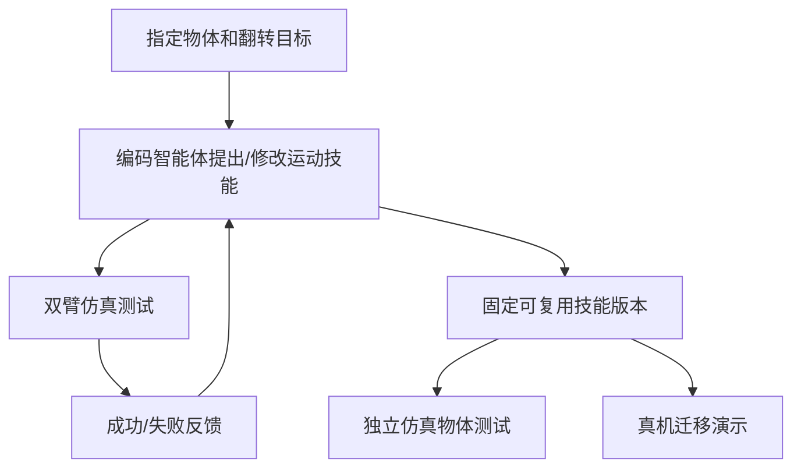

# Flip Anything with Agentic Robotics Self-Learning（通过智能体式机器人自学翻转物体）

## 一句话定义

**Flip Anything** 让编码智能体在仿真里设计、试运行和改进双臂物体翻转技能，以自动测试结果驱动程序/运动原语迭代，再检验其跨物体和真机迁移。

## 英文缩写速查

| 缩写 | 英文全称 | 简要说明 |
|---|---|---|
| RL | Reinforcement Learning | 以环境反馈改善控制行为的研究背景 |
| Sim2Real | Simulation to Reality | 将仿真验证的翻转技能迁移到实体机器人 |
| DoF | Degrees of Freedom | 机器人单臂关节/运动自由度 |
| SR | Success Rate | 仿真测试集中翻转完成比例 |

## 为什么重要

复杂物体翻转涉及多接触点与摩擦变化；让 agent 在环境中迭代可复用动作，而不是为每件物体写规则，为机器人技能自动开发提供实验路径。

## 流程总览（论文与项目主页的可核验层级）

这是**方法循环**，不是已公开 Python/ROS 代码的实际函数调用图。

## 核心原理

编码智能体根据交互结果修订运动原语，建立可复用翻转程序；通过保留测试集检验它是否能超越训练过程针对的单个场景。研究突出“技能程序迭代 + 物理仿真闭环”，不是单纯的语言推理评测。

## 实验与评测（论文作者报告）

| 实验设置 | 成功率 |
|---|---:|
| 训练/迭代仿真初始 | 24.7% |
| 经自动修改后（342/360） | 95.0% |
| 冻结技能版本 held-out 测试（109/120） | 90.8% |

这些是特定物体、动作与仿真环境下的分数；官网真机演示不能当作同分母的独立成功率结果。

## 结论

**有价值的不是把 95% 视为任意物体真机成功率，而是有验证闭环的技能自动迭代流程。**

1. 在开发时严格划分迭代用环境与 held-out 评测。
2. 分别报告仿真成功与真机迁移成功。
3. 需要可复用原语、失败分类及安全边界，尤其接触丰富的真机任务。

## 与其他工作对比

[WICL](./paper-world-in-context-learning-roboscript.md) 借助模拟试演写入任务上下文记忆，Flip Anything 侧重修改**可执行技能程序**；[SWAM](./paper-swam-cross-modal-alignment.md) 则侧重训练统一模型权重。

## 源码运行时序图

**不适用：** 尚未确认公开可运行的作者官方项目代码仓/脚本。不能把方法流程虚构成具体源码时序图。

## 工程实践

- 复核作者的训练/冻结/测试划分，切勿用 360 次开发测试替代 held-out 集性能。
- 真机实施须自行实现碰撞边界、夹持接触检测、速度/力限制等安全策略；本文公开资料未提供可直接运行的部署命令。

## 局限与风险

具体技能优化效果依赖仿真接触和摩擦参数；不同物体质量和抓取误差对真实系统有影响。官方代码可得性与论文附录尚待核验，因此本节点暂存草稿。

## 关联页面

- [WICL](./paper-world-in-context-learning-roboscript.md)
- [SWAM](./paper-swam-cross-modal-alignment.md)

## 参考来源

- [Flip Anything 一手论文摘录](../../sources/papers/flip-anything-2611-11941.md)
- [官方研究主页归档](../../sources/sites/flip-anything-official.md)

## 推荐继续阅读

- [arXiv:2611.11941](https://arxiv.org/abs/2611.11941)
- [Flip Anything 项目主页](https://berkeleyautomation.github.io/flipanything/)
