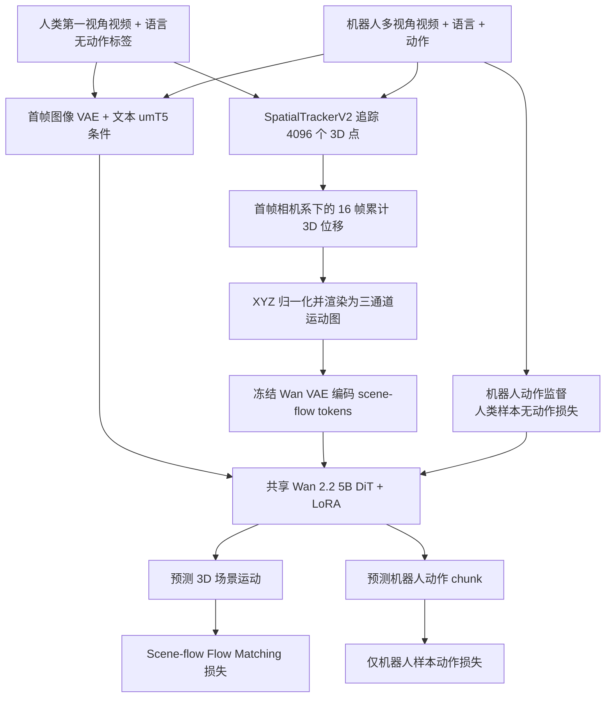
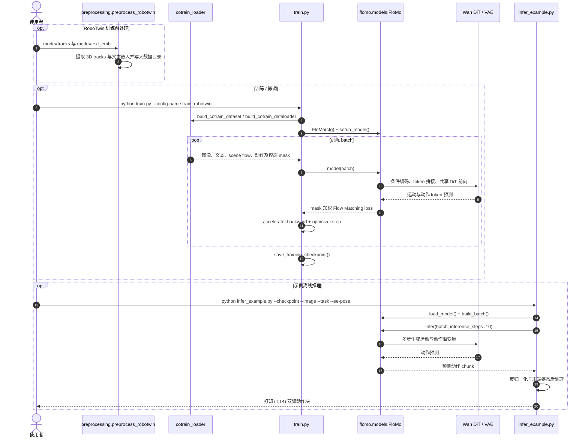

# FloMo：以 3D 场景运动连接人类视频预训练与机器人动作

**原文：** *FloMo: 3D Scene Flow as a World Action Model Intermediate for Learning from Human Video*（Jeremy A. Collins、Namra Patel、Ayush Agarwal、Shitij Govil、Animesh Garg；佐治亚理工学院 Georgia Institute of Technology；[arXiv:2611.05062v2](https://arxiv.org/html/2611.05062)，2026-11-04）。

## 一句话定义

**FloMo 是一种世界–动作模型（WAM）：利用预训练视频生成模型的运动先验，把未来预测目标从 RGB 画面换成 3D 场景流（Scene Flow），联合预测物体/手部运动与机器人动作。** 它不是先生成视频再通过独立逆动力学模型解码动作。

## 英文缩写速查

| 缩写 | 英文全称 | 简要说明 |
|------|----------|----------|
| WAM | World Action Model | 世界状态变化与机器人动作联合建模 |
| Scene Flow | 3D Scene Flow | 场景点在三维空间的运动位移场 |
| DiT | Diffusion Transformer | 本文复用 Wan 2.2 5B 的 Transformer 视频生成骨干 |
| VAE | Variational Autoencoder | 将三通道场景流图编码为视频潜变量，编码器冻结 |
| MA / VA / VMA | Motion–Action / Video–Action / Video–Motion–Action | 同架构下的不同未来预测目标消融 |
| OOD | Out of Distribution | 训练分布外的动作原语、任务或物体 |
| LoRA | Low-Rank Adaptation | 用低秩适配器微调 Wan 主干 |

## 为什么重要

视频生成模型已经通过大规模视频预训练学习运动规律，但预测完整的未来像素还要消耗容量拟合纹理、背景和光照。FloMo 检验的是 **WAM 应预测什么**，而非「还需不需要视频预训练」：**保留视频模型权重中的先验，将下游监督目标改成更接近动作的 3D 位移。**

## 核心信息

| 维度 | 经原文核对的内容 |
|------|------------------|
| 机构 | 佐治亚理工学院（Georgia Institute of Technology） |
| 论文 | [arXiv:2611.05062v2](https://arxiv.org/html/2611.05062)，2026-11-04 |
| 基座 | Wan 2.2 TI2V-5B DiT，30 层；冻结 Wan VAE 与 umT5-XXL |
| 可训练部分 | DiT LoRA rank=64，含动作头约 161M 参数 |
| 训练数据 | 约 81 h EgoVerse 人类第一视角视频、约 0.7 h 内部无动作标签人类视频；另有约 10 h MolmoAct2-BimanualYAM、3.7 h 内部 YAM 示范及 0.4 h 机器人 play |
| 预测 | 16 帧窗口的累计 3D Scene Flow + 16 步动作 chunk；论文动作表示每步 20 维（双臂末端位置、6D 旋转、夹爪） |
| 开源状态 | [项目页](https://flomo-wam.github.io/)已提供[训练/推理/预处理代码](https://github.com/pairlab/flomo)与[三组 MA / VA / VMA 权重](https://huggingface.co/shitijgovil/FloMo)，MIT 许可证；未在本次环境实跑训练或真机 |

## 核心机制：为什么选 3D Scene Flow

1. **离线提取 3D 点轨迹。** 使用 SpatialTrackerV2，对 16 帧窗口首帧的 64×64 网格（4,096 个点）追踪 3D 位置，统一到首帧相机坐标系，减少相机自运动干扰。
2. **累计位移而不是瞬时速度。** 对任一点的第 i 帧，以 `F_i(u,v) = P_i(u,v) - P_0(u,v)` 作监督，首帧位移为零；论文报告该目标相比逐帧速度更平滑。
3. **复用视频潜空间。** 对 XYZ 位移分通道裁剪与归一化，渲染成三通道「伪 RGB 视频」，经冻结 Wan 2.2 VAE 编码为 scene-flow latent；无须额外训练 tokenizer。
4. **联合 Flow Matching。** 首帧图像经冻结 VAE、文本指令经冻结 umT5 编码为条件，scene-flow token 和动作 token 一同进入 LoRA 微调的共享 DiT。默认损失权重 `λ_flow=1, λ_action=0.1, λ_video=0`；只在 VA/VMA 消融开启视频预测。
5. **两阶段训练。** Mid-training 混合人类无动作标签视频（只监督 scene flow）与机器人遥操作数据（监督 scene flow 和动作），随后仅用机器人数据 fine-tune，将动作损失权重升至 1。
6. **推理。** 单次循环用 UniPC 进行 10 步 flow-matching 去噪，输出 16 步动作 chunk 并重新观测规划；动作和运动是联合预测，不保证几何上严格一致。

## 项目流程总览

**读图注意：** 数据中的 scene flow 是离线计算的监督目标，机器人部署时无需在每次执行前运行 SpatialTrackerV2；模型直接联合生成未来 motion/action token。

## 实验与评测（论文原始结果）

### 真实机器人：同骨干、同训练协议的监督目标消融

| 预测目标 | 真机已见任务平均成功率（3 任务，各 15 次） | OOD 成功率（3 任务，各 10 次） |
|----------|-------------------------------------------:|-------------------------------:|
| **FloMo / MA：3D 运动 + 动作** | **91%** | **18/30 = 60%** |
| VMA：RGB 视频 + 3D 运动 + 动作 | 51% | 2/30 ≈ 7% |
| VA：RGB 视频 + 动作 | 40% | 2/30 ≈ 7% |

已见任务是 Oven、Toolbox、Corn；Toolbox 上 MA 为 87%，VA/VMA 均为 13%。OOD 分别检查未见动作原语（Close Cabinet）、未见任务（Pull String）、未见物体（Highlighter）；FloMo 成功数依次为 6/10、7/10、5/10。以上是本论文的受控比较，**不是所有视频预测策略的普遍排名**。

### RoboTwin 2.0 单任务适配（Easy，5 任务）

每个任务 50 条官方示范、5,000 次梯度更新、各 100 个测试 episode：FloMo 平均 **63.6%**，π₀.₅ **44.8%**，FAST-WAM **41.0%**，Diffusion Policy BC **19.2%**；FloMo 在这五个任务上均高于对照。

### 人类视频的贡献与表示效率

- 移除约 81 h EgoVerse 及 0.7 h 内部人类视频后，FloMo 的 OOD 成功率从 **18/30（60%）** 降至 **1/15（约 7%）**。注意消融组每项只测 5 次，样本数与完整组不同。
- 使用真实未来运动/视频作为条件的逆动力学 probe，在只取 **1% 动作数据**时，运动表示对应的动作误差约低 **22%**；这是表示质量分析，**并非端到端 1% 数据的政策成功率**。
- VMA 注意力分析中，动作查询对 motion token 的平均注意力约为 video token 的 **3 倍**。注意力分配是辅助解释，不能单独证明因果。

## 源码运行时序图

基于官方 [README](https://github.com/pairlab/flomo#readme)、[`preprocessing/preprocess_robotwin.py`](https://github.com/pairlab/flomo/blob/main/preprocessing/preprocess_robotwin.py)、[`train.py`](https://github.com/pairlab/flomo/blob/main/train.py)、[`flomo/models/FloMo.py`](https://github.com/pairlab/flomo/blob/main/flomo/models/FloMo.py) 与 [`infer_example.py`](https://github.com/pairlab/flomo/blob/main/infer_example.py) 的实际调用关系：

**复现入口（官方 README）：** 安装 Python 3.10、CUDA 版 PyTorch，克隆 Wan2.2 / DreamZero 并下载 Wan VAE 与 umT5；从 [Hugging Face](https://huggingface.co/shitijgovil/FloMo) 下载模型后，用 `infer_example.py` 对三视角图像、任务指令、当前末端位姿作单步动作预测。RoboTwin 路径先以 `preprocessing.preprocess_robotwin` 的 `tracks` / `text_emb` 模式准备 50 条示范，再以 `train.py --config-name train_robotwin` 微调。示例程序**只打印动作，不负责真机相机采集、实时控制或安全闭环**。

## 工程实践

按照 [官方 README 的安装、推理与 RoboTwin 微调说明](https://github.com/pairlab/flomo#readme)，复现时应区分**离线场景流预处理**与**在线动作推理**：

| 关键环节 | 官方入口与操作要点 | 验证点 |
|----------|--------------------|--------|
| 环境与权重 | Python 3.10、CUDA GPU；安装 Wan2.2、DreamZero 和 `pip install -e .`；准备 Wan VAE/umT5 及 [MA、VA、VMA 模型权重](https://huggingface.co/shitijgovil/FloMo) | 检查 GPU/PyTorch 对应版本和 checkpoint 模态配置，不能把 VMA 的结果当作 MA |
| 数据与 3D tracking | `python -m preprocessing.preprocess_robotwin mode=tracks ...` 与 `mode=text_emb`；先将训练演示转换为可读取的 track 和文本条件 | Scene Flow 是训练目标，离线追踪的正确性决定运动监督质量 |
| RoboTwin 微调 | `python train.py --config-name train_robotwin data_root=... robotwin_task=open_laptop checkpoint=... resume=false run_name=...` | README 示例按单任务 50 条 `demo_clean` 示范、5,000 次更新；`resume=false` 从权重初始化而不是恢复优化器 |
| 单步动作推理 | `python infer_example.py --checkpoint ... --wan-ckpt-dir ... --image primary.png --image left.png --image right.png --task "..." --ee-pose=...` | 视角顺序须为 primary / left / right；基础权重默认使用 `realyam` 归一化，RoboTwin 微调权重须选 `--normalizer-type robotwin` |
| 输出与机器人集成 | CLI 将模型动作反归一化，转换为双臂末端 `(T,14)` 的 `x,y,z,yaw,pitch,roll,gripper` 序列 | 此例只打印动作块；相机采集、动作安全检查、实时下发及闭环执行需另行接入 |

**硬件提示：** 官方 README 对 PyTorch / CUDA 版本、SpaTrackerV2 的 `torchvision` 与 `numpy` 依赖有明确限制，复现前应按仓库当时的安装说明检查版本。本文未在本次环境实际运行训练或真机，以上是**源码与文档核对的复现路径**，不是实测性能。

## 局限与风险

- **预处理开销：** 论文报告 SpatialTrackerV2 在 L40S 上每 16 帧约 2.4 s；每小时 30 FPS 视频需约 72 GPU-hours。数据管线扩展成本不可忽略。
- **运动与动作可能不一致：** 联合预测未施加强制运动–动作一致性约束，运动合理不保证动作正确。
- **单视角预测与遮挡：** 机器人可用三视角条件，但场景流只预测正面相机视角；遮挡、追踪噪声及陌生物体的语言指向会造成退化。
- **适用边界：** 主要是双臂桌面操作和 RoboTwin Easy 单任务；不能据此推断人形全身控制、移动操作或所有开放场景也将获得相同增益。
- **开源与复现：** 代码、三组权重已公开；真实机器人数据中的部分内部示范及硬件集成并不等于完全可公开复现，本文未独立运行。

## 结论

**在本文所测双臂操作任务与匹配消融中，把未来监督从 RGB 换成相机运动解耦的 3D Scene Flow，比预测完整视频更有效地把人类视频先验转移到动作。**

1. **模型选型：** 先区分「预训练使用视频」和「微调预测视频」；FloMo 保留前者、改变后者。
2. **监督设计：** 对比 MA / VA / VMA 时锁定骨干、训练数据与动作头，以机器人成功率而非视频视觉质量为主指标。
3. **数据工程：** 人类无 action label 视频可提供 motion-only supervision，但需预先完成可靠的 3D tracking。
4. **真机评价：** 分开统计已见任务、未见原语/任务/物体与不同视角遮挡的成功率；小样本波动需要额外复核。
5. **落地代价：** 关注 3D tracks 计算预算、5B 主干推理需求及动作–运动一致性，而非只看模拟成功率。

## 与其他工作对比

- **对比像素视频 WAM（VA / VMA / DreamZero）：** 在同骨干、同数据受控评测中，FloMo（MA）已见真机成功率达 **91%**（VMA **51%**、VA **40%**）；在三项 OOD 条件（Table I）下，FloMo 取得 **18/30（60% SR / 68% TP）**，显著优于 VMA（2/30）、VA（2/30）以及联合预测视频与动作的 [DreamZero](./paper-notebook-dreamzero-world-action-models-are-zero-shot-poli.md)（**6/30 = 20% SR / 30% TP**），表明去除像素外观预测目标可减少纹理与背景过拟合。
- **对比 2D 点轨迹中间表示（AMPLIFY）：** 在同一 OOD 真机测试集上，预测图像空间 2D 稀疏点轨迹的 [AMPLIFY](./paper-rcl-2506-14198-amplify-actionless-motion-priors-for-robot-learn.md) 在已包含的 Close Cabinet 上拿到 6/10，但在未见任务 Pull String 与未见物体 Highlighter 上均为 0/10（总计 **6/30 = 20% SR / 23% TP**），落后于采用首帧相机系 3D Scene Flow 的 FloMo（7/10 与 5/10）。
- **对比 VLA 与仿真 WAM（RoboTwin 2.0 Easy）：** 在 5 个单任务固定 50 示范协议下，FloMo 平均 **63.6%** 高于微调 VLA [π₀.₅](./paper-pi05-open-world-vla.md)（**44.8%**）、同 Wan LoRA 配置的 [FAST-WAM](./paper-fast-wam.md)（**41.0%**）与无视频预训练的 Diffusion Policy BC（**19.2%**）；代价是训练前需付出 SpatialTrackerV2 离线追踪开销（L40S 约 2.4 s / 16 帧）。

## 关联页面

- [世界–动作模型（WAM）](../concepts/world-action-models.md)
- [生成式世界模型](../methods/generative-world-models.md)
- [视觉–语言–动作模型（VLA）](../methods/vla.md)
- [WAM 纵深路线：Stage 5 数据与未来监督目标](../../roadmap/depth-wam.md)
- [具身智能小站 11-05 论文阅读地图](../overview/embodied-station-2026-11-05-43-papers-technology-map.md)

## 参考来源

- [FloMo 论文 v2：通读的原始材料](../../sources/papers/flomo_arxiv_2611_05062.md)
- [FloMo 官方项目页核对](../../sources/sites/flomo.md)
- [FloMo 官方源码与入口核对](../../sources/repos/flomo.md)
- [arXiv HTML，含方法、实验、讨论及附录](https://arxiv.org/html/2611.05062)

## 推荐继续阅读

- [官方项目主页与实验结果](https://flomo-wam.github.io/)
- [官方源码与复现 README](https://github.com/pairlab/flomo)
- [MA / VA / VMA 官方模型权重](https://huggingface.co/shitijgovil/FloMo)
