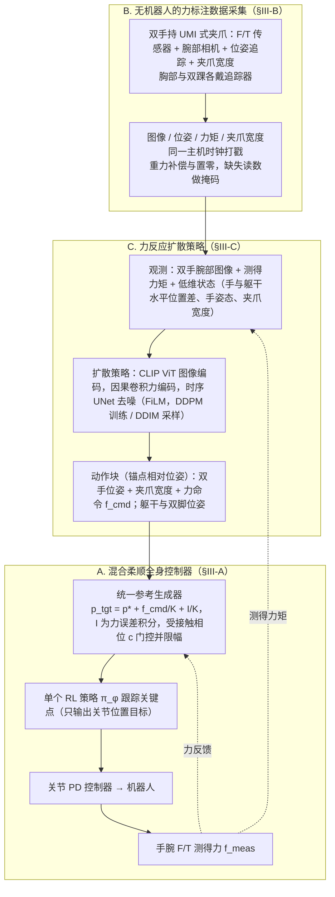

# FLoRe（arXiv:2610.35862）

**FLoRe**（*Learning Force-Reactive Humanoid Loco-Manipulation*，[arXiv:2610.35862](https://arxiv.org/abs/2610.35862)，[项目页](https://louis-leee.github.io/FLoRe/)）来自 [具身智能小站 2026-10-28 盘点](../../sources/blogs/wechat_embodied_station_59_papers_human_video_to_robot_experience_2026-10-28.md)，属「灵巧与接触操作」组。

## 一句话定义

**用带力传感的手持夹爪与身体追踪器采集示范，策略联合预测动作和双手力命令。**

## 英文缩写速查

| 缩写 | 英文全称 | 简要说明 |
|------|----------|----------|
| FLoRe | Learning Force-Reactive Humanoid Loco-Manipulation | 本文框架的简称 |
| UMI | Universal Manipulation Interface | 手持示教接口形式 |
| F/T | Force/Torque | 力与力矩传感 |

## 为什么重要

- 让人形机器人同时跟踪运动与力。混合柔顺全身控制兼顾受力与平衡，真机比较强调同示范、同控制器下的力反馈价值。
- 开源结论：**待发布**（步骤 2.5，2026-10-28）。项目页 HTTP 200，未列 GitHub，页面含 coming soon 字样（脚本扫描）。
- 同期同组工作见 [潜在动作、免渲染事件仿真与机器人评测：具身智能小站 10-28 期 59 篇阅读坐标](../overview/embodied-station-2026-10-28-59-papers-technology-map.md)。

## 流程总览

图依据：论文 §III 开头 / Fig.2、Fig.3 及 §III-A–§III-C。

## 核心机制

| 项 | 内容 |
|----|------|
| **arXiv** | [2610.35862](https://arxiv.org/abs/2610.35862) |
| **开源** | **待发布** |
| **要点** | 用带力传感的手持夹爪与身体追踪器采集示范，策略联合预测动作和双手力命令。 |
| **文内指标** | 公众号转述：混合柔顺全身控制兼顾受力与平衡，真机比较强调同示范、同控制器下的力反馈价值。 |

## 源码运行时序图

**不适用（待发布）** — 项目页 HTTP 200，未列 GitHub，页面含 coming soon 字样（脚本扫描）。 不编造运行脚本；代码公开后再补。

## 实验与评测

- 论文摘要报告：三类真机接触任务中成功率为 **80%**；相同示范与控制器下，仅位置策略为 **26.7%**。
- 策略输入视觉、本体感觉与测量力/力矩，输出动作和每只手的力命令；全身控制器跟踪力并维持平衡。
- **读法：** 本页为索引级摘要，依据公众号转述的官方摘要与仓库信息整理；逐项数字与 baseline 以原文 PDF 为准。

## 与其他工作对比

- 横向索引见 [潜在动作、免渲染事件仿真与机器人评测：具身智能小站 10-28 期 59 篇阅读坐标](../overview/embodied-station-2026-10-28-59-papers-technology-map.md)；同 arXiv 不重复造页。

## 结论

**让人形机器人同时跟踪运动与力：混合柔顺全身控制兼顾受力与平衡，真机比较强调同示范、同控制器下的力反馈价值。**

1. 开源边界：**待发布** — 项目页 HTTP 200，未列 GitHub，页面含 coming soon 字样（脚本扫描）。
2. 核心机制：用带力传感的手持夹爪与身体追踪器采集示范，策略联合预测动作和双手力命令。
3. 复现与选型前核对任务协议、硬件与基准口径，勿直接横比公众号摘录数字。

## 关联页面

- [CARD](./paper-card-contact-anchored-retargeting.md) — 通过显式接触目标和触觉跟踪重定向灵巧示范。

- [manipulation](../tasks/manipulation.md)
- [contact-rich-manipulation](../concepts/contact-rich-manipulation.md)
- [dexterous-kinematics](../concepts/dexterous-kinematics.md)
- [teleoperation](../tasks/teleoperation.md)
- [motion-retargeting](../concepts/motion-retargeting.md)
- [embodied-station-2026-10-28-59-papers-technology-map](../overview/embodied-station-2026-10-28-59-papers-technology-map.md)

## 参考来源

- [flore_arxiv_2610_35862.md](../../sources/papers/flore_arxiv_2610_35862.md)
- [wechat_embodied_station_59_papers_human_video_to_robot_experience_2026-10-28.md](../../sources/blogs/wechat_embodied_station_59_papers_human_video_to_robot_experience_2026-10-28.md)
- [arXiv:2610.35862](https://arxiv.org/abs/2610.35862)
- [arXiv PDF](https://arxiv.org/pdf/2610.35862)：已通读方法部分（实验与附录以略读为准）：§III Method（§III-A 混合柔顺全身控制器、§III-B 力标注数据采集、§III-C 力反应扩散策略）、§IV Experiments 略读

## 推荐继续阅读

- [arXiv PDF](https://arxiv.org/pdf/2610.35862)
- [项目页](https://louis-leee.github.io/FLoRe/)
