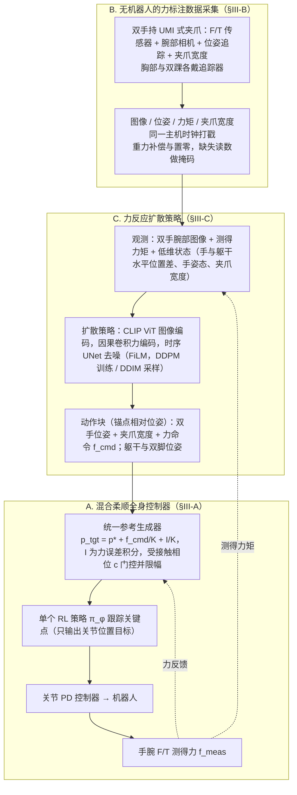
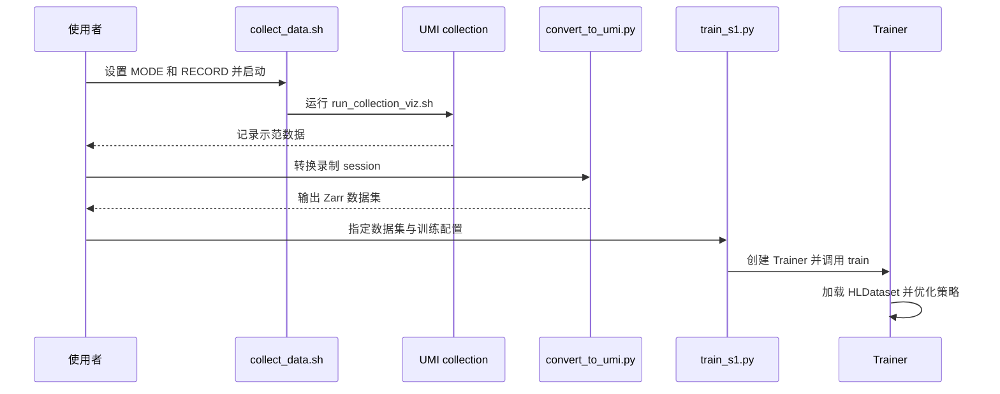

# FLoRe: Learning Force-Reactive Humanoid Loco-Manipulation（力反馈响应式人形移动操作学习）

**FLoRe**（*Learning Force-Reactive Humanoid Loco-Manipulation*，[arXiv:2610.35862](https://arxiv.org/abs/2610.35862)，[项目页](https://louis-leee.github.io/FLoRe/)）来自 [具身智能小站 2026-10-28 盘点](../../sources/blogs/wechat_embodied_station_59_papers_human_video_to_robot_experience_2026-10-28.md)，属「灵巧与接触操作」组。

## 一句话定义

**用带力传感的手持夹爪与身体追踪器采集示范，策略联合预测动作和双手力命令。**

## 英文缩写速查

| 缩写 | 英文全称 | 简要说明 |
|------|----------|----------|
| FLoRe | Learning Force-Reactive Humanoid Loco-Manipulation | 本文框架的简称 |
| UMI | Universal Manipulation Interface | 手持示教接口形式 |
| F/T | Force/Torque | 力与力矩传感 |

## 为什么重要

- 让人形机器人同时跟踪运动与力。混合柔顺全身控制兼顾受力与平衡，真机比较强调同示范、同控制器下的力反馈价值。
- **部分开放**：官方仓库已发布底层控制器训练、ONNX 权重、G1 部署、采集软件及高层策略源码；高层训练与部署指南待发布。详见 [代码归档](../../sources/repos/flore.md)。
- 同期同组工作见 [潜在动作、免渲染事件仿真与机器人评测：具身智能小站 10-28 期 59 篇阅读坐标](../overview/embodied-station-2026-10-28-59-papers-technology-map.md)。

## 流程总览

图依据：论文 §III 开头 / Fig.2、Fig.3 及 §III-A–§III-C。

## 核心机制

| 项 | 内容 |
|----|------|
| **arXiv** | [2610.35862](https://arxiv.org/abs/2610.35862) |
| **机构** | 亚马逊 FAR、纽约大学、卡内基梅隆大学、芝加哥大学 | 
| **开源** | [官方仓库](https://github.com/amazon-far/FLoRe)：部分开放，高层训练部署指南待发布 |
| **要点** | 用带力传感的手持夹爪与身体追踪器采集示范，策略联合预测动作和双手力命令。 |
| **论文版本** | [arXiv v1](https://arxiv.org/html/2610.35862v1)，2026-10-26 |

## 源码运行时序图

以下为官方代码中已核查的数据采集与高层训练路径，不代表完整真机部署路径：

源码依据：[采集入口](https://github.com/amazon-far/FLoRe/blob/cb99fd05ac3e43eefdd1269647a29b98be2b6ea3/scripts/collect_data.sh)、[转换器](https://github.com/amazon-far/FLoRe/blob/cb99fd05ac3e43eefdd1269647a29b98be2b6ea3/third_party/UMI_collection/processing/convert_to_umi.py)、[训练入口](https://github.com/amazon-far/FLoRe/blob/cb99fd05ac3e43eefdd1269647a29b98be2b6ea3/scripts/train_s1.py) 与 [Trainer](https://github.com/amazon-far/FLoRe/blob/cb99fd05ac3e43eefdd1269647a29b98be2b6ea3/flore/s1_policy/training/trainer.py)。训练示例依赖数据和归一化统计；官方高层指南尚待发布。

## 实验与评测

- G1 三项任务各训练一个策略，每项 10 次：推龙门架 7/10、旋转箱子 9/10、擦白板 8/10，合计 24/30。相同示范及控制器下，仅位置策略为 8/30；去掉力命令为 11/30，去掉力观测为 20/30（论文表 II）。
- 仿真中 5–25 N 命令的接触期误差约 1 N/手；该数值不是任务成功率，也不是所有方向的真机精度。真机独立测力计测试中，x 方向稳态平均绝对误差约 1.1 N。
- 限制：每任务仅 10 次；实验覆盖三类任务，横向和向下力追踪较弱；引入力通道相对无力版本增加根部位置误差 1.3–3.2 cm。真实部署需要腕部力传感与标定。

## 与其他工作对比

- 横向索引见 [潜在动作、免渲染事件仿真与机器人评测：具身智能小站 10-28 期 59 篇阅读坐标](../overview/embodied-station-2026-10-28-59-papers-technology-map.md)；同 arXiv 不重复造页。

## 结论

**让人形机器人同时跟踪运动与力：混合柔顺全身控制兼顾受力与平衡，真机比较强调同示范、同控制器下的力反馈价值。**

1. 开源边界：底层控制器、采集软件与高层源码已公开；高层训练部署指南待发布。
2. 核心机制：用带力传感的手持夹爪与身体追踪器采集示范，策略联合预测动作和双手力命令。
3. 复现与选型前核对任务协议、硬件与基准口径，勿直接横比公众号摘录数字。

## 关联页面

- [CARD](./paper-card-contact-anchored-retargeting.md) — 通过显式接触目标和触觉跟踪重定向灵巧示范。

- [manipulation](../tasks/manipulation.md)
- [contact-rich-manipulation](../concepts/contact-rich-manipulation.md)
- [dexterous-kinematics](../concepts/dexterous-kinematics.md)
- [teleoperation](../tasks/teleoperation.md)
- [motion-retargeting](../concepts/motion-retargeting.md)
- [embodied-station-2026-10-28-59-papers-technology-map](../overview/embodied-station-2026-10-28-59-papers-technology-map.md)

## 参考来源

- [flore_arxiv_2610_35862.md](../../sources/papers/flore_arxiv_2610_35862.md)
- [wechat_embodied_station_59_papers_human_video_to_robot_experience_2026-10-28.md](../../sources/blogs/wechat_embodied_station_59_papers_human_video_to_robot_experience_2026-10-28.md)
- [arXiv:2610.35862](https://arxiv.org/abs/2610.35862)
- [arXiv v1 全文](https://arxiv.org/html/2610.35862v1)：方法、实验与结论；仓库源码状态以 2026-11-05 核查为准。
- [官方源码归档](../../sources/repos/flore.md)

## 推荐继续阅读

- [arXiv PDF](https://arxiv.org/pdf/2610.35862)
- [项目页](https://louis-leee.github.io/FLoRe/)
