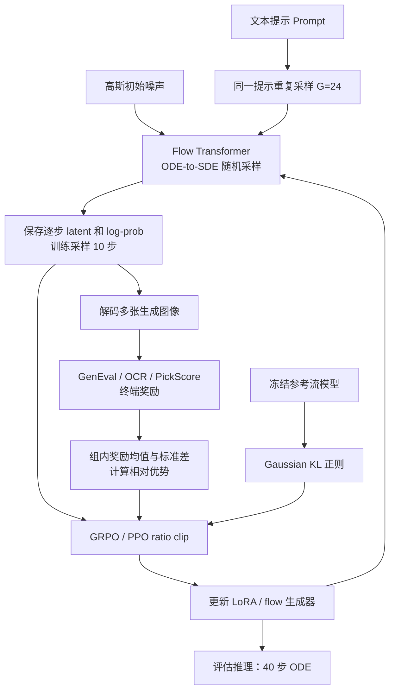
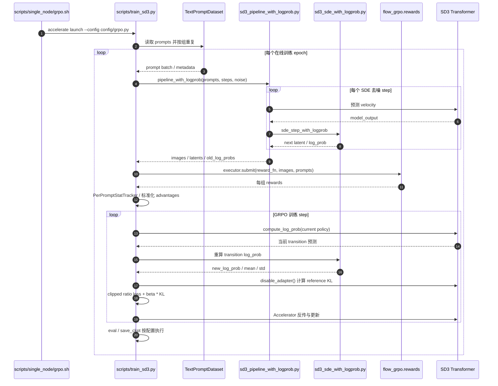

# Flow-GRPO：通过在线强化学习训练流匹配模型 / Training Flow Matching Models via Online RL

## 一句话定义

**Flow-GRPO**（*Flow-GRPO: Training Flow Matching Models via Online RL*，Jie Liu 等，**NeurIPS 2025**，arXiv:2505.05470v5）将**确定性的流匹配 ODE 采样**转为可控随机性的 **SDE 采样**，使每一步生成轨迹都具有可计算的高斯转移概率，进而用 **GRPO** 对预训练流生成模型进行在线奖励对齐。

> **研究边界：** 本文直接验证的是**文本到图像生成**（SD3.5-M、扩展 FLUX.1 Dev），不是机器人流策略、VLA 动作头或真机运动控制的成功率实验。

## 英文缩写速查

| 缩写 | 英文全称 | 简要说明 |
|---|---|---|
| Flow-GRPO | Flow Matching + Group Relative Policy Optimization | 本文在线强化学习优化流生成模型的框架 |
| FM | Flow Matching | 回归连续时间速度场的生成模型训练方法 |
| ODE | Ordinary Differential Equation | 原始流生成模型的确定性采样路径 |
| SDE | Stochastic Differential Equation | 引入随机探索及高斯转移概率的采样路径 |
| GRPO | Group Relative Policy Optimization | 同一条件组内标准化奖励，不训练独立 value critic |
| MDP | Markov Decision Process | 将多步去噪建模为状态、动作和终端奖励的序贯决策过程 |
| PPO | Proximal Policy Optimization | 重要性比率裁剪的策略梯度目标 |
| KL | Kullback–Leibler Divergence | 当前策略与参考基座间的分布偏离正则 |
| OCR | Optical Character Recognition | 文本渲染任务的识别和编辑距离评分 |
| LoRA | Low-Rank Adaptation | 训练可学习适配器，保留原始基座做 reference |
| T2I | Text-to-Image | 论文实际评测的文本生成图像任务 |

## 为什么重要

- **修补数学接口：** 常规 flow matching 的 ODE 轨迹是确定性映射，无法直接把逐步采样概率密度用于 PPO/GRPO 重要性比率；Flow-GRPO 通过边缘分布一致的 SDE 形式获得可采样、可评价的随机去噪转移。
- **引入在线奖励探索：** 同一 prompt 一次采样多个结果，把规则奖励或偏好模型奖励转为组内相对优势；在不需要奖励可微的条件下调整生成器。
- **削减在线采样成本：** 用较差但仍有区分度的 **10 步训练图**计算 reward；推理恢复 **40 步**以保证品质，避免将训练吞吐优化等同线上推理提速。
- **与机器人学习的关系：** [FetchMan](./paper-fetchman.md) 等机器人研究借用了 Flow-GRPO 类在线微调思想，但本论文没有建立机器人轨迹 reward / 动力学安全性证明，跨领域结果不可直接迁移。

## 核心信息

| 项目 | 论文及官方一手信息 |
|---|---|
| 论文 | [arXiv:2505.05470v5](https://arxiv.org/html/2505.05470v5)（初稿 2025-05-08；当前 v5 2025-10-27） |
| 会议 | [NeurIPS 2025 Main Conference](https://proceedings.neurips.cc/paper_files/paper/2025/hash/3a10c46572628d58cb44fb705f25cbbf-Abstract-Conference.html) |
| 作者 | Jie Liu、Gongye Liu、Jiajun Liang、Yangguang Li、Jiaheng Liu、Xintao Wang、Pengfei Wan、Di Zhang、Wanli Ouyang |
| 机构 | 香港中文大学 MMLab、清华大学、快手可灵团队、南京大学、上海人工智能实验室 |
| 基础生成器 | Stable Diffusion 3.5 Medium；附录还测 FLUX.1 Dev |
| 关键配置 | 训练 rollout 10 步 / 推理 40 步；`G=24`；SDE 噪声系数 `a=0.7`；512 像素 |
| 训练 | 论文主实验 **24× NVIDIA A800**；LoRA rank 32 / alpha 64 |
| 开放 | [官方项目页](https://gongyeliu.github.io/Flow-GRPO/)；[官方代码（MIT）](https://github.com/yifan123/flow_grpo)；作者公开三类任务模型与结果展示 |

## 核心原理

### 1. 流匹配与马尔可夫生成轨迹

Rectified Flow 的扰动插值为

\[
x_t=(1-t)x_0+t x_1,\quad t\in[0,1]
\]

其中 `x_0` 是图像数据，`x_1` 是高斯噪声；用速度场 `v_\theta(x_t,t)` 拟合 `x_1-x_0`。生成时从噪声向图像反向积分。论文将状态定为 (prompt, timestep, latent)，下一步 latent 为动作，最终图像才得到 reward。

### 2. ODE→SDE 与高斯 transition（论文 `4；Appendix A）

作者借助 Fokker–Planck 方程构造与原 ODE **相同时间边缘密度**的随机过程：

\[
\mathrm{d}x_t=\left[v_\theta(x_t,t)+\frac{\sigma_t^2}{2t}\left(x_t+(1-t)v_\theta(x_t,t)\right)\right]\mathrm{d}t+\sigma_t\,\mathrm{d}W_t
\]

噪声强度采用 `σ_t=a√(t/(1-t))`；Euler–Maruyama 离散化后每步为条件高斯分布，因而能计算采样 log-prob、policy ratio 和 reference KL。**边缘分布等价是连续时间理论结果**，不能保证有限步积分、数值精度和任意噪声强度下完全无误差。

### 3. GRPO 群体相对优势与参考正则

对同一 prompt 采样 `G` 张图，终端 reward `R_i`（GenEval、OCR、PickScore 等），按组内统计量求：

\[
\hat A_i=\frac{R_i-\mathrm{mean}(R)}{\mathrm{std}(R)}
\]

基于旧策略记录的逐步 log-prob，以 `r_t=\exp(\log p_\theta-\log p_{\theta_{\mathrm{old}}})` 计算概率比率；最大化 `\min(r_t\hat A_i,\operatorname{clip}(r_t,1-\epsilon,1+\epsilon)\hat A_i)-\beta D_{\mathrm{KL}}(\pi_\theta\|\pi_{\mathrm{ref}})`。策略只需组优势而不另训练 critic；参考 KL 限制 reward 过优化导致的质量/多样性退化。

### 4. 降低训练去噪步数

原论文固定 **SDE 训练采样 T=10**、**测试 ODE 推理 T=40**。低步数的中间生成图不一定精致，依靠相对奖励仍可更新参数；40→10 在作者三任务消融中实现超过 **4× reward-vs-wall-clock 训练收敛加速**，降到 5 步未必更快。

## 流程总览

**图源：** 论文 Figure 2、`3–`4、Appendix B；采样与损失的具体顺序进一步由作者 `train_sd3.py` 核对。循环是下一轮 online rollout，不代表同一生成轨迹内部每一步都在反向更新权重。

## 源码运行时序图

官方仓库已提供可运行入口；下图以 **SD3 单机 OCR 训练**为例，严格按源码函数和 README 路径绘制。此图描述程序调用关系，不代表在本次 ingest 环境实际跑通训练。

具体入口与函数对照见 [官方源码核验归档](../../sources/repos/flow_grpo_official.md)，关键文件：`scripts/train_sd3.py`、`flow_grpo/diffusers_patch/sd3_pipeline_with_logprob.py`、`sd3_sde_with_logprob.py`。代码后续增补的 CPS / Flow-GRPO-Fast / GRPO-Guard 不是本文原始方法的必需步骤。

## 实验与评测

论文的图像任务结果（表 1–2）：

| 指标 | SD3.5-M 基座 | Flow-GRPO | 说明 |
|---|---:|---:|---|
| GenEval 组合生成 overall | **63%** | **95%** | 带 KL 的主配置 |
| 文字渲染 OCR 准确率 | **59%** | **92%** | 带 KL；无 KL 为 93%，但图像质量更差 |
| GenEval 优化后的 DrawBench DeQA | **5.39** | **5.25** | 未完全持平；不可写成所有画质指标上升 |
| GenEval 优化后的 DrawBench PickScore | **22.34** | **22.37** | 偏好分大致保留 |
| PickScore 训练任务奖励 | **21.72** | **23.31** | `w/ KL`，带参考正则 |
| FLUX.1 Dev PickScore | **22.62** | **23.97** | 附录 C.4，另一个生成基座 |

其他消融：`G=6/12` 的训练最终崩溃，`G=24` 稳定；`a` 太小限制探索、太大使样本质量严重下降；无 KL 在 GenEval/OCR 导致质量下降，在偏好训练造成图像风格/多样性坍缩。论文还报告 T2I-CompBench++ 2D spatial 从 0.2850 升至 0.5447；不可外推到物理空间定位。

## 结论

**真正的贡献不是把 GRPO 名称套到 Flow 上，而是构造可计算概率的 SDE 采样接口，并在采样质量与在线探索成本之间找到可用折中。**

1. 需要在 flow-based 生成器上做 online RL 时，先明确 **transition log-prob** 是否真的可求；只有终端图像分数不足以构造本文的逐步 ratio。
2. 从 **10 步 SDE 训练 / 40 步 ODE 推理**的分离策略开始调，分别评估训练时间、样本 reward 与测试质量。
3. 维持适当 **KL reference**，否则高 reward 可能伴随质量退化或跨种子多样性消失；论文的低 reward-hacking 结论**有条件**。
4. `G`、噪声 `a`、奖励设计与显存/吞吐紧密耦合，不能只复制「95%」而忽略实验设定。
5. 用于机器人动作流时需要**重新定义奖励、动作支持集与执行安全约束**，本论文没有真机证据。

## 与其他工作对比

| 研究 | 任务与采样接口 | 关键差异 |
|---|---|---|
| [Diffusion Policy](../methods/diffusion-policy.md) | 机器人模仿学习，动作块多步去噪 | 主要从离线演示学动作，不等于在线策略梯度优化 |
| [RoboFFT](./paper-robofft.md) | 扩散动作策略在线 RL 细调 | 机器人策略层的 RL 场景，需另外处理 rollout、稀疏奖励和控制分布 |
| [FetchMan](./paper-fetchman.md) | 仿真人形移动操作的 Flow-GRPO fine-tuning | FetchMan 的机器人任务成功率是另一个研究的结果，而非原始 Flow-GRPO 文本生图指标 |
| [强化学习方法](../methods/reinforcement-learning.md) | 通用 RL/PPO | Flow-GRPO 额外需要连续流到高斯 transition 的构造与效率设计 |

## 工程实践

- **读代码顺序：** 先 `scripts/single_node/grpo.sh` → `scripts/train_sd3.py` → `sd3_pipeline_with_logprob.py` → `sd3_sde_with_logprob.py`，最后看 `flow_grpo/rewards.py` 与 `config/grpo.py`。
- **环境：** 官方 README 用 Python 3.10.16、`pip install -e .`；SD3.5-M 基础权重需按 Hugging Face 许可获取。GenEval/OCR 等奖励模型有独立环境或服务器要求，先核对版本兼容再训练。
- **资源口径：** 官方 README 提供单 GPU 启动脚本，不等于 24×A800 论文主结果能在单卡同样耗时复现；本次未运行。
- **可追踪指标：** 记录 per-prompt group reward 均值/方差、zero-std 占比、ratio clipping、KL、DrawBench 质量/多样性，避免单一 reward 误导。
- **后续扩展：** 仓库增加 Flow-GRPO-Fast、CPS、GRPO-Guard 等，可作为工程分支阅读，勿将后续实验与主论文的 95% / 92% 搅在一起。

## 局限与风险

- **任务范围：** 原论文仅实证文本生图；视频和机器人动作上的物理一致性、闭环成功率与安全约束未验证。
- **reward hacking 仍可能：** 未加适当 KL 时 DrawBench 画质与多样性出现明确退化；带 KL 可改善但影响收敛速度。
- **超参敏感：** 太小 group / 太强噪声会导致训练崩溃；有限步长 SDE 与理论边缘密度保证存在数值差异。
- **复现成本：** 主结果使用 24 张 A800；外部 reward server、多模型依赖和训练 prompt 去重都影响复现实验。
- **测量口径：** GenEval 是规则/检测器评估，OCR 是编辑距离定义，PickScore 为模型奖励；这三者不是统一的「图像质量准确率」。

## 关联页面

- [Diffusion Policy：扩散式动作生成](../methods/diffusion-policy.md)
- [强化学习（RL）](../methods/reinforcement-learning.md)
- [FetchMan：具身视觉人形 loco-manipulation](./paper-fetchman.md)
- [RoboFFT：扩散策略在线强化学习](./paper-robofft.md)

## 参考来源

- [论文 v5 全文通读归档](../../sources/papers/flow_grpo_arxiv_2505_05470_reading.md)
- [官方项目页开放核查](../../sources/sites/flow_grpo_project.md)
- [官方 GitHub 源码阅读与入口](../../sources/repos/flow_grpo_official.md)
- [NeurIPS 2025 正式发表页](https://proceedings.neurips.cc/paper_files/paper/2025/hash/3a10c46572628d58cb44fb705f25cbbf-Abstract-Conference.html)

## 推荐继续阅读

- [arXiv 2505.05470v5 原文（含附录）](https://arxiv.org/html/2505.05470v5)
- [作者 Flow-GRPO 项目主页](https://gongyeliu.github.io/Flow-GRPO/)
- [yifan123/flow_grpo 官方代码](https://github.com/yifan123/flow_grpo)
