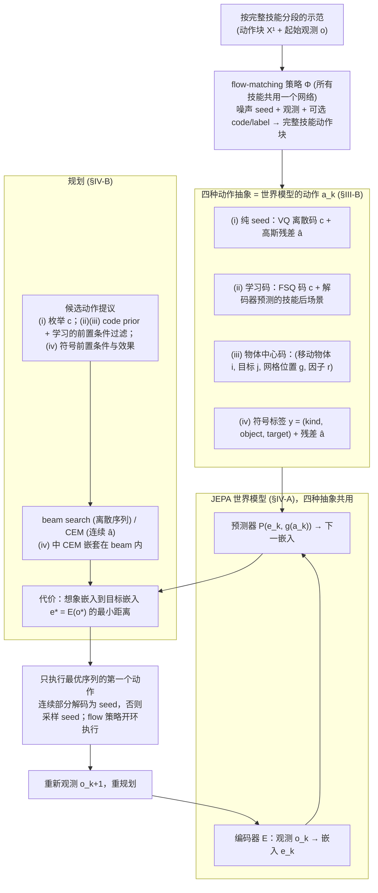

# 技能级世界模型的流策略动作（arXiv:2610.04767）

**技能级世界模型的流策略动作**（*Flow Policies as Actions of Skill-Level World Models: Learned and Symbolic Abstractions for Long-Horizon Planning*，[arXiv:2610.04767](https://arxiv.org/abs/2610.04767)，[项目页](https://andreumatoses.github.io/research/flow-skill-wm)）来自 [具身智能小站 2026-10-13 盘点](../../sources/blogs/wechat_embodied_station_34_papers_mulligan_2026-10-13.md)，属「世界模型与仿真」组。

## 一句话定义

**比较流策略噪声、学习编码与符号标签等技能接口；积木仿真显示长序列性能受搜索限制，符号方案优势部分来自适用性规则。**

## 英文缩写速查

| 缩写 | 英文全称 | 简要说明 |
|------|----------|----------|
| WM | World Model | 世界模型 |
| FM | Flow Matching | 流匹配 |
| TAMP | Task and Motion Planning | 任务与运动规划 |

## 为什么重要

- 让一次完整技能成为世界模型的一步，需要选对接口。
- 开源结论：**项目页未列 GitHub**（步骤 2.5，2026-10-14）。项目页入库日未列 GitHub。
- 同期同组工作见 [失败导向采集与可组合世界动作模型：具身智能小站 10-13 期 34 篇阅读坐标](../overview/embodied-station-2026-10-13-34-papers-technology-map.md)。

## 流程总览

图依据：论文 §III、§IV / Fig.1–2

## 核心机制

| 项 | 内容 |
|----|------|
| **arXiv** | [2610.04767](https://arxiv.org/abs/2610.04767) |
| **开源** | **项目页未列 GitHub** |
| **要点** | 仿真。 |
| **文内指标** | 以原文为准。 |

## 源码运行时序图

**不适用（项目页未列 GitHub）** — 项目页入库日未列 GitHub。 不编造运行脚本；代码公开后再补。

## 实验与评测

- 以原文为准。
- **读法：** 本页为索引级摘要，依据公众号转述的官方摘要与仓库信息整理；逐项数字与 baseline 以原文 PDF 为准。

## 与其他工作对比

- 横向索引见 [失败导向采集与可组合世界动作模型：具身智能小站 10-13 期 34 篇阅读坐标](../overview/embodied-station-2026-10-13-34-papers-technology-map.md)；同 arXiv 不重复造页。

## 结论

**技能接口的比较要剔除搜索与适用性规则的影响。**

1. 开源边界：**项目页未列 GitHub** — 项目页入库日未列 GitHub。
2. 核心机制：仿真。
3. 复现与选型前核对任务协议、硬件与基准口径，勿直接横比公众号摘录数字。

## 关联页面

- [generative-world-models](../methods/generative-world-models.md)
- [hierarchical-reinforcement-learning](../methods/hierarchical-reinforcement-learning.md)
- [flow-matching-embodied-policy](../concepts/flow-matching-embodied-policy.md)
- [embodied-station-2026-10-13-34-papers-technology-map](../overview/embodied-station-2026-10-13-34-papers-technology-map.md)

## 参考来源

- [flow_policies_skill_level_world_models_arxiv_2610_04767.md](../../sources/papers/flow_policies_skill_level_world_models_arxiv_2610_04767.md)
- [wechat_embodied_station_34_papers_mulligan_2026-10-13.md](../../sources/blogs/wechat_embodied_station_34_papers_mulligan_2026-10-13.md)
- [arXiv:2610.04767](https://arxiv.org/abs/2610.04767)
- [arXiv PDF](https://arxiv.org/pdf/2610.04767)：已通读方法部分（实验与附录以略读为准）：§I 引言、§III 动作抽象、§IV 世界模型与规划

## 推荐继续阅读

- [arXiv PDF](https://arxiv.org/pdf/2610.04767)
- [项目页](https://andreumatoses.github.io/research/flow-skill-wm)
