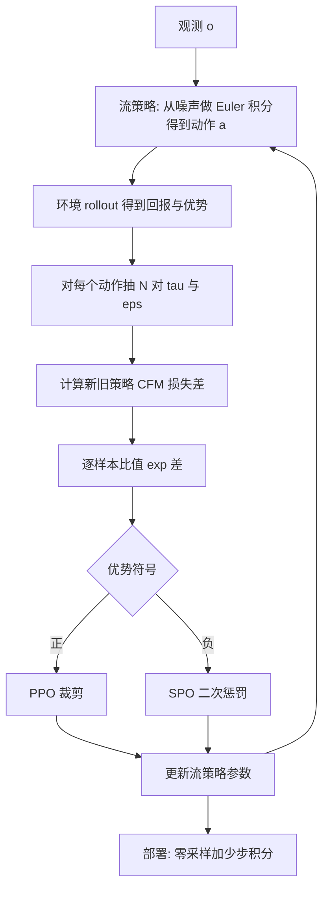

# Flow Policy Gradients for Robot Control（arXiv:2602.02481）

## 一句话定义

**FPO++** 是对 FPO（Flow Policy Optimization，用条件流匹配损失差代替动作似然比的 PPO 式策略梯度）的改进：把比值改为逐样本计算，并对负优势样本使用更保守的信任域（ASPO），使流策略能在足式运动、人形运动跟踪与操作微调中稳定训练，并在 Booster T1 与 Unitree G1 上完成真机部署（论文 §I、§III、§IV）。

## 英文缩写速查

| 缩写 | 英文全称 | 简要说明 |
|------|----------|----------|
| FPO | Flow Policy Optimization（论文称 flow matching policy gradients） | 以 CFM 损失差构造比值代理的无似然策略梯度，来自 McAllister 等（arXiv:2507.21053），本文复述自 §III-A |
| FPO++ | FPO 的改进版 | 逐样本比值 + ASPO，本文提出 |
| CFM | Conditional Flow Matching | 条件流匹配损失，对速度预测做均方误差 |
| ASPO | Asymmetric SPO | 正优势用 PPO 裁剪，负优势用 SPO 目标 |
| SPO | Simple Policy Optimization | 以二次惩罚把比值拉回信任域的目标（论文引 Xie 等） |
| PPO | Proximal Policy Optimization | 裁剪式策略梯度，见 [PPO](../methods/ppo.md) |
| DPPO | Diffusion Policy Policy Optimization | 把去噪步当作决策点的扩散策略微调基线 |
| ReinFlow | Fine-tuning flow matching policy with online RL | 用可学习噪声计算似然的流策略微调基线 |
| BC | Behavior Cloning | 行为克隆，用作操作任务的预训练 |
| GAE | Generalized Advantage Estimation | 广义优势估计 |

## 为什么重要

- 机器人 RL 里的策略梯度通常要求可微的动作似然，策略因此多为对角高斯；流 / 扩散策略在模仿学习中常见，但似然难算（§I）。FPO 路线绕开似然，本文要回答它在真实机器人任务上是否可用。
- 作者自述的结论：原版 FPO 在 IsaacLab 足式任务上不稳定，FPO++ 稳定（§IV-A，Fig. 2）；同一算法既能从零训练，也能微调 BC 预训练的流策略（§IV-C）。
- 论文称其为「首个」无专家蒸馏的流策略人形 sim-to-real（作者自述，§IV-B）；本页不独立核实这一优先性。

## 核心原理与流程总览

FPO 的比值代理（式 3）：以新旧策略对同一动作的 CFM 损失之差取指数。FPO++ 的两处改动（§III-B）：

1. 逐样本比值（式 10）：每个 Monte Carlo 的 (tau_i, eps_i) 各算一个比值并独立裁剪，共享同一优势；on-policy 时与逐动作比值梯度相同，多步更新时信任域更细。
2. ASPO（式 11–13）：优势为正用 PPO 裁剪，优势为负用 SPO，越界时给出把比值拉回的梯度而不是置零。作者的解释是限制 CFM 损失的过快上升，从而保熵、稳定变分间隙（§III-B，该解释依赖「CFM 损失可看作变分下界」的解读）。

另有零采样（§III-D）：训练从 N(0, I) 采初始噪声，测试从 0 开始积分。

## 工程实践

- **足式基准（§IV-A，附录 C.1）：** IsaacLab 速度跟踪；actor 3 层 MLP 256 单元，critic 768；4096 并行环境；训练 rollout 64 步 Euler（论文称 8、16 步降低训练稳定性）；学习率 1e-4，clip 0.05，每动作 16 个 MC 样本，每次更新 4 个 minibatch，learning epochs 为 Go2 取 16、其余取 32（附录 Table A.1）。
- **G1 动作跟踪（§IV-B，附录 C.2）：** 沿用 BeyondMimic 的奖励与观测，4096 环境，rollout 96 步，网络 (1024, 512, 256)，训练 50 步流积分，部署零采样 5 步；域随机化含摩擦、质量、外部推力、0 到 10 ms 执行延迟；一段动作一个策略。
- **操作微调（§IV-C，附录 C.3）：** 动作块 16、10 步流采样、每块 8 个 MC 样本、actor 学习率 1e-5；关闭 ASPO；基础策略来自同一 BC 流策略。
- **数值稳定：** 对 CFM 损失先裁剪再取差，再对差裁剪后取指数（附录 C.2 第 3 点，Fig. A.4）。
- **代码：** 论文写「将发布」，项目页链接到 [amazon-far/fpo-control](https://github.com/amazon-far/fpo-control)；本次未检查仓库内容。

## 评测证据与清单说法的对比核对

对象：CoRL 2026 阅读清单（Glen Berseth 博客）对本文的一句话摘要，作者说明由 LLM 据摘要起草。清单序号 002/101，P0，标 Oral。清单排序是作者用自身研究兴趣模型打分，不是论文质量评价。

清单原句：「Makes flow-matching policy gradients practical for expressive policies, from scratch and fine-tuning, with sim-to-real on two humanoids.」

| 清单说法 | 论文核对 |
|----------|----------|
| flow-matching policy gradients | 该框架来自前作 FPO（论文引 [1]），本文贡献是 FPO++ 的两处目标改动与大量实验，不是提出新框架（§I、§III）。 |
| 对 expressive policies 变得 practical | 论文证据：稳定性提升（Fig. 2、5、6），动作维度间出现相关性、Spot 步态与高斯 PPO 不同（Fig. 9、10）。但「practical」有保留：墙钟更慢，动作跟踪最多约 3 倍，回报略低于调好的高斯 PPO（§IV-F、附录 D.2）。 |
| from scratch | 成立：足式 4 机器人与 G1 / T1 为从零 RL（§IV-A、B），均有仿真曲线。 |
| fine-tuning | 成立但限定：仅为仿真中的 5 个 BC 预训练操作任务（RoboMimic 与 DexMimicGen），无真机微调（§IV-C）；该设置下 ASPO 反而有害，被关闭（附录 D.5）。 |
| sim-to-real on two humanoids | 成立但限定：两台人形是两个不同任务，T1 速度行走与 G1 动作跟踪；两者均为从零训练的策略，微调得到的策略没有上真机；真机结果为 Fig. 3 的定性展示，文中没有真机定量表（§IV-B）。 |

总体：清单句与论文方向一致，没有发现虚构结果；省略了 FPO 是前作、FPO++ 是改进、微调只在仿真、速度与回报上相对高斯 PPO 的代价这几点。

## 结论

FPO++ 扩展了流策略的直接策略梯度训练，但样本效率、墙钟时间和不同任务收益需要分别判断。

- 对照高斯 PPO 时同时报告回报与耗时，不能把更复杂策略直接视为更高效。
- 在操作微调中单独测试 ASPO，并对齐基础策略质量后再比较 DPPO 或 ReinFlow。
- 真机部署需增加定量成功率与重复试验，现有定性展示只能说明可行性。

## 局限

论文自己承认（§IV-F、附录 D.2）：
- 墙钟时间长于高斯 PPO（G1 行走达到回报 25：PPO 19 分钟对 FPO++ 23 分钟）。
- 动作跟踪训练最多慢约 3 倍，回报略低于调好的高斯 PPO；作者推测原因是缺熵正则与 KL 自适应学习率，补上后高斯 PPO 仍更高。
- ASPO 在操作微调中有时降低性能（附录 D.5）。

我看到的未验证之处（本页判断，非作者自述）：
- 真机部分没有定量指标与成功率统计，只有 Fig. 3 的定性展示。
- Table I 的零采样对比中，标准差较大（如随机采样 5 步为 34.7 ± 55.0 对零采样 45.1 ± 27.4），差距相对波动不算大。
- 操作实验只覆盖 RoboMimic 与 DexMimicGen 的 5 个仿真任务，Can 任务上 DPPO 的失败被作者归因于基础策略随机采样成功率低（约 10%），换更好的基础策略后 DPPO 可成功（附录 D.4），因此与 DPPO 的差距依赖基础策略的选择。
- 附录 D.3 中 FPO++ 与 DPPO / ReinFlow 的基础策略不同（Square 上 FPO++ 为 28.62%，DPPO 37.6%），对比并非完全同起点。
- 「首个」sim-to-real 的优先性是作者自述，未独立核实。

## 关联页面

- [PPO](../methods/ppo.md)：FPO 的出发点与 FPO++ 的对照基线（高斯 PPO）。
- [扩散策略](../methods/diffusion-policy.md)：本文被微调的 BC 流 / 扩散策略一类。
- [强化学习](../methods/reinforcement-learning.md)
- [BeyondMimic](../methods/beyondmimic.md)：G1 动作跟踪的代码库与奖励来源。
- [流匹配具身策略](../concepts/flow-matching-embodied-policy.md)
- [Sim2Real](../concepts/sim2real.md)
- [域随机化](../concepts/domain-randomization.md)
- [Isaac Lab](../entities/isaac-lab.md)：足式基准环境。
- [RFPO：整流流策略优化](../entities/paper-rfpo-rectified-flow-policy-optimization.md)：同样把流策略用于人形 / 足式 RL 的相邻工作。

## 参考来源

- [来源归档：Flow Policy Gradients for Robot Control](../../sources/papers/flow-policy-gradients-robot-control_arxiv_2602_02481.md)
- [arXiv:2602.02481](https://arxiv.org/abs/2602.02481)
- [项目页](https://hongsukchoi.github.io/fpo-control)

## 继续阅读

- [arXiv PDF](https://arxiv.org/pdf/2602.02481)
- [代码仓库 amazon-far/fpo-control](https://github.com/amazon-far/fpo-control)
- 前作 FPO：Flow matching policy gradients（arXiv:2507.21053）
- [PPO](../methods/ppo.md)
