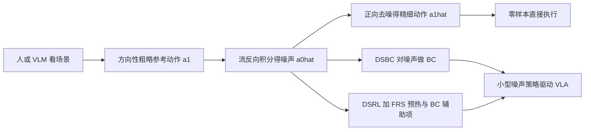

# Improving Robotic Generalist Policies via Flow Reversal Steering（arXiv:2606.13675）

*Improving Robotic Generalist Policies via Flow Reversal Steering*（[arXiv:2606.13675](https://arxiv.org/abs/2606.13675)，Tang、Chen、Wagenmaker、Finn、Levine，Stanford 与 UC Berkeley，2026-06）。本页依据全文精读（见来源归档的核对范围），并把 Glen Berseth 的 CoRL 2026 阅读清单对它的一句话摘要逐项核对。

## 一句话定义

**FRS 把粗糙但「合理」的参考动作（来自人或 VLM）沿 flow matching 通才策略的 ODE 反向积分得到噪声，再正向去噪，得到偏向参考方向、又落在通才动作分布内的精细动作；这些噪声还可用来训练小型噪声策略（DSBC）或预热噪声空间 RL（DSRL + FRS）。**（摘要，第 1、4 节）

## 英文缩写速查

| 缩写 | 英文全称 | 简要说明 |
|------|----------|----------|
| FRS | Flow Reversal Steering | 本文方法：反向流积分得到噪声再去噪 |
| DSRL | Diffusion Steering via Reinforcement Learning | 前作（Wagenmaker 等）：把噪声当动作做 RL 的噪声策略 |
| DSBC | Diffusion Steering via Behavioral Cloning | 本文：对 FRS 噪声做监督 BC 的噪声策略 |
| VLA | Vision-Language-Action | 视觉-语言-动作策略，本文基础策略为 π0.5 |
| VLM | Vision-Language Model | 本文用 Gemini-ER-1.6 给出方向性指引 |
| BC | Behavioral Cloning | 行为克隆 |
| ODE | Ordinary Differential Equation | flow 策略的确定性去噪由 ODE 定义 |
| SAC | Soft Actor-Critic | DSRL 与残差 RL 对照所用的 RL 算法 |

## 为什么重要

- 通才 VLA 里藏着一个「合理行为」先验，但遇到新任务时直接下指令常常无效；作者要的是不重新训练整个模型、就能从先验里调出合适动作（第 1 节，作者自述）。
- 此前找好噪声多靠 RL 试错（DSRL）；FRS 用语义推理直接定位噪声区域，把 RL 变成「有先验数据可预热」的问题（第 2、4.3 节）。
- 代价低：DSBC 训练约 1 GB 显存、不到一分钟，VLA 训练时无需加载（第 5.3 节）。

## 核心原理与流程总览

**原理（第 3、4.1 节）：** flow VLA 学速度场 v_θ，把噪声 a0~N(0,I) 经欧拉积分变成动作 a1，去噪确定性，记为 a1 = μ_θ(a0,o)。FRS 把同一 ODE 反向积分 â0 = μ_θ⁻¹(a1,o)，再 â1 = μ_θ(â0,o)。有限步数下 â1 不等于 a1，而是像「附近的一个通才动作模态」。作者强调它不同于前向扩散加噪（线性插值会把参考信息抹掉），并实验对比了部分加噪（第 5.2 节）。

**参考动作（第 4.2 节，附录 D）：** 人类键盘或 VLM 只给三轴方向与幅度，被展开成直线动作块；允许「交还基础策略」做精细抓取。

## 工程实践

- **设置：** 仿真为 LIBERO，π0.5 基础策略（未在被测切分上训练），每任务 50 次评测（第 5.1 节、附录 E）；真机为 DROID Franka + π0.5-DROID，6 个任务每任务 20 次（附录 F）。
- **关键超参：** 反演与去噪各 10 步（h=0.1，附录 B.1、C.2，作者称是 OpenPi 默认）；步数越多重构越准但噪声越偏离先验（附录 C.2）；仿真噪声策略预测沿块维度平均的 7D 噪声并 tanh 裁剪到 [−5,5]（附录 E.2.1）；真机 DSBC 用 MSE、预测完整噪声块、每任务 10 条成功轨迹、12,500 训练步（表 2）。
- **对照基线：** 基础策略、直接执行 VLM 动作、部分加噪、sample-and-rank（16 个并行样本，按与 VLM 参考的余弦相似度排序）、标准 BC、标准 DSRL、残差 RL（简化版 PLD）、Robometer 奖励（第 5.2-5.4 节、附录 E）。
- **复现：** 论文页有项目页，未见公开代码仓库（核查日期 2026-11-12），故本页不填 `code:`。

## 与清单说法的核对

清单原话（据摘要由 LLM 起草）：「Inverts suboptimal actions to their latent noise and maps them to nearby modes of a flow-matching generalist, steering it to better behavior.」

| 清单要点 | 论文核对 |
|----------|----------|
| 反演次优动作得到潜在噪声 | 属实，摘要写的是「suboptimal but reasonable actions」；实际参考动作是人 / VLM 给的方向性直线动作块，而非策略自己采样的次优动作（第 4.2 节、附录 D） |
| 映射到通才的「附近模态」 | 属实，第 4.1 节与附录 B 明确说得到的是靠近参考的分布内模态；是否真是「更好」取决于参考质量（附录 C.3） |
| 引导到「更好的行为」 | 有限定：仿真零样本整体提升有限（图 5 左，我从图上读数约 8% 到 13%，为目测），在基础策略 ≤2% 的 42 个任务里 11 个涨 ≥10%（第 5.2 节）；大的提升（真机最高 95%、平均 60%）来自 DSBC，且参考动作在真机里是人给的，不是 VLM（第 5.5 节、附录 F） |
| 清单未提及 | 论文的另两项贡献 DSBC 与 DSRL + FRS，以及真机结果；清单摘要只覆盖了方法最核心的一步 |

清单的排序是作者研究兴趣打分，不代表论文质量。

## 局限

**论文自述：** 讨论节只写「some parts are limited」，没有单独列出局限（第 6 节）。附录里能读到的承认：重构不精确，离线 DSBC 不保证重构动作无次优或错误（第 4.3 节）；理想化高斯混合实验里步数在保真与分布内之间折中，优化「留给未来工作」（附录 B.1）；用专家 VLA 作参考也仅达 50%，未恢复专家性能（附录 C.3）；真机 DSRL + FRS 只做了 towel 一个任务、两批在线更新（附录 F）。

**我看到的未验证之处（判断，非作者所述）：**
- 仿真零样本平均提升从图上看较小，且依赖 Gemini-ER-1.6 与一套手写提示，未测其他 VLM（推测不一定可迁移）。
- 方向性参考只适合平移型粗指引，旋转从不由键盘给出（附录 D.1）；对需要精细旋转的任务是否适用论文未测。
- 真机每任务 20 次评测、6 个任务，DSBC 样本是同一批人类零样本成功轨迹，误差条较宽（图 8）。
- 实验基础策略仅 π0.5 一族，论文称对其他 flow 或确定性 DDIM 扩散策略「原则上适用」，但未实验（第 3 节）。
- 仿真的 DSBC 与 RL 只在人工挑选的 15 个与 10 个 LIBERO-90 子集上做，选择依据是零样本 FRS 已有提升，存在选择偏差（第 5.1、5.3 节）。

## 关联页面

- [VLA 方法页](../methods/vla.md)
- [Diffusion Policy](../methods/diffusion-policy.md)
- [模仿学习](../methods/imitation-learning.md)
- [强化学习](../methods/reinforcement-learning.md)
- [残差策略学习](../methods/residual-policy-learning.md)
- [Flow Matching 具身策略](../concepts/flow-matching-embodied-policy.md)
- [π0.5 开放世界 VLA](paper-pi05-open-world-vla.md)
- [AWLS 潜在噪声转向](paper-awls-advantage-weighted-latent-steering.md)
- [LIBERO 基准](libero-benchmark.md)
- [DROID 策略学习](droid-policy-learning.md)

## 参考来源

- [flow-reversal-steering_arxiv_2606_13675.md](../../sources/papers/flow-reversal-steering_arxiv_2606_13675.md)
- [arXiv:2606.13675](https://arxiv.org/abs/2606.13675)
- [项目页](https://flow-reversal-steering.github.io)

## 继续阅读

- [arXiv PDF](https://arxiv.org/pdf/2606.13675v1)
- 前作 DSRL：Wagenmaker 等，Steering your diffusion policy with latent space reinforcement learning，[arXiv:2506.15799](https://arxiv.org/abs/2506.15799)（本文参考文献 [15]）
