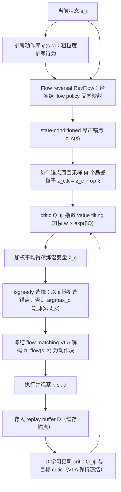

# Flow-Reversed Action Anchors（arXiv:2610.22852）

**Flow-Reversed Action Anchors**（*Sample-Efficient Reinforcement Learning for Policy Improvement via Flow-Reversed Action Anchors*，[arXiv:2610.22852](https://arxiv.org/abs/2610.22852)，[项目页](https://anchorq-rl.com/)）来自 [具身智能小站 2026-11-01 盘点](../../sources/blogs/wechat_embodied_station_56_papers_libero_dynamic_latency_eval_2026-11-01.md)，属「VLA 与策略学习」组。

## 一句话定义

**AnchorQ把参考行为反向映射成潜动作锚点，再局部采样并按价值细化；仿真与真机比较固定交互预算，收益依赖参考动作覆盖和评论器判断准确度。**

## 英文缩写速查

| 缩写 | 英文全称 | 简要说明 |
|------|----------|----------|
| Flow-Reversed Action Anchors | Sample-Efficient Reinforcement Learning for Policy Improvement via Flow-Reversed Action Anchors | 本文方法 / 基准的简称 |

## 为什么重要

- 在已有动作附近探索，减少在线试错。
- 开源结论：**待发布**（步骤 2.5，2026-11-01）。项目页 HTTP 200，未列 GitHub，页面含 soon 字样（脚本扫描）。
- 同期同组工作见 [动态评测、技能编译与环境潜变量适配：具身智能小站 11-01 期 56 篇阅读坐标](../overview/embodied-station-2026-11-01-56-papers-technology-map.md)。

## 流程总览

图依据：论文 §3.1–3.3 / Fig.1、Algorithm 1

## 核心机制

| 项 | 内容 |
|----|------|
| **arXiv** | [2610.22852](https://arxiv.org/abs/2610.22852) |
| **开源** | **待发布** |
| **要点** | AnchorQ把参考行为反向映射成潜动作锚点，再局部采样并按价值细化；仿真与真机比较固定交互预算，收益依赖参考动作覆盖和评论器判断准确度。 |
| **文内指标** | 公众号未给具体数字，本页不引用。 |

## 源码运行时序图

**不适用（待发布）** — 项目页 HTTP 200，未列 GitHub，页面含 soon 字样（脚本扫描）。 不编造运行脚本；代码公开后再补。

## 实验与评测

- 公众号未给具体数字，本页不引用。
- **读法：** 本页为索引级摘要，依据公众号转述的官方摘要与仓库信息整理；逐项数字与 baseline 以原文 PDF 为准。

## 与其他工作对比

- 横向索引见 [动态评测、技能编译与环境潜变量适配：具身智能小站 11-01 期 56 篇阅读坐标](../overview/embodied-station-2026-11-01-56-papers-technology-map.md)；同 arXiv 不重复造页。

## 结论

**在已有动作附近探索，减少在线试错：AnchorQ把参考行为反向映射成潜动作锚点，再局部采样并按价值细化；仿真与真机比较固定交互预算，收益依赖参考动作覆盖和评论器判断准确度。**

1. 开源边界：**待发布** — 项目页 HTTP 200，未列 GitHub，页面含 soon 字样（脚本扫描）。
2. 核心机制：AnchorQ把参考行为反向映射成潜动作锚点，再局部采样并按价值细化；仿真与真机比较固定交互预算，收益依赖参考动作覆盖和评论器判断准确度。
3. 复现与选型前核对任务协议、硬件与基准口径，勿直接横比公众号摘录数字。

## 关联页面

- [vla](../methods/vla.md)
- [imitation-learning](../methods/imitation-learning.md)
- [reinforcement-learning](../methods/reinforcement-learning.md)
- [reinforcement-learning](../methods/reinforcement-learning.md)
- [embodied-station-2026-11-01-56-papers-technology-map](../overview/embodied-station-2026-11-01-56-papers-technology-map.md)

## 参考来源

- [flow_reversed_action_anchors_arxiv_2610_22852.md](../../sources/papers/flow_reversed_action_anchors_arxiv_2610_22852.md)
- [wechat_embodied_station_56_papers_libero_dynamic_latency_eval_2026-11-01.md](../../sources/blogs/wechat_embodied_station_56_papers_libero_dynamic_latency_eval_2026-11-01.md)
- [arXiv:2610.22852](https://arxiv.org/abs/2610.22852)
- [arXiv PDF](https://arxiv.org/pdf/2610.22852)：已通读方法部分（实验与附录以略读为准）：摘要、§1–§4、§3（AnchorQ 方法、Algorithm 1、理论结论 Theorem 1–3）；附录仅浏览

## 推荐继续阅读

- [arXiv PDF](https://arxiv.org/pdf/2610.22852)
- [项目页](https://anchorq-rl.com/)
